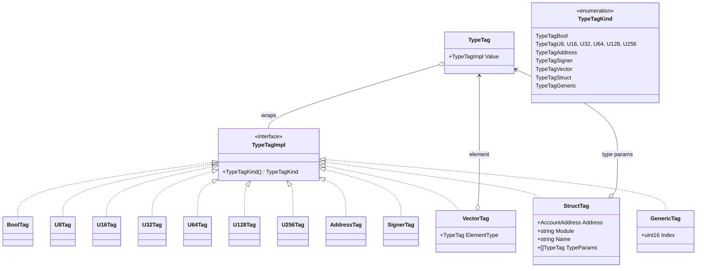
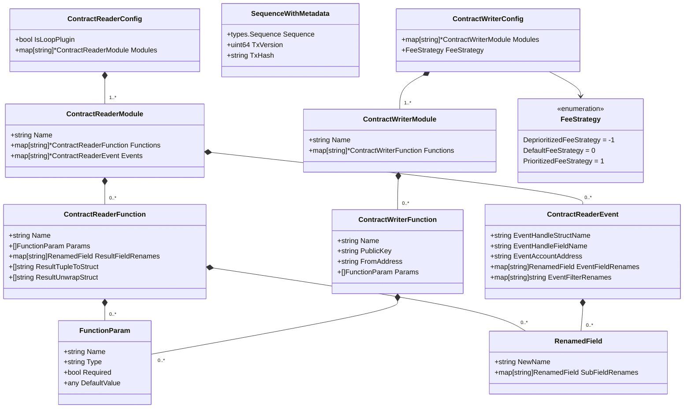
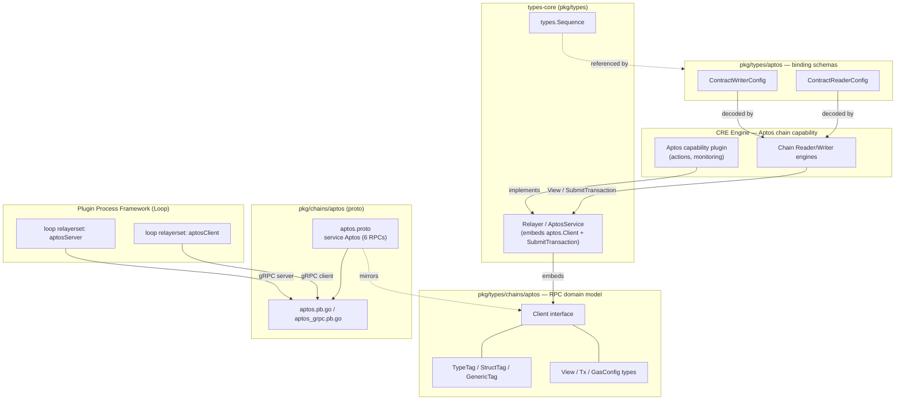
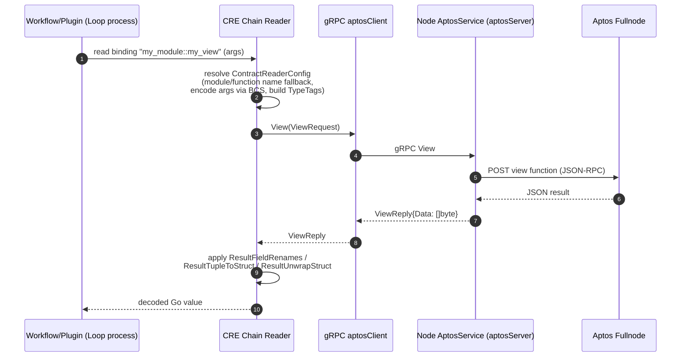
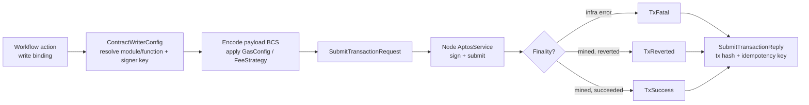

# types-chains/aptos — Aptos Domain Types

> Parent module: [types-chains](../types-chains.md) · Foundation group: [Shared Foundation Libraries & Domain Types](../../Shared_Foundation_Libraries___Domain_Types.md)

## 1. Purpose

The `types-chains/aptos` module defines the **Aptos-specific domain types and contract-binding schemas** shared across the Chainlink stack. It is deliberately dependency-free of any Aptos SDK: everything here is either a plain Go struct/interface or a declarative configuration schema, so that the types can be shared between the Chainlink node, Loop plugin processes, the CRE (Workflow Runtime) engine, and test harnesses without pulling heavyweight blockchain dependencies.

The module consists of three packages:

| Package | Role |
|---|---|
| `chainlink-common/pkg/types/aptos` | **Declarative contract-binding schemas** — describes *how* to read (`ContractReaderConfig`) and write (`ContractWriterConfig`) Move modules, consumed by the generic Chain Reader/Writer engines. |
| `chainlink-common/pkg/types/chains/aptos` | **RPC domain model** — the `Client` interface plus request/reply types, a Go model of the Move type system (`TypeTag` hierarchy), and transaction types. |
| `chainlink-common/pkg/chains/aptos` *(proto)* | **gRPC mirror** of the RPC domain model (`aptos.proto`), used to expose the client across Loop plugin-process boundaries. Documented in [chain-grpc-protos](../chain-grpc-protos.md). |

## 2. Core Components

### 2.1 RPC Client and Domain Model — `pkg/types/chains/aptos/aptos.go`

`Client` is the minimal interface the node needs for reading on-chain Aptos state:

```go
type Client interface {
    LedgerVersion(ctx) (uint64, error)
    AccountAPTBalance(ctx, AccountAPTBalanceRequest) (*AccountAPTBalanceReply, error)
    View(ctx, ViewRequest) (*ViewReply, error)
    TransactionByHash(ctx, TransactionByHashRequest) (*TransactionByHashReply, error)
    AccountTransactions(ctx, AccountTransactionsRequest) (*AccountTransactionsReply, error)
}
```

Key design points:

- **`AccountAddress` is a fixed `[32]byte`** (`AccountAddressLength = 32`), matching Aptos's 32-byte account model.
- **`View`** executes a read-only Move view function. `ViewPayload` carries a `ModuleID` (address + module name), a function name, BCS-encoded arguments (`[][]byte`), and generic `TypeTag` arguments. The reply's `Data` is JSON-encoded bytes, mirroring the upstream Aptos RPC's JSON responses.
- **Transaction model**: `Transaction` is a variant-tagged envelope (`TransactionVariant`: pending, user, genesis, block metadata/epilogue, state checkpoint, validator, unknown) carrying raw transaction data plus optional `Version` and `Success` (nil for pending/genesis transactions). `AccountTransactions` supports paging via optional `Start` version and `Limit`.
- **Write path types**: `SubmitTransactionRequest` carries a `ReceiverModuleID`, an `EncodedPayload` (BCS), and an optional `GasConfig` (`MaxGasAmount` / `GasUnitPrice` in octas). `SubmitTransactionReply` returns a terminal `TransactionStatus` (`TxFatal` → infrastructure failure; `TxReverted` → mined but reverted; `TxSuccess` → mined and succeeded), the tx hash, and an `TxIdempotencyKey` for safe retries.

### 2.2 Move Type System — `TypeTag` Hierarchy

`TypeTag` wraps a `TypeTagImpl` interface with a `TypeTagKind` discriminator. Implementations cover the full Move type space: primitives (`BoolTag`, `U8Tag`…`U256Tag`), `AddressTag`, `SignerTag`, plus the three recursive/composite forms `VectorTag` (element type), `StructTag` (address + module + name + type parameters — the Move *struct tag*), and `GenericTag` (generic parameter index).



This hierarchy maps 1:1 to the `TypeTag` protobuf `oneof` in `chainlink-common/pkg/chains/aptos/aptos.proto`, enabling identical semantics on both sides of a gRPC boundary.

### 2.3 Contract Reader Binding Schema — `pkg/types/aptos/contract_reader.go`

`ContractReaderConfig` is a **declarative, chain-specific binding description** interpreted by the generic Chain Reader engine (see [types-core/chain-contracts](../types-core.md)). It maps human-readable binding names to Move modules, functions, and events:

- **`ContractReaderModule`** — named module with `Functions` and `Events` maps. Names are optional: the map key is used as fallback.
- **`ContractReaderFunction`** — typed `Params` (`FunctionParam{Name, Type, Required, DefaultValue}` with Move type strings) and three result-mapping mechanisms: `ResultFieldRenames` (rename returned fields), `ResultTupleToStruct` (map a Move tuple result into a named struct), and `ResultUnwrapStruct` (unwrap nested struct paths).
- **`ContractReaderEvent`** — locates events by `EventHandleStructName` + `EventHandleFieldName` (supports nested paths like `token_pool_state.burned_events`). `EventAccountAddress` is polymorphic: empty (use bound contract address), a literal hex address, a fully-qualified view function (`0x1::mod::get_event_address`), or a `module::function` pair resolved at the bound contract. `EventFieldRenames` and `EventFilterRenames` normalize off-chain field and filter names to on-chain ones.
- **`RenamedField`** — recursive rename rule (`NewName` + nested `SubFieldRenames`).
- **`SequenceWithMetadata`** — pairs a `types.Sequence` (from [types-core](../types-core.md)) with the producing transaction's `TxVersion`/`TxHash`, used by the transaction manager to correlate sequencing data with on-chain ordering.

The `IsLoopPlugin` flag on `ContractReaderConfig` marks that the config is consumed by a Loop (plugin-process) plugin, which constrains the serialization strategy for values crossing the process boundary.

### 2.4 Contract Writer Binding Schema — `pkg/types/aptos/contract_writer.go`

`ContractWriterConfig` declares write (entry-function) bindings:

- `ContractWriterModule` → `ContractWriterFunction` maps, again with map-key fallback naming.
- Each function declares `Params` (same `FunctionParam` schema as the reader), plus signing identity: the account `PublicKey` and an optional `FromAddress` (derived from the key when omitted).
- **`FeeStrategy`** is a signed enum (`Deprioritized = -1`, `Default = 0`, `Prioritized = 1`) telling the writer whether to underbid or overbid the prevailing gas price, complementing the explicit `GasConfig` on `SubmitTransactionRequest`.



## 3. Architecture & Component Relationships



### 3.1 Relationship to the Relayer Interface

The node-facing write entry point is **not** on `Client` itself. [types-core](../types-core.md) defines:

```go
type AptosService interface {
    aptos.Client
    SubmitTransaction(ctx context.Context, req aptos.SubmitTransactionRequest) (*aptos.SubmitTransactionReply, error)
}
```

so a single interface embeds the five read operations defined here plus the mutating `SubmitTransaction`. Concrete implementations (the node's Aptos relay and the CRE capability plugin) must satisfy both halves.

### 3.2 gRPC Mirror and Loop Process Isolation

`chainlink-common/pkg/chains/aptos/aptos.proto` declares `service Aptos` with the six RPCs (`LedgerVersion`, `AccountAPTBalance`, `View`, `TransactionByHash`, `AccountTransactions`, `SubmitTransaction`) and protobuf messages that mirror the Go types one-to-one — including the `TypeTag` `oneof`, `TransactionVariant` enum, and optional `GasConfig`. The generated `UnsafeAptosServer` is consumed by the [Plugin Process Framework's relayer set](../../Plugin_Process_Framework_(Loop)/loop-relayer-services/loop-relayer-services_relayerset.md), which wraps it as:

- `aptosClient` — binds a `types.RelayID` to an `aptospb.AptosClient`, exposing the typed interface to in-process plugin code.
- `aptosServer` — embeds `aptospb.UnimplementedAptosServer` and delegates to the node's real `AptosService`.

The proto is regenerated via the `generate` target of `chainlink-common/Makefile` (protoc + `protoc-gen-go`/`protoc-gen-go-grpc`, plus the custom `cre-protoc` plugin built from `pkg/capabilities/v2/protoc`).

## 4. Data Flows

### 4.1 Read path: a plugin executes a declared view binding



### 4.2 Write path: transaction submission and status resolution



Event ingestion follows the same binding schema: the reader resolves `EventAccountAddress` (literal, bound address, or view-function-derived), polls the event handle field, then normalizes fields/filters via the configured rename maps.

## 5. Fit Within the Overall System

| Consumer | Usage |
|---|---|
| **Chainlink node (Aptos relay)** | Implements `AptosService` over an Aptos fullnode client; provides `aptosServer` to Loop plugins. |
| **Loop plugin framework** | `aptosClient`/`aptosServer` + `aptos.proto` expose the typed chain API across the plugin-process gRPC boundary. |
| **CRE engine** | The [Aptos chain capability](../../Workflow___Capability_Runtime_(CRE_Engine)/chain_capability_aptos.md) parses `ContractReaderConfig`/`ContractWriterConfig` from job specs and drives reads/writes through these types. Its monitoring protos (`view.proto`, `write_report.proto`) are separate, capability-local schemas. |
| **TXM / sequencing** | `SequenceWithMetadata` links a logical `types.Sequence` to the version/hash of the Aptos transaction that produced it. |
| **Deployment & tests** | Aptos chain state types in the deployment suite and Aptos feature support in system tests build on the same address/tag/transaction model. |

Sibling chain-type modules follow the same pattern and are documented separately: [types-chains/evm](types-chains_evm.md), [types-chains/solana](types-chains_solana.md), [types-chains/stellar-ton](types-chains_stellar-ton.md), [types-chains/sui](types-chains_sui.md). Move/BCS value encoding interplays with the generic [codec](../codec.md) and [values](../values.md) libraries; the gRPC surface is shared with all chains via [chain-grpc-protos](../chain-grpc-protos.md).

## 6. Conventions & Notes

- **Optional naming**: module/function `Name` fields are optional; the enclosing map key is the fallback name. Keep map keys stable — renaming a key changes the binding identity when `Name` is unset.
- **Byte-level fidelity**: arguments are BCS-encoded `[]byte`; view results are JSON-in-`[]byte` because the Aptos RPC returns JSON. Consumers should treat both as opaque unless they own the codec.
- **Nil semantics**: `ViewRequest.LedgerVersion == nil` means "latest ledger"; `Transaction.Version`/`Success` are nil for pending/genesis transactions; `AccountTransactionsRequest.Start`/`Limit` are nil for defaults.
- **Status taxonomy**: `TransactionStatus` collapses all outcomes into exactly three terminal states, making idempotent retry logic (`TxIdempotencyKey`) possible for writers.
- **Proto is generated**: never hand-edit `aptos.pb.go`/`aptos_grpc.pb.go`; edit `aptos.proto` and run `make generate` in `chainlink-common` (see `chainlink-common/Makefile`, targets `generate`/`cre-protoc`).
