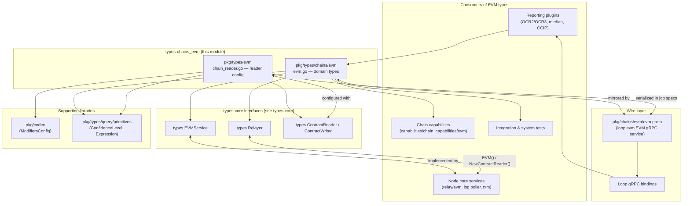
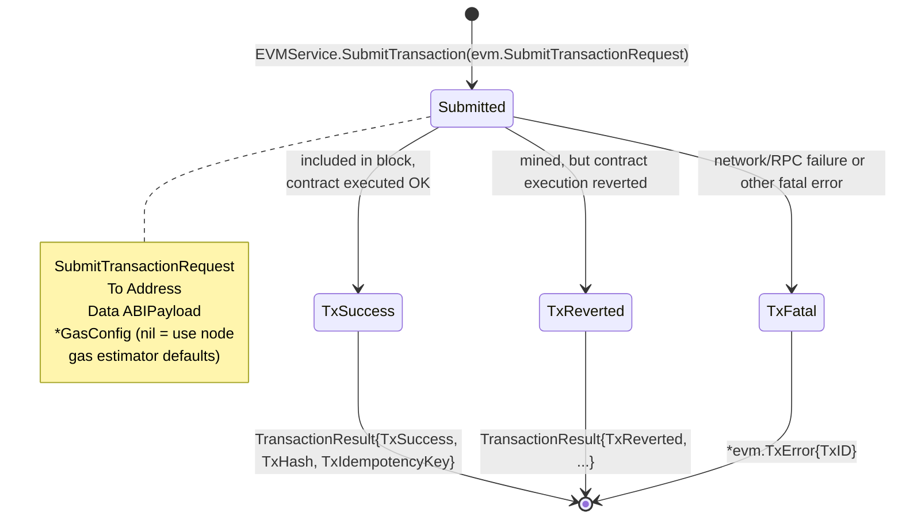
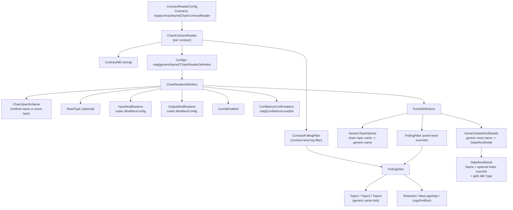
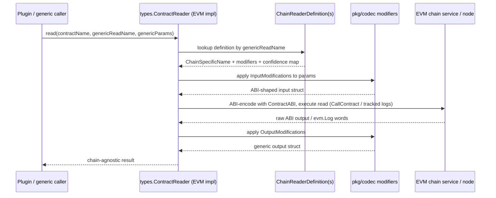
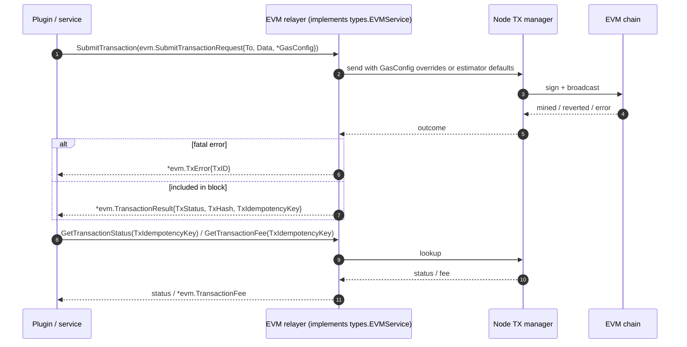
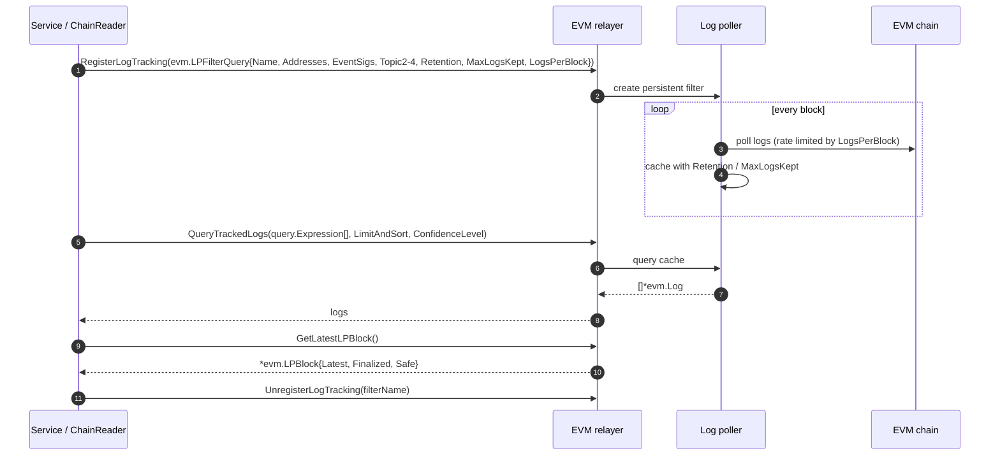
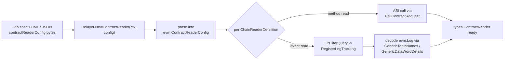

# types-chains_evm

## 1. Introduction

`types-chains_evm` is the **EVM chain-family domain type library** of the Chainlink stack. It lives in the `chainlink-common` Go module (`chainlink-common/go.mod`) and consists of two packages:

| Package | File | Role |
|---|---|---|
| `pkg/types/chains/evm` | `chainlink-common/pkg/types/chains/evm/evm.go` | Plain Go data structures that model EVM chain primitives (addresses, hashes, logs, blocks, transactions, receipts), the request/reply payload types of the EVM chain API, and log-poller types. |
| `pkg/types/evm` | `chainlink-common/pkg/types/evm/chain_reader.go` | Declarative, chain-agnostic **contract reader configuration** types (JSON/TOML-serializable) that describe how generic contract reads map onto EVM ABI calls, events and log-poller filters. |

The module contains **no runtime behavior** — it is intentionally a pure type/contract library. Its purpose is to let many independent components (node core services, reporting plugins, chain capabilities, CCIP, test harnesses) exchange EVM chain data through a small, stable, dependency-light vocabulary. Concretely it defines:

- **EVM primitives**: `Address` (`[20]byte`), `Hash` (`[32]byte`), `ABIPayload` (ABI-encoded `[]byte`) and the constants `AddressLength`/`HashLength`.
- **Chain data model**: `Log`, `FilterQuery`, `Transaction`, `Receipt`, `ReceiptGasInfo`, `Header`, `TransactionFee`.
- **Log-poller (LP) types**: `LPFilterQuery` and `LPBlock`, which describe persistent log tracking filters and the log poller's latest/finalized/safe block view.
- **Transaction lifecycle types**: `TransactionStatus`, `TxError`, `TransactionResult`, `GasConfig`, `SubmitTransactionRequest`.
- **Reporting types**: `SignedReport` (OCR report with context and signatures).
- **Request/reply pairs**: `BalanceAtRequest`/`BalanceAtReply`, `CallContractRequest`/`CallContractReply`, `FilterLogsRequest`/`FilterLogsReply`, `HeaderByNumberRequest`/`HeaderByNumberReply`, `GetTransactionByHashRequest`, `GeTransactionReceiptRequest`.
- **Contract reader configuration**: `ContractReaderConfig`, `ChainContractReader`, `ChainReaderDefinition`, `EventDefinitions`, `ContractPollingFilter`, `PollingFilter`, `DataWordDetail`.

This page documents these types and how they are consumed. The family-level conventions shared with Aptos, Solana, Stellar/TON and SUI are described in the parent page [types-chains](../types-chains.md); the chain-agnostic interfaces (`Relayer`, `EVMService`, `ContractReader`, provider factories) are documented in [types-core](../types-core.md).

---

## 2. Position in the System



Key relationships:

- **Consumed via `types.EVMService`** — the EVM-specific service surface exposed by every EVM relayer (see [types-core_relayer](../types-core.md)). `EVMService` extends the chain-agnostic `GethClient` and its method signatures use exactly the types defined here: `RegisterLogTracking(ctx, evm.LPFilterQuery)`, `SubmitTransaction(ctx, evm.SubmitTransactionRequest) (*evm.TransactionResult, error)`, `GetLatestLPBlock() (*evm.LPBlock, error)`, `CalculateTransactionFee(ctx, evm.ReceiptGasInfo)`, `GetForwarderForEOA(ctx, eoa, ocr2AggregatorID evm.Address, pluginType string)`, `QueryTrackedLogs(...) ([]*evm.Log, error)`, etc.
- **Consumed via `types.Relayer`** — `Relayer.EVM()` returns the `EVMService`, and `Relayer.NewContractReader(ctx, contractReaderConfig []byte)` explicitly documents the EVM implementation as being configured with an `evm.ContractReaderConfig` (see [types-core_relayer](../types-core.md)).
- **Mirrored on the wire by `evm.proto`** — the protobuf schema `chainlink-common/pkg/chains/evm/evm.proto` (package `loop.evm`, service `EVM`, 19 RPCs) defines a 1:1 wire representation of these Go types so that plugins running in separate processes (the [Loop plugin framework](../../Plugin_Process_Framework_(Loop)/loop-plugin-core.md)) can call EVM chain services over gRPC. The generated bindings are documented in [chain-grpc-protos](../chain-grpc-protos.md) and [loop-grpc-bindings](../../Plugin_Process_Framework_(Loop)/loop-grpc-bindings.md).
- **Node-side implementation** — the in-node EVM relay adapter (`chainlink/core/services/relay/evm`, see [node_application_relay](../../Node_Application_Core___Interfaces/node_application/node_application_relay.md)) is the primary implementer of the interfaces these types parameterize.

---

## 3. Type Taxonomy (evm.go)

```mermaid
mindmap
  root(("pkg/types/chains/evm"))
    Primitives
      Address = [20]byte
      Hash = [32]byte
      ABIPayload = []byte
      AddressLength / HashLength
    Chain data model
      Log
      FilterQuery
      CallMsg
      Transaction
      Receipt
      ReceiptGasInfo
      Header
      TransactionFee
    Log poller (LP)
      LPFilterQuery
      LPBlock
    Transaction lifecycle
      TransactionStatus
        TxFatal
        TxReverted
        TxSuccess
      TxError
      TransactionResult
      GasConfig
      SubmitTransactionRequest
    Reporting
      SignedReport
    Request/Reply API
      BalanceAt Request/Reply
      CallContract Request/Reply
      FilterLogs Request/Reply
      HeaderByNumber Request/Reply
      GetTransactionByHashRequest
      GeTransactionReceiptRequest
```

### 3.1 Primitive aliases

```go
const AddressLength = 20
const HashLength  = 32
type Address    = [AddressLength]byte  // evm-style address
type Hash       = [HashLength]byte     // evm-style hash
type ABIPayload = []byte               // solidity-spec ABI encoded bytes
```

Using fixed-size byte arrays (rather than `common.Address`/`common.Hash` from go-ethereum) keeps this package free of heavyweight dependencies while remaining trivially convertible at the implementation boundary.

### 3.2 Chain data model

| Type | Description | Notable fields |
|---|---|---|
| `Log` | EVM-style event log | `Topics []Hash`, `EventSig Hash`, `Address`, `Data ABIPayload`, `Removed bool` (reorg flag), block/tx location fields |
| `FilterQuery` | Mirrors `eth_getLogs` | `BlockHash` (exact match, mutually exclusive with range), `FromBlock`/`ToBlock`, `Addresses`, `Topics [][]Hash` with documented OR/AND semantics per topic position |
| `CallMsg` | Simplified `callMsg` for reads / `EstimateGas` | `To`, `From` (needed when a read depends on `msg.sender`), `Data` |
| `Transaction` | EVM-style transaction | `To`, `Data`, `Hash`, `Nonce`, `Gas`, `GasPrice`, `Value` |
| `Receipt` | EVM-style receipt | `Status` (1 success / 0 revert), `Logs`, `EffectiveGasPrice`, `L1Fee` (L2 chains only), `ContractAddress` |
| `ReceiptGasInfo` | Fee calculation input | `GasUsed`, `EffectiveGasPrice`, `L1Fee` |
| `Header` | Simplified block head | `Timestamp`, `Hash`, `ParentHash`, `Number` |
| `TransactionFee` | Fee wrapper | `TransactionFee *big.Int` (wei) |

### 3.3 Log-poller types

- **`LPFilterQuery`** — defines a persistent, named log-tracking filter: `Name` (identifier used to remove the filter), `Addresses`, `EventSigs`, `Topic2`–`Topic4` candidate values, plus retention controls `Retention`, `MaxLogsKept` and `LogsPerBlock` (both `0` = unlimited). Registered via `EVMService.RegisterLogTracking`; matching logs are collected over time and cached for later retrieval through `EVMService.QueryTrackedLogs`. Registration is a no-op if the name already exists; un-registration is a no-op if it does not.
- **`LPBlock`** — the log poller's consolidated view of chain head: `BlockHash`, `LatestBlockNumber`, `BlockTimestamp`, `FinalizedBlockNumber`, `SafeBlockNumber`. Returned by `EVMService.GetLatestLPBlock` and rewound via `EVMService.LPSkipToBlock`.

> The Solana family defines its own `LPFilterQuery`/`LPBlock` with chain-specific fields (program IDs, IDL JSON, CPI filters) — see [types-chains_solana](types-chains_solana.md). The two are intentionally not shared because the underlying poller capabilities differ per chain.

### 3.4 Transaction lifecycle



- `TransactionStatus` (`TxFatal`, `TxReverted`, `TxSuccess`) is the Go-side result of a submission. `SubmitTransaction` blocks until the transaction is included in a block or fails.
- `TransactionResult` carries the final `TxStatus`, the on-chain `TxHash` and the `TxIdempotencyKey` used for later tracking via `GetTransactionStatus` / `GetTransactionFee`.
- `TxError` is the error type for fatal failures; it surfaces only the internal `TxID` for tracking.
- `GasConfig` (`GasLimit *uint64`, `MaxGasPrice *big.Int`) optionally overrides the node's gas estimator defaults per submission; `nil` fields inherit node configuration.

> **Wire note:** the protobuf schema (`chainlink-common/pkg/chains/evm/evm.proto`) defines a richer `TransactionStatus` enum (`UNKNOWN`, `PENDING`, `UNCONFIRMED`, `FINALIZED`, `FAILED`, `FATAL`) for `GetTransactionStatus` polling across process boundaries, and its comment requires a 1:1 mapping back to this Go enum. When adding states, both sides must be updated in lockstep.

### 3.5 Request/reply API surface

Every read-style RPC follows the same pattern — a request struct carrying the EVM-specific payload plus two cross-cutting knobs:

- **`ConfidenceLevel`** (`primitives.ConfidenceLevel`, from [types-core](../types-core.md) query primitives) — requests block data at a given confidence (e.g. `Finalized`/`Safe`). Only meaningful for positive block numbers; the implementation verifies the requested block has reached that confidence and errors otherwise.
- **`IsExternal bool`** — when `true` the service may apply stricter limits (e.g. response size limits) because the request originates from an external/plugin caller.

| Request | Reply | Purpose |
|---|---|---|
| `BalanceAtRequest{Address, BlockNumber, ConfidenceLevel}` | `BalanceAtReply{Balance *big.Int}` | Account balance in wei at a block |
| `CallContractRequest{Msg *CallMsg, BlockNumber, ConfidenceLevel, IsExternal}` | `CallContractReply{Data []byte}` | Read-only `eth_call`-style execution |
| `FilterLogsRequest{FilterQuery, ConfidenceLevel, IsExternal}` | `FilterLogsReply{Logs []*Log}` | One-shot `eth_getLogs` |
| `HeaderByNumberRequest{Number, ConfidenceLevel, IsExternal}` | `HeaderByNumberReply{Header *Header}` | Block header lookup |
| `GetTransactionByHashRequest{Hash, IsExternal}` | (reply defined on the service side) | Transaction lookup |
| `GeTransactionReceiptRequest{Hash, IsExternal}` | (reply defined on the service side) | Receipt lookup (name as defined in source) |

Block-number sentinel semantics (defined on the wire in `evm.proto` and honored by the Go layer): `nil`/`-2` = latest, `-3` = finalized, `-4` = safe, positive = specific height.

### 3.6 SignedReport

```go
type SignedReport struct {
    RawReport     []byte
    ReportContext []byte
    Signatures    [][]byte
    ID            []byte
}
```

`SignedReport` is the OCR-family report envelope passed to on-chain transmission paths (contract transmitters, forwarders). CCIP's EVM transmitter and codec layers build on it — see [ccip_ocr_transmitters](../../CCIP_Cross-Chain_Protocol/ccip/ccip_ocr_transmitters.md) and [ccip_chain_codecs](../../CCIP_Cross-Chain_Protocol/ccip/ccip_chain_codecs.md).

---

## 4. Declarative Contract Reader Config (chain_reader.go)

The second half of the module defines **how a chain-agnostic contract read is translated into EVM specifics**. These structs are JSON/TOML serializable and end up embedded in relay/OCR2 job specs; the EVM relayer parses them in `Relayer.NewContractReader` and instantiates a `types.ContractReader` (see [types-core_providers](../types-core.md)).



### 4.1 Structural breakdown

- **`ContractReaderConfig`** — top level; `Contracts` is keyed by *contract name*. This is the value passed (serialized) to `Relayer.NewContractReader`.
- **`ChainContractReader`** — per contract: the `ContractABI`, an optional contract-level `ContractPollingFilter`, and `Configs` keyed by *generic read name* (the chain-agnostic name callers query with).
- **`ChainReaderDefinition`** — one read definition:
  - `ChainSpecificName` — the EVM method name (for calls) or event type (for events).
  - `InputModifications` / `OutputModifications` — `codec.ModifiersConfig` ([codec](../codec.md)) that reshape Go structs into/out of ABI encodings (e.g. byte-string modifiers, element extraction).
  - `CacheEnabled` — turn on read caching for this definition.
  - `ConfidenceConfirmations` — maps a `ConfidenceLevel` to the number of confirmations required, letting generic callers request confirmed reads.
  - `EventDefinitions` — for event reads, bridges generic query keys to EVM topics/data words:
    - `GenericTopicNames` — translates chain-agnostic query keys (e.g. `"transfer-value"`) to EVM-specific topic names (e.g. `"evmTransferEvent-weiAmountTopic"`).
    - `GenericDataWordDetails` — names EVM log data words generically (e.g. the first 32-byte word of a USDC transfer event is named `value`), each described by a `DataWordDetail`.
    - `PollingFilter` — optional per-event override of the contract-level log-poller filter; defining one creates a separate log poller filter for that event.
- **`ContractPollingFilter` / `PollingFilter`** — the log-poller settings (`Topic2`–`Topic4` as generic name lists, `Retention`, `MaxLogsKept`, `LogsPerBlock`) that the relayer converts into `evm.LPFilterQuery` values and registers with the log poller at startup. Note the type asymmetry by design: the config layer uses *generic names* (`string`), while the runtime `LPFilterQuery` uses concrete `Hash` values — the relayer performs the translation using the contract ABI.
- **`DataWordDetail`** — `{Name, Index *int, Type string}`; `Type` follows geth ABI type naming. `Index` is an explicit override for edge cases where the word position cannot be computed programmatically and should otherwise be left `nil`.

### 4.2 Runtime flow: a generic contract read



For **event** reads the same definition additionally drives log polling: the (contract- or event-level) `PollingFilter` is converted to an `evm.LPFilterQuery` and registered with `EVMService.RegisterLogTracking`; `GenericTopicNames`/`GenericDataWordDetails` then let the reader decode `evm.Log` topics and data words back into the generic struct, and `ConfidenceConfirmations` decides which `LPBlock` watermark (safe/finalized) the read must respect.

---

## 5. Wire-Protocol Mapping (evm.proto ↔ Go types)

When EVM chain services are consumed across process boundaries (plugins launched by the [Loop framework](../../Plugin_Process_Framework_(Loop)/loop-plugin-core.md)), each Go type here has a protobuf counterpart in `chainlink-common/pkg/chains/evm/evm.proto` (service `loop.evm.EVM`). The mapping conventions:

| Go type (this module) | Proto message | Encoding notes |
|---|---|---|
| `Address` `[20]byte` | `bytes` | fixed 20-byte array |
| `Hash` `[32]byte` | `bytes` | fixed 32-byte array |
| `*big.Int` fields | `values.v1.BigInt` | see [values](../values.md) |
| `Log` | `Log` | adds `tx_index`; `eventSig` as separate field |
| `FilterQuery` | `FilterQuery` | `Topics` wrapped in `repeated Topics` |
| `LPFilterQuery` | `LPFilter` | retention as `int64` seconds |
| `LPBlock` | `LPBlock` | — |
| `Transaction` / `Receipt` / `Header` | same names | — |
| `SubmitTransactionRequest` / `TransactionResult` | `SubmitTransactionRequest` / `SubmitTransactionReply` | result adds idempotency key |
| `TransactionStatus` | `TransactionStatus` (superset enum) | must stay 1:1 mappable |
| `GasConfig` | `GasConfig` (optional) | — |
| `ReceiptGasInfo` / `TransactionFee` | `ReceiptGasInfo` / BigInt fields | — |
| `primitives.ConfidenceLevel` (requests) | `loop.chain.common.Confidence` | — |

The RPC surface of `loop.evm.EVM` covers exactly the operations listed in §3.5 plus the LP operations (`RegisterLogTracking`, `UnregisterLogTracking`, `QueryTrackedLogs`, `GetLatestLPBlock`, `LPSkipToBlock`, `GetFiltersNames`) and transaction operations (`SubmitTransaction`, `GetTransactionStatus`, `GetTransactionFee`, `CalculateTransactionFee`, `GetForwarderForEOA`). Generated client/server bindings are covered in [chain-grpc-protos](../chain-grpc-protos.md) and the relayer-side providers in [loop-relayer-services](../../Plugin_Process_Framework_(Loop)/loop-relayer-services.md).

---

## 6. End-to-End Flows

### 6.1 Transaction submission (in-process)



### 6.2 Persistent log tracking



### 6.3 Chain-reader configuration loading



---

## 7. Dependencies

**Depends on (imports):**

- `chainlink-common/pkg/types/query/primitives` — `ConfidenceLevel` in request types (see [types-core](../types-core.md)).
- `chainlink-common/pkg/codec` — `ModifiersConfig` in `ChainReaderDefinition` (see [codec](../codec.md)).
- `chainlink-common/pkg/config` — `config.Duration` in `PollingFilter.Retention`.
- Standard library only otherwise (`math/big`, `time`); no go-ethereum dependency.

**Depended on by:**

- **EVM relayer & node services** (`chainlink/core/services/relay/evm`, log poller, TX manager) — implement `EVMService` using these types.
- **Loop gRPC bindings** — `chainlink-common/pkg/chains/evm` (generated from `evm.proto`) plus the relayer-set EVM client/server in the Loop framework.
- **Chain capabilities** — `capabilities/chain_capabilities/evm` (forwarder contracts, trigger services, monitoring) and CCIP EVM components.
- **Other chain families** — sibling pages [types-chains_aptos](types-chains_aptos.md), [types-chains_solana](types-chains_solana.md), [types-chains_sui](types-chains_sui.md), [types-chains_stellar-ton](types-chains_stellar-ton.md) follow the same structural conventions.

Because this module is near the bottom of the dependency graph (pure types), changes here are compile-time visible to virtually every EVM-touching component; additive changes are cheap, but renaming or reshaping existing types (e.g. `LPFilterQuery`, `TransactionStatus`) requires coordinated updates in the relayer implementation, the `evm.proto` schema, and generated bindings.

---

## 8. Design Conventions & Notes

1. **Types only, no behavior** — the only method defined in `evm.go` is `TxError.Error()`. All logic lives in implementations behind `types-core` interfaces.
2. **Fixed-size arrays over external types** — `Address`/`Hash` are `[20]`/`[32]`-byte arrays, keeping the package dependency-free and gRPC-serializable.
3. **Generic-name translation layer** — `chain_reader.go` deliberately separates *chain-agnostic* names (what callers query with) from *chain-specific* names (what EVM uses), via `GenericTopicNames`, `GenericDataWordDetails` and `ChainSpecificName`. This is the pattern other chain families replicate in their own `contract_reader.go` (e.g. Solana uses Anchor IDL names — see [types-chains_solana](types-chains_solana.md)).
4. **Two-tier polling filters** — contract-level defaults in `ContractPollingFilter` with optional per-event overrides in `EventDefinitions.PollingFilter`; each override creates its own log poller filter.
5. **Cross-cutting request knobs** — `ConfidenceLevel` and `IsExternal` appear uniformly on read-style requests; `IsExternal` signals that a caller may be subject to stricter response limits.
6. **Known naming quirk** — `GeTransactionReceiptRequest` (missing a "t" in `Get…`) is the actual exported name in `evm.go`; keep it in mind when searching the codebase.
7. **Build ownership** — these packages are part of the single `chainlink-common` Go module (`chainlink-common/go.mod`); there is no separate build or release configuration for this module. Code generation for the wire schema (`evm.proto`) is handled by the chainlink-common tooling (see [build-and-repo-tooling](../../Build,_CI___Release_Infrastructure/build-and-repo-tooling.md)).

---

## 9. Related Documentation

- Parent overview: [types-chains](../types-chains.md) · [Shared Foundation Libraries & Domain Types](../../Shared_Foundation_Libraries___Domain_Types.md)
- Interfaces consuming these types: [types-core](../types-core.md) (esp. [types-core_relayer](../types-core.md), [types-core_providers](../types-core.md), [types-core_chain-contracts](../types-core.md))
- Wire schema & bindings: [chain-grpc-protos](../chain-grpc-protos.md) · [loop-grpc-bindings](../../Plugin_Process_Framework_(Loop)/loop-grpc-bindings.md)
- Encoding support: [codec](../codec.md) · [values](../values.md)
- Sibling chain families: [types-chains_aptos](types-chains_aptos.md) · [types-chains_solana](types-chains_solana.md) · [types-chains_sui](types-chains_sui.md) · [types-chains_stellar-ton](types-chains_stellar-ton.md)
- EVM consumers: [CCIP chain codecs](../../CCIP_Cross-Chain_Protocol/ccip/ccip_chain_codecs.md) · [CCIP OCR transmitters](../../CCIP_Cross-Chain_Protocol/ccip/ccip_ocr_transmitters.md) · [Node application relay](../../Node_Application_Core___Interfaces/node_application/node_application_relay.md) · [EVM chain capability](../../Workflow___Capability_Runtime_(CRE_Engine)/chain_capability_evm.md)
- Mercury/LLO types that ride on EVM transmitters: [types-mercury-llo](../types-mercury-llo.md)
