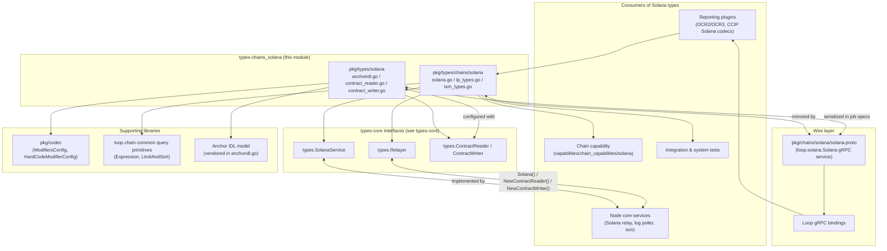
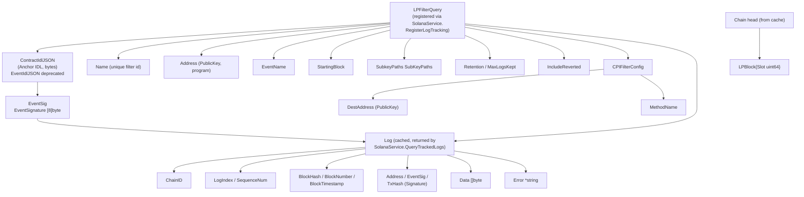
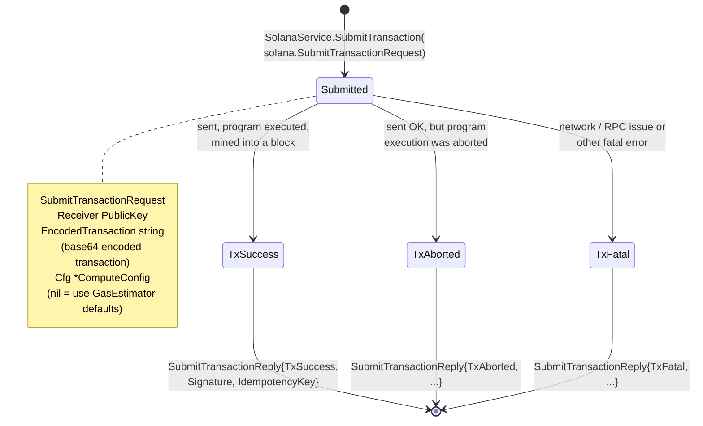
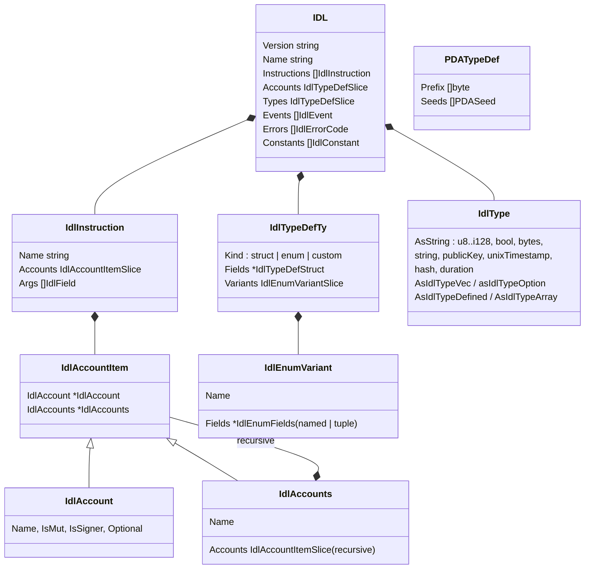
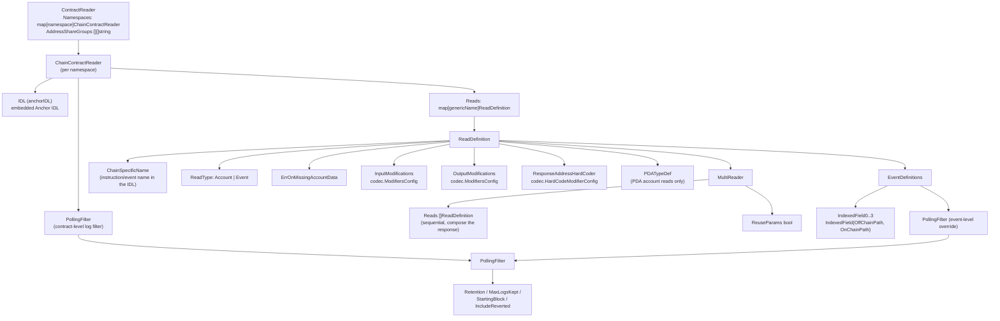
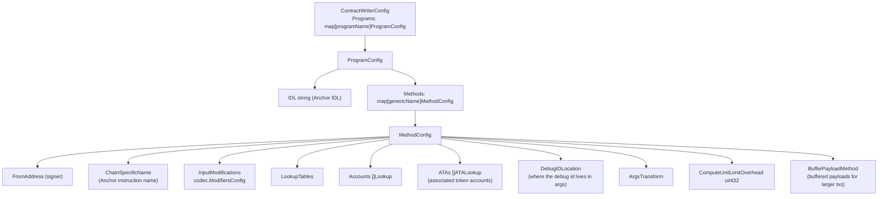

# types-chains_solana

## 1. Introduction

`types-chains_solana` is the **Solana chain-family domain type library** of the Chainlink stack. It lives in the `chainlink-common` Go module (`chainlink-common/go.mod`) and consists of two packages:

| Package | File | Role |
|---|---|---|
| `pkg/types/chains/solana` | `chains/solana/solana.go`, `chains/solana/lp_types.go`, `chains/solana/txm_types.go` | Plain Go data structures that model Solana chain primitives (public keys, hashes, signatures, accounts, messages, transactions), the request/reply payload types of the Solana RPC surface, the transaction-manager submission types, and the log-poller (LP) types. |
| `pkg/types/solana` | `solana/anchoridl.go`, `solana/contract_reader.go`, `solana/contract_writer.go` | Declarative, chain-agnostic **contract reader/writer configuration** types (JSON-serializable), including a vendored copy of the Anchor IDL model used to describe Solana programs. |

Like the other `types-chains` packages, the module contains **no runtime behavior** — it is intentionally a pure type/contract library. Its purpose is to let independent components (node core services, reporting plugins, chain capabilities, CCIP, test harnesses) exchange Solana chain data through a small, stable, dependency-light vocabulary. Concretely it defines:

- **Solana primitives**: `PublicKey` (`[32]byte`), `Hash` (= `PublicKey`), `Signature` (`[64]byte`), `PublicKeySlice`, `AccountMeta(Slice)`, and the constants `PublicKeyLength`/`HashLength`/`SignatureLength`.
- **RPC semantics enums**: `EncodingType` (`base58`, `base64`, `base64+zstd`, `jsonParsed`, `json`), `CommitmentType` (`finalized`, `confirmed`, `processed`), `ConfirmationStatusType`, `TransactionDetailsType`, `TransactionVersion`.
- **Chain data model**: `Account`, `DataBytesOrJSON`, `Message`, `MessageHeader`, `MessageAddressTableLookup`, `Transaction`, `TransactionMeta`, `InnerInstruction`, `CompiledInstruction`, `TokenBalance`, `ReturnData`, `LoadedAddresses`.
- **The `Client` RPC interface** — a typed wrapper over the Solana JSON-RPC API (`GetBalance`, `GetAccountInfoWithOpts`, `GetBlock`, `GetTransaction`, `GetFeeForMessage`, `GetSignatureStatuses`, `SimulateTX`, `GetProgramAccounts`, …) with paired `*Request`/`*Reply` structs.
- **Transaction lifecycle types**: `SubmitTransactionRequest`, `SubmitTransactionReply`, `ComputeConfig`, `TransactionStatus` (`TxFatal`, `TxAborted`, `TxSuccess`).
- **Log-poller (LP) types**: `LPFilterQuery`, `Log`, `LPBlock`, `EventSignature`, `CPIFilterConfig` for persistent, named event tracking backed by Anchor IDLs.
- **Anchor IDL model** (`IDL`, `IdlType`, `IdlAccountItem`, `IdlTypeDefTyStruct`, `IdlTypeDefTyEnum`, `PDATypeDef`, …) copied from `gagliardetto/anchor-go` so program schemas can be embedded in configurations.
- **Contract reader config**: `ContractReader`, `ChainContractReader`, `ReadDefinition`, `MultiReader`, `PollingFilter`, `EventDefinitions`, `IndexedField` — mapping generic contract reads onto Anchor accounts/events, including PDA derivation.
- **Contract writer config**: `ContractWriterConfig`, `ProgramConfig`, `MethodConfig` — mapping generic writes onto Anchor instructions with account/ATA resolution and codec transformations.

This page documents these types and how they are consumed. The family-level conventions shared with EVM, Aptos, Stellar/TON and SUI are described in the parent page [types-chains](../types-chains.md); the chain-agnostic interfaces (`Relayer`, `SolanaService`, `ContractReader`, provider factories) are documented in [types-core](../types-core.md).

> Cross-reference: the EVM sibling page ([types-chains_evm](types-chains_evm.md)) notes that `LPFilterQuery`/`LPBlock` are defined per chain and intentionally not shared. The Solana variants here trade EVM topic filters for **Anchor IDL + event-signature** filters and add cross-program-invocation (CPI) filtering.

---

## 2. Position in the System



Key relationships:

- **Consumed via `types.SolanaService`** — the Solana-specific service surface exposed by every Solana relayer (see [types-core_relayer](../types-core/types-core_relayer.md)). `SolanaService` **embeds `solana.Client`** and adds the lifecycle/observation methods whose signatures use exactly the types defined here:
  - `SubmitTransaction(ctx, solana.SubmitTransactionRequest) (*solana.SubmitTransactionReply, error)` — blocks until finalization or error
  - `RegisterLogTracking(ctx, solana.LPFilterQuery) error` / `UnregisterLogTracking(ctx, filterName string) error` — both are idempotent no-ops when the filter name already exists / does not exist
  - `QueryTrackedLogs(ctx, []query.Expression, query.LimitAndSort) ([]*solana.Log, error)` — reads the persistent log cache populated by registered filters
  - `GetLatestLPBlock(ctx) (*solana.LPBlock, error)` — the log poller's cached view of chain head
  - `GetFiltersNames(ctx) ([]string, error)` — used for later filter pruning
- **Consumed via `types.Relayer`** — `Relayer.Solana()` returns the `SolanaService`, and `Relayer.NewContractReader(ctx, contractReaderConfig []byte)` / `NewContractWriter(ctx, config []byte)` receive the JSON serialization of the config structs documented in sections 7 and 8 (see [types-core_relayer](../types-core/types-core_relayer.md)).
- **Mirrored on the wire by `solana.proto`** — the protobuf schema `chainlink-common/pkg/chains/solana/solana.proto` (package `loop.solana`, service `Solana`, 17 RPCs) defines a 1:1 wire representation of these Go types so that plugins running in separate processes (the [Loop plugin framework](../../Plugin_Process_Framework_(Loop)/loop-plugin-core.md)) can call Solana chain services over gRPC. The generated bindings are documented in [chain-grpc-protos](../chain-grpc-protos.md) and [loop-grpc-bindings](../../Plugin_Process_Framework_(Loop)/loop-grpc-bindings.md); the Solana relayer gRPC server adapter is documented in [loop-relayer-services_relayerset](../../Plugin_Process_Framework_(Loop)/loop-relayer-services/loop-relayer-services_relayerset.md).
- **Node-side implementation** — the in-node Solana relay adapter (see [node_application_relay](../../Node_Application_Core___Interfaces/node_application/node_application_relay.md)) is the primary implementer of the interfaces these types parameterize.
- **Chain capability** — the Solana chain capability plugin depends directly on these types plus `gagliardetto/solana-go` and `chainlink-solana` (`capabilities/chain_capabilities/solana/go.mod`); it is documented in [chain_capability_solana](../../Workflow___Capability_Runtime_(CRE_Engine)/chain_capability_solana.md). CCIP's Solana address/extra-data codecs and message hasher build on the same family (see [ccip_chain_codecs](../../CCIP_Cross-Chain_Protocol/ccip/ccip_chain_codecs.md)).

---

## 3. Solana Chain Domain Types (`chains/solana/solana.go`)

```mermaid
mindmap
  root(("pkg/types/chains/solana"))
    Primitives
      PublicKey = [32]byte
      Hash = PublicKey
      Signature = [64]byte
      PublicKeySlice
      AccountMeta / AccountMetaSlice
    RPC semantics
      EncodingType
        base58 / base64
        base64+zstd / jsonParsed / json
      CommitmentType
        finalized / confirmed / processed
      ConfirmationStatusType
      TransactionDetailsType
      TransactionVersion
    Chain data model
      Account
      DataBytesOrJSON
      DataSlice
      Message / MessageHeader
      MessageAddressTableLookup
      Transaction
      TransactionMeta
      CompiledInstruction / InnerInstruction
      TokenBalance / UiTokenAmount
      ReturnData / LoadedAddresses
    Client RPC interface
      GetBalance
      GetAccountInfoWithOpts
      GetMultipleAccountsWithOpts
      GetBlock
      GetSlotHeight
      GetTransaction
      GetFeeForMessage
      GetSignatureStatuses
      SimulateTX
      GetProgramAccounts
    Request/Reply API
      GetAccountInfo Request/Reply
      GetMultipleAccounts Request/Reply
      GetBalance Request/Reply
      GetBlock Request/Reply
      GetSlotHeight Request/Reply
      GetTransaction Request/Reply
      GetFeeForMessage Request/Reply
      GetLatestBlockhash Request/Reply
      GetSignatureStatuses Request/Reply
      SimulateTX Request/Reply
      GetProgramAccounts Request/Reply
```

### 3.1 Primitive aliases

```go
const (
    PublicKeyLength = 32
    HashLength      = PublicKeyLength
    SignatureLength = 64
)
type PublicKey      [PublicKeyLength]byte // represents solana-go PublicKey
type PublicKeySlice []PublicKey           // represents solana-go PublicKeySlice
type Signature      [SignatureLength]byte // represents solana-go Signature
type Hash           PublicKey             // represents solana-go Hash
```

Types are deliberately re-declared as plain fixed-size arrays instead of importing `github.com/gagliardetto/solana-go` (the comment on each type names the upstream representation it "represents"). This keeps the package dependency-light and trivially convertible at the implementation boundary — the actual conversion to `solana-go` types happens in implementers such as the node relay adapter and the chain capability, which do import `solana-go` (see `capabilities/chain_capabilities/solana/go.mod`).

### 3.2 RPC semantics enums

| Type | Values | Meaning |
|---|---|---|
| `EncodingType` | `base58`, `base64`, `base64+zstd`, `jsonParsed`, `json` | How `Account.Data` is returned. `base58` is limited to data < 129 bytes; `base64` works for any size; `base64+zstd` compresses; `jsonParsed` uses program-specific parsers and falls back to `base64` when no parser is found; `json` is raw JSON (usually `jsonParsed` is intended). |
| `CommitmentType` | `finalized`, `confirmed`, `processed` | Read consistency: cluster-finalized / voted on by supermajority / node's latest (may be skipped by the cluster). |
| `ConfirmationStatusType` | `processed`, `confirmed`, `finalized` | Cluster confirmation status of a signature, returned per signature in `GetSignatureStatuses`. |
| `TransactionDetailsType` | `full`, `signatures`, `none`, `accounts` | Verbosity of transactions embedded in a `GetBlock` reply. |
| `TransactionVersion` | `LegacyTransactionVersion` (= -1) and newer versions (`MaxSupportedTransactionVersion0/1` are the version bounds used for block queries) | Transaction wire version. |

Supporting option structs (`GetAccountInfoOpts`, `GetBlockOpts`, `GetProgramAccountsOpts`, `SimulateTXOpts`, `DataSlice`, `SimulateTransactionAccountsOpts`) mirror the corresponding `solana-go` RPC option types, including the documented interaction rules (e.g. `dataSlice` is not allowed with `jsonParsed`; `SigVerify` conflicts with `ReplaceRecentBlockhash`).

### 3.3 Chain data model

| Type | Description | Notable fields |
|---|---|---|
| `Account` | On-chain account state | `Lamports`, `Owner PublicKey`, `Data *DataBytesOrJSON`, `Executable`, `RentEpoch *big.Int`, `Space` |
| `DataBytesOrJSON` | Account data in either binary or parsed form | `RawDataEncoding`, `AsDecodedBinary []byte`, `AsJSON []byte` (populated per requested encoding) |
| `DataSlice` | Limits returned account data | `Offset`, `Length` (`*uint64`) |
| `RPCContext` | Read context | `Slot uint64` (slot at which the read was evaluated) |
| `MessageHeader` | Message signing/readonly layout | `NumRequiredSignatures`, `NumReadonlySignedAccounts`, `NumReadonlyUnsignedAccounts` |
| `Message` | Transaction message | `AccountKeys PublicKeySlice`, `Header`, `RecentBlockhash`, `Instructions []CompiledInstruction`, `AddressTableLookups` |
| `MessageAddressTableLookup` | v0 address-lookup-table reference | `AccountKey`, `WritableIndexes`, `ReadonlyIndexes` |
| `Transaction` | Signed transaction | `Signatures []Signature`, `Message` |
| `TransactionResultEnvelope` | Returned transaction form | `AsParsedTransaction *Transaction` or `AsDecodedBinary Data` |
| `CompiledInstruction` | Compact program invocation | `ProgramIDIndex`, `Accounts []uint16`, `Data`, `StackHeight` |
| `InnerInstruction` | CPIs emitted by one instruction | `Index`, `Instructions []CompiledInstruction` |
| `TransactionMeta` | Execution metadata | `Err`, `Fee`, `PreBalances`/`PostBalances`, `InnerInstructions`, `PreTokenBalances`/`PostTokenBalances`, `LogMessages`, `LoadedAddresses`, `ReturnData`, `ComputeUnitsConsumed` |
| `TokenBalance` / `UiTokenAmount` | SPL token accounting | `AccountIndex`, `Owner`, `ProgramId`, `Mint`, `UiTokenAmount{Amount, Decimals, UiAmountString}` |
| `ReturnData` / `Data` / `LoadedAddresses` | Execution results | `ProgramId` + `Data{Content, Encoding}`; read-only/writable loaded addresses |

### 3.4 The `Client` interface

`Client` wraps the Solana RPC with the types above; every method takes a `context.Context` and a chain-specific request struct. The interface also contains `mustEmbedUnimplementedClient()`, a compile-time assertion that forces implementers to embed the generated gRPC unimplemented client so that adding interface methods does not silently break out-of-tree implementers (the same pattern used by `types.UnimplementedSolanaService`, see [types-core_relayer](../types-core/types-core_relayer.md)).

| Method | Request → Reply | Purpose |
|---|---|---|
| `GetBalance` | `GetBalanceRequest{Addr, Commitment}` → `GetBalanceReply{Value, Slot}` | Lamports balance for an account |
| `GetAccountInfoWithOpts` | `GetAccountInfoRequest{Account, Opts, IsExternal}` → `GetAccountInfoReply{RPCContext, Value *Account}` | Account state + metadata with encoding/data-slice options |
| `GetMultipleAccountsWithOpts` | `GetMultipleAccountsRequest{Accounts, Opts, IsExternal}` → `GetMultipleAccountsReply{RPCContext, Value []*Account}` | Batch account fetch |
| `GetBlock` | `GetBlockRequest{Slot, Opts}` → `GetBlockReply{Blockhash, PreviousBlockhash, ParentSlot, BlockTime, BlockHeight}` | Block by slot (commitment: finalized/confirmed only) |
| `GetSlotHeight` | `GetSlotHeightRequest{Commitment}` → `GetSlotHeightReply{Height}` | Current height at commitment |
| `GetTransaction` | `GetTransactionRequest{Signature, IsExternal}` → `GetTransactionReply{Slot, BlockTime, Version, Transaction, Meta}` | Transaction lookup with full metadata |
| `GetFeeForMessage` | `GetFeeForMessageRequest{Message (base58), Commitment}` → `GetFeeForMessageReply{Fee, Slot}` | Fee estimate for a message |
| `GetSignatureStatuses` | `GetSignatureStatusesRequest{Sigs}` → `GetSignatureStatusesReply{Results []*GetSignatureStatusesResult}` | Per-signature `Slot`, `Confirmations`, `Err`, `ConfirmationStatus` |
| `SimulateTX` | `SimulateTXRequest{Receiver, EncodedTransaction, Opts, IsExternal}` → `SimulateTXReply{Err, Logs, Accounts, UnitsConsumed}` | Dry-run a transaction |
| `GetProgramAccounts` | `GetProgramAccountsRequest{Program, Opts, IsExternal}` → `GetProgramAccountsReply{Value []*KeyedAccount}` | All accounts owned by a program, with `RPCFilter{Memcmp, DataSize}` filtering |

**Request/reply conventions.** Every externally reachable request struct carries the cross-cutting knob `IsExternal bool`: when `true`, the service may apply stricter limits (e.g. response size limits) because the request originates from an external/plugin caller. This mirrors the convention documented for the EVM family in [types-chains_evm](types-chains_evm.md). `GetLatestBlockhashRequest`/`GetLatestBlockhashReply` (recent blockhash + `LastValidBlockHeight`) are defined alongside for transaction construction flows.

---

## 4. Log-Poller Types (`chains/solana/lp_types.go`)

These types back the persistent event-tracking feature of `SolanaService` (`RegisterLogTracking` / `QueryTrackedLogs` / `GetLatestLPBlock`).



| Type | Description | Notable fields |
|---|---|---|
| `EventSignature` | `[EventSignatureLength]byte` with `EventSignatureLength = 8` — the 8-byte discriminator that identifies an Anchor event in program logs | — |
| `IndexedValue` | `[]byte`, matches the Solana lp-types `IndexedValue` | — |
| `SubKeyPaths` | `[][]string` paths used to locate values within decoded event data | — |
| `LPFilterQuery` | A persistent, named log-tracking filter ("cache-filter"): which logs should be cached. Cached logs are retrieved via `SolanaService.QueryTrackedLogs`. | `Name` (idempotency key for register/unregister), `Address` (program `PublicKey`), `EventName`, `EventSig EventSignature`, `StartingBlock`, `EventIdlJSON` (**Deprecated** — use `ContractIdlJSON`), `ContractIdlJSON` (the Anchor IDL, in bytes), `SubkeyPaths`, `Retention time.Duration`, `MaxLogsKept int64`, `IncludeReverted bool`, `CPIFilterConfig *CPIFilterConfig` |
| `CPIFilterConfig` | Restricts tracked events to those emitted from a cross-program invocation matching `DestAddress` + `MethodName` | `DestAddress PublicKey`, `MethodName string` |
| `Log` | A cached, parsed Solana program log ("matches lp-parsed solana logs") | `ChainID`, `LogIndex`, `BlockHash Hash`, `BlockNumber`, `BlockTimestamp uint64`, `Address PublicKey`, `EventSig EventSignature`, `TxHash Signature`, `Data []byte`, `SequenceNum`, `Error *string` (non-nil if the emitting transaction failed) |
| `LPBlock` | The log poller's consolidated view of chain head — a single `Slot uint64` (Solana has no separate block hash in this view) | `Slot` |

Lifecycle semantics (defined on the service, see [types-core_relayer](../types-core/types-core_relayer.md)): registration is a **no-op when `Name` already exists**; un-registration is a **no-op when the name does not exist**. `IncludeReverted` controls whether logs emitted by transactions that failed during on-chain execution are retained. The `Retention`/`MaxLogsKept` pair bounds cache growth (`0` = unlimited).

The `query.Expression` filters accepted by `QueryTrackedLogs` are defined in the Loop query primitives (`loop/chain-common/query.proto`, shared with the wire schema below) — see [loop-plugin-core_query_primitives](../../Plugin_Process_Framework_(Loop)/loop-plugin-core/loop-plugin-core_query_primitives.md).

---

## 5. Transaction Lifecycle (`chains/solana/txm_types.go`)



- **`SubmitTransactionRequest`** carries the `Receiver PublicKey`, the base64-`EncodedTransaction`, and an optional `*ComputeConfig`.
- **`ComputeConfig`** (`ComputeLimit *uint32`, `ComputeMaxPrice *uint64`) overrides the compute-budget settings per submission; `nil` fields inherit the values configured in the node's GasEstimator.
- **`TransactionStatus`** (`TxFatal`, `TxAborted`, `TxSuccess`) is the Go-side result of a submission; `SubmitTransaction` blocks until the transaction is finalized or an error occurs.
- **`SubmitTransactionReply`** carries the `Signature`, an `IdempotencyKey string` for later tracking, and the final `Status`.

> **Wire note:** the protobuf schema (`solana.proto`) defines the corresponding `TxStatus` enum (`TX_STATUS_FATAL`, `TX_STATUS_ABORTED`, `TX_STATUS_SUCCESS`) and requires a 1:1 mapping to this Go enum. When adding states, both sides must be updated in lockstep — the same discipline documented for the EVM family in [types-chains_evm](types-chains_evm.md).

---

## 6. Anchor IDL Model (`solana/anchoridl.go`)

Solana programs built with Anchor ship an **IDL** (interface definition language) JSON document describing instructions, accounts, types, events, errors and constants. This package contains a vendored copy of that model (the comment notes it was copied from `gagliardetto/anchor-go` because the upstream definition lives in an unimportable `main` package), so configurations can embed and reason about program schemas without importing the generator tooling.



Highlights:

- **`IDL`** is the root document; `IdlTypeDefSlice.GetByName` supports lookups by type name, and `IdlAccountItemSlice.NumAccounts` counts (possibly nested) accounts.
- **`IdlAccountItem`** is a tagged union (`IdlAccount` XOR `IdlAccounts`) with custom `MarshalJSON`/`UnmarshalJSON` that discriminates on the presence of the `accounts` vs `isMut` keys and **rejects invalid nesting and cycles** (`checkForIdlAccountsCycle`).
- **`IdlType`** is an envelope over the primitive scalar types (`bool`, `u8`–`i128`, `bytes`, `string`, `publicKey`), the composite wrappers (`vec`, `option`, `array`, user `defined` types), plus Chainlink's custom additions `unixTimestamp`, `hash` and `duration`. Custom JSON marshalling keeps the wire format identical to Anchor's IDL JSON.
- **`PDATypeDef`** (`Prefix []byte`, `Seeds []PDASeed{Name, Type}`) is **not** part of the official IDL — it exists so implementers can encode PDA (program-derived address) seeds to calculate the address for PDA account reads; it is referenced by the reader config in section 7.
- **`IdlTypeDefTyStruct`** / **`IdlTypeDefTyEnum`** model the two `IdlTypeDefTyKind` variants used to describe program data types; `IdlEnumVariant.IsUint8` / `IdlEnumVariantSlice.IsSimpleEnum` detect bare C-style enums.

---

## 7. Declarative Contract Reader Config (`solana/contract_reader.go`)

These structs describe **how a chain-agnostic contract read is translated into Solana specifics**. They are JSON-serializable and end up embedded in relay/OCR2 job specs; the Solana relayer parses them in `Relayer.NewContractReader` and instantiates a `types.ContractReader` (see [types-core_providers](../types-core/types-core_providers.md)). The generic read entry points (`BatchRead`, `Sequence`) these configs parameterize are documented in [types-core_chain-contracts](../types-core/types-core_chain-contracts.md).



### 7.1 Structural breakdown

- **`ContractReader`** — top level; `Namespaces` is keyed by namespace. `AddressShareGroups` lists namespace groups that share the same on-chain address: whichever binding is `Bound` first determines the shared address, and later bindings must pass either an empty address (inherit) or the identical address, otherwise an error is thrown.
- **`ChainContractReader`** — per namespace: the embedded **`IDL`** (`anchorIDL`), an optional contract-level `*PollingFilter`, and `Reads` keyed by the *generic read name* (the chain-agnostic name callers query with).
- **`ReadDefinition`** — one read definition:
  - `ChainSpecificName` — the Anchor instruction or event name in the IDL.
  - `ReadType` — `Account` (i.e. an Anchor account/instruction read) or `Event` (a program log event).
  - `InputModifications` / `OutputModifications` — `codec.ModifiersConfig` ([codec](../codec.md)) that reshape Go structs into/out of Anchor borsh encodings.
  - `PDADefinition` — `PDATypeDef` seed encoding used **only** for PDA account reads.
  - `MultiReader` — a list of sub-`ReadDefinition`s that are read sequentially to fill out the complete response for the parent read; the parent must define codec modifiers that add the fields the child reads fill in. `ReuseParams` reuses the parent's params for all child reads.
  - `EventDefinitions` — for event reads: maps the four Anchor indexed fields (`IndexedField0`–`IndexedField3`, each an `IndexedField{OffChainPath, OnChainPath}`) and can carry an event-level `PollingFilter` override.
  - `ResponseAddressHardCoder` — hard-codes the program address into a defined response field (`codec.HardCodeModifierConfig`).
  - `HasPollingFilter()` reports whether event-level polling is configured.

### 7.2 Parsing and validation rules (custom `UnmarshalJSON`)

- `ContractReader.UnmarshalJSON` — unmarshals `namespaces` and, when present, `addressShareGroups`; then validates that **each namespace appears in at most one share group**, returning `commontypes.ErrInvalidConfig` otherwise.
- `ChainContractReader.UnmarshalJSON` — accepts the `anchorIDL` field either as a **JSON string containing the IDL** or as a **raw IDL object**; enforces that the IDL has **at least one account or event**, and that the namespace defines **at least one read** (`ErrInvalidConfig` otherwise).

### 7.3 Polling filter

`PollingFilter` (`Retention *time.Duration`, `MaxLogsKept *int64`, `StartingBlock *int64`, `IncludeReverted *bool`) is the configuration-side counterpart of the tracking parameters in `LPFilterQuery` (section 4): it decides which logs the persistent filter caches, with `omitempty`-style pointers distinguishing "unset" from "unlimited".

---

## 8. Contract Writer Config (`solana/contract_writer.go`)

The writer config describes **how a chain-agnostic write maps onto an Anchor instruction**, including the account resolution and compute-budget mechanics of building a Solana transaction. The `Relayer.NewContractWriter(ctx, config []byte)` entry point receives this config serialized as JSON (see [types-core_relayer](../types-core/types-core_relayer.md)).



| Type | Description |
|---|---|
| `ContractWriterConfig` | Top level; `Programs` keyed by *program name* (the generic name callers write with). |
| `ProgramConfig` | Per program: the Anchor `IDL` (string) and `Methods` keyed by *generic method name*. |
| `MethodConfig` | Per method: `FromAddress` (signing account), `ChainSpecificName` (Anchor instruction name), `InputModifications` (`codec.ModifiersConfig`, see [codec](../codec.md)), `LookupTables`, `Accounts []Lookup`, `ATAs []ATALookup` (associated-token-account derivation), `DebugIDLocation` (args position of the debug ID), `ArgsTransform`, `ComputeUnitLimitOverhead` (added to calculated compute units), and `BufferPayloadMethod` (the method used to buffer payloads supporting larger transaction sizes). |

The submitted transaction itself is expressed with the wire types of section 5 (`SubmitTransactionRequest` carrying a base64-encoded transaction and `ComputeConfig`), closing the loop between configuration and execution.

---

## 9. Wire Format & gRPC Layer

The Go types above are mirrored 1:1 by the protobuf schema `chainlink-common/pkg/chains/solana/solana.proto` (package `loop.solana`), which imports `loop/chain-common/query.proto` (log query expressions) and `values/v1/values.proto` (e.g. `BigInt` for `RentEpoch`). The schema is regenerated together with the rest of `chainlink-common` via `make generate` / `cre-protoc` in `chainlink-common/Makefile` (protoc + `protoc-gen-go`/`protoc-gen-go-grpc` installed by `script/install-protoc.sh`).

| Go type (this module) | Protobuf counterpart (`solana.proto`) |
|---|---|
| `Client` methods (`GetBalance` … `GetProgramAccounts`) | RPCs of service `Solana` with identical names |
| `SolanaService.SubmitTransaction` | `SubmitTransaction(SubmitTransactionRequest) returns (SubmitTransactionReply)` |
| `SolanaService.RegisterLogTracking` / `UnregisterLogTracking` / `QueryTrackedLogs` / `GetLatestLPBlock` / `GetFiltersNames` | Dedicated RPCs (the latter two take `google.protobuf.Empty`) |
| `EncodingType`, `CommitmentType`, `ConfirmationStatusType` | `ENUM EncodingType`, `CommitmentType`, `ConfirmationStatusType` |
| `TransactionStatus` (`TxFatal`/`TxAborted`/`TxSuccess`) | `ENUM TxStatus` (`TX_STATUS_FATAL`/`_ABORTED`/`_SUCCESS`) |
| `Account` / `ComputeConfig` / `DataBytesOrJSON` / `DataSlice` / `GetAccountInfoOpts` | Messages of the same names (`DataBytesOrJSON` uses a `oneof body { raw, json }`) |

The generated Go bindings (`pkg/chains/solana/solana.pb.go`, `solana_grpc.pb.go` — including `UnsafeSolanaServer` and the envelope enums `DataBytesOrJSON_Json`, `TransactionEnvelope_Parsed`, `Expression_*`, `Primitive_*`) are documented in [chain-grpc-protos](../chain-grpc-protos.md). On the Loop side, `pkg/loop/internal/relayerset/solana.go` provides the `solServer` adapter that exposes a node's `SolanaService` to out-of-process plugins over this gRPC contract — see [loop-relayer-services_relayerset](../../Plugin_Process_Framework_(Loop)/loop-relayer-services/loop-relayer-services_relayerset.md) and the overall framework in [loop-plugin-core](../../Plugin_Process_Framework_(Loop)/loop-plugin-core.md).

Because `types.UnimplementedSolanaService` embeds the generated `solana.UnimplementedSolanaClient`, Go implementers of the service surface and gRPC clients evolve together: any new RPC added to the proto surfaces as a new unimplemented method rather than a silent nil call.

---

## 10. Consumers & Related Documentation

| Consumer | Usage of this module | Documentation |
|---|---|---|
| Node core (Solana relay, log poller, txm) | Implements `SolanaService` (embeds `Client`), persists `LPFilterQuery` filters, caches `Log`s, submits `SubmitTransactionRequest`s | [node_application_relay](../../Node_Application_Core___Interfaces/node_application/node_application_relay.md) |
| Loop plugin framework | `solana.proto` gRPC service; `solServer` relayer-set adapter; query `Expression` primitives | [loop-plugin-core](../../Plugin_Process_Framework_(Loop)/loop-plugin-core.md), [loop-relayer-services_relayerset](../../Plugin_Process_Framework_(Loop)/loop-relayer-services/loop-relayer-services_relayerset.md), [loop-grpc-bindings](../../Plugin_Process_Framework_(Loop)/loop-grpc-bindings.md) |
| Chain capability (`capabilities/chain_capabilities/solana`) | Executes workflow read/write capabilities against Solana using `Client` + writer/reader configs; depends on `gagliardetto/solana-go` and `chainlink-solana` (`capabilities/chain_capabilities/solana/go.mod`) | [chain_capability_solana](../../Workflow___Capability_Runtime_(CRE_Engine)/chain_capability_solana.md) |
| CCIP | Solana address codec, extra-data decoder and message hasher for CCIP lanes (`ccipsolana`) | [ccip_chain_codecs](../../CCIP_Cross-Chain_Protocol/ccip/ccip_chain_codecs.md) |
| System tests | Solana chain harness (`SolChain`) provisions and exercises these types end-to-end | [system-tests](../../Dev,_Test___Simulation_Environments/system-tests.md) |
| CLI bindings generator | `cre-cli generate-bindings solana` consumes Anchor IDLs of the same shape as `anchoridl.go` | [cre-cli-bindings-generator](../../Developer_Toolchain_(CLI,_SDKs___API_Clients)/cre-cli-bindings-generator.md) |

**Family and cross-cutting pages:**

- Parent overview and shared conventions: [types-chains](../types-chains.md)
- Sibling chain families: [types-chains_evm](types-chains_evm.md), [types-chains_aptos](types-chains_aptos.md), [types-chains_stellar-ton](types-chains_stellar-ton.md), [types-chains_sui](types-chains_sui.md)
- Chain-agnostic interfaces these types parameterize: [types-core](../types-core.md) — in particular [types-core_relayer](../types-core/types-core_relayer.md) (`Relayer`, `SolanaService`), [types-core_chain-contracts](../types-core/types-core_chain-contracts.md) (`ContractReader`, `BatchRead`, `Sequence`), and [types-core_providers](../types-core/types-core_providers.md) (provider factories)
- Supporting libraries: [codec](../codec.md) (`ModifiersConfig`, `HardCodeModifierConfig`), [chain-grpc-protos](../chain-grpc-protos.md) (generated bindings)
