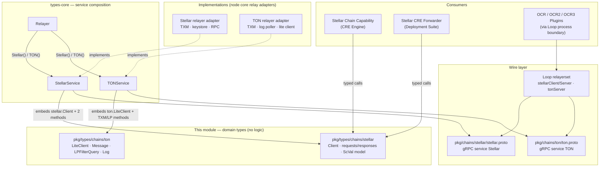
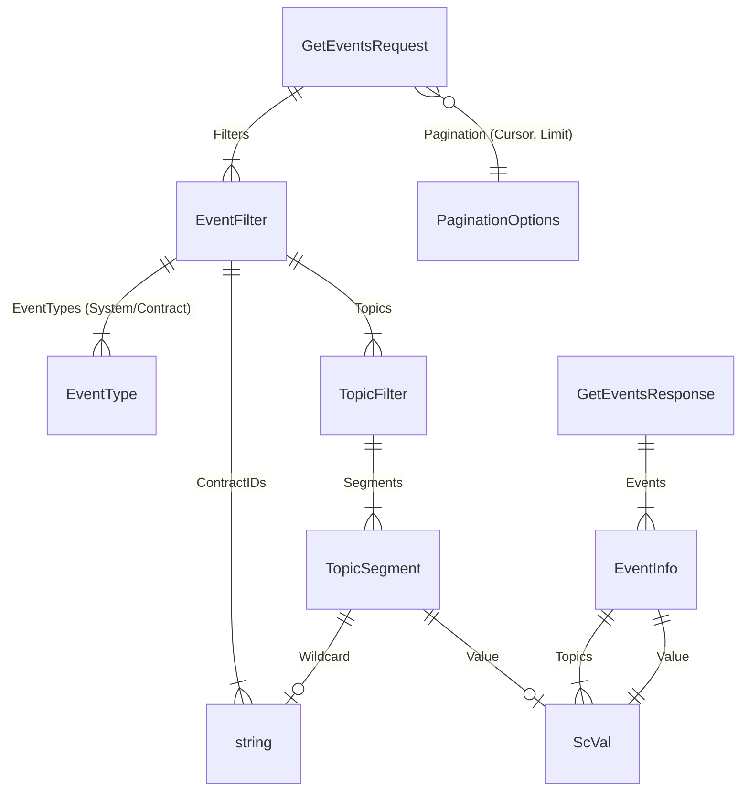
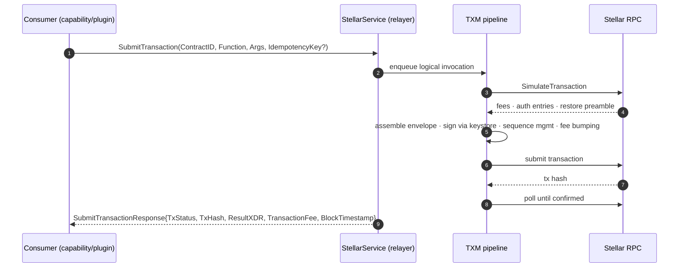
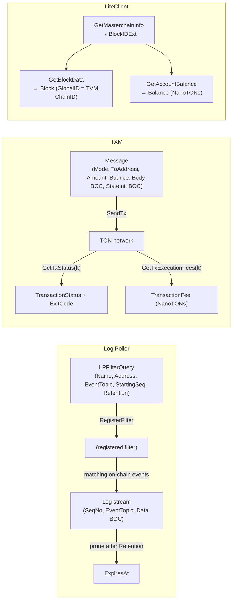
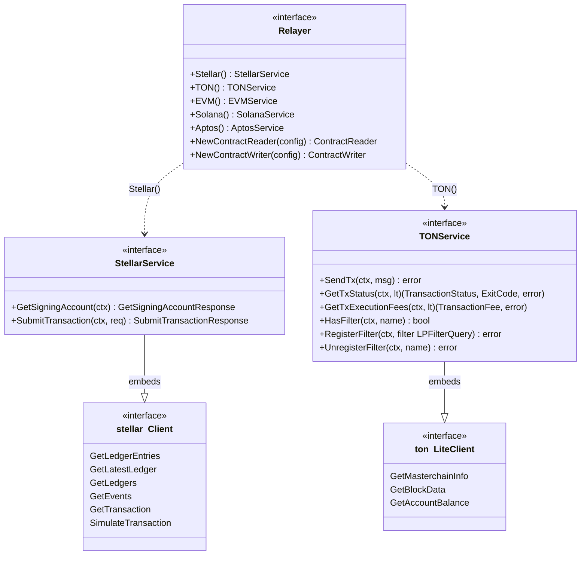
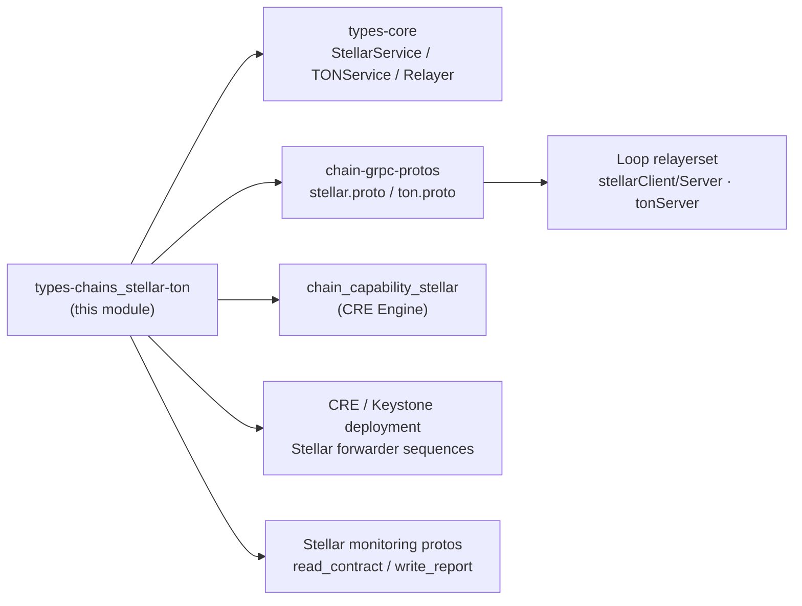

# types-chains: Stellar & TON Domain Types

## Introduction

This module documents the **chain-specific domain types for the Stellar and TON blockchains**, defined in:

- `chainlink-common/pkg/types/chains/stellar/stellar.go` — the Stellar (Soroban) client interface, request/response types, transaction lifecycle types, and the `ScVal` Soroban value model.
- `chainlink-common/pkg/types/chains/ton/ton.go` — the TON `LiteClient` interface plus message, log-poller, and fee types.

These packages are **pure domain contracts**: they contain no business logic, no networking, and no chain clients. They exist so that consumers (reporting plugins, CRE chain capabilities, forwarders, deployment tooling) can interact with Stellar and TON relayers without depending on node-specific SDKs or the relayer's internal implementation. They are the Stellar/TON counterparts of the EVM, Aptos, and Solana types documented in [types-chains EVM](types-chains_evm.md), [types-chains Aptos](types-chains_aptos.md), [types-chains Solana](types-chains_solana.md), and [types-chains Sui](types-chains_sui.md).

The types are composed into service interfaces by [types-core](../types-core.md) (`StellarService`, `TONService`, embedded in `Relayer`) and mirrored one-to-one by gRPC schemas in [chain-grpc-protos](../chain-grpc-protos.md) (`chainlink-common/pkg/chains/stellar/stellar.proto`, `chainlink-common/pkg/chains/ton/ton.proto`), which the Loop plugin framework uses to expose these services across process boundaries (see [loop-relayer-services](../../../Plugin_Process_Framework_(Loop)/loop-relayer-services.md)).

## Architecture Overview

Key architectural properties:

1. **Interface segregation.** Each chain exposes a narrow, chain-idiomatic surface. `stellar.Client` holds read/simulate operations; the mutating operations (`SubmitTransaction`, `GetSigningAccount`) are layered on top by `StellarService`. `ton.LiteClient` holds block/account reads; TXM and log-poller operations are layered on top by `TONService`.
2. **Encoding decoupling.** The domain layer normalizes chain encodings into Go-friendly forms (base64 XDR strings for Stellar, `[]byte` BOC for TON), so consumers never serialize XDR or BOC themselves.
3. **Wire parity.** Every domain type has a protobuf counterpart with the same field names, enabling mechanical mapping across the Loop gRPC boundary without semantic drift.

## Stellar Domain Types (`pkg/types/chains/stellar`)

### `Client` Interface

`Client` is the read-and-simulate surface over a Stellar RPC node. All methods are context-aware; all XDR payloads in requests/responses are **base64-encoded strings**.

| Method | Purpose | Typical Consumer Use |
|---|---|---|
| `GetLedgerEntries` | Fetch ledger entries by base64 XDR `LedgerKey`s | Sequence-number and contract-state lookups |
| `GetLatestLedger` | Current ledger hash, sequence, protocol version, close time | Timeout / liveness detection |
| `GetLedgers` | Paginated ledger range (by `StartLedger` or opaque `Cursor`) | Historical scanning, finality confirmation |
| `GetEvents` | Contract events filtered by ledger range, event type, contract IDs, and topic filters | Log-polling-style trigger detection |
| `GetTransaction` | Transaction by hash; returns fee (stroops), ledger sequence, close time | Receipt / confirmation checks |
| `SimulateTransaction` | Dry-run a Soroban `InvokeContract` call without submitting | Read-only contract calls, fee estimation |

### Read Types

- `GetLedgerEntriesRequest`/`Response` — request takes `Keys []string` (base64 XDR ledger keys); response yields `LedgerEntryResult` entries (`KeyXDR`, `DataXDR`, `LastModifiedLedger`, optional `LiveUntilLedgerSeq *uint32`, optional `ExtensionXDR`) plus `LatestLedger` for read-consistency. Fewer entries may be returned than keys requested.
- `GetLedgersRequest`/`Response` — `StartLedger` is **mutually exclusive** with `Pagination.Cursor` (native Stellar RPC rejects both); the response's `Cursor` feeds the next page. `LedgerInfo` carries hex hash, sequence, close time, and base64 XDR header/metadata blobs.
- `GetLatestLedgerResponse` — hex-encoded hash, protocol version, sequence, close time, plus base64 `LedgerHeaderXDR` / `LedgerMetadataXDR`.
- `GetTransactionRequest`/`Response` — the response deliberately carries only fee/ledger metadata (`FeeStroops`, `LedgerSequence`, `LedgerCloseTime`).

### Event Types

The event model mirrors the Stellar RPC `getEvents` endpoint:

- `EventInfo` carries ledger position (`Ledger`, `LedgerClosedAt`), attribution (`ContractID`, `TransactionHash`, operation/transaction indexes), and the decoded-on-demand `Topics` / `Value` as `ScVal`s.
- Responses include `Cursor` and the ledger/window bounds (`LatestLedger`, `OldestLedger` and their close times) so pollers can maintain cursor state and detect retention pruning.

### Simulation (Soroban Dry-Run)

`SimulateTransaction` is **not** a generic transaction-envelope simulator. It is a contract-call simulator expressed as `ContractID` + `Function` + `Args []ScVal`, which the implementation turns into a synthetic single-operation `InvokeContract` transaction.

- `SimulateAuthMode` (`"record"` — recommended default for empty, `"enforce"`, `"record_allow_nonroot"`) controls how Soroban authorization entries are handled.
- `SimulateResourceConfig.InstructionLeeway` optionally extends the CPU instruction budget.
- `SimulateTransactionResponse` returns the full simulation payload: `Success`/`Error`, `ReturnValueXDR`, `RequiredAuthXDR` (auth entries to attach on submit), diagnostic `EventsXDR`, `TransactionDataXDR` and `MinResourceFee` (ready-to-use transaction data), and a `SimulateRestorePreamble` (`TransactionDataXDR` + `MinResourceFee`) when archived ledger entries must be restored before submission.

### Transaction Submission (TXM Pipeline)

`SubmitTransactionRequest` deliberately contains **only the logical invocation** — `IdempotencyKey`, optional `FromAddress` (empty = TXM default keystore account), `ContractID`, `Function`, `Args`, `LedgerBoundsOffset`, and `MaxResourceFee`. The TXM owns simulation, sequence management, envelope assembly, signing, fee bumping, and confirmation. This is the same logical-invocation/physical-execution split used by the Solana TXM types (see [types-chains Solana](types-chains_solana.md)).

Outcomes are the three-value `TransactionStatus` enum — `TxFatal` (never reached the network: RPC, signing, or validation failure), `TxFailed` (included on-chain but execution reverted/failed), `TxSuccess`. The response also returns the TXM-assigned `TxIdempotencyKey` for deduplication, `ResultXDR`/`ResultMetaXDR`, and optional `TransactionFee` (stroops) and `BlockTimestamp` (microseconds).

### Signing Account vs. Transaction Source

`GetSigningAccountResponse` (surfaced on `StellarService`, not on `Client`) returns the relayer's default TXM signing account (`G…` StrKey). This exists because of a Stellar-specific subtlety:

- Some Soroban contracts (e.g. the CRE forwarder's `report()`) take the transmitter as an **explicit `Address` argument** checked via `require_auth()`.
- That contract argument is separate from the transaction **source account** used for signing (`FromAddress` on `SubmitTransactionRequest`).

Callers that encode such arguments must query this address from the relayer rather than hard-coding capability configuration. See the forwarder usage in [cre-forwarder](../../CRE___Keystone_Deployment_Suite/cre-forwarder.md).

### The `ScVal` Value Model

Stellar's Soroban runtime passes typed values (`ScVal`). The domain layer models `ScVal` as a Go **tagged union**: a `Type ScValType` discriminator plus exactly one payload field. This mirrors the protobuf `ScVal` shared with the wire layer (`capabilities/blockchain/stellar/v1alpha/scval.proto`, imported by `stellar.proto`).

| Category | ScValTypes | Payload Types |
|---|---|---|
| Scalars | `Bool`, `Void`, `U32`, `I32`, `U64`, `I64`, `Timepoint`, `Duration` | `*bool`, `*Void`, `*uint32` … `*uint64` |
| Wide integers | `U128`, `I128`, `U256`, `I256` | `UInt128Parts{Hi,Lo}` … `Int256Parts{HiHi,HiLo,LoHi,LoLo}` |
| Bytes / text | `Bytes`, `String`, `Symbol` | `[]byte`, `*string` |
| Collections | `Vec`, `Map` | `ScVec{Values}`, `ScMap{Entries []ScMapEntry}` |
| Identity | `Address` | `ScAddress` (`AccountID`, `ContractID`, `MuxedAccount`, `ClaimableBalance`, `LiquidityPoolID`) |
| Contract system | `ContractInstance`, `LedgerKeyContractInstance`, `NonceKey`, `Error` | `ScContractInstance`, `Void`, `ScNonceKey`, `ScError` |

Supporting types: `ScErrorType` / `ScErrorCode` enums (contract, Wasm VM, context, storage, object, crypto, events, budget, value, auth — and their error codes) model host-level failures inside `ScError`.

This `ScVal` model is what consumers use to build `Args` for both `SimulateTransaction` and `SubmitTransactionRequest`, and what `GetEvents` returns in `EventInfo.Topics`/`Value`.

## TON Domain Types (`pkg/types/chains/ton`)

The TON surface is much smaller and organized around three functional areas that `TONService` composes: a **LiteClient** (read-only block/account access), **TXM** (transaction management), and a **Log Poller**. Package-level type aliases `ExitCode = int32` (TVM smart-contract exit code) and `BOC = []byte` (Bag-of-Cells encoded cell) establish the chain's encoding vocabulary.

### `LiteClient` Interface

| Method | Signature | Notes |
|---|---|---|
| `GetMasterchainInfo` | `(ctx) (*BlockIDExt, error)` | Returns the tip of the masterchain (`Workchain`, `Shard`, `SeqNo`) — TON's analogue of "latest head" |
| `GetBlockData` | `(ctx, *BlockIDExt) (*Block, error)` | `Block.GlobalID` acts as the **EVM-equivalent ChainID for TVM** |
| `GetAccountBalance` | `(ctx, address, *BlockIDExt) (*Balance, error)` | Balance in NanoTONs, read at a specific block |

The masterchain-tip-first flow (`GetMasterchainInfo` → `GetBlockData`/`GetAccountBalance`) reflects TON's shard architecture, where all reads are anchored to a `BlockIDExt`.

### TXM Types

- `Message` — the unit of submission: `Mode` (TON send mode), `ToAddress` (raw or user-friendly), `Amount` (tons, decimal string), `Bounce` flag, `Body BOC`, and optional `StateInit BOC` (for deploying new contracts). The body/state-init are opaque `BOC` cells — callers building them use chain tooling, while the relayer only transports them.
- `TransactionFee` — `*big.Int` cost of a transaction in NanoTONs, returned by `TONService.GetTxExecutionFees`.
- `Balance` — `*big.Int` NanoTONs; both use `big.Int` rather than fixed-width integers because TON value ranges exceed `int64`.

### Log Poller Types

The TON log poller follows the same register/query pattern as EVM and Solana log tracking ([types-chains EVM](types-chains_evm.md), [types-chains Solana](types-chains_solana.md)):

- `LPFilterQuery` — `ID`, `Name` (registration key), `Address` (contract), `EventName`, `EventTopic` (uint64 topic hash), `StartingSeq`, and `Retention time.Duration` for in-memory retention.
- `Log` — a captured event: `FilterID`, `SeqNo` (block sequence), `Address`, `EventTopic`, `Data` (raw BOC of the body cell), `ReceivedAt`, optional `ExpiresAt` (retention expiry), and an optional `Error` string for capture-time failures.

## Service Composition (`types-core`)

The domain types are consumed via composite interfaces defined in [types-core](../types-core.md) (`chainlink-common/pkg/types/relayer.go`):

Notes on the composition choices:

- **Stellar** keeps `Client` read/simulate-only and adds exactly two methods at the service layer: `GetSigningAccount` (keystore access, deliberately not on the raw client) and `SubmitTransaction` (mutating, TXM-backed). Relayer nodes implement `StellarService` as a whole; in-process and out-of-process consumers program against `stellar.Client` + the two extras.
- **TON** mirrors the same pattern with the TXM and log-poller method groups attached to `TONService`, while `LiteClient` stays focused on masterchain/block/balance reads.
- Both services are reachable only through `Relayer` (`Relayer.Stellar()`, `Relayer.TON()`), consistent with the relayer abstraction in [types-core](../types-core.md).

## Wire-Protocol Mapping (`chain-grpc-protos`)

Every domain type has a 1:1 protobuf counterpart in [chain-grpc-protos](../chain-grpc-protos.md), which the Loop framework uses to proxy these services into plugin processes (client/server wrappers in [loop-relayer-services](../../../Plugin_Process_Framework_(Loop)/loop-relayer-services.md): `stellarClient`/`stellarServer` and `tonServer`). The mapping is mechanical but has encoding conventions worth knowing:

| Concern | Domain (Go) | Wire (protobuf) |
|---|---|---|
| Stellar XDR payloads | `string` fields, base64-encoded (e.g. `DataXDR`, `RequiredAuthXDR []string`) | `bytes` fields, raw XDR binary |
| Optional scalar (`LiveUntilLedgerSeq`) | `*uint32` (nil = absent) | `has_live_until_ledger_seq bool` + `uint32` presence pair |
| Stellar hashes | hex `string` (`Hash`, `TxHash`) | raw `bytes` |
| ScVal arguments | tagged-union Go struct | `capabilities.blockchain.stellar.v1alpha.ScVal` message |
| TON amounts / fees | `*big.Int` (`Balance`, `TransactionFee`) | `values.v1.BigInt` |
| TON durations | `time.Duration` (`LPFilterQuery.Retention`) | `int64 retention_secs` |
| TON message body | `BOC = []byte` | `bytes body` / `optional bytes state_init` |
| Status enums | `TransactionStatus` (Stellar: `TxFatal/TxFailed/TxSuccess`; TON: via `TONService.GetTxStatus`) | `TxStatus` / `TransactionStatus` enums |

The Stellar proto's `Stellar` service exposes all eight operations including `SubmitTransaction` and `GetSigningAccount` (i.e. the proto corresponds to the full `StellarService`, not just the embedded `Client`). The TON proto's `TON` service exposes the `LiteClient` RPCs plus `SendTx` / `GetTxStatus` / `GetTxExecutionFees` and the log-poller filter RPCs — exactly the `TONService` surface.

## Consumers & Relationships

- **CRE Stellar chain capability** (`capabilities/chain_capabilities/stellar` — its own Go module) imports `chainlink-common` for these types and uses `stellar.ScVal` to encode forwarder report arguments; see [chain_capability_stellar](../../../Workflow___Capability_Runtime_(CRE_Engine)/chain_capability_stellar.md).
- **Deployment suites** build Stellar forwarder deploy/configure sequences against the same domain contracts (forwarder `report()` transmitter argument via `GetSigningAccount`); see [cre-forwarder](../../CRE___Keystone_Deployment_Suite/cre-forwarder.md).
- **Loop plugin framework** wraps the wire services so out-of-process OCR/OCR3 plugins call Stellar/TON relayers transparently; see [loop-relayer-services](../../../Plugin_Process_Framework_(Loop)/loop-relayer-services.md) and the generated bindings overview in [loop-grpc-bindings](../../../Plugin_Process_Framework_(Loop)/loop-grpc-bindings.md).
- **Node application core** relay adapters are the reference implementations of `StellarService`/`TONService`; how adapters plug into the node is covered in [node_application_relay](../../Node_Application_Core___Interfaces/node_application/node_application_relay.md).

## Design Conventions & Gotchas

1. **Base64 XDR everywhere in the Stellar domain layer.** Unlike the protobuf layer (raw bytes), all `*XDR` fields are base64 strings. Consumers decoding XDR must base64-decode first.
2. **`SimulateTransaction` ≠ generic simulation.** Only single `InvokeContract` calls are supported; there is no path to simulate raw transaction envelopes. Use it for read-only calls and pre-submit resource/auth discovery.
3. **Two Stellar "accounts" to keep straight.** `GetSigningAccountResponse.AccountAddress` (for `require_auth`'d `Address` contract arguments) vs. `SubmitTransactionRequest.FromAddress` (transaction source/signer). They are frequently the same account, but are conceptually distinct.
4. **Empty-vs-default semantics.** In both request families, empty string fields mean "use service default": `AuthMode: ""` → `"record"`, `FromAddress: ""` → TXM keystore default, `SourceAccount: ""` → deterministic placeholder source, `IdempotencyKey: ""` → TXM assigns one.
5. **Stellar pagination is cursor-or-start, never both.** `GetLedgersRequest.StartLedger` and `Pagination.Cursor` are mutually exclusive; native RPC rejects both being set.
6. **TON amounts are decimal strings and `big.Int`s.** `Message.Amount` is a decimal string in tons; `Balance`/`TransactionFee` are `*big.Int` NanoTONs — do not use `int64` for TON value math.
7. **TON logs are opaque BOC.** `Log.Data` is the raw body cell; decoding requires Soroban-analogous TVM tooling on the consumer side.
8. **The types are contract-only.** Neither package performs I/O; implementing relayers (and Loop servers) own the network behavior. Interface tests and mocks for these contracts live with the relayer implementations, not here.

## Module & Build Context

Both packages belong to the `github.com/smartcontractkit/chainlink-common` Go module (`chainlink-common/go.mod`) and depend only on the standard library (plus `context`) — keeping the domain layer dependency-free is intentional so that capability modules (e.g. `capabilities/chain_capabilities/stellar`, which additionally pins `github.com/stellar/go-stellar-sdk` for BOC/XDR construction) can import it without pulling in chain SDKs. For the sibling chains, see the parent page [types-chains](../types-chains.md) and the overall library map in [Shared_Foundation_Libraries___Domain_Types](../../Shared_Foundation_Libraries___Domain_Types.md).
