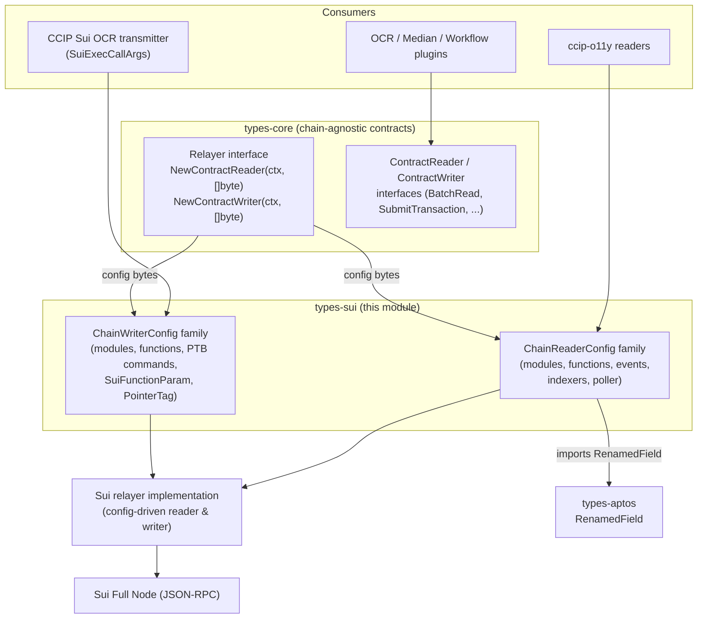
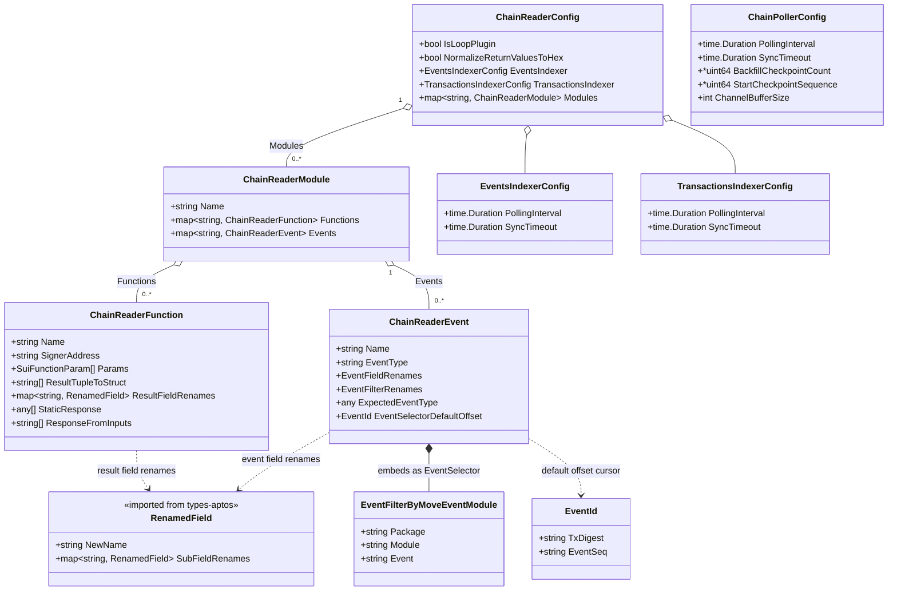
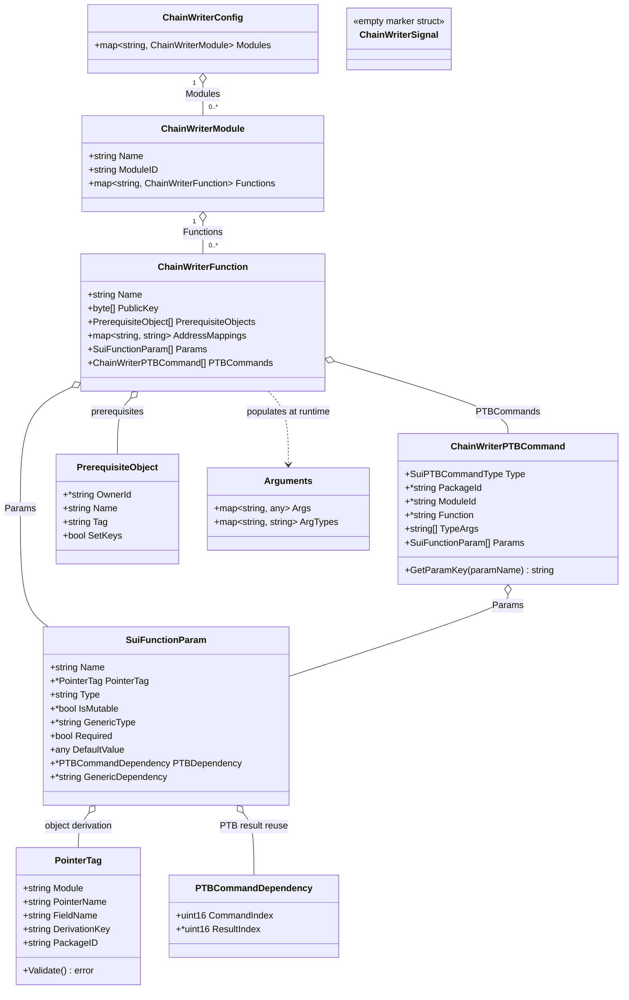
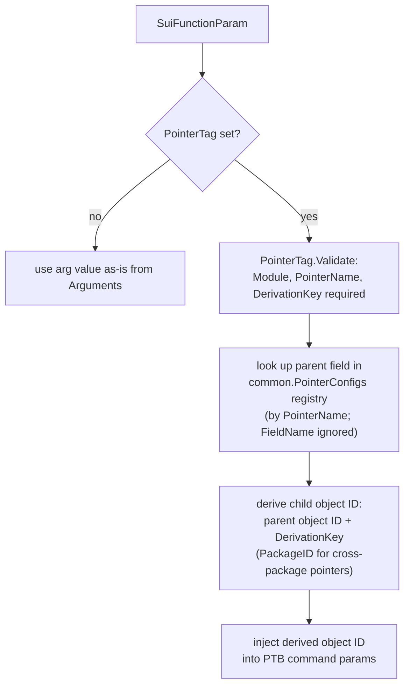
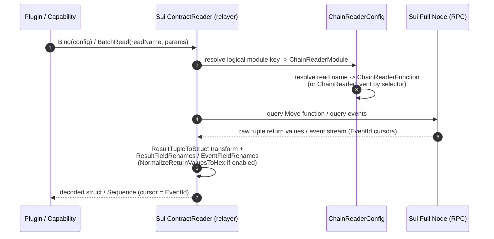
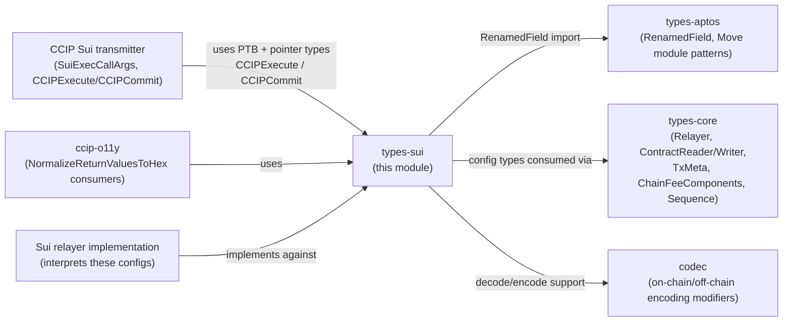

# Sui Chain Types — Contract Reader & Writer Configurations

> **Go package:** `github.com/smartcontractkit/chainlink-common/pkg/types/sui` (inside the `chainlink-common` Go module)
> **Source files:** `chainlink-common/pkg/types/sui/contract_reader.go`, `chainlink-common/pkg/types/sui/contract_writer.go`

## 1. Overview

`types-sui` defines the **domain types and declarative configuration schemas for interacting with Sui Move smart contracts**. It is the Sui member of the [types-chains family](../types-chains.md): a set of per-chain type packages that give every chain integration (EVM, Aptos, Solana, Stellar/TON, Sui) a common shape for the two fundamental on-chain interaction modes:

- **Contract reading** (`contract_reader.go`) — how off-chain code declares *what to read* from a Sui package: Move functions, emitted events, and how raw results are decoded and renamed, plus how event/transaction indexing and checkpoint-based polling are configured.
- **Contract writing** (`contract_writer.go`) — how off-chain code declares *what to write* to a Sui package: Programmable Transaction Block (PTB) commands (`move_call`, `publish`, `transfer`), typed parameters, on-chain pointer-object derivation, and argument plumbing.

The package is intentionally **pure types**: apart from two small helpers (`PointerTag.Validate()` and `ChainWriterPTBCommand.GetParamKey()`), it contains no business logic. The actual interpretation of these configurations lives in the Sui relayer implementation, which receives the config as serialized bytes through the chain-agnostic `Relayer` factories defined in [types-core](../types-core/types-core_relayer.md).

---

## 2. Where the module sits in the system



Key architectural facts:

1. **No chain-specific service interface on the `Relayer`.** The `Relayer` interface exposes dedicated family services for EVM, TON, Solana, Aptos and Stellar — but *not* for Sui. All Sui interactions flow through the generic `NewContractReader`/`NewContractWriter` factories, which receive the Sui configuration as raw `[]byte` (see [types-core_relayer](../types-core/types-core_relayer.md) and [types-core_chain-contracts](../types-core/types-core_chain-contracts.md)).
2. **Shared machinery with Aptos.** Sui and Aptos are both Move-based, so Sui's reader reuses the [`RenamedField` helper from `types-aptos`](types-chains_aptos.md) for field renaming, and follows the same "config map keyed by logical module name" pattern (see [types-chains](../types-chains.md) for the family-wide conventions).
3. **Hand-written types, no protobufs.** Unlike the other chain families, which also ship gRPC bindings under `chainlink-common/pkg/chains/*` (documented in [chain-grpc-protos](../chain-grpc-protos.md)), there is no `sui.proto`: these types are plain Go structs, serialized (typically as JSON) when handed to the relayer. They are also not exposed over the Loop gRPC plugin surface (see [loop-relayer-services](../../Plugin_Process_Framework_(Loop)/loop-relayer-services/loop-relayer-services_relayer.md)) — a Sui plugin relayer would receive the same serialized config through the `RelayerServer` surface.
4. **CCIP integration.** The Sui CCIP OCR transmitter builds on the writer types — PTB composition and pointer-derived object arguments are exactly what `SuiExecCallArgs` needs to construct Sui transactions (see [ccip_ocr_transmitters](../../CCIP_Cross-Chain_Protocol/ccip/ccip_ocr_transmitters.md)).

---

## 3. Contract reader configuration (`contract_reader.go`)

### 3.1 Components

| Type | Purpose |
|---|---|
| `ChainReaderConfig` | Top-level reader configuration: loop-plugin flag, return-value normalization, event/transaction indexer settings, and the map of named modules. |
| `ChainReaderModule` | Groups a Move module's callable functions and emitted events under a logical name. |
| `ChainReaderFunction` | Describes one read: parameters (`SuiFunctionParam`), result decoding (`ResultTupleToStruct`, `ResultFieldRenames`), or a canned response (`StaticResponse`, `ResponseFromInputs`). |
| `ChainReaderEvent` | Describes one event type: the `package::module::event` selector, field/filter renames, expected type, and a pruning-aware default offset. |
| `EventFilterByMoveEventModule` / `EventSelector` | The 3-part Move event tag (`Package`, `Module`, `Event`); `EventSelector` is a type alias used for event identity. |
| `EventId` | Sui's event cursor: `txDigest` + `eventSeq`. Used both to identify an event and as the resync fallback offset. |
| `EventsIndexerConfig` / `TransactionsIndexerConfig` | Polling interval and sync timeout for the event and transaction indexers. |
| `ChainPollerConfig` | Checkpoint-driven poller settings: interval, timeout, optional backfill (`latest - N` checkpoints), explicit start sequence, and channel buffer size. |

### 3.2 Type model



### 3.3 Behavioral notes

- **Name defaulting.** `ChainReaderModule.Name`, `ChainReaderFunction.Name` and `ChainReaderEvent.Name` are all optional; when omitted, the implementation uses the key of the enclosing map (`Modules`, `Functions`, `Events` respectively). This mirrors the Aptos `ContractReaderModule` convention.
- **Result decoding.** `ResultTupleToStruct` transforms a tuple-typed Move return value into a JSON object; `ResultFieldRenames` then renames response fields (recursively, via `aptos.RenamedField.SubFieldRenames`). `StaticResponse` and `ResponseFromInputs` provide canned/mapped responses for reads that are not real on-chain calls.
- **Hex normalization.** `NormalizeReturnValuesToHex` converts base64-encoded byte/address return values into `0x`-prefixed hex strings. It exists specifically for **ccip-o11y** consumers and defaults to `false` so that typed-struct decoding is preserved for everyone else — a meaningful default to keep in mind when adding new readers.
- **`IsLoopPlugin`.** Declares whether this reader config is used by a plugin running inside the Loop process, which affects how the runtime wires the reader.
- **Pruning-aware event tracking.** `ChainReaderEvent.EventSelectorDefaultOffset` supplies a fallback `EventId` when the database has no recorded offset for a selector and the requested start point is older than the RPC node's pruning cutoff — preventing unresolvable backfills. `EventId` (`txDigest` + `eventSeq`) is Sui's native event cursor and doubles as the sequence anchor for reads that follow the generic `Sequence` cursor model from [types-core](../types-core/types-core_chain-contracts.md).
- **Two timing layers.** `EventsIndexerConfig`/`TransactionsIndexerConfig` tune the broad indexers (poll interval + sync timeout), while `ChainPollerConfig` tunes the checkpoint poller, including `BackfillCheckpointCount` (resume from `latest − N` checkpoints), an optional explicit `StartCheckpointSequence` that overrides backfill, and `ChannelBufferSize` (default e.g. 16) for the delivery channel.

---

## 4. Contract writer configuration (`contract_writer.go`)

### 4.1 Components

| Type | Purpose |
|---|---|
| `ChainWriterConfig` | Top-level writer configuration: map of named modules. |
| `ChainWriterModule` | A Move module (with explicit `ModuleID`) and its callable functions. |
| `ChainWriterFunction` | One logical write: signer `PublicKey`, `PrerequisiteObjects`, `AddressMappings`, plain `Params`, or a list of `PTBCommands`. |
| `ChainWriterPTBCommand` | A single PTB command (`move_call` / `publish` / `transfer`) with optional package/module/function targets, type args and params. |
| `SuiPTBCommandType` | Command type enum: `SuiPTBCommandMoveCall`, `SuiPTBCommandPublish`, `SuiPTBCommandTransfer`. |
| `SuiFunctionParam` | A typed function parameter with optional `PointerTag`, mutability, generic type, default value, PTB-result dependency, or generic dependency. |
| `PTBCommandDependency` | Links a parameter to a previous command's result (`CommandIndex`, optional `ResultIndex`). |
| `PointerTag` | Declares how to derive an object ID from an on-chain pointer object (validated). |
| `PrerequisiteObject` | An owned object that must be fetched via `SuiX_GetOwnedObjects` (by `OwnerId` + `Tag`) and injected into the argument map. |
| `Arguments` | Runtime argument carrier: `Args` (name → value) and `ArgTypes` (name → generic type). |
| `ChainWriterSignal` | Empty marker struct. |
| `PTBChainWriterModuleName`, `CCIPExecute`, `CCIPCommit` | Well-known constants: the PTB-builder component name (`cll://component=cw/type=ptb_builder`) and the CCIP `execute`/`commit` logical names. |

### 4.2 Type model



> **Shared type:** `SuiFunctionParam` is defined in `contract_writer.go` but is also used by `ChainReaderFunction.Params` — it is the single parameter model for *both* reading and writing in this package.

### 4.3 The PTB model

A `ChainWriterFunction` either takes flat `Params`, or — for expressive multi-step transactions — a list of `ChainWriterPTBCommand`s that the relayer composes into one Sui **Programmable Transaction Block**:

- `move_call` — invoke a Move function on a package (`PackageId`, `ModuleId`, `Function`, `TypeArgs`, `Params`); `PackageId` is optional only for commands that don't need it (e.g. `publish`).
- `publish` — deploy a package.
- `transfer` — transfer objects.

Parameters inside a command can consume **results of earlier commands** in the same PTB via `SuiFunctionParam.PTBDependency` (`CommandIndex` + optional `ResultIndex`), which is how multi-call flows (e.g. "read state → compute → call forwarder") are expressed declaratively.

**`GetParamKey` note.** `ChainWriterPTBCommand.GetParamKey(paramName)` builds the key that associates an entry in the `Arguments` map with a specific command parameter. The doc-comment describes it conceptually as `packageId::moduleId::functionName::parameterName`, but the implementation joins the four segments with dots: `"packageId.moduleId.functionName.paramName"`. Consumers must match on the implemented (`.`-separated) format.

### 4.4 Object resolution: prerequisites and pointer derivation

Sui writes frequently need object IDs that live on-chain. Two mechanisms handle this:

1. **`PrerequisiteObject`** — before building the PTB, the relayer issues `SuiX_GetOwnedObjects` for `OwnerId` and picks the object matching `Tag`, inserting it into the args map under `Name` (or under the object's *keys* when `SetKeys` is set).
2. **`PointerTag`** — for parameters, declares that the object ID must be **derived from a pointer object** stored on-chain. `Validate()` enforces that `Module`, `PointerName` and `DerivationKey` are set. `FieldName` is declared but **currently ignored**: the parent field is looked up from the global `common.PointerConfigs` registry keyed by `PointerName` (kept for backward compatibility/future override). `PackageID` supports cross-package pointers (e.g. an off-ramp package depending on a `CCIPObjectRef` in the CCIP package); when empty, the calling contract's package is used.



---

## 5. Data flows

### 5.1 Contract read flow



### 5.2 Contract write flow

```mermaid
sequenceDiagram
    autonumber
    participant C as Caller (plugin / CCIP transmitter)
    participant CW as Sui ContractWriter (relayer)
    participant RPC as Sui Full Node (RPC)

    C->>CW: SubmitTransaction(contract, method, args, transactionID, ...)
    CW->>CW: resolve ChainWriterFunction +<br/>AddressMappings (logical name -> package/module)
    CW->>RPC: SuiX_GetOwnedObjects(OwnerId) for each PrerequisiteObject
    RPC-->>CW: owned objects; match by Tag
    CW->>CW: build Arguments (Args + ArgTypes)<br/>derive PointerTag object IDs
    CW->>CW: compose PTB from PTBCommands<br/>(move_call / publish / transfer,<br/>wired via PTBCommandDependency)
    CW->>RPC: sign with PublicKey, submit PTB
    RPC-->>CW: transaction digest
    CW-->>C: ack; later status via GetTransactionStatus (IdempotencyKey)
```

The write call conforms to the chain-agnostic `ContractWriter` interface (`SubmitTransaction`, `GetTransactionStatus`, `GetFeeComponents`, `GetEstimateFee`, with `TxMeta` for workflow execution IDs and gas limits) — see [types-core_chain-contracts](../types-core/types-core_chain-contracts.md).

---

## 6. Cross-module dependency map



- **→ types-aptos:** `ResultFieldRenames` and `EventFieldRenames` are typed as `map[string]aptos.RenamedField`. See [types-chains_aptos](types-chains_aptos.md) for the full `RenamedField` semantics (recursive `SubFieldRenames`).
- **→ types-core:** the reader/writer configs are the Sui implementations of the contracts in [types-core_chain-contracts](../types-core/types-core_chain-contracts.md) (`ChainReaderConfig` here parallels EVM's `ContractReaderConfig`; `ChainFeeComponents`/`TxMeta` come from the core writer types). Instantiation happens through `Relayer` — see [types-core_relayer](../types-core/types-core_relayer.md).
- **← CCIP:** the Sui OCR transmitter (`SuiExecCallArgs`) and the well-known `CCIPExecute`/`CCIPCommit` function names tie this package to CCIP's Sui support — see [ccip_ocr_transmitters](../../CCIP_Cross-Chain_Protocol/ccip/ccip_ocr_transmitters.md). The CCIP deployment suite also drives Sui token pools through these configs (see [ccip-changesets](../../CCIP_Deployment_Suite/ccip-changesets.md)).
- **→ codec:** complex on-chain value transformations for reads/writes build on the shared encoding primitives documented in [codec](../codec.md).
- **↔ other chain types:** compare with [types-chains_evm](types-chains_evm.md) (ABI/word-based reads), [types-chains_solana](types-chains_solana.md) (Anchor IDL-driven reads), and [types-chains_stellar-ton](types-chains_stellar-ton.md) — the family-wide conventions are in [types-chains](../types-chains.md).

---

## 7. Build & maintenance notes

- The package lives in the **`chainlink-common` Go module** (`chainlink-common/go.mod`, module path `github.com/smartcontractkit/chainlink-common`) — a standalone, shared library module consumed by the node, capabilities and CCIP codebases.
- There is **no `sui.proto` / generated gRPC code** for this package; it consists of hand-written Go types. Regeneration of the module's generated artifacts (mocks via mockery, protobufs for *other* packages, module graph) is driven by `make -C chainlink-common generate` (`chainlink-common/Makefile`), and linting via `script/lint.sh` (`chainlink-common/Makefile` targets `lint` / `lint-workspace`).
- Because the configs cross process/plugin boundaries as `[]byte`, treat field names and JSON tags as **compatibility surface**: renaming a field silently breaks deployed configurations. Additive, optional fields (like `NormalizeReturnValuesToHex` or `FieldName` reserved for future use) are the preferred evolution path.

---

## 8. Usage notes & gotchas

1. **Map-key name defaulting everywhere.** Modules, functions and events all fall back to their map key as the logical name — keep keys stable, they are part of the config identity.
2. **`PointerTag.FieldName` is dead weight today.** It is parsed but ignored; the parent lookup always comes from `common.PointerConfigs` via `PointerName`. Do not rely on per-config field overrides.
3. **`SetKeys` changes the argument shape.** When `PrerequisiteObject.SetKeys` is true, the fetched object contributes its *keys* rather than a single named entry to the args map — verify arg names in `PTBCommands` accordingly.
4. **Pruning:** always consider setting `EventSelectorDefaultOffset` for high-volume selectors; without it, a fresh/offline node may be unable to resume from an old cursor.
5. **Backfill vs. explicit start:** `StartCheckpointSequence` (if set) overrides `BackfillCheckpointCount` in `ChainPollerConfig`.
6. **Key format for `GetParamKey`:** implemented as `packageId.moduleId.functionName.paramName` (dots, not the `::` mentioned in the comment).
7. **`ChainWriterSignal`** is an empty marker struct — present for type-system wiring, carries no data.

---

## 9. Related documentation

- Parent: [types-chains — per-chain domain type packages](../types-chains.md)
- Sibling chain types: [types-chains_evm](types-chains_evm.md) · [types-chains_aptos](types-chains_aptos.md) · [types-chains_solana](types-chains_solana.md) · [types-chains_stellar-ton](types-chains_stellar-ton.md)
- Chain-agnostic contracts these configs fulfill: [types-core_chain-contracts](../types-core/types-core_chain-contracts.md) · [types-core_relayer](../types-core/types-core_relayer.md)
- Where configs are consumed by CCIP: [ccip_ocr_transmitters](../../CCIP_Cross-Chain_Protocol/ccip/ccip_ocr_transmitters.md)
- Family overview: [Shared Foundation Libraries & Domain Types](../../Shared_Foundation_Libraries___Domain_Types.md)
