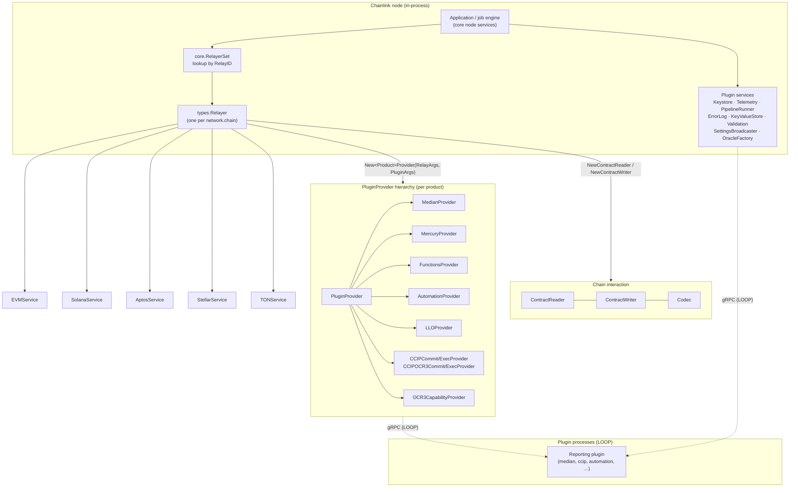
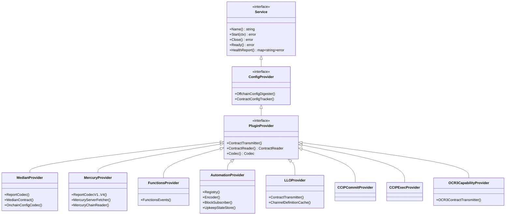

# types-core — Core Domain Types & Interface Contracts

## Overview

`types-core` documents the foundational **domain types and interface contracts** of the Chainlink platform, defined in the `github.com/smartcontractkit/chainlink-common` Go module (Go 1.27, see [`chainlink-common/go.mod`](https://github.com/smartcontractkit/chainlink-common) root manifest at `chainlink-common/go.mod`) under the packages:

- `chainlink-common/pkg/types` — the canonical, chain-agnostic vocabulary: service lifecycle, `Relayer`, `ContractReader` / `ContractWriter`, `Codec`, the per-product `PluginProvider` hierarchy, and plugin-type identifiers.
- `chainlink-common/pkg/types/core` — the slim **service contracts injected into plugin processes** (keystore, telemetry, pipeline runner, error log, key-value store, validation, settings, relayer set, oracle factory).
- `chainlink-common/pkg/types/automation` — the Automation (upkeep/keeper) domain model.
- `chainlink-common/pkg/types/keystore` — the policy-based keystore consumer/management API.
- `chainlink-common/pkg/types/query/primitives` — visitor-based query filter primitives shared by every chain reader.
- `chainlink-common/pkg/types/interfacetests` — a reusable **interface-conformance test harness** for `ContractReader` / `ContractWriter` implementations.

These contracts are the "lingua franca" of the ecosystem: the [node application](../Node_Application_Core___Interfaces.md), the [platform services](../Node_Platform_Services.md), the [LOOP plugin framework](../Plugin_Process_Framework_(Loop).md), and the [CRE capability runtime](../Workflow___Capability_Runtime_(CRE_Engine).md) all speak them. Because the same interfaces are used **in-process** by the node and **across gRPC** by plugin binaries (LOOP), the contracts are deliberately dependency-light and every error is designed to survive a gRPC round-trip.

> **Where this module sits:** `types-core` defines the *contracts*. Chain-specific wire/config types that implement them live in [types-chains](types-chains.md) and [chain-grpc-protos](chain-grpc-protos.md); the concrete codec engine lives in [codec](codec.md); product payload types for Mercury/LLO live in [types-mercury-llo](types-mercury-llo.md); CCIP payload types live in [types-ccip](../CCIP_Cross-Chain_Protocol/types-ccip.md).

---

## Architecture

### Big picture: who consumes these contracts



Every contract in this module either:

1. **describes a service the node runs** (`types.Service`, `Relayer`, `RelayerSet`),
2. **describes what a plugin needs from the node** (`PluginProvider` + the `core/*` service interfaces), or
3. **describes the data exchanged between them** (`CheckResult`, `TxMeta`, `Sequence`, `Head`, query primitives, error taxonomy).

### Interface hierarchy



`Service` is the deprecated alias in `pkg/types/types.go` (`go:fix inline`) for [`services.Service`](services.md) — `Name/Start/Close/Ready/HealthReport`. Everything above builds on it.

### How a plugin gets wired to the node (LOOP)

```mermaid
sequenceDiagram
    autonumber
    participant Core as Chainlink node core
    participant Loop as LOOP gRPC boundary
    participant Plug as Plugin process (e.g. CCIP/median)

    Core->>Core: RelayerSet.Get(RelayID)
    Core->>Core: Relayer.NewPluginProvider(RelayArgs, PluginArgs)
    Core->>Loop: serve PluginProvider + services<br/>(Telemetry, ErrorLog, KeyValueStore,<br/>PipelineRunnerService, RelayerSet)
    Plug->>Loop: ReportingPluginClient.NewReportingPluginFactory(config, ...)
    Loop->>Core: factory returns types.ReportingPluginFactory
    Note over Core,Plug: OCR rounds: plugin reads via ContractReader,<br/>encodes via Codec, reports via ContractTransmitter
```

The pb contracts for this boundary are documented in [loop-grpc-bindings](../Plugin_Process_Framework_(Loop)/loop-grpc-bindings.md); the server-side adapters in [loop-relayer-services](../Plugin_Process_Framework_(Loop)/loop-relayer-services/loop-relayer-services_plugin_providers.md).

---

## Sub-module documentation

<!-- SUBMODULE_INDEX_START -->
The module is split into six focused sub-modules (all sources under `chainlink-common/pkg/types` unless noted):

| Sub-module | Scope & covered sources | Documentation |
|---|---|---|
| **Relayer & chain services** | `relayer.go` (`Relayer`, `RelayID`, `ChainService`, `EVMService`, `TONService`, `SolanaService`, `AptosService`, `StellarService` + `Unimplemented*` embeds) and `core/relayerset.go` (plugin-side `Relayer`, `RelayerSet`, slim `RelayArgs`/`PluginArgs`) | [types-core/types-core_relayer.md](types-core/types-core_relayer.md) |
| **Chain contracts (read / write / codec / query)** | `contract_reader.go` (`BatchRead`, `BatchReadResult`, `Sequence`), `contract_writer.go` (`TxMeta`, `ChainFeeComponents`), `codec.go` (`ContractTypeProvider`), `query/primitives/primitives.go` (`Block`, `Comparator`, `Primitive`, `Timestamp`, `TxHash`), `interfacetests/utils.go` (`TestingT` harness) | [types-core/types-core_chain-contracts.md](types-core/types-core_chain-contracts.md) |
| **Product providers** | `types.go` (`Service`), `provider.go` (`PluginProvider` + error taxonomy), `provider_median.go`, `provider_mercury.go`, `provider_functions.go` (`OracleRequest`/`OracleResponse`), `provider_automation.go`, `provider_ccip.go` (`CCIPCommitProvider`, `CCIPExecProvider`, `CCIPFactoryGenerator`, `CCIPProviderArgs`), `provider_ccip_ocr3.go`, `provider_ocr3_capability.go`, `reporting_plugin_factory.go` | [types-core/types-core_providers.md](types-core/types-core_providers.md) |
| **Plugin service contracts** | `core/errorlog.go`, `core/keystore.go` (`UnimplementedKeystore`, `Ed25519Signer`, capability accounts), `core/oracle_factory.go`, `core/pipeline_runner.go` (`Vars`, `Options`, `TaskResult`), `core/reporting_plugin_service.go` (`ReportingPluginServer`, `ReportingPluginServiceConfig`), `core/settings.go`, `core/telemetry.go`, `core/validation.go` | [types-core/types-core_plugin-services.md](types-core/types-core_plugin-services.md) |
| **Automation domain model** | `automation/basetypes.go` (`UpkeepPayload`, `CheckResult`, `TransmitEvent`, `CoordinatedBlockProposal`, `ReportedUpkeep`, `UpkeepIdentifier`) and `automation/interfaces.go` (`Registry`, `Encoder`, `EventProvider`, `LogEventProvider`, `LogRecoverer`, `PayloadBuilder`, `BlockSubscriber`, `UpkeepStateStore`, `ConditionalUpkeepProvider`) | [types-core/types-core_automation.md](types-core/types-core_automation.md) |
| **Keystore APIs** | `keystore/types.go` — policy-based consumer `Keystore` (`Sign`, `SignBatch`, `Verify`, `ListKeys`, `RunUDF`) and node-exclusive `Management` API | [types-core/types-core_keystore.md](types-core/types-core_keystore.md) |
<!-- SUBMODULE_INDEX_END -->

---

## Key concepts

### 1. Service lifecycle

`types.Service` (deprecated alias of [`services.Service`](services.md)) is the base of nearly every interface here: `Name()`, `Start(ctx)`, `Close()`, `Ready()`, `HealthReport() map[string]error`. `HealthReport` semantics are consistent across the module: keys are service names, `nil` means healthy, and implementations should use `services.CopyHealth` to merge sub-service reports (see `ContractReader.HealthReport` in `contract_reader.go`).

### 2. Relay identity & relayer shapes

- **`types.RelayID{Network, ChainID}`** uniquely identifies a relayer (`"evm.137"`). `NewRelayID` / `UnmarshalString` handle the `network.chain` encoding.
- **`types.RelayArgs` / `types.PluginArgs`** (fat, node-side) vs **`core.RelayArgs` / `core.PluginArgs`** (slim, plugin-side). They carry the same concepts (contract ID, relay config bytes, provider type, transmitter ID, plugin config bytes, Mercury credentials) but the plugin-side versions are what marshal over the LOOP pb boundary.
- **`types.Relayer`** (node-side factory: per-chain services + `New*Provider` methods) vs **`core.Relayer`** (plugin-side, minimal surface: chain services access, provider creation, head access). See [types-core_relayer](types-core/types-core_relayer.md).

### 3. Chain-agnostic reading & writing

- **`BoundContract{Address, Name}`** composes the **read identifier** `"<address>-<name>-<readName>"` — the key into every `Codec` map.
- **`ContractReader`**: single reads (`GetLatestValue` with `primitives.ConfidenceLevel`), batched reads (`BatchGetLatestValues` grouped by `BoundContract` with per-read error isolation in `BatchReadResult`), event streaming (`QueryKey`/`QueryKeys` returning `Sequence`), and dynamic binding (`Bind`/`Unbind`).
- **`ContractWriter`**: `SubmitTransaction` keyed by an `IdempotencyKey`, `TransactionStatus` progression (`Unknown → Pending → Unconfirmed → Finalized/Failed/Fatal`), fee introspection (`ChainFeeComponents`, `EstimateFee`), and `TxMeta` carrying workflow execution ID / optional gas limit.
- **`Codec`**: name-keyed `Encoder`/`Decoder` composition (`binary` codecs → `TypeCodec` → `StructCodec` → `CodecFromTypeCodec`); implemented by the [codec](codec.md) library; `ContractTypeProvider` lets remote callers materialize the right Go type before decoding.
- **Query primitives**: visitor-pattern filters (`Comparator`, `Block`, `Confidence`, `Timestamp`, `TxHash`) composed into `query.KeyFilter` boolean trees by `pkg/types/query` (`query.Where`, `query.And/Or`), each translated per chain / per DB via the `Visitor` interface.

### 4. Error taxonomy (gRPC-stable)

Defined in `provider.go` (and reused across the module): `InvalidArgumentError`, `UnimplementedError`, `InternalError`, `NotFoundError`. Each wraps a gRPC code (`GRPCStatus()`) and implements `Is()` via `grpcErrorHasTypeAndMessage`, so `errors.Is` keeps working after a gRPC round-trip — the module doc notes they must work "with or without LOOP enabled". Domain sentinels build on them:

| Area | Sentinels |
|---|---|
| `ContractReader` | `ErrInvalidType`, `ErrInvalidConfig`, `ErrContractReaderConfigMissing`, `ErrInternal`, `ErrNotFound`, `ErrFinalityViolated` |
| `Codec` | `ErrFieldNotFound`, `ErrInvalidEncoding`, `ErrSliceWrongLen`, `ErrNotASlice` |
| `ContractWriter` | `ErrSettingTransactionGasLimitNotSupported` |

### 5. Backward-compatibility patterns

The module encodes several explicit compatibility conventions:

- **`Unimplemented*` embeds** (`UnimplementedRelayer`, `UnimplementedChainService`, `UnimplementedEVMService`, `UnimplementedSolanaService`, `UnimplementedAptosService`, `UnimplementedStellarService`, `UnimplementedContractReader`, `core.UnimplementedKeystore`) return `codes.Unimplemented` by default, so adding interface methods does not break downstream implementations.
- **Wire-stable automation structs**: `BlockKey`, `CheckResult`, `CoordinatedBlockProposal` are broadcast on the p2p network for quorum; their docs require review + upgrade plans before any change, and `CheckResult` isolates the non-encoded `RetryInterval` field behind custom `MarshalJSON`/`UnmarshalJSON`.
- **Deprecated aliases with `go:fix inline`**: `types.Service` → `services.Service`, `types.Plugin` → `PluginProvider`.

### 6. Plugin-type identifiers

`pkg/types/plugin.go` defines `OCR2PluginType` constants (`median`, `dkg`, `ocr2automation`, `functions`, `mercury`, `llo`, `plugin`, `ocr3-capability`, `vault-plugin`, `dontime`, `ring`, `securemint`, `consensus-queue`, `ccip-commit`, `ccip-execution`) — the registry keys that map jobs to the provider factories above.

---

## Relationship to other modules

| Module | Relationship |
|---|---|
| [types-chains](types-chains.md) | Implements the reader/writer contracts with chain-specific config types (`evm.ContractReaderConfig`, `solana`, `sui`, `aptos` modules) and defines the per-chain client request/reply structs used by `EVMService`, `SolanaService`, `AptosService`, `StellarService`, `TONService`. |
| [codec](codec.md) | The concrete `encodings.Builder` / `TypeCodec` engine behind `types.Codec`. |
| [types-mercury-llo](types-mercury-llo.md) | Payload types (`mercury/v1..v4`, `llo.ReportInfo`) referenced by `MercuryProvider` / `LLOProvider`. |
| [types-ccip](../CCIP_Cross-Chain_Protocol/types-ccip.md) | CCIP reader/plugin types returned by `CCIPCommitProvider` / `CCIPExecProvider` (`ccip`, `ccipocr3` sub-packages). |
| [services](services.md) | `services.Service`, `StopChan`, health merging — the lifecycle base of this module. |
| [LOOP framework](../Plugin_Process_Framework_(Loop).md) | The transport that exposes these contracts to out-of-process plugins (pb bindings, provider servers). |
| [Node keystore service](../Node_Platform_Services/keystore.md) | The node-side implementation behind the keystore contracts. |
| [Node application](../Node_Application_Core___Interfaces.md) | Consumes `Relayer`/providers when assembling jobs and relay adapters. |

---

## Testing support

- **`pkg/types/mocks`** — mockery-generated mocks for `ContractReader` and every chain service (configured in `chainlink-common/.mockery.yaml`, run via the `mockery` target of `chainlink-common/Makefile`).
- **`pkg/types/interfacetests`** — a reusable *interface testing* harness (the repo's term for what is usually called contract testing, avoiding the smart-contract collision — see the package `README.md`). It provides `BasicTester`, `TestingT[T]`, `RunTests`/`RunTestsInParallel` with per-test enable/disable, plus ready-made helpers for writer flows (`SubmitTransactionToCW`, `WaitForTransactionStatus`, `batchContractWrite`) and codec round-trip fixtures (`TestStruct` and friends). Every chain implementation of `ContractReader`/`ContractWriter` is expected to run these tests; see [types-core_chain-contracts](types-core/types-core_chain-contracts.md).
- **`pkg/services/servicetest`** ([services.md](services.md)) complements this with `Runnable`-style start/stop/health assertions for `Service` implementations.
