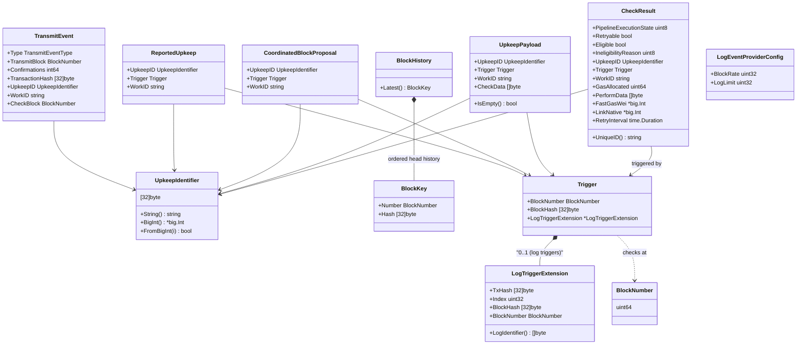
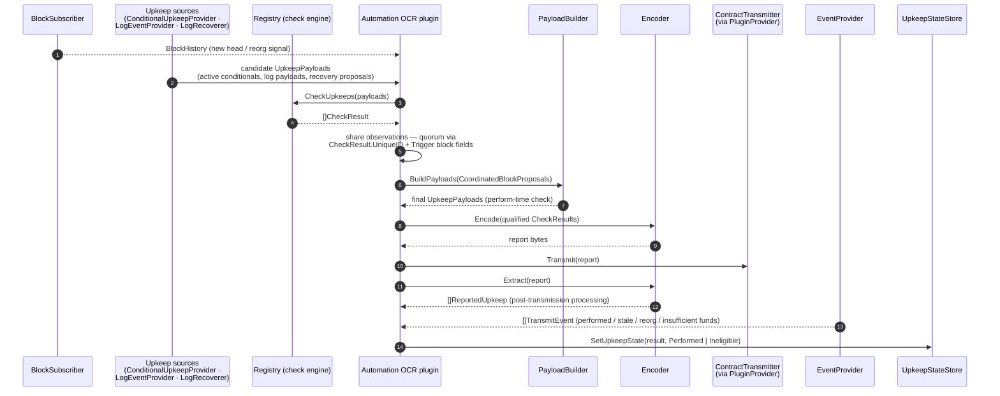
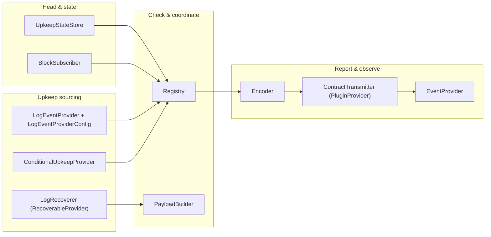
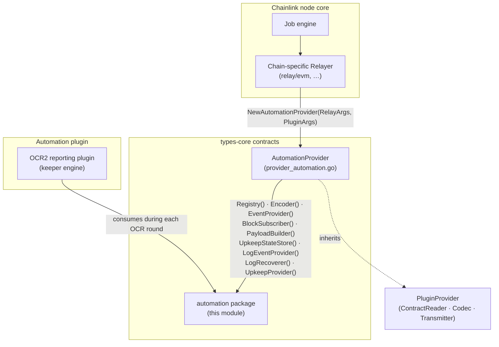

# Automation — Upkeep Domain Types & Contracts (`chainlink-common/pkg/types/automation`)

**Go module:** `github.com/smartcontractkit/chainlink-common` (Go 1.27.1, see [`chainlink-common/go.mod`](https://github.com/smartcontractkit/chainlink-common) at `chainlink-common/go.mod`)
**Package:** `github.com/smartcontractkit/chainlink-common/pkg/types/automation`
**Parent:** [types-core](../types-core.md)
**Siblings:** [types-core_relayer](types-core_relayer.md) · [types-core_providers](types-core_providers.md) · [types-core_chain-contracts](types-core_chain-contracts.md) · [types-core_plugin-services](types-core_plugin-services.md) · [types-core_keystore](types-core_keystore.md)

---

## 1. Overview

This module defines the **Automation (Keepers) domain model**: the shared vocabulary used by the node-side chain adapters and the Automation OCR2 reporting plugin to detect, check, coordinate, report, and settle **upkeeps** (registered on-chain jobs that are automatically executed when eligible).

It consists of three source files in one contract-only package:

| File | Contents |
|---|---|
| `basetypes.go` | Value types: identities (`UpkeepIdentifier`), block primitives (`BlockNumber`, `BlockKey`, `BlockHistory`), trigger payloads (`UpkeepPayload`), check results (`CheckResult`), coordination units (`CoordinatedBlockProposal`), report records (`ReportedUpkeep`), lifecycle records (`TransmitEvent`) and their enums |
| `trigger.go` | `Trigger` and `LogTriggerExtension` — the trigger abstraction (block-based and log-based) |
| `interfaces.go` | The service contracts a relayer hands to the Automation plugin: `Registry`, `Encoder`, `EventProvider`, `BlockSubscriber`, `PayloadBuilder`, `UpkeepStateStore`, `LogEventProvider`, `LogRecoverer`, `ConditionalUpkeepProvider` |

**Design principles**

1. **Contract-only** — pure interfaces and serializable value types; no business logic. Consumers and implementations are free to live anywhere (node core, chain-specific relayers, plugin binaries).
2. **Quorum-safe wire types** — `Trigger`, `LogTriggerExtension`, `BlockKey`, `CheckResult`, and `CoordinatedBlockProposal` are explicitly marked as **P2P observation types**: they cross the OCR peer network to reach quorum, so *any* change is a breaking protocol change requiring review and an upgrade plan. `CheckResult.UniqueID()` defines the canonical identity used for that quorum.
3. **Explicit trust boundaries** — `CoordinatedBlockProposal` documents exactly which fields are quorum-coordinated (trigger block number/hash) and which **must not be trusted** (everything else may be manipulated by a single malicious node).
4. **Small dependency surface** — the only external contract dependency is [`pkg/services`](../services.md) (lifecycle `Service`), keeping the package embeddable in node and plugin binaries alike.

The entry point that aggregates all of these contracts for a plugin is the **`AutomationProvider`** interface defined in `chainlink-common/pkg/types/provider_automation.go` and documented in [types-core_providers](types-core_providers.md).

---

## 2. Component inventory

### 2.1 Value & data types (`basetypes.go`, `trigger.go`)

| Component | Kind | Purpose |
|---|---|---|
| `UpkeepIdentifier` | `[32]byte` | Unique upkeep ID, mirrored as `uint256` on-chain; helpers `String()`, `BigInt()`, `FromBigInt()` (zeroes itself and returns `false` for negative or >32-byte values) |
| `BlockNumber` | `uint64` alias | Chain block height |
| `BlockKey` | struct | Block (number + hash); **P2P observation type** |
| `BlockHistory` | `[]BlockKey` | Ordered head history with `Latest()` (errors on empty) |
| `TransmitEventType` | enum | `PerformEvent`, `StaleReportEvent`, `ReorgReportEvent`, `InsufficientFundsReportEvent`, `UnknownEvent` |
| `TransmitEvent` | struct | Record of a transmission transaction: type, block, confirmations, tx hash, `UpkeepID`, `WorkID`, original `CheckBlock` |
| `UpkeepState` | enum | Final state of a unit of work: `Performed` or `Ineligible` (`UnknownState` default) |
| `Trigger` | struct | What triggered an upkeep check: block number + hash plus optional `*LogTriggerExtension`; **P2P observation type** |
| `LogTriggerExtension` | struct | Log-event identity: tx hash, log index, block hash/number; `LogIdentifier()` = blockHash‖txHash‖index; **P2P observation type** |
| `CheckResult` | struct | Outcome of checking an upkeep: execution state, retryability, eligibility, `UpkeepID`, `Trigger`, `WorkID`, `GasAllocated`, `PerformData`, `FastGasWei`, `LinkNative`, `RetryInterval`; **P2P observation type** |
| `checkResultMsg` | struct *(internal)* | JSON wire form of `CheckResult` (deliberately **excludes `RetryInterval`**) |
| `UpkeepPayload` | struct | Check input: `UpkeepID` + `Trigger` + `WorkID` + `CheckData`; `IsEmpty()` filters by empty `WorkID` |
| `CoordinatedBlockProposal` | struct | Unit of work performable after its check block reached quorum; **P2P observation type** with an explicit trust boundary (§5.5) |
| `ReportedUpkeep` | struct | Upkeep identity for a report that was generated (`UpkeepID` + `Trigger` + `WorkID`) |
| `LogEventProviderConfig` | struct | Tuning for log fetching: `BlockRate`, `LogLimit` |

Internal plumbing: `checkResultDelimiter = 0x09` (tab) and `checkResultStringTemplate` back `CheckResult.UniqueID()` and the debug-only `CheckResult.String()`.

### 2.2 Interfaces (`interfaces.go`)

| Interface | Extends | Purpose |
|---|---|---|
| `Registry` | — | The upkeep **check engine**: `CheckUpkeeps(ctx, ...UpkeepPayload) ([]CheckResult, error)` plus lifecycle (`Name`, `Start`, `Close`, `HealthReport`) |
| `ConditionalUpkeepProvider` | — | Supplies payloads for *condition-based* upkeeps: `GetActiveUpkeeps(ctx)` |
| `LogEventProvider` | — | Supplies payloads for *log-triggered* upkeeps: `GetLatestPayloads(ctx)`, `SetConfig(LogEventProviderConfig)` |
| `RecoverableProvider` | — | Supplies recovery proposals for upkeeps missed earlier: `GetRecoveryProposals(ctx)` |
| `LogRecoverer` | `RecoverableProvider` | Recovery service: also `GetProposalData(ctx, CoordinatedBlockProposal)` to fetch raw proposal data; own `Start`/`Close` |
| `PayloadBuilder` | — | Builds final check payloads for coordinated proposals: `BuildPayloads(ctx, ...CoordinatedBlockProposal)` |
| `Encoder` | — | Report codec: `Encode(...CheckResult)` → report bytes, `Extract(report)` → `[]ReportedUpkeep` |
| `EventProvider` | [`services.Service`](../services.md) | Head/event feed for transmissions: `GetLatestEvents(ctx)` → `[]TransmitEvent` |
| `BlockSubscriber` | — | Head tracking with fan-out: `Subscribe() (int, chan BlockHistory, error)` / `Unsubscribe(int)` |
| `UpkeepStateStore` | `UpkeepStateUpdater` + `UpkeepStateReader` | Local persistence of final upkeep state; own `Start`/`Close` |
| `UpkeepStateUpdater` | — | `SetUpkeepState(ctx, CheckResult, UpkeepState)` |
| `UpkeepStateReader` | — | `SelectByWorkIDs(ctx, workIDs...)` → `[]UpkeepState` |

---

## 3. Type architecture

### 3.1 Data types

### 3.2 Interfaces and their composition

```mermaid
classDiagram
    direction TB

    class servicesService["services.Service (pkg/services)"] {
        <<interface>>
        +Start(ctx) error
        +Close() error
        +HealthReport()
    }
    class UpkeepStateUpdater {
        <<interface>>
        +SetUpkeepState(ctx, CheckResult, UpkeepState) error
    }
    class UpkeepStateReader {
        <<interface>>
        +SelectByWorkIDs(ctx, ...workIDs) []UpkeepState
    }
    class UpkeepStateStore {
        <<interface>>
        +Start(ctx) error
        +Close() error
    }
    class RecoverableProvider {
        <<interface>>
        +GetRecoveryProposals(ctx) []UpkeepPayload
    }
    class LogRecoverer {
        <<interface>>
        +GetProposalData(ctx, CoordinatedBlockProposal) []byte
        +Start(ctx) error
        +Close() error
    }
    class Registry {
        <<interface>>
        +CheckUpkeeps(ctx, ...UpkeepPayload) []CheckResult
        +Name() string
        +Start(ctx) error
        +Close() error
        +HealthReport() map~string~error
    }
    class ConditionalUpkeepProvider {
        <<interface>>
        +GetActiveUpkeeps(ctx) []UpkeepPayload
    }
    class LogEventProvider {
        <<interface>>
        +GetLatestPayloads(ctx) []UpkeepPayload
        +SetConfig(LogEventProviderConfig)
    }
    class PayloadBuilder {
        <<interface>>
        +BuildPayloads(ctx, ...CoordinatedBlockProposal) []UpkeepPayload
    }
    class Encoder {
        <<interface>>
        +Encode(...CheckResult) []byte
        +Extract(report) []ReportedUpkeep
    }
    class EventProvider {
        <<interface>>
        +GetLatestEvents(ctx) []TransmitEvent
    }
    class BlockSubscriber {
        <<interface>>
        +Subscribe() tuple
        +Unsubscribe(id) error
    }

    UpkeepStateUpdater <|.. UpkeepStateStore : embeds
    UpkeepStateReader <|.. UpkeepStateStore : embeds
    RecoverableProvider <|.. LogRecoverer : embeds
    servicesService <|.. EventProvider : embeds
```

> **Lifecycle inconsistency (deliberate):** only `EventProvider` embeds the modern [`services.Service`](../services.md); `Registry`, `LogRecoverer`, `UpkeepStateStore`, and `BlockSubscriber` hand-roll their own `Start`/`Close`, and `Registry` additionally requires `HealthReport()`. Implementations should follow this per-interface shape exactly, since the Automation plugin consumes them as independent service components.

---

## 4. The upkeep lifecycle — how the pieces fit together

The Automation reporting plugin orchestrates one OCR round through these contracts. Everything below is reached via the [`AutomationProvider`](types-core_providers.md) facade that a chain-specific relayer constructs (see [node_application_relay](../../Node_Application_Core___Interfaces/node_application/node_application_relay.md)).

Stage-by-stage:

1. **Head tracking** — `BlockSubscriber` fans out `BlockHistory` channels to subscribers; history ordering supports reorg detection.
2. **Upkeep sourcing** — three independent sources produce candidate `UpkeepPayload`s:
   * `ConditionalUpkeepProvider.GetActiveUpkeeps` — condition-based upkeeps registered on-chain;
   * `LogEventProvider.GetLatestPayloads` — log-triggered upkeeps, tuned via `SetConfig(LogEventProviderConfig{BlockRate, LogLimit})`;
   * `LogRecoverer.GetRecoveryProposals` — proposals for upkeeps missed in earlier rounds, with `GetProposalData` to fetch the raw data attached to a `CoordinatedBlockProposal`.
3. **Checking** — `Registry.CheckUpkeeps` evaluates each payload against on-chain state and returns a `CheckResult` per payload (execution state, eligibility, `PerformData`, gas/gas-price inputs). The plugin may retry payloads where `Retryable` is set, honoring `RetryInterval` (internal only — see §5.3).
4. **Coordination** — nodes exchange observations; quorum is computed over `CheckResult.UniqueID()` (which incorporates the trigger block). The resulting `CoordinatedBlockProposal` marks a unit of work as performable *only once its check block is coordinated*.
5. **Final payloads** — `PayloadBuilder.BuildPayloads` turns coordinated proposals into the definitive `UpkeepPayload`s checked at perform time (may partially fail: payloads plus an error).
6. **Reporting & transmission** — `Encoder.Encode` serializes qualified `CheckResult`s into report bytes, transmitted through the OCR `ContractTransmitter` obtained from the generic [`PluginProvider`](types-core_chain-contracts.md); `Encoder.Extract` decodes a (peer) report back into `[]ReportedUpkeep`.
7. **Event reconciliation & state** — `EventProvider.GetLatestEvents` streams `TransmitEvent`s (`PerformEvent`, `StaleReportEvent`, `ReorgReportEvent`, `InsufficientFundsReportEvent`) used to reconcile on-chain outcomes, and the plugin persists final states through `UpkeepStateStore` (`Performed` / `Ineligible`), queried back via `SelectByWorkIDs` for deduplication.

---

## 5. Component details

### 5.1 Identity & block primitives

* **`UpkeepIdentifier`** — a fixed `[32]byte` matching the on-chain `uint256` upkeep ID. `BigInt()` interprets it big-endian; `FromBigInt` performs the inverse with defensive semantics: it zeroes the identifier first and returns `false` (leaving zeros in place) if the input is negative or exceeds 32 bytes.
* **`BlockNumber` / `BlockKey` / `BlockHistory`** — minimal head vocabulary. `BlockKey` is a P2P observation type (validated for quorum), so its shape must stay backward-compatible. `BlockHistory.Latest()` returns element 0 and errors on an empty history.

### 5.2 Triggers

`Trigger` couples the block at which an upkeep was checked (`BlockNumber` + `BlockHash`) with an optional `LogTriggerExtension` for log-based triggers:

* `NewTrigger(blockNumber, blockHash)` — plain/conditional triggers; `NewLogTrigger` adds the extension.
* `LogTriggerExtension.LogIdentifier()` composes `blockHash ‖ txHash ‖ bigEndian(logIndex)` — the canonical identity of a log event.
* The extension's `BlockNumber` **may be zero/empty**; consumers must treat it as optional and derive the block from `BlockHash` when absent.

Both types are P2P observation types: fields are encoded into `CheckResult.UniqueID()`, so reordering, renaming, or re-typing them changes quorum behavior across the network.

### 5.3 `CheckResult` — quorum encoding

`CheckResult` is the central observation type. Its wire-identity rules:

* **`UniqueID()`** deterministically concatenates all quorum-relevant fields using tab (`0x09`) delimiters and `fmt` `%+v` formatting for booleans and the log-trigger extension, then hex-encodes the result. Any code change to this function or to participating types is a network-visible protocol change.
* **JSON marshaling** goes through the internal `checkResultMsg` mirror struct, which deliberately **omits `RetryInterval`** — retry timing is node-internal and must never influence observations.
* `String()` is explicitly debug-only; report encoding must go through the `Encoder` interface.
* Semantics of key fields: `PipelineExecutionState != 0` marks failure (`Retryable` says whether the same payload can be reprocessed); on success, `Eligible`/`IneligibilityReason` gate inclusion in a report, and `GasAllocated`, `PerformData`, `FastGasWei`, `LinkNative` feed the perform transaction.

### 5.4 Transmit events & upkeep state

`TransmitEvent` + `TransmitEventType` let the plugin reconcile its reports with what actually landed on-chain (performs, stale reports, reorged reports, insufficient-funds reports). Final outcomes are stored as `UpkeepState` (`Performed` / `Ineligible`) via `UpkeepStateStore`, which composes the updater/reader sub-interfaces and is itself a startable/closable component. The store is the local dedupe and audit layer; it is distinct from the on-chain Automation Registry contract, which this package deliberately does not model.

### 5.5 Work units and the trust boundary

Three structs carry "a unit of work" through the pipeline, distinguished by stage and trustworthiness:

| Type | Stage | Trust model |
|---|---|---|
| `UpkeepPayload` | Check input (before coordination) | Node-local; `IsEmpty()` filters zero payloads |
| `CoordinatedBlockProposal` | Between quorum and final check | **Only `Trigger.BlockNumber`/`Trigger.BlockHash` are quorum-coordinated**; `WorkID` is deterministic; every other field *should not be trusted* (a single malicious node can fabricate them) |
| `ReportedUpkeep` | After report generation/decoding | Derived from encoded reports via `Encoder.Extract` |

This asymmetry is why `PayloadBuilder.BuildPayloads` re-derives payloads from proposals instead of trusting proposal fields.

### 5.6 The relayer-facing interface set

The ten interfaces group into five responsibilities, each implemented by the chain-specific relayer and consumed by the Automation plugin:

* **Sourcing** — conditionals, logs, and recovery (§4 step 2).
* **Check & coordinate** — `Registry` runs the actual on-chain simulations; `PayloadBuilder` finalizes payloads for coordinated proposals.
* **Report & observe** — `Encoder` is the only report codec; `EventProvider` (the sole [`services.Service`](../services.md)-shaped interface here) streams transmission outcomes; on-chain transmission itself reuses the OCR transmitter from the shared [`PluginProvider`](types-core_chain-contracts.md) rather than defining a new one.
* **Head & state** — `BlockSubscriber` drives round cadence and reorg awareness; `UpkeepStateStore` persists final states.

---

## 6. Position in the system

* **Producer** — a chain-specific **Relayer** builds an `AutomationProvider` via `NewAutomationProvider(ctx, RelayArgs, PluginArgs)` (factory defined on [`types.Relayer`](types-core_relayer.md); argument types in [types-core_plugin-services](types-core_plugin-services.md)). Concrete adapters live in the node's relay layer — see [node_application_relay](../../Node_Application_Core___Interfaces/node_application/node_application_relay.md).
* **Consumer** — the Automation OCR2 reporting plugin consumes the aggregated interfaces each round; the OCR engine context (rounds, quorum, transmission) is described in [ocr](../../Oracle_Engines___Data_Pipelines/ocr.md).
* **Cross-process note** — the Automation plugin typically runs in-process, but these contracts are dependency-light precisely so the same gRPC provider-serialization machinery used for other products (see [loop-relayer-services](../../Plugin_Process_Framework_(Loop)/loop-relayer-services.md)) can proxy them when plugins run as LOOP subprocesses.
* **Testing** — the value types are covered by `chainlink-common/pkg/types/automation/basetypes_test.go` (encoding, identity, and conversion round-trips); relayers providing these interfaces should supply conformant implementations following the patterns in the [types-core interface-test harness](types-core_chain-contracts.md).

## 7. Implementation & compatibility notes

| # | Note |
|---|---|
| 1 | **P2P observation types** (`Trigger`, `LogTriggerExtension`, `BlockKey`, `CheckResult`, `CoordinatedBlockProposal`) must remain backward-compatible; changes require review plus an upgrade plan because nodes reach quorum over their encodings. |
| 2 | `CheckResult.RetryInterval` is intentionally excluded from JSON; encode it nowhere except internal scheduling. |
| 3 | `CheckResult.UniqueID()` output changes with *any* edit to its field list, ordering, delimiters (`0x09`), or formatting (`%+v`) — treat it as protocol. |
| 4 | `CoordinatedBlockProposal` fields beyond the coordinated trigger block are untrusted; never act on them without re-deriving through `PayloadBuilder`. |
| 5 | `UpkeepIdentifier.FromBigInt` zeroes the receiver on invalid input (negative or >32 bytes) and returns `false`; the zero-value identifier means "unset". |
| 6 | `LogTriggerExtension.BlockNumber` is optional (may be zero); derive from `BlockHash` when required. |
| 7 | `LogEventProviderConfig` (`BlockRate`, `LogLimit`) is applied via `SetConfig` and may be updated at runtime; providers must apply it without restart. |
| 8 | `BlockHistory.Latest()` errors on empty history — callers must handle the error rather than reading the zero-value `BlockKey`. |
| 9 | Interfaces embed different lifecycle contracts (§3.2); match each interface's exact shape (`services.Service` vs. hand-rolled `Start`/`Close`) when implementing providers. |
| 10 | The module manifest is `chainlink-common/go.mod`; this package introduces no dependencies beyond the Go standard library and `pkg/services`, keeping it usable from node and plugin binaries alike. |

---

**Related documentation:** [types-core](../types-core.md) · [types-core_providers](types-core_providers.md) (the `AutomationProvider` facade) · [types-core_relayer](types-core_relayer.md) (factory ownership) · [types-core_chain-contracts](types-core_chain-contracts.md) (ContractReader/Codec used during checks) · [types-core_plugin-services](types-core_plugin-services.md) (`RelayArgs`/`PluginArgs`) · [services](../services.md) (lifecycle contract)
