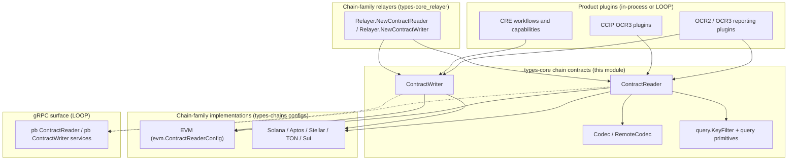
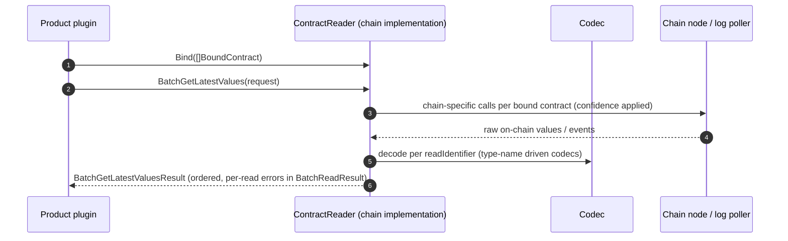
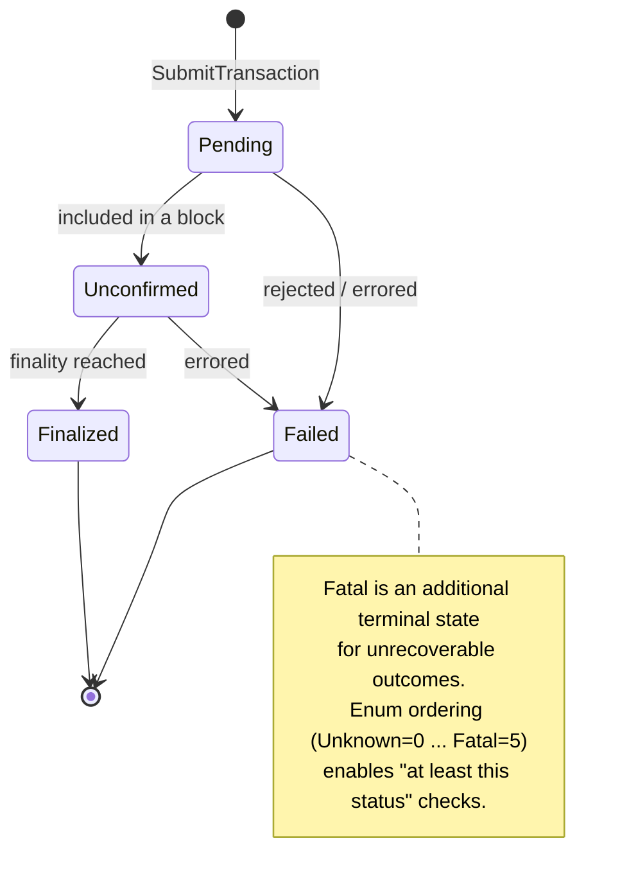
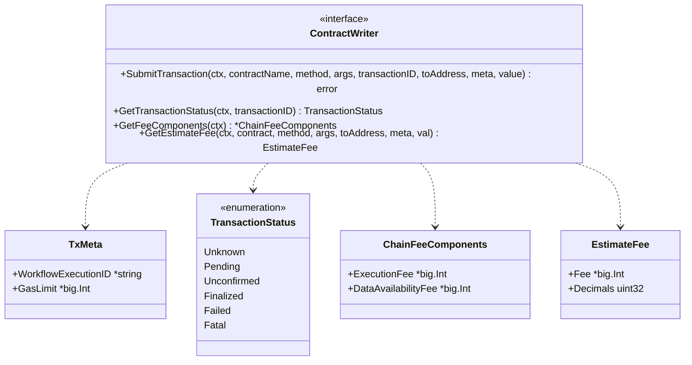
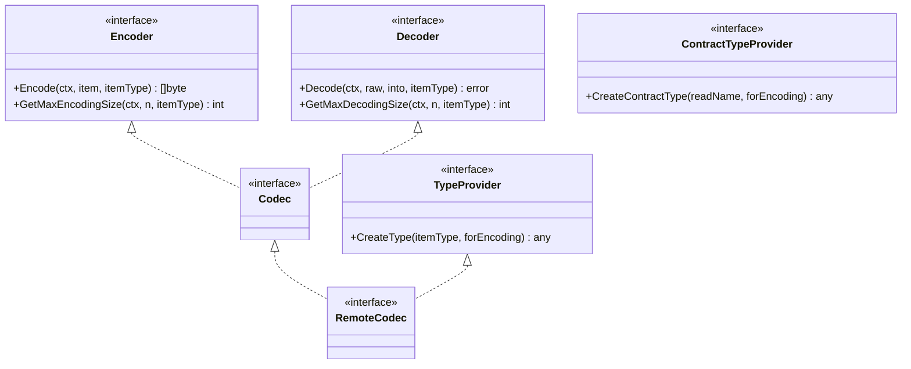
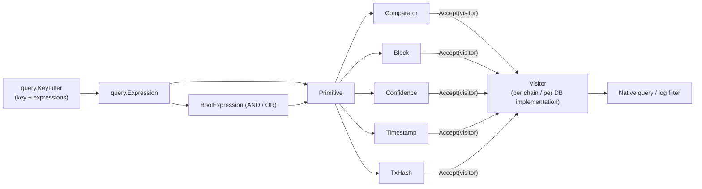
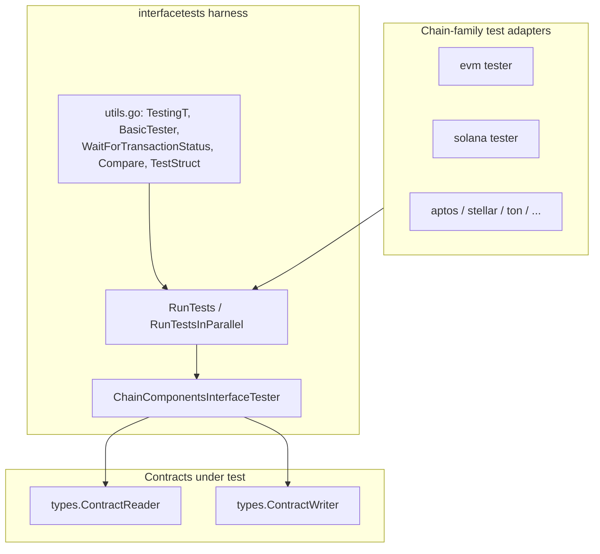
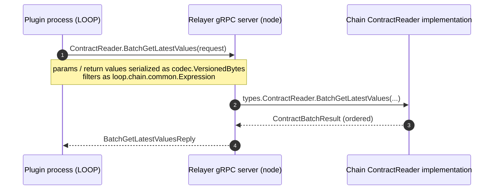

# types-core / Chain Contracts (`types-core_chain-contracts`)

> **Module location:** `chainlink-common/pkg/types` (Go module `github.com/smartcontractkit/chainlink-common`, see `chainlink-common/go.mod`)
> **Files:** `contract_reader.go`, `contract_writer.go`, `codec.go`, `query/primitives/primitives.go`, `interfacetests/utils.go`

## 1. Introduction

The **chain-contracts** module defines the *chain-agnostic contract interaction surface* of the Chainlink stack: a small, stable set of Go interfaces and value types that let any product plugin — OCR reporting plugins, CCIP, CRE workflows, automation — read contract state, emit events, submit transactions, and filter on-chain data **without importing chain-specific code**.

It provides four groups of contracts:

| Group | Files | Purpose |
|---|---|---|
| **Reading** | `contract_reader.go` | `ContractReader` service: point reads, batched reads, event queries, contract bindings, plus the `BatchRead` / `BatchReadResult` / `Sequence` / `BoundContract` / `Head` value types |
| **Writing** | `contract_writer.go` | `ContractWriter` service: transaction submission, status tracking, fee estimation, plus `TxMeta`, `TransactionStatus`, `ChainFeeComponents`, `EstimateFee` |
| **Encoding** | `codec.go` | `Encoder` / `Decoder` / `Codec` / `RemoteCodec` / `TypeProvider` / `ContractTypeProvider` — type-name driven binary (de)serialization of params and return values |
| **Querying & Testing** | `query/primitives/primitives.go`, `interfacetests/utils.go` | Visitor-based query primitives (`Comparator`, `Block`, `Confidence`, `Timestamp`, `TxHash`) and the generic interface-test harness (`TestingT`, `RunTests`) |

Everything here is *contract-first by design*: the interfaces are the only thing products and chain families share, and a shared test suite (the "interface tests") enforces behavioral parity across every chain implementation.

## 2. Position in the System

This module is a sub-module of [types-core](../types-core.md) within [Shared_Foundation_Libraries___Domain_Types](../../Shared_Foundation_Libraries___Domain_Types.md). It relates to its siblings as follows:

- **[types-core_relayer](types-core_relayer.md)** — The `Relayer` interface is the *factory* for contract components: `NewContractReader(ctx, contractReaderConfig []byte)` and `NewContractWriter(ctx, config []byte)` return the interfaces defined here. The config bytes are interpreted by each chain family.
- **[types-core_providers](types-core_providers.md)** — `PluginProvider` exposes `ContractReader()` and `Codec()` to OCR plugins; the provider files also define the gRPC-mappable error types (`InvalidArgumentError`, `UnimplementedError`, …) reused by the sentinels in this module.
- **[types-chains](../types-chains.md)** — Chain-*specific* configuration and client types (e.g. `evm.ContractReaderConfig`, `ChainReaderDefinition`, Solana/Sui/Aptos reader & writer configs) that drive concrete implementations of the interfaces defined here.
- **[codec](../codec.md)** — The generic codec engine (`TypeCodec`, `Builder`, `CodecFromTypeCodec`, modifiers) that implements the `Codec` interface contract from `codec.go`.
- **[services](../services.md)** — `services.Service` (Start/Close/Ready/Name/HealthReport) which both `ContractReader` and `ContractWriter` embed.

### Consumers across the platform

- **OCR / OCR3 reporting plugins** obtain a `ContractReader` and `Codec` via `PluginProvider` — see [Oracle_Engines___Data_Pipelines](../../Oracle_Engines___Data_Pipelines.md) and [ocr2_delegate](../../Oracle_Engines___Data_Pipelines/ocr/ocr2_delegate.md).
- **CCIP OCR3 plugins** use chain-specific contract readers/writers built on these interfaces — see [CCIP_Cross-Chain_Protocol](../../CCIP_Cross-Chain_Protocol.md) and [types-ccip_ocr3_plugin_types](../../CCIP_Cross-Chain_Protocol/types-ccip/types-ccip_ocr3_plugin_types.md).
- **CRE workflows** consume writers for on-chain writes with Keystone metering metadata (`TxMeta.WorkflowExecutionID`) — see [Workflow___Capability_Runtime_(CRE_Engine)](../../Workflow___Capability_Runtime_(CRE_Engine).md) and [metering-and-billing](../metering-and-billing.md).
- **LOOP plugin processes** reach these interfaces across process boundaries via the generated gRPC services — see [loop-grpc-bindings](../../Plugin_Process_Framework_(Loop)/loop-grpc-bindings.md) and [loop-plugin-core](../../Plugin_Process_Framework_(Loop)/loop-plugin-core.md).

## 3. Architecture



Two instantiation paths exist:

1. **In-process:** a node-side relayer builds the concrete reader/writer from chain-family config and hands it to the plugin directly.
2. **Cross-process (LOOP):** the plugin talks to a gRPC *server-side adapter* (`ProviderServer`) that forwards to the in-process implementation; params and return values travel as `codec.VersionedBytes`. The proto surface mirrors the Go interfaces one-to-one.

Both paths are invisible to product code — it only depends on the interfaces in this module.

## 4. ContractReader (`contract_reader.go`)

`ContractReader` is a `services.Service` (lifecycle + `HealthReport`, see [services](../services.md)) that defines the essential read operations every chain must implement:

```go
type ContractReader interface {
    services.Service
    GetLatestValue(ctx, readIdentifier string, confidenceLevel primitives.ConfidenceLevel, params, returnVal any) error
    GetLatestValueWithHeadData(...) (*Head, error)
    BatchGetLatestValues(ctx, request BatchGetLatestValuesRequest) (BatchGetLatestValuesResult, error)
    Bind(ctx, bindings []BoundContract) error        // idempotent; noop for existing bindings
    Unbind(ctx, bindings []BoundContract) error
    QueryKey(ctx, contract BoundContract, filter query.KeyFilter, limitAndSort query.LimitAndSort, sequenceDataType any) ([]Sequence, error)
    QueryKeys(ctx, filters []ContractKeyFilter, limitAndSort query.LimitAndSort) (iter.Seq2[string, Sequence], error)
    HealthReport() map[string]error
    mustEmbedUnimplementedContractReader()           // forward-compatibility guard
}
```

Key semantics:

- **Read identifiers.** A read is addressed by `readIdentifier`, composed from a binding via `BoundContract.ReadIdentifier(readName)` = `"<address>-<contractName>-<readName>"`. Read names are *generic* names mapped to chain-specific methods/events by configuration (e.g. EVM `ChainReaderDefinition` in [types-chains](../types-chains.md)).
- **Confidence levels.** Reads take a `primitives.ConfidenceLevel` (`Finalized`, `Safe`, `Unconfirmed`) that maps to each chain's finality semantics. `HealthReport` must report `ErrFinalityViolation` on finality violations.
- **Encoding.** `params` must marshal with `json.Marshal` / `fxamacker/cbor` (the dependency is declared in `chainlink-common/go.mod`); implementations must ignore unexpected extra fields, and unset fields of `returnVal` remain unset — this keeps the same call sites portable across chains and contract versions.
- **values.Value support.** Passing a `*values.Value` as `returnVal` makes the implementation encode results as a `values.Value` (see [values](../values.md)); the gRPC surface exposes the same behavior via the `as_value_type` flag.

### Core value types

| Type | Description |
|---|---|
| `BoundContract{Address, Name}` | A named binding of a contract address; input to Bind/Unbind and read calls. |
| `BatchGetLatestValuesRequest` | `map[BoundContract]ContractBatch`, where `ContractBatch = []BatchRead{ReadName, Params, ReturnVal}`. |
| `BatchGetLatestValuesResult` | `map[BoundContract]ContractBatchResults`; **order is preserved** from the request. Per-read failures are carried in `BatchReadResult` (`GetResult()` returns `(any, error)`; `SetResult` is used by implementations/adapters). |
| `Sequence` | A chain-agnostic event record: `Cursor` (opaque pagination token), `TxHash`, embedded `Head` (Height/Hash/Timestamp), and typed `Data`. |
| `Head` | `Height string`, `Hash []byte`, `Timestamp uint64` (Unix). |
| `ContractKeyFilter` | `query.KeyFilter` + `BoundContract` + `SequenceDataType` — used by `QueryKeys` to fetch several event types in one call. |
| `UnimplementedContractReader` | Embeddable stub returning `UnimplementedError` for every method, so interface additions don't break downstream implementations (also satisfies the `mustEmbed…` guard). |

### Read data flow



## 5. ContractWriter (`contract_writer.go`)

`ContractWriter` is also a `services.Service` and abstracts transaction submission and tracking:

```go
type ContractWriter interface {
    services.Service
    SubmitTransaction(ctx, contractName, method string, args any, transactionID IdempotencyKey, toAddress string, meta *TxMeta, value *big.Int) error
    GetTransactionStatus(ctx, transactionID IdempotencyKey) (TransactionStatus, error)
    GetFeeComponents(ctx) (*ChainFeeComponents, error)
    GetEstimateFee(ctx, contract, method string, args any, toAddress string, meta *TxMeta, val *big.Int) (EstimateFee, error)
}
```

- **`IdempotencyKey`** (a `string`) is generated by the caller; the underlying TXM uses it to prevent double-sends and to track attempts.
- **`TxMeta`** carries optional metadata: `WorkflowExecutionID *string` (used by Keystone/CRE metering — see [metering-and-billing](../metering-and-billing.md)) and `GasLimit *big.Int`. If an implementation cannot honor a per-transaction gas limit it must return `ErrSettingTransactionGasLimitNotSupported` (`InvalidArgumentError`).
- **`TransactionStatus`** is an ordered enum every TXM must support — the ordering is meaningful: the interface-test helper `WaitForTransactionStatus` (see §8) waits until `current >= target`.
- **`ChainFeeComponents`** splits costs into `ExecutionFee` and `DataAvailabilityFee` (L1 data-posting cost on L2s); **`EstimateFee`** returns the total cost (`Fee *big.Int`, `Decimals uint32`) including the transferred `val`.

### Transaction lifecycle





## 6. Codec & Type Providers (`codec.go`)

Because a `ContractReader`/`ContractWriter` may return arbitrary on-chain types, all encoding instructions are **keyed by a type name** (`itemType`). For readers, the top-level `itemType` is the `readIdentifier`.

```go
type Encoder interface {
    Encode(ctx, item any, itemType string) ([]byte, error)
    GetMaxEncodingSize(ctx, n int, itemType string) (int, error)   // worst-case size for n dynamic elements
}
type Decoder interface {
    Decode(ctx, raw []byte, into any, itemType string) error
    GetMaxDecodingSize(ctx, n int, itemType string) (int, error)
}
type Codec interface { Encoder; Decoder }
type TypeProvider interface { CreateType(itemType string, forEncoding bool) (any, error) }
type ContractTypeProvider interface { CreateContractType(readName string, forEncoding bool) (any, error) }
type RemoteCodec interface { Codec; TypeProvider }   // usable across the gRPC boundary
```

`CreateType`/`CreateContractType` let a caller that does not know a type at compile time (typically across a gRPC hop) instantiate the correct Go type via reflection before decoding into it. The concrete composition machinery (`TypeCodec`, `Builder`, struct codecs, EVM ABI builder, modifiers) lives in the [codec](../codec.md) module; `RemoteCodec` is what the LOOP adapters expose as `pb/codec` services.



## 7. Query Primitives (`query/primitives/primitives.go`)

Event querying (`QueryKey`/`QueryKeys`) uses a small, ORM-like DSL built on a **visitor pattern** so each chain (and each backing store) can translate primitives into native queries (SQL predicates, log filters, etc.):

```go
// Visitor gets a per-chain/per-DB implementation converting primitives to queries.
type Visitor interface {
    Comparator(primitive Comparator)
    Block(primitive Block)
    Confidence(primitive Confidence)
    Timestamp(primitive Timestamp)
    TxHash(primitive TxHash)
}

type Primitive interface{ Accept(visitor Visitor) }
```

| Primitive | Fields | Meaning |
|---|---|---|
| `Comparator` | `Name string`, `ValueComparators []ValueComparator{Value any, Operator}` | Filter over **key data values** (e.g. `transferValue >= 150 AND <= 300`). |
| `Block` | `Block string`, `Operator` | Compare against block numbers. |
| `Confidence` | `ConfidenceLevel` | Restrict results to a finality level (`Finalized` / `Safe` / `Unconfirmed`); `ConfidenceLevelFromString` parses the string form. |
| `Timestamp` | `Timestamp uint64`, `Operator` | Compare against Unix timestamps. |
| `TxHash` | `TxHash string` | Restrict results to a transaction. |

`ComparisonOperator` defines `Eq, Neq, Gt, Lt, Gte, Lte` (with `String()` rendering `==, !=, >, <, >=, <=`), and `AnyOperator` (via the generic `Any[T]` helper) models SQL's `ANY(array)` to replace long `OR` chains.

### Composition with the `query` package

The `chainlink-common/pkg/types/query` package composes these primitives into `KeyFilter`s and pagination:

- `query.Where(key, exprs...)` builds a `KeyFilter` whose top-level expressions are **AND**-combined; nested `query.And`/`query.Or` build boolean trees (validated to have ≥ 2 sub-expressions; recursion guarded by `MAX_EXPRESSION_DEPTH = 32`).
- Constructor helpers map 1:1 to the primitives: `query.Comparator`, `query.Block`, `query.Confidence`, `query.Timestamp`, `query.TxHash`.
- Ready-made filters (`key_filter.go`) such as `IndexedSequencesKeyFilter`, `SequencesByBlockRangeKeyFilter`, `SequencesCreatedAfterKeyFilter`, and `IndexedSequencesByTxHashKeyFilter` cover the common event-polling shapes.
- `LimitAndSort` (`CountLimit` / `CursorLimit`, sorting by `SortByTimestamp` / `SortByBlock` / `SortBySequence`) provides cursor-based pagination; `SerializeExpressions` / `DeserializeExpressions` JSON-encode comparator values so filters survive the gRPC hop.



## 8. Interface Testing Utilities (`interfacetests/utils.go`)

Because every chain family must implement the reader/writer contracts *identically*, the `types/interfacetests` package ships a reusable harness. Per `chainlink-common/pkg/types/interfacetests/README.md`, these are called **interface tests** (the term "contract testing" is reserved for smart-contract tests in this codebase).

This module contributes the generic core:

- **`TestingT[T]`** — a generic test-driver interface (`Failed`, `Run(name, f)`, `Parallel`, `Context`) extending `tests.TestingT`, so the same test bodies run against `*testing.T` and custom runners.
- **`BasicTester[T]`** — chain-adapter callbacks: `Setup`, `Name`, `GetAccountBytes/GetAccountString` (chain-native account encodings), and test selection (`IsDisabled` / `DisableTests` backed by `TestSelectionSupport`).
- **`RunTests` / `RunTestsInParallel`** — execute `[]Testcase[T]` honoring the disabled-test registry (parallel mode assumes tester setup happened upfront to avoid races).
- **Comparison & waiting helpers** — `Compare[T cmp.Ordered]` applies a `primitives.ComparisonOperator` to ordered values; `WaitForTransactionStatus` polls `ContractWriter.GetTransactionStatus` (15-minute budget, 1-second ticker) and fails on `Failed`/`Fatal`, relying on the enum ordering (`current >= status`).
- **Shared fixtures** — `TestStruct` and its static/dynamic nested variants exercise every encoding corner (slices, `*big.Int`, accounts, nested static/dynamic structs); `CreateTestStruct` builds them from chain-provided accounts.

The same package's `ChainComponentsInterfaceTester` (with `GetContractReader`, `GetContractWriter`, `GetBindings`, `DirtyContracts`, `GenerateBlocksTillConfidenceLevel`) plus `RunContractReaderInterfaceTests` define the full behavioral suite — `GetLatestValue` (values, primitives, slices, head data, confidence levels, filtering, mapstructure modifiers), `BatchGetLatestValues` (ordering, error propagation), and `QueryKey`/`QueryKeys` (filtering, cursor limits). Chain families wire this suite into their own test files; the harness is also reused by generated mocks for fast, chain-independent runs.



## 9. Wire Contract (gRPC / LOOP)

When products run in a separate plugin process, the interfaces are served over gRPC with one-to-one proto mirrors (see [loop-grpc-bindings](../../Plugin_Process_Framework_(Loop)/loop-grpc-bindings.md)):

- `chainlink-common/pkg/loop/internal/pb/contract_reader.proto` — `service ContractReader` with `GetLatestValue`, `GetLatestValueWithHeadData`, `BatchGetLatestValues`, `QueryKey`, `QueryKeys`, `Bind`, `Unbind`; messages `BatchRead`, `ContractBatchResult`, `Head`, `Sequence`, `SequenceWithKey`, `BoundContract`, `QueryKeyFilter` (carrying `loop.chain.common.Expression`).
- `chainlink-common/pkg/loop/internal/pb/contract_writer.proto` — `service ContractWriter` with `SubmitTransaction`, `GetTransactionStatus` (reusing `loop.evm` messages), `GetFeeComponents`, `GetEstimateFee`; `TransactionMeta` mirrors `TxMeta`.
- Payloads travel as `codec.VersionedBytes` (version + data, from `chainlink-common/pkg/internal/codec/codec.proto`); the `as_value_type` flag switches decoding to `values.Value`.



The `RemoteCodec` interface (§6) is the corresponding contract for the remote codec server, enabling `CreateType`-based decoding on the plugin side.

## 10. Error Conventions

All sentinel errors in this module are built on the provider error types from [types-core_providers](types-core_providers.md) (`InvalidArgumentError`, `UnimplementedError`, `InternalError`, `NotFoundError`), which implement `error`, `GRPCStatus()`, and `Is()` — so `errors.Is` works both in-process and across gRPC (status codes map to `codes.InvalidArgument`, `codes.Unimplemented`, `codes.Internal`, `codes.NotFound`).

| Sentinel | Category | Raised when |
|---|---|---|
| `ErrInvalidType` | reader/codec | A value or type cannot be handled (also returned by codec size calculators for unknown/nested-dynamic types). |
| `ErrInvalidConfig` | reader | Configuration for a read is invalid. |
| `ErrContractReaderConfigMissing` | reader | `RelayConfig` lacks the `ContractReader` entry. |
| `ErrNotFound` | reader | The requested value/event does not exist (e.g. event never triggered). |
| `ErrInternal` | reader | Internal error. |
| `ErrFinalityViolated` | reader | Finality violation; must surface via `HealthReport`. |
| `ErrSettingTransactionGasLimitNotSupported` | writer | Per-transaction `TxMeta.GasLimit` unsupported by the chain's TXM. |
| `ErrFieldNotFound`, `ErrInvalidEncoding`, `ErrSliceWrongLen`, `ErrNotASlice` | codec | Structural decode/encode failures. |

## 11. Extending: Adding a Chain Family

1. **Define configuration** for your family under `pkg/types/<family>` (reader/writer configs, e.g. `evm.ContractReaderConfig`, `ChainReaderDefinition`) — see [types-chains](../types-chains.md).
2. **Implement `ContractReader` and `ContractWriter`**, embedding `UnimplementedContractReader` so future interface changes don't break compilation, and honoring the sentinel-error conventions (§10).
3. **Implement the `primitives.Visitor`** for your chain/store so `KeyFilter` expressions become native queries (§7).
4. **Wire the factory** into your `Relayer` (`NewContractReader` / `NewContractWriter`) — see [types-core_relayer](types-core_relayer.md).
5. **Run the interface tests**: implement `ChainComponentsInterfaceTester` (plus `BasicTester` account callbacks) and invoke `RunContractReaderInterfaceTests`; disable genuinely unsupported cases via `DisableTests`. Reuse `SubmitTransactionToCW` / `WaitForTransactionStatus` for writer parity.
6. **Regenerate mocks** — `ContractReader` mocks live in `pkg/types/mocks` and are generated by mockery (config in `chainlink-common/.mockery.yaml`, e.g. the `github.com/smartcontractkit/chainlink-common/pkg/types` → `ContractReader` entry); run via the `mockery` target of `chainlink-common/Makefile`. Proto/gRPC stubs are regenerated with the `generate` / `cre-protoc` targets of the same Makefile.

## 12. Related Documentation

- [types-core](../types-core.md) — parent: all shared domain types.
- [types-core_relayer](types-core_relayer.md) — `Relayer` / chain services; factory for readers & writers.
- [types-core_providers](types-core_providers.md) — `PluginProvider` and shared error types.
- [types-chains](../types-chains.md) — chain-specific reader/writer configs and client types.
- [codec](../codec.md) — codec engine implementing the `Codec` contract.
- [services](../services.md) — `services.Service` lifecycle contract embedded by both interfaces.
- [values](../values.md) — `values.Value` dynamic value encoding.
- [loop-grpc-bindings](../../Plugin_Process_Framework_(Loop)/loop-grpc-bindings.md) — gRPC mirrors of these interfaces.
- [Shared_Foundation_Libraries___Domain_Types](../../Shared_Foundation_Libraries___Domain_Types.md) — top-level module map.
