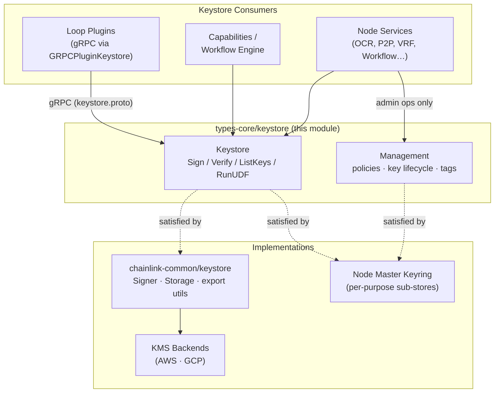
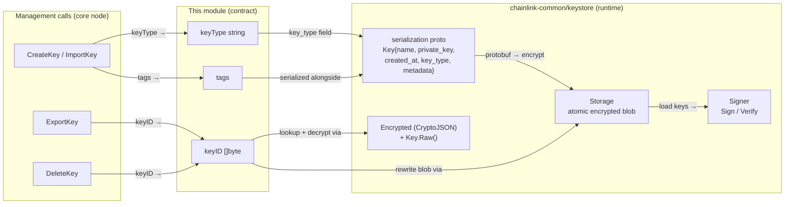
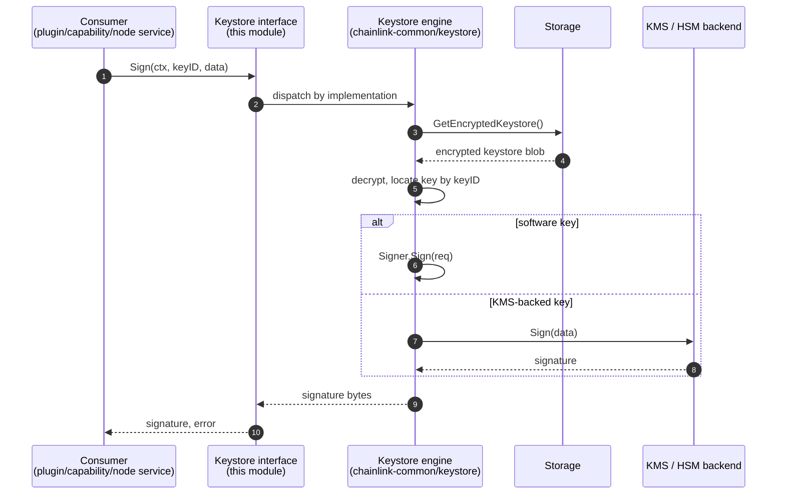
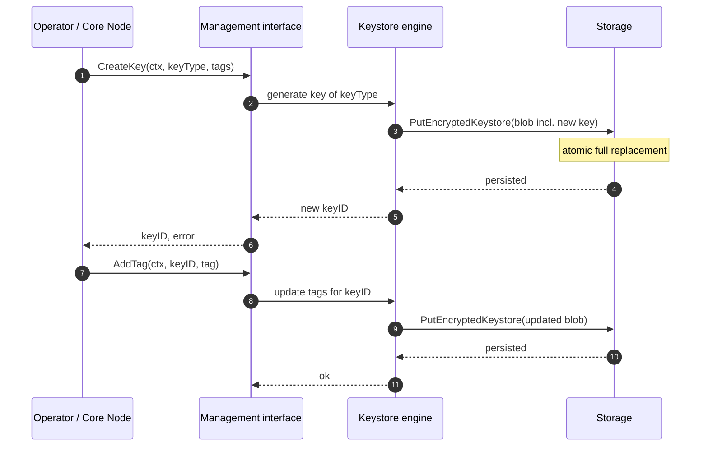
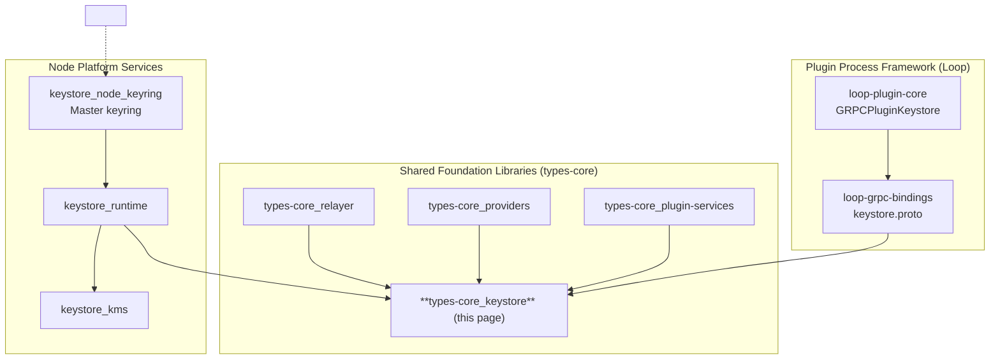

# types-core / Keystore

The `keystore` sub-module of [`types-core`](../types-core.md) defines the **chain-agnostic key management contracts** shared across the Chainlink stack. It lives in `chainlink-common/pkg/types/keystore/types.go` and declares two complementary Go interfaces:

- **`Keystore`** — the consumer-facing surface for signing, verification and key discovery, exposed to plugins, capabilities and other keystore consumers.
- **`Management`** — a **core-node-exclusive** administrative surface for key lifecycle (create/import/export/delete), access policies, and tag management.

These interfaces are deliberately minimal and operate on opaque `[]byte` key identifiers and payloads, allowing any key type (secp256k1, ed25519, StarkNet, etc.) and any backing implementation (encrypted DB blob, AWS/GCP KMS) to satisfy the contract. The concrete runtime implementation is provided by the separate Go module `chainlink-common/keystore` (see [Node_Platform_Services / keystore / keystore_runtime](../../Node_Platform_Services/keystore/keystore_runtime.md)), and the node's composite keyring is documented in [Node_Platform_Services / keystore / keystore_node_keyring](../../Node_Platform_Services/keystore/keystore_node_keyring.md).

---

## Module Purpose

| Concern | How it is addressed |
|---|---|
| **Contract-first design** | Interfaces are defined *before* implementations, decoupling consumers from any particular key store technology. |
| **Consumer/producer separation** | `Keystore` is safe to hand to untrusted code (plugins, WASM workflows); `Management` is reserved for the core node process. |
| **Chain agnosticism** | All key material is `[]byte`; key types are identified by strings (`keyType`) and organized by tags, so no chain-specific types leak into the contract. |
| **Extensibility without breaking changes** | `RunUDF` lets callers execute user-defined functions against key material without widening the interface for every new use case. |

---

## Component Reference

### `Keystore` (consumer interface)

Exposed to keystore consumers (plugins, capabilities, relayer code).

| Method | Signature (simplified) | Description |
|---|---|---|
| `Sign` | `(ctx, keyID []byte, data []byte) ([]byte, error)` | Signs a single payload with the key identified by `keyID`. |
| `SignBatch` | `(ctx, keyID []byte, data [][]byte) ([][]byte, error)` | Signs multiple payloads in one call. |
| `Verify` | `(ctx, keyID []byte, data []byte) (bool, error)` | Verifies a signed payload against the given key. |
| `VerifyBatch` | `(ctx, keyID []byte, data [][]byte) ([]bool, error)` | Verifies multiple payloads, returning a result per item. |
| `ListKeys` | `(ctx, tags []string) ([][]byte, error)` | Returns key IDs filtered by tags. |
| `RunUDF` | `(ctx, name string, keyID []byte, data []byte) ([]byte, error)` | Executes a user-defined function on the keystore. Per the source documentation, this provides future extensibility — implementers must ensure UDFs are safe and do not compromise keystore security or data integrity. |

> **Security note (from source):** `RunUDF` is an intentional extensibility escape hatch. Implementations should treat UDF names as an allow-listed operation registry and validate inputs before touching key material.

### `Management` (core node exclusive)

Administrative interface implemented only by the node's keyring layer; it is *not* projected into plugin runtimes.

| Group | Methods | Description |
|---|---|---|
| **Policies** | `AddPolicy(ctx, policy []byte) (string, error)`, `RemovePolicy(ctx, policyID string) error`, `ListPolicy(ctx) []byte` | Manage access policies that govern which principals/contexts may use which keys. |
| **Key lifecycle** | `ImportKey(ctx, keyType string, data []byte, tags []string) ([]byte, error)`, `ExportKey(ctx, keyID []byte) ([]byte, error)`, `CreateKey(ctx, keyType string, tags []string) ([]byte, error)`, `DeleteKey(ctx, keyID []byte) error` | Create, import (with a `keyType` discriminator), export and delete keys. |
| **Tags** | `AddTag(ctx, keyID, tag string) error`, `RemoveTag(ctx, keyID, tag string) error`, `ListTags(ctx, keyID []byte) ([]string, error)` | Curate the tag vocabulary used by `ListKeys` discovery. |

### Supporting contract: `UnimplementedKeystore`

`chainlink-common/pkg/types/core/keystore.go` provides `type UnimplementedKeystore struct{}` — the standard Go-GRPC "forward-compat" base struct used by server implementations (see [types-core_plugin-services](types-core_plugin-services.md)). Server types embed it so that adding methods to the `Keystore` interface does not break deployments until each method is explicitly implemented.

---

## Architecture

The keystore contract sits at the bottom of the dependency graph: everything above it (Loop plugins, capabilities, node services) depends on these interfaces, while implementations live below.

### Relationship to the runtime implementation

The `chainlink-common/keystore` module (a separate `go.mod`) requires `github.com/smartcontractkit/chainlink-common` — i.e., it **depends on** this types module, not the other way around (see `chainlink-common/keystore/go.mod`). Its key runtime building blocks map onto the contract as follows:

- **`Storage`** — `GetEncryptedKeystore` / `PutEncryptedKeystore`. `PutEncryptedKeystore` *must atomically replace the entire encrypted keystore*, which is the persistence primitive backing `ImportKey`/`CreateKey`/`DeleteKey`.
- **`Signer`** — request/response-shaped `Sign`/`Verify` used by the concrete engine beneath the contract's simple signature.
- **`Encrypted` / `Key`** (in `internal/exportutils.go`) — export helpers where `Encrypted` exposes `GetCrypto() CryptoJSON` (Ethereum-style Web3 Secret Storage encryption) and `Key` exposes `Raw()`, supporting `ExportKey`/`ImportKey` round-trips.
- **`serialization/keystore.proto`** — the encrypted-at-rest wire format: `Keystore { repeated Key keys }`, each `Key` carrying `name`, `private_key`, `created_at`, `key_type`, `metadata`. Note `key_type` and `metadata` correspond directly to the `keyType` parameter and tag metadata of the `Management` interface.

---

## Data Flow: Signing a Payload

The typical consumer path — from a workflow or plugin call down to a signature — passes through the contract, the runtime engine, and (optionally) a KMS backend.

Administrative operations (node-only) follow the same shape but enter through `Management` and are persisted via `Storage.PutEncryptedKeystore` as an *atomic whole-keystore replacement*, guaranteeing consistency between key material, tags and metadata.

---

## Position in the System

This module is a leaf of the shared foundation layer. It has **no inbound dependencies** on other Chainlink modules — only on the standard library — which is what makes it safe to depend on from every consumer tier.

### Consumers

1. **Loop plugins (out-of-process).** Plugins reach the node's keystore over gRPC. The legacy Loop surface (`chainlink-common/pkg/loop/internal/pb/keystore.proto`) exposes `Accounts`, `Sign` and `Decrypt` RPCs, and `GRPCPluginKeystore` (`chainlink-common/pkg/loop/plugin_keystore.go`) bridges that transport to `keystore.GRPCService`. See [loop-plugin-core grpc plugin surfaces](../../Plugin_Process_Framework_(Loop)/loop-plugin-core/loop-plugin-core_grpc_plugin_surfaces.md) and [loop-grpc-bindings](../../Plugin_Process_Framework_(Loop)/loop-grpc-bindings.md).
2. **Node services and relayers.** The node's `Master` keyring (`chainlink/core/services/keystore/master.go`) composes per-purpose stores (CSA, Eth, OCR, OCR2, P2P, Solana, StarkNet, Aptos, Stellar, Tron, TON, Sui, VRF, Workflow, DKGRecipient) behind `Unlock`/`IsEmpty` lifecycle methods, and sub-stores implement the `getDefault[K]` generic constraint (`EnsureKey` / `GetAll`) to lazily provision default keys. Details in [keystore_node_keyring](../../Node_Platform_Services/keystore/keystore_node_keyring.md). Individual-purpose stores such as `OCR`, `OCR2`, `P2P` and `Workflow` (`chainlink/core/services/keystore/{ocr,ocr2,p2p,workflow}.go`) fulfill the consumer contract for their domain.
3. **Capabilities and workflows (CRE).** The workflow engine and capabilities resolve signing through the same contract (e.g., the vault capability's `SecretsService` and DKG recipient keys used by OCR3 configuration — see [capabilities_vault](../../Workflow___Capability_Runtime_(CRE_Engine)/capabilities/capabilities_vault.md) and [cre-ocr3](../../CRE___Keystone_Deployment_Suite/cre-ocr3.md)).

### Provider & plugin-service contracts

The keystore types are siblings of the plugin service contracts in [`types-core_plugin-services`](types-core_plugin-services.md): where `UnimplementedKeystore` anchors keystore gRPC servers, the same file provides `UnimplementedContractReader`, `UnimplementedRelayer`, etc. Together they form the server-side glue between the pure Go interfaces in this module and the gRPC transport in the [Loop framework](../../Plugin_Process_Framework_(Loop)/loop-plugin-core.md).

---

## Implementation Guidance

- **Atomicity:** any implementation of the runtime must treat the encrypted keystore as a single unit of persistence; partial updates are forbidden (per `Storage.PutEncryptedKeystore` contract).
- **Key identifiers:** `keyID` is opaque; implementations choose the encoding (UUID, hex address, raw public key) but must keep it stable across restarts since `ListKeys` output is consumed downstream by `Sign`.
- **Batch semantics:** `SignBatch`/`VerifyBatch` return per-item results; implementations should avoid all-or-nothing failure semantics unless the underlying signer mandates it.
- **Policy enforcement:** `Management.AddPolicy` returns a generated policy ID; policies are evaluated *before* `Keystore` operations in node deployments, so consumers should expect authorization errors propagated from `Sign`/`Verify` calls.
- **Export safety:** `ExportKey` returns raw key material — in the runtime this flows through `Encrypted` (CryptoJSON) so exported blobs remain passphrase-protected; consumers must never log or persist this output in plaintext.

## Related Documentation

- Parent: [types-core](../types-core.md)
- Sibling contracts: [types-core_relayer](types-core_relayer.md) · [types-core_providers](types-core_providers.md) · [types-core_plugin-services](types-core_plugin-services.md) · [types-core_chain-contracts](types-core_chain-contracts.md) · [types-core_automation](types-core_automation.md)
- Implementations: [keystore_runtime](../../Node_Platform_Services/keystore/keystore_runtime.md) · [keystore_node_keyring](../../Node_Platform_Services/keystore/keystore_node_keyring.md) · [keystore_kms](../../Node_Platform_Services/keystore/keystore_kms.md) · [keystore_core_keys](../../Node_Platform_Services/keystore/keystore_core_keys.md)
- Plugin transport: [loop-grpc-bindings](../../Plugin_Process_Framework_(Loop)/loop-grpc-bindings.md) · [loop-plugin-core](../../Plugin_Process_Framework_(Loop)/loop-plugin-core.md)
