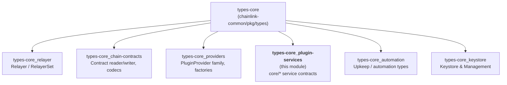
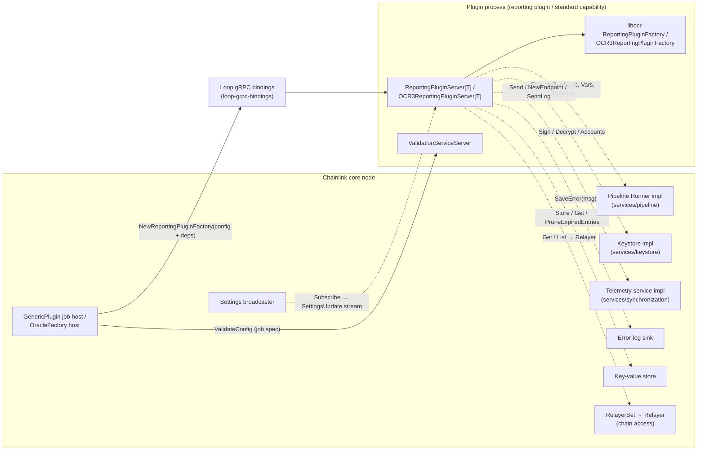
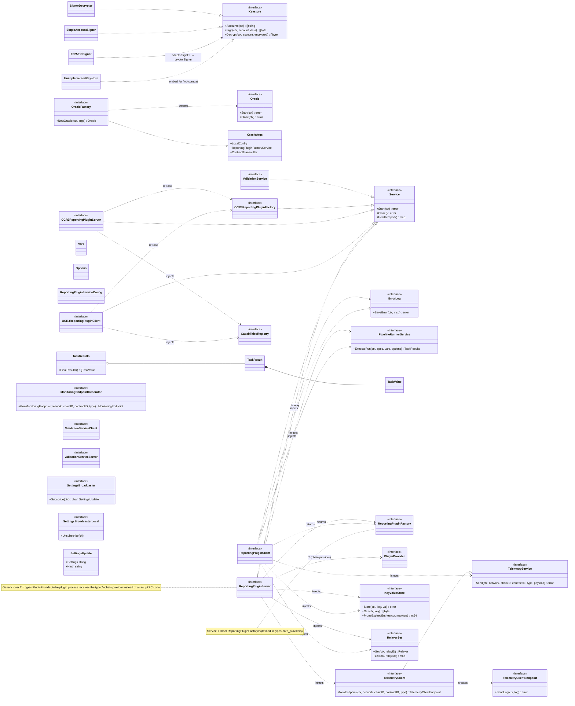
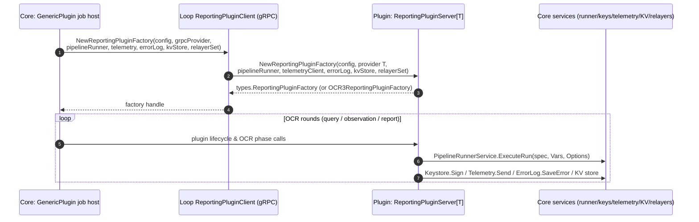
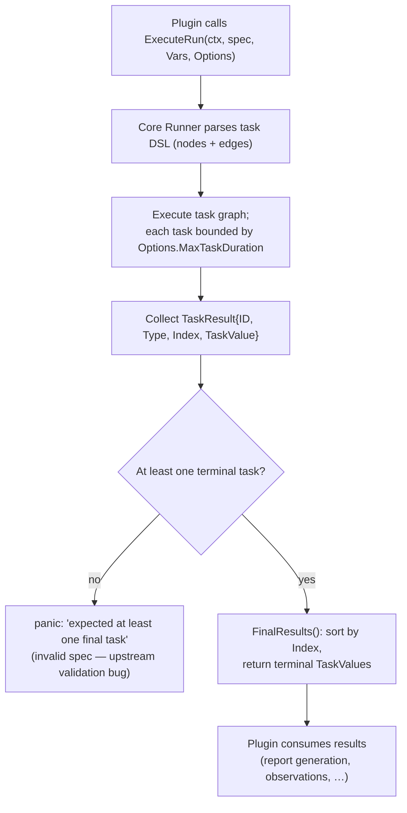
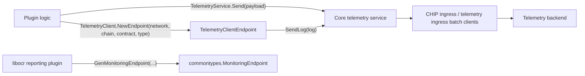

# types-core — Plugin Service Contracts (`chainlink-common/pkg/types/core`)

> Parent: [types-core](../types-core.md) · Grand-parent: [Shared Foundation Libraries & Domain Types](../../Shared_Foundation_Libraries___Domain_Types.md)

## 1. Introduction

This module documents the `chainlink-common/pkg/types/core` package: the **transport-neutral service contracts that a Chainlink node ("core") injects into plugin processes** — OCR reporting plugins, standard capabilities, and oracle factories.

Every distributed-computation plugin running under the node needs a set of privileged services it cannot implement itself: access to signing keys, a sandboxed pipeline execution engine, telemetry egress, chain access, error capture, key-value storage, configuration updates, and config validation. This package defines those contracts as plain Go interfaces plus a handful of small value types. It deliberately contains almost no behavior — the only executable logic is the set of keystore signing adapters — because the same contracts must be satisfiable **in-process** (monolithic node) and **over gRPC** (out-of-process plugin under the [Plugin Process Framework (Loop)](../../Plugin_Process_Framework_\(Loop\).md)).

Key facts:

| Aspect | Detail |
|---|---|
| Go package | `github.com/smartcontractkit/chainlink-common/pkg/types/core` |
| Go module | `github.com/smartcontractkit/chainlink-common` (see `chainlink-common/go.mod`, Go 1.27) |
| Notable external dependency | `github.com/smartcontractkit/libocr` (OCR2/OCR3 types used by oracle & reporting-plugin contracts) |
| Content style | Interfaces + value structs; gRPC realization lives in [loop-grpc-bindings](../../Plugin_Process_Framework_\(Loop\)/loop-grpc-bindings.md) |
| Conventions | Client/Server interface pairs, `services.Service` lifecycle, `Unimplemented*` embedding for forward compatibility |

## 2. Position in the Architecture

The `core` package is one of six sub-domains of the [types-core](../types-core.md) module:



Within the overall system it plays the role of the **contract boundary between the node's platform services and the plugin runtime**:

- The **node side** (core) implements these contracts with real services: keystore, pipeline runner, telemetry ingress, relayers, KV store (see §8.2).
- The **plugin side** consumes them. When a plugin runs as a separate process, the [Loop framework](../../Plugin_Process_Framework_\(Loop\).md) supplies gRPC client/server adapters for exactly these interfaces (`keystore_grpc.pb.go`, `pipeline_runner_grpc.pb.go`, `reporting_plugin_service_grpc.pb.go`, `telemetry_grpc.pb.go`, `validate_config_grpc.pb.go`, `keyvalue_store_grpc.pb.go`).

### 2.1 Runtime context



## 3. Component Catalogue

| File | Components | Responsibility |
|---|---|---|
| `core/errorlog.go` | `ErrorLog` | Sink for plugins to persist notable errors in the node |
| `core/keystore.go` | `Keystore`, `UnimplementedKeystore`, `Ed25519Signer`, `NewSingleAccountSigner`/`singleAccountSigner`, `NewSignerDecrypter`/`signerDecrypter`, `Decrypter`, constants | Key access & signing contracts plus stdlib-crypto adapters |
| `core/oracle_factory.go` | `Oracle`, `OracleFactory`, `OracleArgs` | Lifecycle for libocr-backed oracles created on behalf of plugins |
| `core/pipeline_runner.go` | `PipelineRunnerService`, `Vars`, `Options`, `TaskValue`, `TaskResult`, `TaskResults` | Contract to execute task-DSL specs inside the node's pipeline engine |
| `core/reporting_plugin_service.go` | `ReportingPluginServiceConfig`, `ReportingPluginClient`, `ReportingPluginServer[T]`, `OCR3ReportingPluginClient`, `OCR3ReportingPluginServer[T]`, `OCR3ReportingPluginFactory` | Hosting contract for generic-job reporting plugins (OCR2-style and OCR3) |
| `core/settings.go` | `SettingsBroadcaster`, `SettingsBroadcasterLocal`, `SettingsUpdate` | Streaming of node settings updates to plugins |
| `core/telemetry.go` | `TelemetryService`, `TelemetryClient`, `TelemetryClientEndpoint`, `MonitoringEndpointGenerator` | Telemetry egress contracts |
| `core/validation.go` | `ValidationService`, `ValidationServiceClient`, `ValidationServiceServer` | Plugin-supplied job/config validation |

## 4. Interface Model



## 5. Component Reference

### 5.1 `ErrorLog`

```go
type ErrorLog interface {
    SaveError(ctx context.Context, msg string) error
}
```

A minimal, contextual sink handed to plugins so they can hand errors to the node for persistence, aggregation, and alerting rather than only logging them locally. It is one of the standard dependencies of every `NewReportingPluginFactory` call. Keeping the signature deliberately tiny (`ctx` + message) makes the contract trivially proxyable over gRPC.

### 5.2 Keystore and signing adapters (`core/keystore.go`)

**Contract.** `Keystore` exposes three operations:

| Method | Semantics |
|---|---|
| `Accounts(ctx)` | Lists account identifiers the keystore can sign for. |
| `Sign(ctx, account, data)` | Returns `data` signed by `account`. Passing `nil` data is a defined **no-op probe for account existence**. |
| `Decrypt(ctx, account, encrypted)` | Decrypts data with the account's key (not supported by all implementations). |

**Forward compatibility.** Implementations **must embed `UnimplementedKeystore`**. Each of its methods returns `status.Errorf(codes.Unimplemented, ...)` (a gRPC status error), so when the interface gains methods in a later release, binaries compiled against the older interface keep working and surface an explicit `Unimplemented` error instead of a compile/link or nil-method failure. This is the package's canonical versioning pattern for binary plugins.

**Adapters.** The file also ships three ready-made implementations that adapt a `Keystore` (or a `SignFn`) into shapes other libraries expect:

- `Ed25519Signer` — adapts a `Keystore.Sign`-shaped function into a standard library `crypto.Signer` (plus `services.StartClose` lifecycle via a `services.StopChan`). It validates that the account is a hex-encoded (optional `0x` prefix) 32-byte Ed25519 public key, and rejects anything but `crypto/rand.Reader` and `crypto.Hash(0)` options.
- `singleAccountSigner` — a `Keystore` over exactly one account backed by a `crypto.Signer`; `Decrypt` is unsupported.
- `signerDecrypter` — a `Keystore` combining a separate signer and `Decrypter` for one account. It additionally enforces **domain separation** for the well-known `StandardCapabilityAccount`: payloads must carry the 97-byte prefix produced by `peeridhelper.MakePeerIDSignatureDomainSeparatedPayload` (which also implicitly bounds message length to ≤ 1024 bytes).

**Well-known accounts.**

| Constant | Value | Use |
|---|---|---|
| `P2PAccountKey` | `"P2P_SIGNER"` | Account key used for libocr/p2p signing. |
| `StandardCapabilityAccount` | `"STANDARD_CAPABILITY_ACCOUNT"` | The shared signing account for standard capabilities; payloads **must** be domain-separated as described above. |

For the node's real keystore implementation (master keyring, OCR/OCR2/P2P/workflow keys), see [Node Platform Services → keystore](../../Node_Platform_Services/keystore.md); the abstract `Keystore`/`Management` pair of the `types` package is covered in [types-core_keystore](types-core_keystore.md).

### 5.3 Oracle lifecycle (`core/oracle_factory.go`)

```go
type Oracle interface {
    Start(ctx context.Context) error
    Close(ctx context.Context) error
}

type OracleFactory interface {
    NewOracle(ctx context.Context, args OracleArgs) (Oracle, error)
}

type OracleArgs struct {
    LocalConfig                   types.LocalConfig
    ReportingPluginFactoryService ocr3types.ReportingPluginFactory[[]byte]
    ContractTransmitter           ocr3types.ContractTransmitter[[]byte]
}
```

This is the seam through which an OCR3 oracle is constructed on behalf of a plugin/standard-capability runtime:

- `OracleArgs.LocalConfig` — libocr node-local configuration.
- `ReportingPluginFactoryService` — the OCR3 reporting plugin factory (typically supplied by the plugin, wrapped by the OCR3 hosting variants described in §5.5).
- `ContractTransmitter` — the on-chain transmitter for OCR3 reports.

`OracleFactory` implementations live in the relay/provider layer (e.g. the EVM relay adapter) and are reached through `OCR3CapabilityProvider`/`Relayer` — see [types-core_providers](types-core_providers.md) and the relay runtime notes in [node_application_relay](../../Node_Application_Core___Interfaces/node_application/node_application_relay.md). The OCR machinery itself is documented in [OCR engines](../../Oracle_Engines___Data_Pipelines/ocr.md).

### 5.4 Pipeline execution bridge (`core/pipeline_runner.go`)

```go
type PipelineRunnerService interface {
    ExecuteRun(ctx context.Context, spec string, vars Vars, options Options) (TaskResults, error)
}
```

Plugins rarely perform HTTP or bridge calls directly; instead they ask the node to execute a **task-DSL spec** inside the node's sandboxed pipeline engine.

| Type | Role |
|---|---|
| `Vars` | `map[string]any` input variables (e.g. the triggering event/juels data) substituted into the spec. |
| `Options` | `MaxTaskDuration` bounds per-task execution time. |
| `TaskValue` | Per-task outcome: `Error`, JSON-serializable `Value`, and `IsTerminal`. |
| `TaskResult` | `TaskValue` plus coordinates: `ID`, `Type`, `Index`. |
| `TaskResults` | Collection with `FinalResults()`. |

`FinalResults()` sorts results by `Index` and returns only terminal task values. It **panics if no terminal task exists** — this is an intentional invariant check: a valid spec must have at least one terminal node (spec validity is enforced upstream by [config-validation](../config-validation.md) tooling and, for plugins, by the `ValidationService` contract described in §5.8).

The node-side implementation is `core/services/pipeline/runner.go` (`Runner`) — see [pipeline execution engine](../../Oracle_Engines___Data_Pipelines/pipeline/pipeline_execution_engine.md). Its gRPC projection is the `PipelineRunnerService` in [loop-grpc-bindings](../../Plugin_Process_Framework_\(Loop\)/loop-grpc-bindings.md).

### 5.5 Reporting plugin hosting (`core/reporting_plugin_service.go`)

This is the largest contract in the package and the one that gives the module its name.

```go
type ReportingPluginServiceConfig struct {
    ProviderType  string
    Command       string        // plugin binary to spawn
    PluginName    string
    TelemetryType string
    PluginConfig  string        // serialized plugin configuration
}
```

Two symmetric pairs of interfaces exist, one pair per OCR generation, each split into a **Client** (implemented in the core node) and a **Server** (implemented by the plugin process):

| Interface pair | Returns | Extra capability injected |
|---|---|---|
| `ReportingPluginClient` ⇄ `ReportingPluginServer[T]` | `types.ReportingPluginFactory` | — |
| `OCR3ReportingPluginClient` ⇄ `OCR3ReportingPluginServer[T]` | `OCR3ReportingPluginFactory` | `CapabilitiesRegistry` |

Shared properties:

- All four are `services.Service` (Start/Close/HealthReport — see the [services library](../services.md)); the loop runtime drives their lifecycle alongside the job.
- The client receives a raw `grpc.ClientConnInterface` ("passthrough provider connection") because the core is chain-agnostic; the server receives the typed provider `T types.PluginProvider` because the plugin needs chain-specific contract access. The Loop transport adapter performs that conversion — see [loop-relayer-services → plugin providers](../../Plugin_Process_Framework_\(Loop\)/loop-relayer-services/loop-relayer-services_plugin_providers.md).
- Both sides inject the same dependency bundle: `PipelineRunnerService`, telemetry (`TelemetryService` on the client side, `TelemetryClient` on the server side), `ErrorLog`, `KeyValueStore`, and `RelayerSet`.
- Both expose `NewValidationService(ctx) (ValidationService, error)`, letting the core obtain a validator backed by the plugin's own config schema (see §5.8).
- `OCR3ReportingPluginFactory` composes `services.Service` with libocr's `ocr3types.ReportingPluginFactory[[]byte]`; the OCR2-era `types.ReportingPluginFactory` it mirrors is defined in [types-core_providers](types-core_providers.md).

The OCR3 variants additionally receive a `CapabilitiesRegistry` handle (the capability registry contract documented in [capabilities → registry](../../Workflow___Capability_Runtime_\(CRE_Engine\)/capabilities/capabilities_registry.md)), which OCR3-based standard capabilities use to look up peer capabilities.

### 5.6 Settings broadcast (`core/settings.go`)

```go
type SettingsUpdate struct {
    Settings string // default format TOML
    Hash     string // default sha256
}
```

- `SettingsBroadcaster.Subscribe(ctx)` returns a receive-only channel of `SettingsUpdate`s — the mechanism by which plugin processes learn about node configuration changes (relevant to long-lived capabilities that must react to reconfiguration).
- `SettingsBroadcasterLocal` is an optional capability interface: **local** (in-process) broadcasters cannot detect abandonment of a channel, so subscribers must call `Unsubscribe` explicitly. Remote client/server pairs unsubscribe automatically when the transport closes. Implementations should support both models; consumers should type-assert to `SettingsBroadcasterLocal` when they know they hold a local instance.

### 5.7 Telemetry (`core/telemetry.go`)

| Contract | Method(s) | Purpose |
|---|---|---|
| `TelemetryService` | `Send(ctx, network, chainID, contractID, telemetryType, payload)` | Push one telemetry payload scoped by network/chain/contract/type. |
| `TelemetryClientEndpoint` | `SendLog(ctx, log)` | A pre-bound endpoint for one (network, chain, contract, type) tuple. |
| `TelemetryClient` | `TelemetryService` + `NewEndpoint(...)` | Server-side (plugin-side) façade: batch sends or acquire dedicated endpoints. |
| `MonitoringEndpointGenerator` | `GenMonitoringEndpoint(network, chainID, contractID, telemetryType)` | Produces a libocr `commontypes.MonitoringEndpoint` for OCR framework instrumentation. |

The asymmetry mirrors §5.5: the core implements `TelemetryService` (it owns egress), while plugins are handed a `TelemetryClient`. Node-side egress implementations (telemetry/CHIP ingress clients) are documented in the [Telemetry & Observability Platform](../../Telemetry___Observability_Platform.md) — see [telemetry_ingress](../../Telemetry___Observability_Platform/telemetry_ingress.md) and [beholder-telemetry](../../Telemetry___Observability_Platform/beholder-telemetry.md).

### 5.8 Configuration validation (`core/validation.go`)

```go
type ValidationService interface {
    services.Service
    ValidateConfig(ctx context.Context, config map[string]any) error
}
type ValidationServiceClient interface { ValidateConfig(...) } // core side, no lifecycle
type ValidationServiceServer interface { ValidateConfig(...) } // plugin side, no lifecycle
```

The single method lets the node validate a job/plugin configuration against the plugin's own schema at spec-creation time. The trio is split so that:

- `ValidationService` (the full, lifecycle-carrying interface) is what `NewReportingPluginFactory` / `NewValidationService` hand out;
- `ValidationServiceClient` and `ValidationServiceServer` are the narrow faces used by the gRPC transport, which already manages connection lifecycle — neither side is forced to re-implement `Start`/`Close`.

## 6. Process Flows

### 6.1 Bootstrapping a reporting plugin (core ⇄ plugin, via Loop)



Note that dependencies flow **core → plugin** ( factories/services the plugin consumes), while runtime data flows **plugin → core** through those same contracts.

### 6.2 Pipeline run execution



### 6.3 Telemetry egress



## 7. Design Notes

1. **Client/Server symmetry.** Every cross-process contract is declared as a matched pair. The Loop framework (see [loop-plugin-core](../../Plugin_Process_Framework_\(Loop\)/loop-plugin-core.md)) generates the gRPC glue: a `…Client` in the node, a `…Server` in the plugin, and protobuf plumbing in [loop-grpc-bindings](../../Plugin_Process_Framework_\(Loop\)/loop-grpc-bindings.md). Adding a contract here means adding the matching pb service there.
2. **Generics only where the plugin needs typing.** Only the *server* interfaces are generic (`ReportingPluginServer[T types.PluginProvider]`, `OCR3ReportingPluginServer[T]`): the plugin process must receive its concrete chain provider. The *client* side deals in `grpc.ClientConnInterface` because the core must stay chain-agnostic.
3. **Forward compatibility by embedding.** `UnimplementedKeystore` is the pattern for evolving binary plugin interfaces safely: default methods returning gRPC `Unimplemented` keep old plugin binaries compatible with newer core nodes.
4. **Lifecycle discipline.** Anything long-lived implements `services.Service` (from the [services library](../services.md)); `Oracle`/`OracleFactory` use the context-aware `Start`/`Close` variant favored by libocr integrations.
5. **Fail-fast invariants.** `TaskResults.FinalResults()` panics on a spec without terminal tasks — treat it as an internal invariant, not an error channel; spec validity must be checked by validation tooling first ([config-validation](../config-validation.md)).
6. **Domain separation for shared keys.** Signatures produced under `StandardCapabilityAccount` must be domain-separated (prefix via `peeridhelper`); `signerDecrypter` rejects non-conforming payloads to prevent cross-protocol signature replay.

## 8. Dependencies

### 8.1 Outbound — consumed by this package

| Dependency | Source | Used by |
|---|---|---|
| `services.Service`, `services.StopChan` | `chainlink-common/pkg/services` | lifecycle of clients/servers, `Ed25519Signer`, `ValidationService` |
| `types.PluginProvider`, `types.ReportingPluginFactory`, `types.RelayID` | [types-core_providers](types-core_providers.md), [types-core_relayer](types-core_relayer.md) | generic parameter of the plugin servers; factory return type; `RelayerSet` keys |
| `Relayer`, `RelayerSet`, `KeyValueStore` | `core/relayerset.go`, `core/keyvalue_store.go` (same `core` package; see [types-core_relayer](types-core_relayer.md)) | injected into every reporting-plugin server |
| libocr `types.LocalConfig`, `ocr3types.*`, `commontypes.MonitoringEndpoint` | `github.com/smartcontractkit/libocr` (pinned in `chainlink-common/go.mod`) | `OracleArgs`, `OCR3ReportingPluginFactory`, `MonitoringEndpointGenerator` |
| `peeridhelper` (libocr ragep2p) | libocr | domain-separated signature prefix checks |
| `jsonserializable.JSONSerializable` | `chainlink-common/pkg/utils` | `TaskValue.Value` |
| `CapabilitiesRegistry` | capabilities registry contract — [capabilities_registry](../../Workflow___Capability_Runtime_\(CRE_Engine\)/capabilities/capabilities_registry.md) | OCR3 plugin client/server |

### 8.2 Inbound — consumers

| Consumer | What it implements/uses | Where documented |
|---|---|---|
| Loop framework (`GRPCService`, plugin runtime, `grpcPlugin`) | gRPC projections of these contracts | [loop-plugin-core](../../Plugin_Process_Framework_\(Loop\)/loop-plugin-core.md) |
| Core node job engine (`GenericPlugin` jobs, job spawner) | Hosts `ReportingPluginClient`, `ValidationService` | [job_service](../../Node_Platform_Services/job_service.md) |
| Pipeline engine (`Runner`) | Implements `PipelineRunnerService` | [pipeline_execution_engine](../../Oracle_Engines___Data_Pipelines/pipeline/pipeline_execution_engine.md) |
| Keystore master | Implements `Keystore` | [keystore](../../Node_Platform_Services/keystore.md) |
| Relay adapters (e.g. EVM `RelayAdapter`) | Implement `OracleFactory` / provide `PluginProvider` | [node_application_relay](../../Node_Application_Core___Interfaces/node_application/node_application_relay.md), [loop-relayer-services](../../Plugin_Process_Framework_\(Loop\)/loop-relayer-services.md) |
| Telemetry ingress / CHIP ingress | Implement `TelemetryService`/`TelemetryClient` | [telemetry_ingress](../../Telemetry___Observability_Platform/telemetry_ingress.md), [chip-ingress](../../Telemetry___Observability_Platform/chip-ingress.md) |
| Feeds service (job distributor-managed plugins) | Spawns generic plugin jobs with these contracts | [feeds_service](../../Node_Platform_Services/feeds_service.md) |
| Plugin binaries (median, CCIP, standard capabilities) | Implement `ReportingPluginServer[T]`, consume the injected services | [Oracle engines](../../Oracle_Engines___Data_Pipelines.md), [CRE engine](../../Workflow___Capability_Runtime_\(CRE_Engine\).md) |

## 9. Related Documentation

- [types-core](../types-core.md) — umbrella module for `chainlink-common/pkg/types`
- [types-core_relayer](types-core_relayer.md) — `Relayer`/`RelayerSet`/`RelayArgs`/`PluginArgs` and `KeyValueStore` details
- [types-core_providers](types-core_providers.md) — `PluginProvider` hierarchy and `ReportingPluginFactory`
- [types-core_keystore](types-core_keystore.md) — abstract `Keystore`/`Management` types package
- [Plugin Process Framework (Loop)](../../Plugin_Process_Framework_\(Loop\).md) — out-of-process plugin runtime and gRPC bindings
- [Shared Foundation Libraries & Domain Types](../../Shared_Foundation_Libraries___Domain_Types.md) — sibling foundation libraries (services, logger, settings, …)
