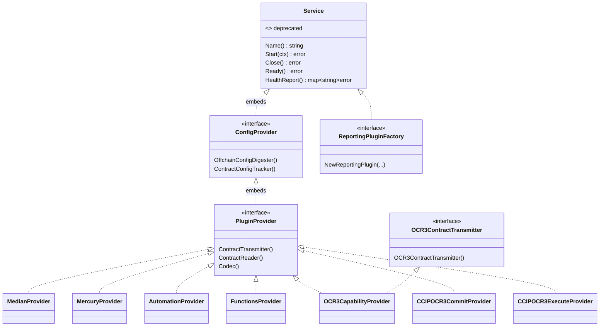
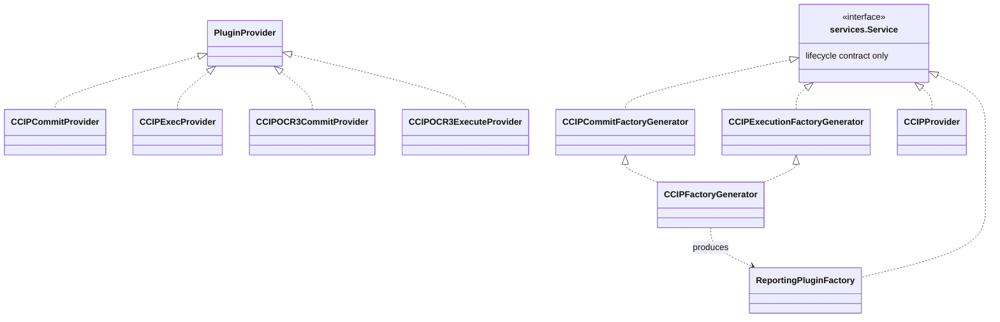
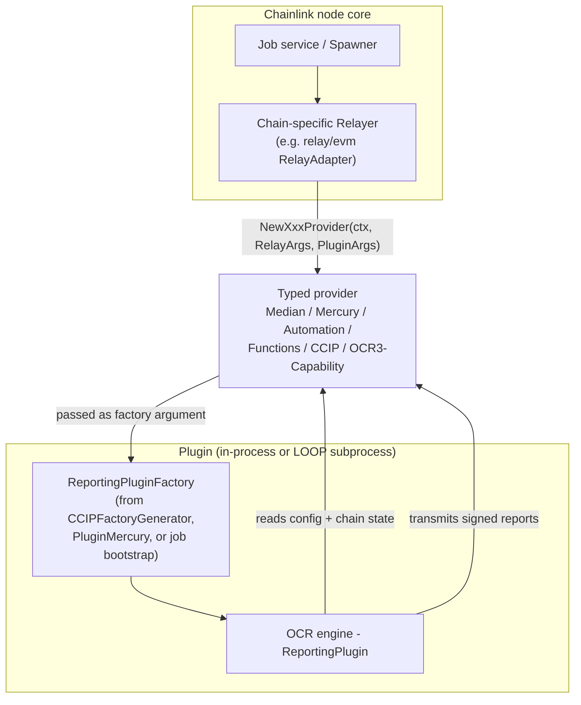
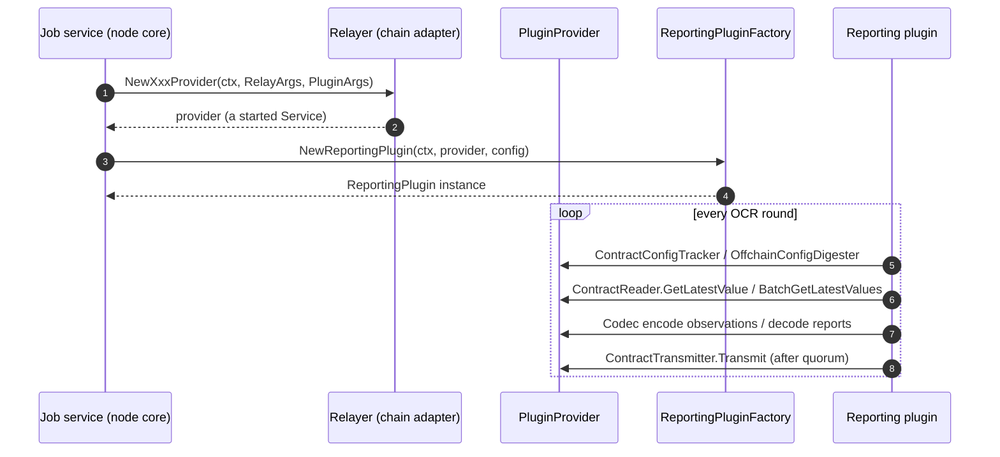
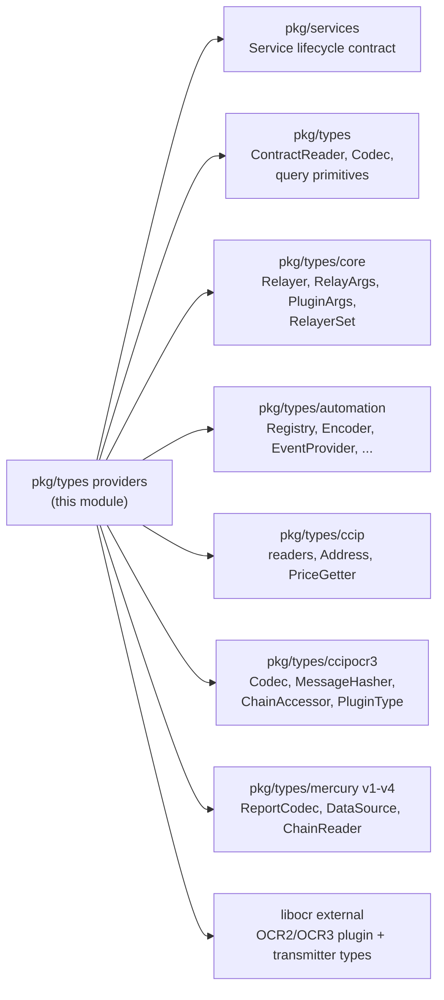

# Providers — Plugin Provider Contracts (`chainlink-common/pkg/types`)

**Go module:** `github.com/smartcontractkit/chainlink-common` (see `chainlink-common/go.mod`, which also pins `libocr` — the source of the `ocrtypes`/`ocr3types` vocabulary used throughout)
**Package:** `github.com/smartcontractkit/chainlink-common/pkg/types`
**Parent:** [types-core](../types-core.md)
**Siblings:** [types-core_relayer](types-core_relayer.md) · [types-core_chain-contracts](types-core_chain-contracts.md) · [types-core_plugin-services](types-core_plugin-services.md) · [types-core_automation](types-core_automation.md) · [types-core_keystore](types-core_keystore.md)

---

## 1. Overview

This module defines the **provider contract layer** of the Chainlink node: the set of Go interfaces that a chain-specific **Relayer** hands to an off-chain reporting (OCR2/OCR3) plugin so the plugin can observe chain state, encode/decode data, and transmit reports — without knowing anything about the underlying blockchain SDK.

Everything in this module is deliberately *contract-only*: pure interface declarations plus a handful of small value types and gRPC-mapped sentinel errors. There is no business logic. This makes the module the shared "port" layer of the node's hexagonal architecture, usable by:

| Consumer | Role | Where documented |
|---|---|---|
| Chain-specific relayers (node core, e.g. `relay/evm`) | *Implement* the constructors and provider structs | [node_application_relay](../../Node_Application_Core___Interfaces/node_application/node_application_relay.md) |
| LOOP plugin processes | *Marshal* providers across process boundaries as gRPC Client/Server halves | [loop-relayer-services](../../Plugin_Process_Framework_(Loop)/loop-relayer-services.md), [loop-grpc-bindings](../../Plugin_Process_Framework_(Loop)/loop-grpc-bindings.md) |
| OCR engines & reporting plugins | *Consume* providers through `ReportingPluginFactory` | [ocr](../../Oracle_Engines___Data_Pipelines/ocr.md) |
| CCIP OCR3 plugins | Implement/execute CCIP providers on source & destination chains | [types-ccip](../../CCIP_Cross-Chain_Protocol/types-ccip.md), [ccip](../../CCIP_Cross-Chain_Protocol/ccip.md) |

**Design principles**

1. **Composition over configuration** — every product provider embeds the generic `PluginProvider`, which embeds `ConfigProvider`, which embeds a lifecycle `Service`. A plugin declares what it needs by naming the narrowest interface it can.
2. **gRPC-safe errors** — sentinel error types implement `GRPCStatus()`/`Is()` so that error *categories* (not just strings) survive a LOOP round-trip. As the source comments state, they "should work with or without LOOP enabled".
3. **Zero-heavy dependencies** — the module depends only on `libocr`, `pkg/services`, and sibling `pkg/types/*` packages, so node binaries and standalone plugin binaries can share the exact same contract.

---

## 2. Component inventory

| Source file | Component | Kind | Purpose |
|---|---|---|---|
| `types.go` | `Service` | interface *(deprecated)* | Legacy lifecycle contract (`Name`, `Start`, `Close`, `Ready`, `HealthReport`). Superseded by `pkg/services.Service`; carries `//go:fix inline` so tooling rewrites usages automatically. See [services](../services.md). |
| `provider.go` | `ConfigProvider` | interface | Watch-only contract for **bootstrap jobs**: `OffchainConfigDigester()` + `ContractConfigTracker()`. |
| `provider.go` | `PluginProvider` | interface | Base contract for any OCR2 plugin: config tracking **plus** `ContractTransmitter()`, `ContractReader()`, `Codec()`. |
| `provider.go` | `Plugin` | type alias *(deprecated)* | Alias for `PluginProvider`, kept for compatibility (`//go:fix inline`). |
| `provider.go` | `OCR3ContractTransmitter` | interface | Exposes an OCR3-style `ocr3types.ContractTransmitter[[]byte]`. |
| `provider.go` | `InvalidArgumentError`, `UnimplementedError`, `InternalError`, `NotFoundError` | error types | gRPC-mapped sentinels (see §6). |
| `provider_automation.go` | `AutomationProvider` | interface | Everything the Automation OCR2 plugin needs (registry, encoder, events, payloads…). |
| `provider_ccip.go` | `CCIPCommitProvider`, `CCIPExecProvider` | interfaces | CCIP v1.x-style lane contracts: commit-store/off-ramp/on-ramp/price readers, tx status, token readers. |
| `provider_ccip.go` | `CCIPCommitFactoryGenerator`, `CCIPExecutionFactoryGenerator`, `CCIPFactoryGenerator` | interfaces | Construct `ReportingPluginFactory` for CCIP commit/execution on any chain. |
| `provider_ccip.go` | `CCIPProvider` | interface | OCR3-native CCIP provider: `ChainAccessor`, OCR3 transmitter, `ccipocr3.Codec`. |
| `provider_ccip.go` | `CCIPProviderArgs` | struct | Relay-agnostic args used by a Relayer to build a `CCIPProvider`. |
| `provider_ccip_ocr3.go` | `CCIPOCR3CommitProvider`, `CCIPOCR3ExecuteProvider` | interfaces | OCR3 CCIP codec + message-hasher surfaces. |
| `provider_functions.go` | `FunctionsProvider`, `FunctionsEvents` | interfaces | Chainlink Functions event sourcing through router-proxy contracts. |
| `provider_functions.go` | `OracleRequest`, `OracleResponse` | structs | On-chain event payloads produced by `FunctionsEvents`. |
| `provider_median.go` | `MedianProvider` | interface | Data Feeds median OCR2 plugin: `ReportCodec`, `MedianContract`, `OnchainConfigCodec`. |
| `provider_mercury.go` | `MercuryProvider` | interface | Mercury feed plugins: report codecs **v1–v4**, on-chain config codec, server fetcher, chain reader. *Config tracking only — no on-chain transmission.* |
| `provider_mercury.go` | `PluginMercury`, `MercuryPluginFactory` | interfaces | Remote construction of Mercury plugin factories per data-source version. |
| `provider_ocr3_capability.go` | `OCR3CapabilityProvider` | interface | `PluginProvider` + `OCR3ContractTransmitter` — used by OCR3-based capabilities (e.g. Keystone forwarders). |
| `reporting_plugin_factory.go` | `ReportingPluginFactory` | interface | Lifecycle-capable (`Service`) wrapper around `libocr.ReportingPluginFactory`. |

---

## 3. Interface architecture

### 3.1 Type hierarchy



### 3.2 Two `Service` definitions — a documented inconsistency

Maintainers should be aware that the package currently mixes **two lifecycle interfaces**:

| Embedded by | Interface |
|---|---|
| `ConfigProvider` → every `PluginProvider` descendant, `ReportingPluginFactory`, `MercuryPluginFactory`, `FunctionsEvents` | `types.Service` (the **deprecated** one in `types.go`) |
| `CCIPCommitFactoryGenerator`, `CCIPExecutionFactoryGenerator`, `CCIPProvider`, `PluginMercury`; automation `EventProvider`; `ContractReader` | `services.Service` from [`pkg/services`](../services.md) |

The deprecated `types.Service` carries a `//go:fix inline` directive, so `gofix` rewrites references to `services.Service` automatically. New provider families should embed `services.Service` directly.

### 3.3 CCIP provider family (two generations)

CCIP is the largest family because it spans both the legacy OCR2-style lane providers and the OCR3-native ones:



The concrete reader/codec types returned by these interfaces (`CommitStoreReader`, `OffRampReader`, `OnRampReader`, `PriceGetter`, `TokenDataReader`, `TokenPoolBatchedReader`, `CommitPluginCodec`, `ExecutePluginCodec`, `MessageHasher`, …) are domain types owned by the CCIP module and are documented in [types-ccip](../../CCIP_Cross-Chain_Protocol/types-ccip.md).

---

## 4. Runtime wiring & lifecycle

### 4.1 Who creates providers

Providers are **never constructed by plugins**. They are built by a chain-specific **Relayer** — the node-side adapter that owns the chain client — and injected into the plugin. The `Relayer` interface (see [types-core_relayer](types-core_relayer.md)) exposes one typed factory method per provider family:

```go
NewConfigProvider(ctx, RelayArgs)                          (ConfigProvider, error)
NewMedianProvider(ctx, RelayArgs, PluginArgs)              (MedianProvider, error)
NewMercuryProvider(ctx, RelayArgs, PluginArgs)             (MercuryProvider, error)
NewFunctionsProvider(ctx, RelayArgs, PluginArgs)           (FunctionsProvider, error)
NewAutomationProvider(ctx, RelayArgs, PluginArgs)          (AutomationProvider, error)
NewLLOProvider(ctx, RelayArgs, PluginArgs)                 (LLOProvider, error)        // see types-mercury-llo
NewCCIPCommitProvider(ctx, RelayArgs, PluginArgs)          (CCIPCommitProvider, error)
NewCCIPExecProvider(ctx, RelayArgs, PluginArgs)            (CCIPExecProvider, error)
NewPluginProvider(ctx, RelayArgs, PluginArgs)              (PluginProvider, error)
NewOCR3CapabilityProvider(ctx, RelayArgs, PluginArgs)      (OCR3CapabilityProvider, error)
NewCCIPProvider(ctx, CCIPProviderArgs)                     (CCIPProvider, error)
```

`RelayArgs` carries chain identity (chain ID, relayer config); `PluginArgs` carries plugin identity (external job ID, plugin type) — both defined in `pkg/types/core` ([types-core_plugin-services](types-core_plugin-services.md)).



### 4.2 Provider → plugin data flow (one OCR round)



Key contracts exercised during a round:

* **`ContractReader`** — chain-agnostic reads keyed by `(readIdentifier, ConfidenceLevel)` with CBOR/JSON-encoded params; supports batching (`BatchGetLatestValues`), binding lifecycle (`Bind`/`Unbind`), and event polling (`QueryKey`/`QueryKeys` returning `Sequence`s). Its `HealthReport()` must report `ErrFinalityViolation` on finality issues. Defined in [types-core_chain-contracts](types-core_chain-contracts.md).
* **`Codec`** — the `Encoder + Decoder` pair (`codec.go`) used to marshal observations and reports between plugin and chain representations.
* **`ContractTransmitter`** — libocr's `ocrtypes.ContractTransmitter` (OCR2) or `ocr3types.ContractTransmitter[[]byte]` (OCR3, via `OCR3ContractTransmitter`).
* **Config** — `ContractConfigTracker` + `OffchainConfigDigester` (libocr types); bootstrap jobs use *only* these, which is why `ConfigProvider` exists as the minimal contract.

### 4.3 Cross-process operation (LOOP)

When a plugin runs as a separate process, these same interfaces are transparently split into **gRPC client/server halves**:

* The node wraps its relayer with the server halves generated in `chainlink-common/pkg/loop` (`ProviderServer`, per-plugin provider servers such as the OCR2/OCR3/CCIP `PluginProviderServer`s).
* The plugin process receives typed clients that implement the interfaces from this module.
* The proto bindings that mirror each method live in the LOOP gRPC surface — see [loop-grpc-bindings](../../Plugin_Process_Framework_(Loop)/loop-grpc-bindings.md) and the relayer service wiring in [loop-relayer-services](../../Plugin_Process_Framework_(Loop)/loop-relayer-services.md). An in-process variant is provided by `loop.ProviderServer` for plugins linked directly into the node.
* Sentinel errors (§6) are designed for exactly this boundary: they map onto gRPC status codes and survive re-hydration as matching `errors.Is` targets.

---

## 5. Provider families in detail

### 5.1 Median (Data Feeds)

```go
type MedianProvider interface {
    PluginProvider
    ReportCodec() median.ReportCodec
    MedianContract() median.MedianContract
    OnchainConfigCodec() median.OnchainConfigCodec
}
```

The classic OCR2 data-feeds contract; all three extra components come from `libocr`'s median plugin package. Node-side plugin implementation: [ocr2 delegate / median plugin](../../Oracle_Engines___Data_Pipelines/ocr/ocr2_delegate.md).

### 5.2 Mercury

```go
type MercuryProvider interface {
    PluginProvider
    ReportCodecV1() v1.ReportCodec   // …V2, V3, V4
    OnchainConfigCodec() mercury.OnchainConfigCodec
    MercuryServerFetcher() mercury.ServerFetcher
    MercuryChainReader() mercury.ChainReader
}
```

Per the source: *"Mercury requires config tracking but does not transmit on-chain."* The provider carries **four parallel report-codec versions**; `PluginMercury` builds a versioned `MercuryPluginFactory` (which itself combines `Service` with `ocr3types.MercuryPluginFactory`). Domain types are documented in [types-mercury-llo](../types-mercury-llo.md).

### 5.3 Automation

`AutomationProvider` composes `PluginProvider` with nine automation-specific accessors:

| Accessor | Returns (from `pkg/types/automation`) |
|---|---|
| `Registry()` | `automation.Registry` — `CheckUpkeeps(UpkeepPayload…)`, full `Service` lifecycle |
| `Encoder()` | `automation.Encoder` — `Encode(CheckResult…) []byte` / `Extract([]byte) []ReportedUpkeep` |
| `TransmitEventProvider()` | `automation.EventProvider` — `GetLatestEvents(ctx) []TransmitEvent` |
| `BlockSubscriber()` | `automation.BlockSubscriber` |
| `PayloadBuilder()` | `automation.PayloadBuilder` |
| `UpkeepStateStore()` | `automation.UpkeepStateStore` |
| `LogEventProvider()` | `automation.LogEventProvider` |
| `LogRecoverer()` | `automation.LogRecoverer` |
| `UpkeepProvider()` | `automation.ConditionalUpkeepProvider` |

The automation domain model (`UpkeepPayload`, `TransmitEvent`, `CoordinatedBlockProposal`, …) is documented in [types-core_automation](types-core_automation.md).

### 5.4 Functions

`FunctionsProvider` adds a single accessor, `FunctionsEvents() FunctionsEvents` — a `Service` that understands router-proxy contracts and returns `[]OracleRequest` and `[]OracleResponse` via `LatestEvents()`. `OracleRequest` carries the full on-chain shape (request/initiator/subscription accounts, `Data`, `DataVersion`, `Flags`, `CallbackGasLimit`, `TxHash`, coordinator contract, on-chain metadata); `OracleResponse` is just the `RequestID`.

### 5.5 CCIP

**Legacy lane providers (OCR2-style).** `CCIPCommitProvider` supplies commit-side readers (commit store, off-ramp, on-ramp, price getter, price registry, native token). `CCIPExecProvider` adds execution-side concerns: `GetTransactionStatus`, `NewTokenDataReader`, `NewTokenPoolBatchedReader`.

**OCR3-native providers.** `CCIPOCR3CommitProvider` / `CCIPOCR3ExecuteProvider` expose only `ReportCodec(ctx)` (commit vs. execute plugin codec) and `MsgHasher(ctx)` — the minimal surface the OCR3 CCIP plugins need, with the heavier read accessors moving into `CCIPProvider` (`ChainAccessor()`, OCR3 `ContractTransmitter()`, `ccipocr3.Codec`).

**Factory generation.** Because CCIP plugins run as remote LOOP processes, factories are produced by `CCIPFactoryGenerator`:

```go
NewCommitFactory(ctx, provider CCIPCommitProvider) (ReportingPluginFactory, error)
NewExecutionFactory(ctx, src, dst CCIPExecProvider, srcChainID, dstChainID int64,
                    sourceTokenAddress string) (ReportingPluginFactory, error)
```

**`CCIPProviderArgs`** — the complete, chain-agnostic argument bundle a Relayer needs to build a `CCIPProvider`:

| Field | Type | Notes |
|---|---|---|
| `ExternalJobID` | `uuid.UUID` | Identifies the owning job |
| `OffRampAddress` | `ccipocr3.UnknownAddress` | Chain-agnostic address bytes |
| `PluginType` | `ccipocr3.PluginType` | Commit vs. execution |
| `TransmitterAddress` | `ccipocr3.UnknownEncodedAddress` | |
| `ContractReaderConfig` | `[]byte` | Only used by accessors still on ChainReader/ChainWriter (e.g. Solana) |
| `ChainWriterConfig` | `[]byte` | Same caveat |
| `ExtraDataCodecBundle` | `ccipocr3.ExtraDataCodecBundle` | The Go instance actually served over LOOP; its protobuf equivalent is `ExtraDataCodecBundleID` |

CCIP job specs (validated by the Job Distributor / feeds service) are the usual source of these args.

### 5.6 OCR3 Capability

The smallest family, and the bridge to the Keystone/CRE world:

```go
type OCR3CapabilityProvider interface {
    PluginProvider
    OCR3ContractTransmitter   // embeds the OCR3 transmitter accessor
}
```

Consumed by OCR3-based standard capabilities; the deployment counterpart (forwarder/OCR3 contracts) is covered in [CRE/Keystone deployment](../../CRE___Keystone_Deployment_Suite/cre-ocr3.md).

### 5.7 `ReportingPluginFactory`

```go
type ReportingPluginFactory interface {
    Service                              // lifecycle
    libocr.ReportingPluginFactory        // NewReportingPlugin / ValidateConfiguration
}
```

It is the *product* handed over by every factory generator (`CCIPFactoryGenerator`, `PluginMercury`) and is the type the job orchestrator ultimately holds.

---

## 6. Error model

Four sentinel error types map 1:1 onto gRPC status codes, defined in `provider.go`:

| Sentinel | gRPC code |
|---|---|
| `InvalidArgumentError` | `codes.InvalidArgument` |
| `UnimplementedError` | `codes.Unimplemented` |
| `InternalError` | `codes.Internal` |
| `NotFoundError` | `codes.NotFound` |

Each implements:

* `Error() string` — plain message.
* `GRPCStatus() *status.Status` — makes the error *native* to `google.golang.org/grpc/status`, so gRPC servers/clients serialize it without wrapping.
* `Is(target error) bool` — matches either the exact sentinel or a **gRPC-transported** error: the target must decode to a `status` with the same code **and** a message whose colon-separated segments contain the sentinel's message (trimmed). This handles the common case where LOOP/middleware flattens wrapped error chains into a single `a: b: c` string.

```go
// Node-side provider implementation:
return NotFoundError("evm chain 1337 not found")

// Plugin process, after the error crossed LOOP/gRPC:
if errors.Is(err, NotFoundError("evm chain 1337 not found")) {
    // recovered the *category* (NotFound) and the message without string parsing
}
```

Rule of thumb for implementers: return these sentinels (wrapped with `%w` for context) whenever a failure crosses the plugin boundary; they are the only error values guaranteed to round-trip.

---

## 7. Dependency map



| Dependency | Used for | Documented in |
|---|---|---|
| `pkg/services` | `services.Service` lifecycle + health reporting | [services](../services.md) |
| `pkg/types` (same package) | `ContractReader`, `Codec`, `query` primitives | [types-core_chain-contracts](types-core_chain-contracts.md) |
| `pkg/types/core` | `Relayer`, `RelayArgs`, `PluginArgs`, `RelayerSet` | [types-core_plugin-services](types-core_plugin-services.md), [types-core_relayer](types-core_relayer.md) |
| `pkg/types/automation` | Automation accessors | [types-core_automation](types-core_automation.md) |
| `pkg/types/ccip`, `pkg/types/ccipocr3` | CCIP readers, codecs, hashers, args | [types-ccip](../../CCIP_Cross-Chain_Protocol/types-ccip.md) |
| `pkg/types/mercury/v1..v4` | Mercury report codecs & data sources | [types-mercury-llo](../types-mercury-llo.md) |
| `libocr` (pinned in `chainlink-common/go.mod`) | `ocrtypes`/`ocr3types` plugin, transmitter, digester, tracker types | — |
| `pkg/logger` | Logging contract for implementations | [logger](../logger.md) |

---

## 8. Extension guide — adding a new provider family

1. **Define the contract** in a new `provider_<product>.go`: embed `PluginProvider` and add only the accessors the plugin genuinely needs. Embed `services.Service` (not the deprecated `types.Service`) for any new lifecycle-level interfaces.
2. **Add a constructor to `Relayer`** (`relayer.go`, pattern `NewXxxProvider(ctx, RelayArgs, PluginArgs)`), so every chain adapter can build it — see [types-core_relayer](types-core_relayer.md).
3. **If the plugin runs remotely**, extend the LOOP relayer surface: proto message + `Unsafe*Server` binding in `chainlink-common/pkg/loop/internal/pb` and a `ProviderServer` wrapper — process documented in [loop-relayer-services](../../Plugin_Process_Framework_(Loop)/loop-relayer-services.md) and [loop-plugin-core](../../Plugin_Process_Framework_(Loop)/loop-plugin-core.md).
4. **If plugin construction is remote too**, add a factory generator interface embedding `services.Service` that returns `ReportingPluginFactory` (pattern: `CCIPFactoryGenerator`, `PluginMercury`).
5. **Use the sentinel errors** (`NotFoundError`, `InternalError`, …) for boundary failures so clients can `errors.Is` across gRPC.
6. **Keep it contract-only** — no implementations, no I/O. Implementations belong in chain relayers (node core) or LOOP server wrappers.

---

## 9. File reference

| File | Exported symbols |
|---|---|
| `types.go` | `Service` *(deprecated, `//go:fix inline` → `services.Service`)* |
| `provider.go` | `ConfigProvider`, `PluginProvider`, `Plugin` *(deprecated alias)*, `OCR3ContractTransmitter`, `InvalidArgumentError`, `UnimplementedError`, `InternalError`, `NotFoundError`, `grpcErrorHasTypeAndMessage` *(unexported)* |
| `provider_automation.go` | `AutomationProvider` |
| `provider_ccip.go` | `CCIPCommitProvider`, `CCIPExecProvider`, `CCIPCommitFactoryGenerator`, `CCIPExecutionFactoryGenerator`, `CCIPFactoryGenerator`, `CCIPProvider`, `CCIPProviderArgs` |
| `provider_ccip_ocr3.go` | `CCIPOCR3CommitProvider`, `CCIPOCR3ExecuteProvider` |
| `provider_functions.go` | `FunctionsProvider`, `FunctionsEvents`, `OracleRequest`, `OracleResponse` |
| `provider_median.go` | `MedianProvider` |
| `provider_mercury.go` | `MercuryProvider`, `PluginMercury`, `MercuryPluginFactory` |
| `provider_ocr3_capability.go` | `OCR3CapabilityProvider` |
| `reporting_plugin_factory.go` | `ReportingPluginFactory` |
