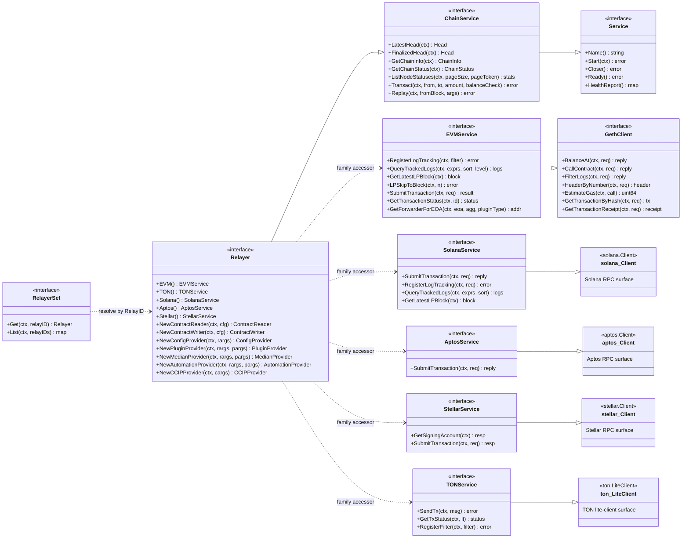
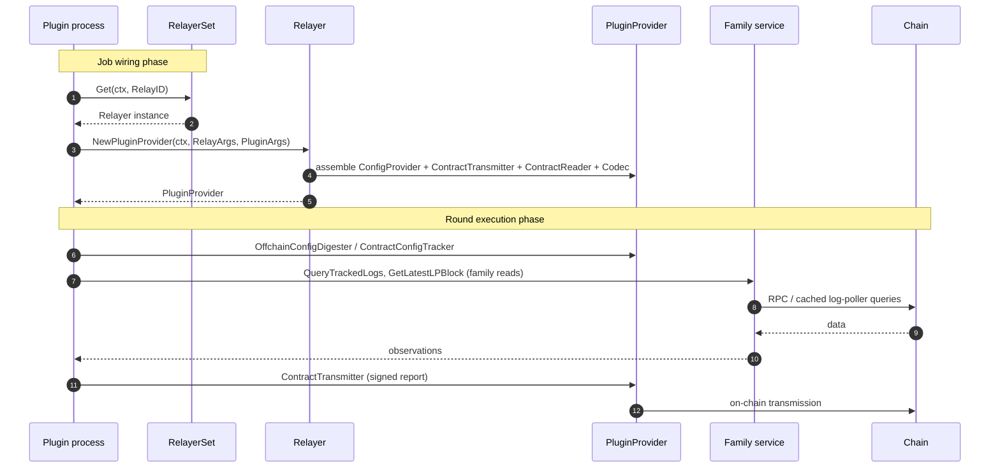
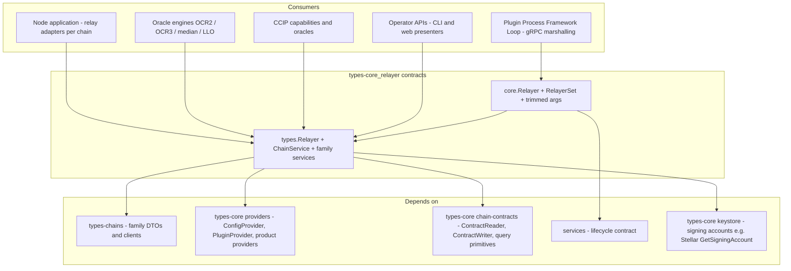

# types-core · Relayer Contracts (`types-core_relayer`)

> **Module scope:** `chainlink-common/pkg/types/relayer.go` and `chainlink-common/pkg/types/core/relayerset.go`
>
> This module defines the **canonical, chain-agnostic contracts for relayers** — the abstraction through which every Chainlink oracle engine, plugin, and service talks to any supported blockchain (EVM, Solana, Aptos, Stellar, TON) without knowing chain-specific details. It ships two complementary contract sets:
>
> * **`types.Relayer` (node-facing, full surface)** — the aggregate interface implemented by each chain's relay service inside the node, exposing chain operations, per-family service accessors, contract I/O, and **provider factory methods** for every oracle product.
> * **`core.Relayer` / `core.RelayerSet` (plugin-facing, narrow surface)** — the trimmed contract handed to plugin processes (via the [Loop plugin framework](../../Plugin_Process_Framework_(Loop)/loop-plugin-core.md)) that resolves relayers by [`RelayID`](#31-identity--relayid) and produces the [`PluginProvider`](types-core_providers.md) a reporting plugin needs.

For the module's position within the shared foundation libraries, see the parent pages [types-core](../types-core.md) and [Shared Foundation Libraries & Domain Types](../../Shared_Foundation_Libraries___Domain_Types.md).

---

## 1. Purpose and core functionality

A **relayer** is the node's per-chain gateway. The contracts in this module answer three questions in a chain-agnostic way:

1. **"Which chain am I talking to?"** — identity via `RelayID{Network, ChainID}` and descriptive value types (`ChainInfo`, `ChainStatus`, `NodeStatus`).
2. **"How do I read from and write to it?"** — uniform `ChainService` operations (heads, status, token transfer, replay) plus typed per-family services (`EVMService`, `SolanaService`, `AptosService`, `StellarService`, `TONService`) and contract I/O (`NewContractReader` / `NewContractWriter`, see [types-core_chain-contracts](types-core_chain-contracts.md)).
3. **"How do I wire an oracle product to it?"** — provider factory methods (`NewPluginProvider`, `NewMedianProvider`, `NewCCIPProvider`, …) that assemble product-specific [providers](types-core_providers.md) from `RelayArgs` / `PluginArgs`.

Both files are **pure interface + value-type definitions** (no logic), living inside the `github.com/smartcontractkit/chainlink-common` Go module (`chainlink-common/go.mod`, Go 1.27.1). Concrete behaviour is supplied by:

| Side | Implementation | Documentation |
|---|---|---|
| Node (in-process) | Per-chain relay adapters, e.g. the EVM `RelayAdapter` in `chainlink/core/services/relay/evm/loop_impl.go` | [node_application_relay](../../Node_Application_Core___Interfaces/node_application/node_application_relay.md) |
| Plugin process (out-of-process) | Loop gRPC client/server wrappers that marshal these interfaces across process boundaries | [loop-relayer-services](../../Plugin_Process_Framework_(Loop)/loop-relayer-services.md), [loop-grpc-bindings](../../Plugin_Process_Framework_(Loop)/loop-grpc-bindings.md) |

---

## 2. Core contracts

### 2.1 Identity — `RelayID`

```go
type RelayID struct {
    Network string // e.g. "evm", "solana", "aptos", "stellar", "ton"
    ChainID string // chain-specific id, e.g. "1" for EVM mainnet
}
```

* `Name()` / `String()` render the canonical `"<Network>.<ChainID>"` form; `NewRelayID(n, c)` constructs one.
* `UnmarshalString(s)` parses exactly one `.` separator — anything else is an error.
* `RelayID` is the **map key** used by `RelayerSet.List` and the lookup argument for `RelayerSet.Get`, making it the stable handle by which jobs, plugins, and operator tooling address a specific chain. The same identifiers surface in operator APIs — e.g. the chain/node presenters ([cli_commands_remote_resources](../../Node_Application_Core___Interfaces/cli_commands/cli_commands_remote_resources.md)) and REST chain controllers ([web_api_rest_controllers](../../Node_Application_Core___Interfaces/web_api/web_api_rest_controllers.md)) — which consume the `ChainStatus` / `NodeStatus` value types defined here.

### 2.2 Lifecycle base — `Service`

`ChainService` embeds `types.Service`:

```go
type Service interface {
    Name() string
    Start(context.Context) error
    Close() error
    Ready() error
    HealthReport() map[string]error
}
```

This is the standard lifecycle contract used across the codebase (see [services](../services.md) for the runtime utilities built around it). Any `Relayer` is therefore a startable, health-reportable service that the node's application orchestrator manages alongside other services.

### 2.3 `ChainService` — uniform chain operations

The `ChainService` interface is the family-independent subset every relayer must support:

| Method | Purpose |
|---|---|
| `LatestHead` / `FinalizedHead` | Head observation; chains without finality semantics may return `codes.Unimplemented` for `FinalizedHead` |
| `GetChainInfo` | `ChainInfo` (family, chain id, network name incl. testnet/mainnet/devnet qualifier) |
| `GetChainStatus` | `ChainStatus` (id, enabled flag, TOML config) |
| `ListNodeStatuses` | Paginated RPC-node statuses (`NodeStatus`) |
| `Transact` | Token transfer (optionally balance-checked first) |
| `Replay` | Emergency recovery tool to re-process blocks from `fromBlock` |

Supporting value types: `ChainStatus`, `ChainInfo`, `NodeStatus`, and `MercuryCredentials` (legacy + current URL, username, password — passed through `RelayArgs` for Mercury-capable relays).

### 2.4 Family services

Each blockchain family gets a typed service interface. These interfaces **embed the family's gRPC-backed client** defined in the [types-chains](../types-chains.md) module (whose wire formats live in [chain-grpc-protos](../chain-grpc-protos.md)), then add relayer-managed capabilities:

| Interface | Embeds | Adds |
|---|---|---|
| `EVMService` | `GethClient` (`BalanceAt`, `CallContract`, `FilterLogs`, `HeaderByNumber` with block-number/confidence-level semantics, `EstimateGas`, tx lookups) | Log-poller style tracking (`RegisterLogTracking`, `QueryTrackedLogs`, `GetLatestLPBlock`, `LPSkipToBlock`, `GetFiltersNames`), TXM (`SubmitTransaction`, `GetTransactionStatus`, fee calculation via `IdempotencyKey`), and forwarder resolution (`GetForwarderForEOA`) |
| `SolanaService` | `solana.Client` (balance, accounts, blocks, fee estimation, signature statuses, simulate, program accounts) | `SubmitTransaction`, log-poller tracking trio, `GetLatestLPBlock`, `GetFiltersNames` |
| `AptosService` | `aptos.Client` (ledger version, balances, view functions, tx lookups) | `SubmitTransaction` |
| `StellarService` | `stellar.Client` (simulate, events, ledgers/ledger entries, tx lookups) | `GetSigningAccount` (TXM signing account from the relayer keystore — needed when Soroban `require_auth` arguments must carry the signer address) and `SubmitTransaction` via the TXM pipeline |
| `TONService` | `ton.LiteClient` | TXM (`SendTx`, `GetTxStatus` incl. exit code, `GetTxExecutionFees`) and log-poll filters (`HasFilter`, `RegisterFilter`, `UnregisterFilter`) |

Key design points:

* **Confidence levels & block targeting.** `GethClient` methods accept explicit block-number sentinels (latest / finalized / safe / specific height) and `ConfidenceLevel` verification hints, giving plugins a uniform read-consistency model.
* **Cached log tracking.** `RegisterLogTracking` is idempotent by filter name ("noop guaranteed when filter.Name exists"); `QueryTrackedLogs` only returns logs collected by registered filters and is parameterised by the shared [query primitives](types-core_chain-contracts.md) (`query.Expression`, `query.LimitAndSort`, `primitives.ConfidenceLevel`).
* **Signing account separation (Stellar).** `GetSigningAccount` (contract-argument-level signer) is deliberately distinct from `SubmitTransactionRequest.FromAddress` (transaction-level signing).

### 2.5 `Relayer` — the aggregate contract

```go
type Relayer interface {
    ChainService
    EVM() (EVMService, error)      // family accessors return ErrUnimplemented on non-EVM relayers
    TON() (TONService, error)
    Solana() (SolanaService, error)
    Aptos() (AptosService, error)
    Stellar() (StellarService, error)
    NewContractWriter(ctx, config []byte) (ContractWriter, error)
    NewContractReader(ctx, contractReaderConfig []byte) (ContractReader, error)
    // Provider factories (full list in §6)
    NewConfigProvider(ctx, rargs RelayArgs) (ConfigProvider, error)
    ...
}
```

The factory methods are the seam between this module and every oracle product: they take `RelayArgs` (chain/job configuration) plus `PluginArgs` (transmitter id + opaque plugin config) and return the product's [provider contract](types-core_providers.md). Config formats for contract reader/writer are implementation-defined (for EVM, see `evm.ContractReaderConfig`).

### 2.6 The `core` package — plugin-facing subset

`chainlink-common/pkg/types/core/relayerset.go` defines what a **plugin process** sees (marshalled across process boundaries by [Loop](../../Plugin_Process_Framework_(Loop)/loop-plugin-core.md)):

```go
type RelayerSet interface {
    Get(ctx, relayID types.RelayID) (Relayer, error)
    List(ctx, relayIDs ...types.RelayID) (map[types.RelayID]Relayer, error) // all relayers when no ids given
}

type Relayer interface {
    services.Service                       // lifecycle from chainlink-common/pkg/services
    EVM() / TON() / Solana() / Aptos() / Stellar()
    NewPluginProvider(ctx, RelayArgs, PluginArgs) (PluginProvider, error)
    NewContractReader / NewContractWriter
    LatestHead / FinalizedHead / GetChainInfo
}

type PluginProvider interface { types.ConfigProvider }
```

Deliberate differences from the full `types.Relayer`:

| Full `types.Relayer` (node) | Narrow `core.Relayer` (plugin) |
|---|---|
| Operator methods: `GetChainStatus`, `ListNodeStatuses`, `Transact`, `Replay` | **Omitted** — plugin processes never perform operator or token-transfer actions |
| Product factories: median, mercury, functions, automation, LLO, CCIP, OCR3 capability | Only `NewPluginProvider` — other products are wired by the node and handed to plugins as pre-built plugins |
| `types.Service` lifecycle | `services.Service` lifecycle (same method set, canonical shared definition — see [services](../services.md)) |

`core.RelayArgs` / `core.PluginArgs` mirror the `types`-package structs but are a **trimmed subset**:

| Field | `types.RelayArgs` | `core.RelayArgs` | Why |
|---|---|---|---|
| `ExternalJobID`, `JobID`, `OracleSpecID`, `New` | ✔ | ✘ | Node-internal job bookkeeping never crosses into plugin processes |
| `ContractID`, `RelayConfig` (opaque bytes), `ProviderType`, `MercuryCredentials` | ✔ | ✔ | Required to configure the provider on the plugin side |
| `PluginArgs{TransmitterID, PluginConfig}` | ✔ | ✔ | Identical shape — opaque `[]byte` plugin config passes straight through because plugin config may differ per relay type |

`core.PluginProvider` is an alias-style wrapper over `types.ConfigProvider` (offchain-config digester + contract config tracker), which `types.PluginProvider` extends with `ContractTransmitter`, `ContractReader`, and `Codec` — see [types-core_providers](types-core_providers.md).

### 2.7 Forward-compatibility stubs (`Unimplemented*`)

The file provides embedding-ready stubs for every interface, following gRPC conventions:

* `UnimplementedChainService`, `UnimplementedRelayer`, `UnimplementedEVMService`, `UnimplementedSolanaService`, `UnimplementedAptosService`, `UnimplementedStellarService`.
* All stub methods return `status.Errorf(codes.Unimplemented, ...)`, unifying error handling whether the relayer is local or gRPC-proxied. `UnimplementedRelayer` additionally panics on `Name()` / `HealthReport()` (lifecycle methods that make no sense to no-op).
* `UnimplementedSolanaService` embeds `solana.UnimplementedSolanaClient` — required by the generated client's `mustEmbedUnimplementedClient()` guard.
* Compile-time assertions (`var _ Relayer = &UnimplementedRelayer{}`) keep stubs in lockstep with the interfaces. Comments note that embedding may become **required** in the future via an unexported method — the standard Go pattern for evolving interfaces without breaking downstream implementors on dependency bumps.

---

## 3. Architecture — interface hierarchy



The family service interfaces compose the chain RPC clients from [types-chains](../types-chains.md) (gRPC-backed per [chain-grpc-protos](../chain-grpc-protos.md)) with relayer-managed log polling and transaction management, so a plugin consumes **one** interface per family instead of stitching RPC + poller + TXM concerns together.

---

## 4. Data flow — job wiring and plugin execution

The typical end-to-end flow for an OCR2/OCR3-style plugin (the same pattern generalises to median, functions, automation, LLO, and CCIP):



Notes on the flow:

* In the **node** the `RelayerSet`/`Relayer` are in-process implementations (per-chain relay adapters such as the EVM `RelayAdapter`, which pairs a Loop relayer with a `types.ChainService` — see [node_application_relay](../../Node_Application_Core___Interfaces/node_application/node_application_relay.md)).
* In a **plugin process** every arrow above is a gRPC hop marshalled by Loop's relayer/relayerset bindings — see [loop-relayer-services](../../Plugin_Process_Framework_(Loop)/loop-relayer-services.md) and the `relayer`/`relayerset` bindings in [loop-grpc-bindings](../../Plugin_Process_Framework_(Loop)/loop-grpc-bindings.md). Because stubs return `codes.Unimplemented`, in-process and out-of-process relayers present an identical error surface.
* The oracle engines that consume the resulting providers are documented under [OCR engines & data pipelines](../../Oracle_Engines___Data_Pipelines/ocr.md); CCIP-specific providers under [CCIP cross-chain protocol](../../CCIP_Cross-Chain_Protocol/ccip.md).

---

## 5. Provider factory matrix

Every `New*Provider` method on `types.Relayer` corresponds to a product provider contract (full details in [types-core_providers](types-core_providers.md)):

| Factory method | Returns | Consumer |
|---|---|---|
| `NewConfigProvider(ctx, RelayArgs)` | `ConfigProvider` | Config-only flows (OCR bootstrap) |
| `NewPluginProvider(ctx, RelayArgs, PluginArgs)` | `PluginProvider` | Generic OCR2 plugins; also the only factory on `core.Relayer` |
| `NewMedianProvider` | `MedianProvider` | Median / data streams |
| `NewMercuryProvider` | `MercuryProvider` | Mercury (credentials via `RelayArgs.MercuryCredentials`) |
| `NewFunctionsProvider` | `FunctionsProvider` | Chainlink Functions |
| `NewAutomationProvider` | `AutomationProvider` | Automation (see [types-core_automation](types-core_automation.md)) |
| `NewLLOProvider` | `LLOProvider` | Low-latency oracle |
| `NewCCIPCommitProvider` / `NewCCIPExecProvider` | `CCIPCommitProvider` / `CCIPExecProvider` | CCIP commit / execution plugins |
| `NewOCR3CapabilityProvider` | `OCR3CapabilityProvider` | OCR3 capability runtime |
| `NewCCIPProvider(ctx, CCIPProviderArgs)` | `CCIPProvider` | CCIP DON oracle (factory-generator style, see [types-ccip](../../CCIP_Cross-Chain_Protocol/types-ccip.md)) |

All factories share the same argument convention: `RelayArgs` carries chain/job configuration (`RelayConfig` is opaque, implementation-specific bytes; `ProviderType` discriminates provider variants), while `PluginArgs` carries the transmitter identity and the plugin's own opaque config blob.

---

## 6. Dependencies and fit in the overall system



Reading the graph:

* **`types-chains`** supplies every request/reply DTO and the embedded client interfaces (`evm`, `solana`, `aptos`, `stellar`, `ton` packages). This module adds no wire formats of its own.
* **`types-core_providers`** supplies everything the factories return (`ConfigProvider`, `PluginProvider`, product providers, `Head`, `IdempotencyKey`, `TransactionStatus` companion types).
* **`types-core_chain-contracts`** supplies the `ContractReader` / `ContractWriter` returned by the two `NewContract*` methods and the query primitives used by `QueryTrackedLogs`.
* **Keystore coupling** is indirect but real: relayers sign through the node keyring (see [types-core_keystore](types-core_keystore.md) and the node-side [keystore](../../Node_Platform_Services/keystore.md)); `StellarService.GetSigningAccount` is the explicit interface point.
* **Loop** mirrors these contracts over gRPC so plugins run in separate processes with dependency isolation — the plugin-facing subset (`core` package) exists precisely to keep that surface minimal and stable.

---

## 7. Conventions and error handling

* **Opaque configuration by design.** `RelayConfig`, `PluginConfig`, and contract reader/writer configs are raw `[]byte`; their schemas belong to each implementation (e.g. `evm.ContractReaderConfig`). This lets the contracts stay chain- and product-neutral.
* **gRPC status codes everywhere.** Even in-process implementations return `status.Errorf(codes.Unimplemented, ...)` from stubs, so callers can branch on `codes.Unimplemented` uniformly (e.g. `FinalizedHead` on chains without finality).
* **Idempotent log filters.** `RegisterLogTracking` with an existing name is a no-op; `UnregisterLogTracking` with an unknown name is a no-op — plugins need no registration bookkeeping.
* **Lifecycle-first.** Everything starts from `Service` (`Start`/`Close`/`Ready`/`HealthReport`), so relayers slot into the node's service orchestration and health reporting like any other service.
* **Stub-embedding evolution path.** New interface methods ship with matching `Unimplemented*` stubs; implementors embed the stub and override only what they support, which prevents upstream dependency bumps from breaking downstream packages.

---

## 8. Related documentation

**Within `types-core`:**
* [types-core](../types-core.md) — parent module overview
* [types-core_providers](types-core_providers.md) — `Service`, `ConfigProvider`, `PluginProvider`, product provider contracts
* [types-core_chain-contracts](types-core_chain-contracts.md) — contract reader/writer and query primitives
* [types-core_keystore](types-core_keystore.md) — key management contracts behind relayer signing
* [types-core_automation](types-core_automation.md) — automation provider details

**Sibling foundation modules:**
* [types-chains](../types-chains.md) — per-chain DTOs and client interfaces embedded by family services
* [chain-grpc-protos](../chain-grpc-protos.md) — protobuf/gRPC definitions backing family clients
* [services](../services.md) — lifecycle helpers used by `core.Relayer`

**Consumers:**
* [Plugin Process Framework (Loop) — plugin core](../../Plugin_Process_Framework_(Loop)/loop-plugin-core.md)
* [Loop — relayer services](../../Plugin_Process_Framework_(Loop)/loop-relayer-services.md) and [Loop — gRPC bindings](../../Plugin_Process_Framework_(Loop)/loop-grpc-bindings.md)
* [Node application — relay](../../Node_Application_Core___Interfaces/node_application/node_application_relay.md) (per-chain relay adapters, e.g. EVM `RelayAdapter`)
* [Oracle engines & data pipelines](../../Oracle_Engines___Data_Pipelines/ocr.md) — OCR2/OCR3, median, LLO consumers of relayer providers
* [CCIP cross-chain protocol](../../CCIP_Cross-Chain_Protocol/ccip.md) — CCIP oracle creation from relayers
