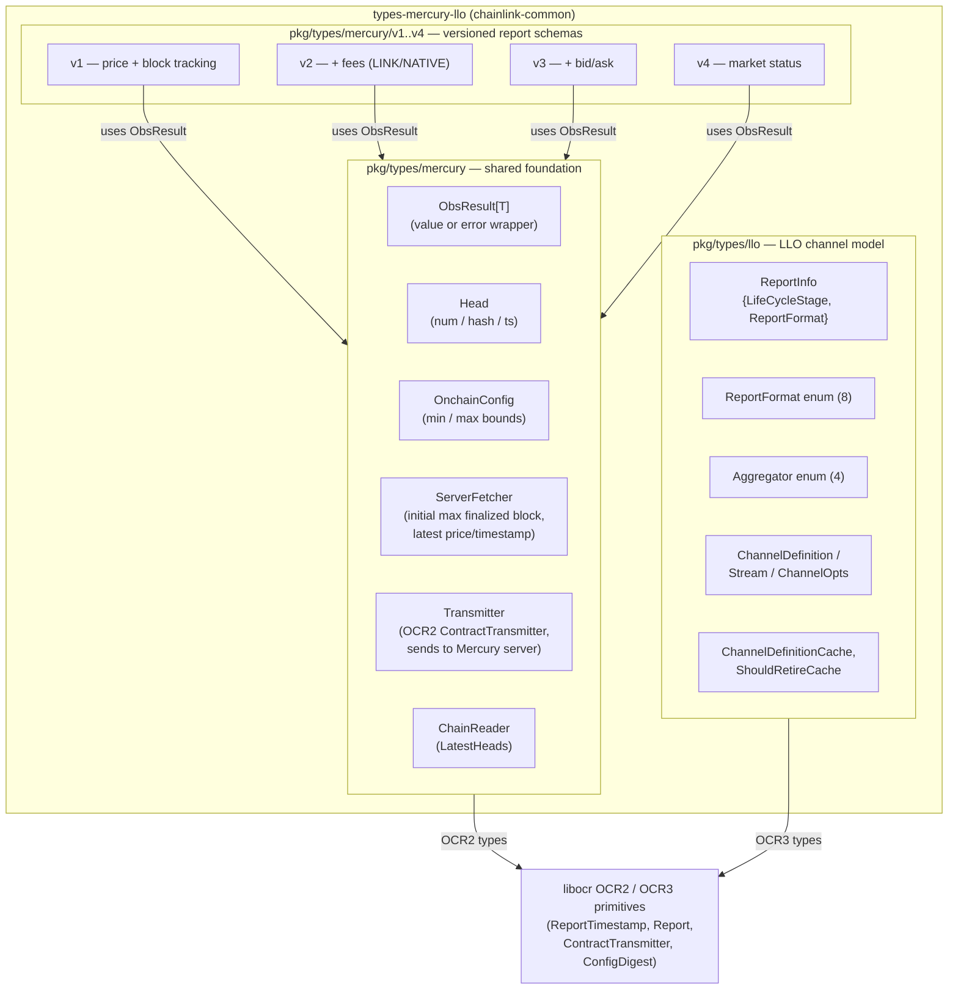
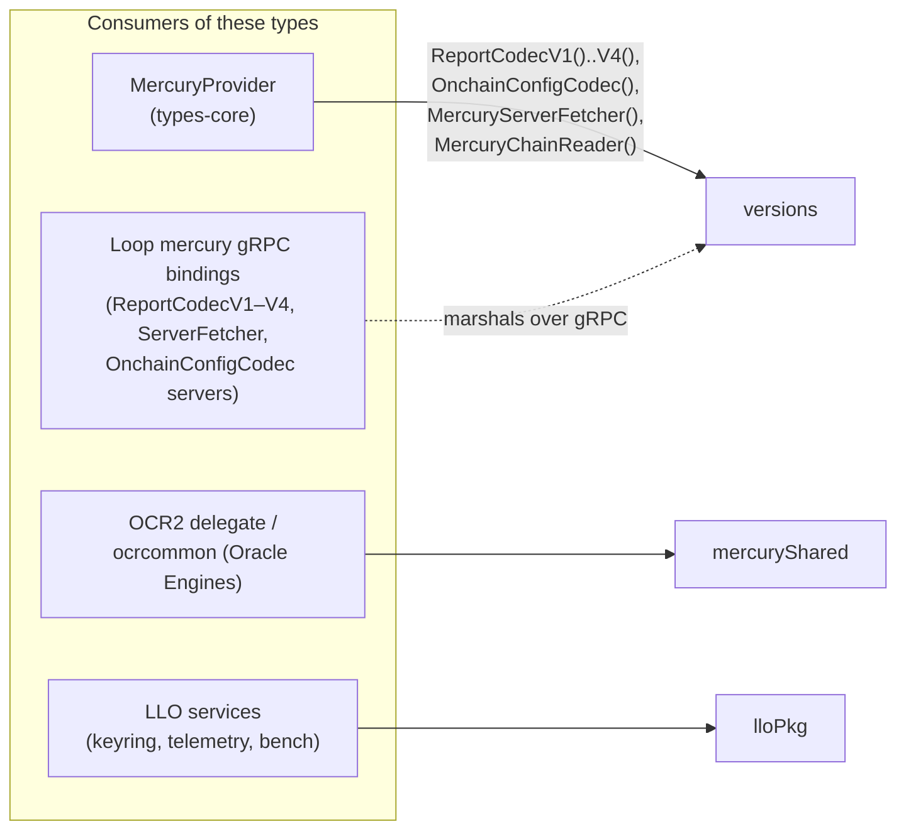
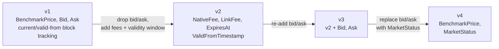
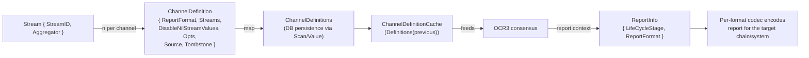

# Mercury & LLO Domain Types (`types-mercury-llo`)

> **Parent module:** [Shared Foundation Libraries & Domain Types](../Shared_Foundation_Libraries___Domain_Types.md)

## 1. Purpose and Scope

`types-mercury-llo` defines the shared **domain types and interface contracts** for Chainlink's two generations of off-chain data-verification/reporting products:

| Product | Package | Consensus engine | Reporting destination |
|---|---|---|---|
| **Mercury** (Data Streams / premium feeds) | `chainlink-common/pkg/types/mercury` (+ versioned sub-packages `v1`–`v4`) | OCR2 (`libocr/offchainreporting2plus/types`) | Dedicated **Mercury server** (no on-chain transmission) |
| **LLO** (Low-Latency Oracle) | `chainlink-common/pkg/types/llo` | OCR3 (`ocr3types`) | Multiple targets on-chain/off-chain (EVM, JSON, CRE capability triggers, …) |

This module contains **no implementation logic** — only type definitions, interfaces, enumerations and serialisation helpers. It exists so that oracle engines, relay plugins, gRPC plugin bindings and node services can all agree on the *shape* of observations, reports, channels and transmitters without depending on each other's internals.

The module lives inside the `github.com/smartcontractkit/chainlink-common` Go module and depends on `github.com/smartcontractkit/libocr` for the underlying OCR2/OCR3 type primitives (see `chainlink-common/go.mod`, `libocr` requirement).

## 2. Package Layout

| Package | Files | Core content |
|---|---|---|
| `pkg/types/mercury` | `types.go` | Shared Mercury building blocks: `ObsResult[T]`, `OnchainConfig`, `OnchainConfigCodec`, `ServerFetcher`, `Transmitter`, `ChainReader`, `Head` |
| `pkg/types/mercury/v1` | `types.go` | v1 report schema: `Block`, `ReportFields`, `ReportCodec`, `DataSource`, `Observation` |
| `pkg/types/mercury/v2` | `types.go` | v2 report schema: fees (`NativeFee`/`LinkFee`/`ExpiresAt`), `ReportCodec`, `DataSource`, `Observation` |
| `pkg/types/mercury/v3` | `types.go` | v3 report schema: v2 + `Bid`/`Ask` |
| `pkg/types/mercury/v4` | `types.go` | v4 report schema: `MarketStatus` (bid/ask removed) |
| `pkg/types/llo` | `types.go` | LLO channel model: `ReportInfo`, `ReportFormat` (8 formats), `Aggregator` (4 aggregators), `Stream`, `ChannelDefinition`, `ChannelOpts`, `ChannelDefinitions`, caches |

## 3. Architecture Overview





## 4. Sub-modules

The module splits cleanly along the two product lines and the shared Mercury foundation. Detailed documentation per sub-module:

| Sub-module | Documentation (generated) | Core components covered | Contents |
|---|---|---|---|
| **Mercury shared foundation** | [types-mercury-llo_mercury.md](types-mercury-llo/types-mercury-llo_mercury.md) | `mercury/types.go::Head`, `::ObsResult`, `::OnchainConfig`, `::Transmitter` | `ObsResult[T]`, `OnchainConfig(+Codec)`, `ServerFetcher`, `Transmitter`, `ChainReader`, `Head` — the cross-version vocabulary every Mercury version package builds on |
| **Mercury report codecs (v1–v4)** | [types-mercury-llo_report-codecs.md](types-mercury-llo/types-mercury-llo_report-codecs.md) | `mercury/v1/types.go::DataSource`, `::Observation`, `::ReportFields`; `mercury/v2/types.go::DataSource`, `::Observation`, `::ReportCodec`, `::ReportFields`; `mercury/v3/types.go` (same set); `mercury/v4/types.go` (same set) | The four versioned report schemas (`ReportFields`, `ReportCodec`, `DataSource`, `Observation`) and their evolution |
| **LLO channel & report types** | [types-mercury-llo_llo.md](types-mercury-llo/types-mercury-llo_llo.md) | `llo/types.go::ReportInfo` (plus its companion types `ReportFormat`, `Aggregator`, `Stream`, `ChannelDefinition`, `ChannelDefinitions`, caches) | `ReportInfo`, `ReportFormat`/`Aggregator` enums, `Stream`/`ChannelDefinition`/`ChannelOpts`, persistence (`Scan`/`Value`) and definition caches |

Each sub-module page cross-references back to this overview and to the consuming modules listed in §8 (MercuryProvider, Loop gRPC bindings, OCR2/LLO engines).

## 5. Mercury Report Version Evolution

Mercury report schemas are strictly additive/generative — each version is frozen once published. The four versions evolve as follows:



| Aspect | v1 | v2 | v3 | v4 |
|---|---|---|---|---|
| Prices in `ReportFields` | Benchmark, Bid, Ask | Benchmark only | Benchmark, Bid, Ask | Benchmark only |
| Fees | — | `NativeFee`, `LinkFee`, `ExpiresAt` | same as v2 | same as v2 |
| Validity | `ValidFromBlockNum` + current block num/hash/ts | `ValidFromTimestamp` | `ValidFromTimestamp` | `ValidFromTimestamp` |
| Special observation | block list (`LatestBlocks`), `MaxFinalizedBlockNumber` | `MaxFinalizedTimestamp`, Link/Native price | + Bid/Ask | + `MarketStatus` |
| `ReportCodec` extras | `CurrentBlockNumFromReport` | `ObservationTimestampFromReport` | `ObservationTimestampFromReport` | `ObservationTimestampFromReport` |
| `DataSource.Observe` flag | `fetchMaxFinalizedBlockNum` | `fetchMaxFinalizedTimestamp` | `fetchMaxFinalizedTimestamp` | `fetchMaxFinalizedTimestamp` (see ⚠ note in v3/v4 code about `types` vs `ocrtypes` alias self-consistency) |

All `ReportCodec` implementations must be **pure and thread-safe**, and every `DataSource` must be safe for concurrent `Observe` calls with graceful degradation after context expiry (cheap finalisation allowed, no blocking work).

## 6. Mercury Report Lifecycle

```mermaid
sequenceDiagram
    participant OCR as OCR2 core (libocr)
    participant DS as DataSource (v1–v4)
    participant RC as ReportCodec (v1–v4)
    participant TX as Transmitter (mercury)

    OCR->>DS: Observe(ctx, ReportTimestamp, fetchMaxFinalized…)
    DS-->>OCR: Observation{ BenchmarkPrice/Bid/Ask/Fees … : ObsResult[T] }
    OCR->>RC: BuildReport(ctx, ReportFields)
    RC-->>OCR: Report (max MaxReportLength(n) bytes)
    OCR->>TX: Transmit(ctx, Report, attributions…)
    TX->>TX: Signed report → Mercury server<br/>(FromAccount() = CSA public key)
    Note over TX: LatestConfigDigestAndEpoch is a stub;<br/>no on-chain transmission exists in Mercury
```

The `ServerFetcher` interface is mirrored over gRPC by the Loop plugin framework — see [Mercury gRPC bindings](../Plugin_Process_Framework_(Loop)/loop-grpc-bindings/loop-grpc-bindings_mercury.md) (`UnsafeServerFetcherServer`, `UnsafeOnchainConfigCodecServer`, `UnsafeReportCodecV1..V4Server`).

## 7. LLO Channel → Report Model

LLO generalises what Mercury hard-codes per version into a **declarative channel model**:



Key design decisions encoded in `pkg/types/llo/types.go`:

- **`StreamID`/`ChannelID` are `uint32`** — chosen deliberately for cross-language compatibility (JSON, JavaScript), compactness, and to avoid encoding ambiguities (e.g. UUID→`[32]byte`).
- **`ReportFormat` is an open-but-frozen enum** (reserved `0` and `math.MaxUint32`): formats are forever-compatible once added. Supported: `EVMPremiumLegacy` (Mercury v0.3 compatibility — the historical bridge between the two products), `JSON`, `Retirement` (OCR instance handover), `EVMABIEncodeUnpacked`, `CapabilityTrigger` (protobuf, CRE-compatible), `EVMStreamlined`, `EVMABIEncodeUnpackedExpr`, `HistoryBackfill`. Both numeric and string JSON/text (un)marshalling are supported.
- **`Aggregator` enum**: `Median`, `Mode`, `Quote` (bid/mid/ask tuples), `Calculated` (expressions for `EVMABIEncodeUnpackedExpr`).
- **`ChannelOpts` are canonicalised JSON** — `UnmarshalJSON`/`MarshalJSON` round-trip through a map so that key ordering is deterministic and `ChannelDefinition.Equals` can compare options byte-wise.
- **Tombstoning & provenance**: `Tombstone` flags owner-issued removals; `Source` records which role added the definition (1 = `ChannelConfigStore` owner).
- **`Transmitter = ocr3types.ContractTransmitter[ReportInfo]`** — the OCR3 analogue of Mercury's transmitter, generic over `ReportInfo`.

## 8. Cross-module Relationships

| Related module | Relationship |
|---|---|
| [types-core — providers](types-core/types-core_providers.md) | `MercuryProvider` (in `chainlink-common/pkg/types/provider_mercury.go`) is the relay-level factory exposing `ReportCodecV1()..V4()`, `OnchainConfigCodec()`, `MercuryServerFetcher()`, `MercuryChainReader()` — the primary consumption point for this module's Mercury interfaces |
| [types-chains — EVM](types-chains/types-chains_evm.md) | Mercury/LLO EVM report formats ultimately target EVM chains; `Transmitter` implementations use chain clients from there |
| [Loop gRPC bindings — Mercury](../Plugin_Process_Framework_(Loop)/loop-grpc-bindings/loop-grpc-bindings_mercury.md) | gRPC server/client surfaces generated directly from these interfaces (report codecs v1–v4, data sources v1–v4, onchain-config codec, server fetcher) so report logic can run in plugin processes |
| [Oracle Engines — OCR2 delegate](../Oracle_Engines___Data_Pipelines/ocr/ocr2_delegate.md) | The OCR2 job delegate wires Mercury `DataSource`/`Transmitter`/`ReportCodec` implementations into libocr oracle instances |
| [Oracle Engines — LLO](../Oracle_Engines___Data_Pipelines/llo/llo_telemetry.md) | LLO runtime services (telemetry, keyring, benchmarks) consume the channel/report types defined here |

## 9. Build & Packaging Notes

- All code belongs to the **`github.com/smartcontractkit/chainlink-common`** Go module (see `chainlink-common/go.mod`); there is no separate module for these packages.
- The only significant external dependency is **`github.com/smartcontractkit/libocr`** (`chainlink-common/go.mod`, line 54), providing `offchainreporting2plus/types` (OCR2) and `ocr3types` (OCR3) primitives that `Transmitter`, `DataSource` and `ReportCodec` are parameterised over.
- `ChannelDefinitions` implements `driver.Valuer`/`sql.Scanner`, so the package also shapes the **database representation** (JSONB-style columns) used by node persistence layers that store channel definitions.
