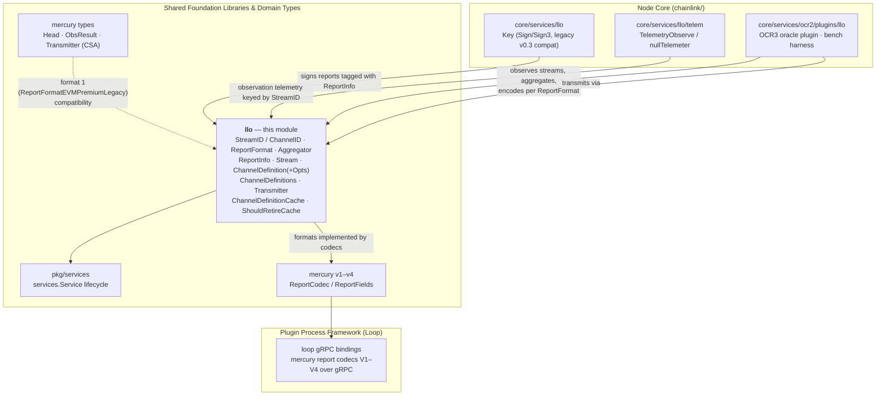
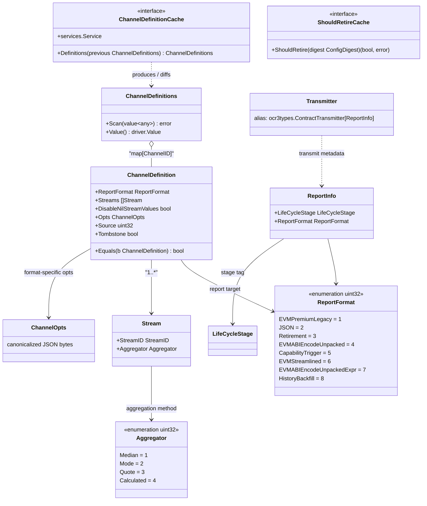

# LLO Domain Types (`chainlink-common/pkg/types/llo`)

## 1. Introduction

The `llo` package is the **canonical domain-types library for Chainlink's Low-Latency Oracle (LLO)** — the streaming oracle engine that evolved out of the Mercury data-streams program. It defines, in one small, dependency-light file (`chainlink-common/pkg/types/llo/types.go`), the shared vocabulary that every part of the system uses when talking about LLO:

- **Channel/stream identifiers** (`StreamID`, `ChannelID`)
- **Report formats** (`ReportFormat`) — the on-chain/off-chain wire encodings a report can target
- **Aggregation methods** (`Aggregator`) — how multiple node observations collapse into a single value
- **Report metadata** (`ReportInfo`) — the lifecycle/format tag attached to every transmitted OCR3 report
- **Channel definitions** (`Stream`, `ChannelDefinition`, `ChannelDefinitions`, `ChannelOpts`) — the declarative configuration of what a channel observes and how it reports
- **The transmitter specialization** (`Transmitter`) — an OCR3 `ContractTransmitter` generic over `ReportInfo`
- **Cache contracts** (`ChannelDefinitionCache`, `ShouldRetireCache`) — the interfaces between the channel-definition store and the OCR3 oracle runtime

Because these types are consumed simultaneously by the node core (`chainlink/core/services/llo`, `core/services/ocr2/plugins/llo`), the plugin process framework (gRPC codecs), and deployment/test tooling, the package is deliberately **stable, append-only, and free of business logic**.

> **Module position:** this is the `llo` child of the [types-mercury-llo](../types-mercury-llo.md) module, which groups the LLO and Mercury domain types inside the [Shared Foundation Libraries & Domain Types](../../Shared_Foundation_Libraries___Domain_Types.md) area. The sibling pages cover [Mercury core types](types-mercury-llo_mercury.md) and [Mercury report codecs v1–v4](types-mercury-llo_report-codecs.md).

### Module at a glance

| Property | Value |
|---|---|
| Package path | `github.com/smartcontractkit/chainlink-common/pkg/types/llo` |
| Go module | `github.com/smartcontractkit/chainlink-common` (see `chainlink-common/go.mod`) |
| Key file | `chainlink-common/pkg/types/llo/types.go` |
| External deps | `github.com/smartcontractkit/libocr` (OCR2/OCR3 types), `chainlink-common/pkg/services` |
| Protos | none — pure Go types, no code generation |
| Primary consumers | node core LLO engine, OCR3 LLO plugin, telemetry, benchmarks, gRPC codec bindings |

---

## 2. Design Principles

The package encodes several deliberate, long-term compatibility decisions (documented in the source itself):

1. **`uint32` identifiers for streams and channels.** 4 billion IDs cover all conceivable channel/stream requirements; `uint32` is JSON/JavaScript-safe, chain-agnostic (unlike `[32]byte`, which is not fully supported on Starknet etc.), compact, and avoids the encoding ambiguity of UUIDs. **ID `0` should not be used** — it is reserved to avoid confusion with uninitialized values.
2. **Append-only enumerations.** `ReportFormat` and `Aggregator` are wire/on-chain contracts: *"Only add something here if you actually need it, because it has to be supported forever and can't be changed."* Values are never reused or renumbered, and both `0` and `math.MaxUint32` are permanently reserved (declared via blank constants).
3. **Deterministic JSON.** `ChannelOpts` is canonicalized (map round-trip with sorted keys) so that JSON equality is byte-stable — required by `ChannelDefinition.Equals`.
4. **Dual string/number JSON support.** `ReportFormat` and `Aggregator` marshal to human-readable names (`"evm_streamlined"`, `"median"`) and unmarshal from *either* the name or the raw number, for operator-friendly config plus backward compatibility.
5. **Database-ready persistence.** `ChannelDefinitions` implements `sql.Scanner` and `driver.Valuer`, so the channel-definitions cache can be persisted as a JSON blob in the node's Postgres database.
6. **Chain-agnostic targets.** `ReportFormat` explicitly supports multiple targets — EVM, JSON, protobuf/CRE triggers, retirement handovers — rather than hard-coding EVM semantics.

---

## 3. Type Catalogue

### 3.1 Identifiers

| Type | Underlying | Notes |
|---|---|---|
| `StreamID` | `uint32` | Identifies an individual observable data stream. `0` discouraged. |
| `ChannelID` | `uint32` | Identifies a report channel. `0` discouraged. |

### 3.2 `LifeCycleStage`

An open `string` type carried inside `ReportInfo`. The package itself does not constrain the values; stage labels are supplied by the channel-definitions store in the node core, where channels exist in parallel lifecycle tracks (conventionally *staging* vs *production*) so that definitions can be rolled out and validated before affecting production reports. Treat it as an opaque tag when consuming reports.

### 3.3 `ReportFormat` — the report wire formats

`ReportFormat` is a `uint32` enumeration. Values are immutable once shipped; `ReportFormats` exposes the full list for validation/enumeration.

| Value | Constant | String form | Purpose |
|---|---:|---|---|
| 1 | `ReportFormatEVMPremiumLegacy` | `evm_premium_legacy` | Maintains compatibility with the **legacy Mercury v0.3 report format** |
| 2 | `ReportFormatJSON` | `json` | Simple JSON format for reference and debugging |
| 3 | `ReportFormatRetirement` | `retirement` | "Capstone" report marking a retired OCR instance and handing over crucial information to a new one |
| 4 | `ReportFormatEVMABIEncodeUnpacked` | `evm_abi_encode_unpacked` | Fixed schema header followed by an arbitrary ABI-encoded payload |
| 5 | `ReportFormatCapabilityTrigger` | `capability_trigger` | Protobuf binary format compatible with **CRE capability triggers** |
| 6 | `ReportFormatEVMStreamlined` | `evm_streamlined` | Feeless report format with packed encoding and minimal header overhead (size/gas optimal) |
| 7 | `ReportFormatEVMABIEncodeUnpackedExpr` | `evm_abi_encode_unpacked_expr` | Like format 4, plus custom expressions that compute report values from the available streams |
| 8 | `ReportFormatHistoryBackfill` | `history_backfill` | *Meta-format*: the channel carries pre-aggregated historical observations in `Opts`; reports are encoded with the target channel's codec |

API surface: `String()`, `ReportFormatFromString(s)`, `MarshalText`/`UnmarshalText`, `MarshalJSON`/`UnmarshalJSON` (accepts string name **or** numeric value; unknown values render as `unknown(<n>)`).

### 3.4 `Aggregator` — observation aggregation methods

`Aggregator` is a `uint32` enumeration describing how the consensus protocol collapses multiple node observations of a stream into a single value.

| Value | Constant | String form | Purpose |
|---|---:|---|---|
| 1 | `AggregatorMedian` | `median` | Median of observations |
| 2 | `AggregatorMode` | `mode` | Most frequent value |
| 3 | `AggregatorQuote` | `quote` | Special aggregator for Bid/Mid/Ask price tuples |
| 4 | `AggregatorCalculated` | `calculated` | Calculated stream values in the outcome, used by `ReportFormatEVMABIEncodeUnpackedExpr` |

Same API pattern as `ReportFormat` (`String`, `AggregatorFromString`, text/JSON marshaling with string-or-number tolerance).

### 3.5 Core structs

```go
type ReportInfo struct {
    LifeCycleStage LifeCycleStage
    ReportFormat   ReportFormat
}

type Stream struct {
    StreamID   StreamID   `json:"streamId"`
    Aggregator Aggregator `json:"aggregator"`
}

type ChannelDefinition struct {
    ReportFormat           ReportFormat `json:"reportFormat"`
    Streams                []Stream     `json:"streams"`
    DisableNilStreamValues bool         `json:"disableNilStreamValues"`
    Opts                   ChannelOpts  `json:"opts"`
    Source                 uint32       `json:"source"`
    Tombstone              bool         `json:"tombstone"`
}

type ChannelDefinitions map[ChannelID]ChannelDefinition
type ChannelOpts       []byte
```

Field semantics worth calling out:

| Field | Semantics |
|---|---|
| `ChannelDefinition.ReportFormat` | Output format of reports for the channel — may target a different chain or a custom codec. |
| `ChannelDefinition.Streams` | The streams observed and aggregated by the protocol for this channel. |
| `ChannelDefinition.DisableNilStreamValues` | When `true`, a channel with any `nil` stream value is **not reportable** until all values are present. When `false` (default), `nil` values are allowed and the report codec must handle them. |
| `ChannelDefinition.Opts` | Format-specific configuration (e.g. feed ID, expiry window, USD base fee). Encoding is up to the format implementer and must stay consistent per `ReportFormat`. May be `nil`. |
| `ChannelDefinition.Source` | Set by the LLO channel-definitions cache: the ID of the role that added the definition. `1` is always the **ChannelConfigStore owner**; greater values are adders. |
| `ChannelDefinition.Tombstone` | Marks an owner tombstone that removes the definition from the current cache. |

`ChannelDefinition.Equals` provides structural equality (tombstone, source, format, nil-value policy, stream-by-stream comparison, and byte equality of canonicalized `Opts`) — used by the definitions cache to diff previous vs. next definition sets.

`ChannelDefinitions` (the `map[ChannelID]ChannelDefinition`) additionally implements:

- `Scan(value any) error` — `sql.Scanner`; tolerates `nil` and empty byte slices.
- `Value() (driver.Value, error)` — `driver.Valuer`; marshals to JSON.

### 3.6 Transmitter

```go
type Transmitter = ocr3types.ContractTransmitter[ReportInfo]
```

A type alias that specializes libocr's generic OCR3 `ContractTransmitter` to LLO's `ReportInfo` metadata. Every report transmitted by the LLO oracle therefore carries its `LifeCycleStage` and `ReportFormat` alongside the OCR3 report context. Contrast this with the Mercury `Transmitter` (CSA-pushed to a server, no on-chain contract) documented in the [Mercury types](types-mercury-llo_mercury.md) page.

### 3.7 Cache interfaces

```go
type ChannelDefinitionCache interface {
    Definitions(previous ChannelDefinitions) ChannelDefinitions
    services.Service
}

type ShouldRetireCache interface {
    ShouldRetire(digest ocr2types.ConfigDigest) (bool, error)
}
```

- **`ChannelDefinitionCache`** is the contract between the channel-definition store and the OCR3 oracle runtime. `Definitions(previous)` returns the full definition set given the previous round's set (the cache computes deltas/tombstones internally). It embeds `services.Service`, inheriting the standard node service lifecycle (`Start`/`Close`/health) documented on the [services](../services.md) page.
- **`ShouldRetireCache`** lets the oracle ask whether a given OCR2/OCR3 config digest should retire — the trigger for emitting `ReportFormatRetirement` capstone reports during instance handover.

---

## 4. Architecture & Component Relationships

The package sits at the centre of a hub-and-spoke pattern: it owns **no behaviour**, but every LLO component depends on its types.



**Reading the diagram:**

- The **OCR3 LLO plugin** (`core/services/ocr2/plugins/llo`, see the [LLO oracle engine](../../Oracle_Engines___Data_Pipelines/llo.md) page) consumes `ChannelDefinitionCache` for the active channel set, observes each `Stream`, runs the `Aggregator`, and encodes reports in the channel's `ReportFormat`. Its benchmark harness parameterizes load as *channels × streams-per-channel* — i.e., it scales directly with the `ChannelDefinitions` this package models.
- The node's **keyring** (`core/services/llo/keyring.go::Key`) signs reports, explicitly retaining legacy `Sign`/`Verify` methods "needed for v0.3 report compatibility" — the signing-side mirror of `ReportFormatEVMPremiumLegacy`.
- **Telemetry** (`TelemetryObserve`) is emitted per stream observation; `nullTelemeter` is the no-op default, following the same null-object pattern used across the [telemetry & observability platform](../../Telemetry___Observability_Platform.md).
- **gRPC codec bindings** in the [Loop plugin framework](../../Plugin_Process_Framework_(Loop).md) surface report codecs (including the Mercury V1–V4 codecs that the legacy LLO format interoperates with) across the plugin process boundary.

### Type-level relationships



---

## 5. Report Lifecycle & Data Flow

The sequence below shows how a LLO report travels from channel configuration to its on-chain/off-chain target. The types in this package mark every stage of the path.

```mermaid
sequenceDiagram
    autonumber
    participant Src as Channel source<br/>(ChannelConfigStore owner / adders)
    participant Cache as ChannelDefinitionCache<br/>(node DB-backed)
    participant Oracle as LLO OCR3 Oracle<br/>(core plugin runtime)
    participant Tx as Transmitter<br/>ocr3types.ContractTransmitter[ReportInfo]
    participant Tgt as Target<br/>(EVM contract · JSON · CRE trigger · …)

    Src->>Cache: upsert ChannelDefinition<br/>(format, streams, opts, Source; tombstones for removal)
    Note over Cache: definitions persisted via<br/>ChannelDefinitions.Scan/Value (JSON blob)
    Cache->>Oracle: Definitions(previous)
    loop each OCR3 round
        Oracle->>Oracle: observe each Stream (StreamID)
        Oracle->>Oracle: aggregate observations<br/>(median / mode / quote / calculated)
        Oracle->>Oracle: encode report per ChannelDefinition.ReportFormat
        Oracle->>Tx: Transmit(report, ReportInfo{LifeCycleStage, ReportFormat})
        Tx->>Tgt: signed OCR3 report
    end
    opt instance handover
        Oracle->>Cache: ShouldRetire(configDigest)
        Oracle->>Tgt: ReportFormatRetirement "capstone" report
    end
```

**Stage-by-stage mapping to this package:**

1. **Definition intake** — upstream roles (owner = `Source 1`, adders > 1) publish `ChannelDefinition`s; removal is expressed with `Tombstone: true` rather than deletion, so every cache replica converges via `Equals`-based diffing.
2. **Persistence** — the definitions map is stored as JSON (`Scan`/`Value`), surviving node restarts; `Opts` round-trips through canonicalized JSON so persisted definitions compare byte-equal.
3. **Observation & aggregation** — each `Stream` pairs a `StreamID` with an `Aggregator`; telemetry hooks (`TelemetryObserve`) attach per-observation metrics.
4. **Encoding** — `ReportFormat` selects the codec; nil-value policy (`DisableNilStreamValues`) determines reportability; `AggregatorCalculated` values feed expression-based formats (4/7).
5. **Transmission** — `Transmit` carries `ReportInfo{LifeCycleStage, ReportFormat}` so receivers (and the retirement path via `ShouldRetireCache`) can interpret each report correctly.
6. **Retirement** — `ReportFormatRetirement` reports hand state over to a new OCR instance.

---

## 6. Serialization & Persistence Reference

| Concern | Mechanism | Notes |
|---|---|---|
| Report format / aggregator in JSON | Name string preferred (`"evm_streamlined"`, `"median"`); raw numbers also accepted on unmarshal | Errors: `unknown report format: %q` / `unknown aggregator: %q` |
| Unknown enum in text | `unknown(<n>)` via `String()` | Safe for logs |
| `ChannelOpts` | Canonicalized JSON (map round-trip, sorted keys) | `null` unmarshals to `nil`; `nil` marshals to `"null"` |
| `ChannelDefinitions` | `sql.Scanner` + `driver.Valuer` (JSON) | `nil` bytes → `nil` map; empty bytes → empty map |
| Equality | `ChannelDefinition.Equals` | Includes `Opts` byte equality (hence canonicalization) and per-stream comparison |

---

## 7. Compatibility & Extension Rules

Because these enums are wire and (in several formats) **on-chain** contracts:

- **Never** renumber, reuse, or delete a `ReportFormat`/`Aggregator` value; both `0` and `math.MaxUint32` are permanently reserved.
- Adding a new format is an append-only operation:
  1. Add the next free constant with a comment explaining the need.
  2. Add cases to `String()` / `ReportFormatFromString` (or the `Aggregator` equivalents).
  3. Add it to the `ReportFormats` slice.
  4. Implement the codec in the owning target/plugin — do **not** put codec logic in this package.
- Keep `StreamID`/`ChannelID` as `uint32` — downstream serialization (JSON, protobufs, on-chain payloads, JavaScript tooling) depends on the width.
- Continue using `0` for neither stream nor channel IDs.
- Any change to `ChannelDefinition` JSON shape must remain backward-compatible with definitions already persisted in node databases and with historical `ReportInfo` values.

---

## 8. Build & Module Context

- The package lives in the `github.com/smartcontractkit/chainlink-common` Go module (`chainlink-common/go.mod`), which pins the `smartcontractkit/libocr` dependency providing `ocr3types.ContractTransmitter` and the OCR2 `ConfigDigest` used by `ShouldRetireCache`. There is no protobuf/codegen step for this package (unlike the [chain gRPC protos](../chain-grpc-protos.md) or the [Loop gRPC bindings](<../../Plugin_Process_Framework_(Loop)/loop-grpc-bindings.md>) modules).
- Module-level build/lint tooling (`chainlink-common/Makefile`) applies as for the rest of `chainlink-common`.

---

## 9. Related Documentation

| Topic | Link |
|---|---|
| Parent module (Mercury + LLO types) | [types-mercury-llo](../types-mercury-llo.md) |
| Mercury core types (`Head`, `ObsResult`, CSA `Transmitter`) | [types-mercury-llo_mercury](types-mercury-llo_mercury.md) |
| Mercury report codecs v1–v4 (`ReportCodec`, `ReportFields`, `Observation`) | [types-mercury-llo_report-codecs](types-mercury-llo_report-codecs.md) |
| Relayer / provider / plugin-service contracts | [types-core](../types-core.md) |
| `services.Service` lifecycle contract | [services](../services.md) |
| LLO engine in the node core (keyring, telemetry, plugin, benchmarks) | [Oracle Engines → llo](../../Oracle_Engines___Data_Pipelines/llo.md) |
| Loop gRPC bindings (report codecs across plugin process boundary) | [loop-grpc-bindings](<../../Plugin_Process_Framework_(Loop)/loop-grpc-bindings.md>) and [loop-relayer-services](<../../Plugin_Process_Framework_(Loop)/loop-relayer-services.md>) |
| Shared foundation libraries overview | [Shared_Foundation_Libraries___Domain_Types](../../Shared_Foundation_Libraries___Domain_Types.md) |
