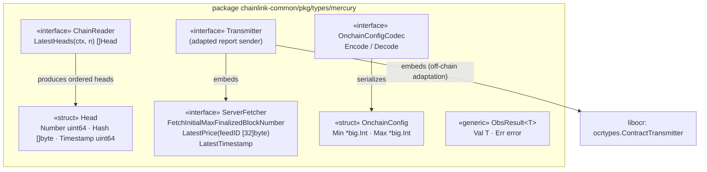
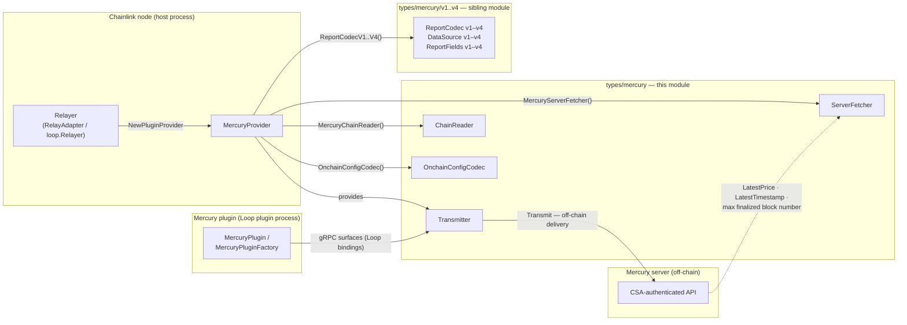

# types-mercury-llo / Mercury — Core Domain Types

> **Source of truth:** `chainlink-common/pkg/types/mercury/types.go`
> **Go package:** `mercury` (Go module `github.com/smartcontractkit/chainlink-common`, declared in `chainlink-common/go.mod`)

## 1. Introduction

This module defines the **shared, version-independent domain types and service contracts for the Mercury off-chain reporting product**. Mercury is a Chainlink data product in which oracle reports are delivered to an **off-chain Mercury server** (not to an on-chain contract). The types in this package are therefore deliberately minimal:

- a **`Head`** abstraction for Mercury's own notion of chain heads,
- a generic **`ObsResult[T]`** envelope for reporting observation values *or* errors,
- **`OnchainConfig`** with its **`OnchainConfigCodec`** (the only on-chain-derived data Mercury carries: min/max value bounds),
- the **`ServerFetcher`** interface for querying the Mercury server (prices, timestamps, finalized block numbers),
- the **`Transmitter`** interface, which *adapts* libocr's on-chain `ContractTransmitter` to Mercury's off-chain delivery model,
- and a **`ChainReader`** interface for fetching recent heads.

The package is the vocabulary used by:

- the **version-specific report codecs and data sources** (v1–v4), documented in the sibling module [types-mercury-llo report-codecs](types-mercury-llo_report-codecs.md),
- the **`MercuryProvider`** relay-provider contract ([types-core](../types-core.md)) that hands these interfaces to Mercury jobs,
- the **Loop plugin-process framework**, which mirrors each interface as a gRPC service surface so the Mercury plugin can run in a separate process ([loop-grpc-bindings_mercury](../../Plugin_Process_Framework_(Loop)/loop-grpc-bindings/loop-grpc-bindings_mercury.md)).

For the Low-Latency Oracle (LLO) successor to Mercury, see [types-mercury-llo LLO](types-mercury-llo_llo.md).

## 2. Module position in the system

```
Shared_Foundation_Libraries___Domain_Types
└── types-mercury-llo                      (this group: Mercury + LLO domain types)
    ├── types-mercury-llo_mercury          ← YOU ARE HERE (version-independent Mercury contracts)
    ├── types-mercury-llo_report-codecs    (Mercury v1–v4 DataSource / ReportCodec / ReportFields)
    └── types-mercury-llo_llo              (LLO ReportInfo and lifecycle types)
```

The module sits at the **contract layer**: it contains no business logic, no I/O, and no persistence. Concrete implementations live in the Chainlink node's relay layer (see [Node Application — Relay](../../Node_Application_Core___Interfaces/node_application/node_application_relay.md)) and in the Mercury plugin, and cross the node↔plugin boundary through the Loop framework.

## 3. Core components

All components below are defined in `chainlink-common/pkg/types/mercury/types.go`.

### 3.1 Data structures

| Component | Kind | Description |
|---|---|---|
| `Head` | `struct` | Minimal block-header record: `Number uint64`, `Hash []byte`, `Timestamp uint64`. Returned by `ChainReader.LatestHeads`. Note this is a Mercury-specific head, distinct from the generic `types.Head` returned by `Relayer.LatestHead`/`FinalizedHead` ([types-core Relayer](../types-core.md)). |
| `ObsResult[T any]` | `struct` (generic) | Observation envelope: `Val T` plus `Err error`. Allows a data source to report either a value **or** an error as a first-class outcome, so per-oracle observation aggregation can treat failures as ordinary inputs rather than aborts. |
| `OnchainConfig` | `struct` | `Min *big.Int`, `Max *big.Int`. Applies to **all** reported values (price, bid and ask). The only piece of Mercury state derived from an on-chain contract configuration. |

### 3.2 Interfaces

| Component | Purpose | Methods |
|---|---|---|
| `OnchainConfigCodec` | Serializes `OnchainConfig` to/from the wire format agreed with the Mercury on-chain config contract. | `Encode(ctx, OnchainConfig) ([]byte, error)`, `Decode(ctx, []byte) (OnchainConfig, error)` |
| `ServerFetcher` | Node-side client for the Mercury server's verification endpoints. | `FetchInitialMaxFinalizedBlockNumber(ctx) (*int64, error)`, `LatestPrice(ctx, feedID [32]byte) (*big.Int, error)`, `LatestTimestamp(ctx) (int64, error)` |
| `Transmitter` | The OCR-compatible report sender. Embeds `ServerFetcher` and libocr's `ocrtypes.ContractTransmitter`. | Inherited from both embedded interfaces. Implementation notes (from the source): `Transmit` sends to the Mercury server (there is **no on-chain contract**); `LatestConfigDigestAndEpoch` is a stub; `FromAccount()` must return the node's **CSA public key**. |
| `ChainReader` | Head tracking for Mercury feeds. | `LatestHeads(ctx, int) ([]Head, error)` — an ordered list of the latest *n* heads. |

The external dependency is `github.com/smartcontractkit/libocr/offchainreporting2plus/types`, imported as `ocrtypes`; `Transmitter` exists precisely so that the standard OCR2 reporting cycle can be reused unchanged while reports are delivered off-chain.

## 4. Architecture

### 4.1 Component structure



### 4.2 System context — how the contracts are consumed

The node's relay layer exposes a `MercuryProvider` (defined in `chainlink-common/pkg/types/provider_mercury.go`, [types-core](../types-core.md)). A provider is obtained from a `Relayer` via `NewPluginProvider` and hands every contract in this module — plus the v1–v4 report codecs — to the Mercury job. The plugin itself may run out-of-process, in which case each interface is bridged over gRPC by the Loop framework.



Related modules that consume these contracts:

- **[Loop gRPC bindings — Mercury](../../Plugin_Process_Framework_(Loop)/loop-grpc-bindings/loop-grpc-bindings_mercury.md)** — generated gRPC servers for `MercuryAdapter` (the `Transmitter`), `MercuryChainReader`, `ServerFetcher`, `OnchainConfigCodec`, `ReportCodecV1`–`V4`, plus `MercuryPlugin`/`MercuryPluginFactory`; each `Unsafe…Server` surface corresponds to one interface in this package (see also [chain-grpc-protos](../chain-grpc-protos.md)).
- **[Oracle Engines — OCR](../../Oracle_Engines___Data_Pipelines/ocr.md)** — the OCR2 delegate (`connProvider`, [ocr2_delegate](../../Oracle_Engines___Data_Pipelines/ocr/ocr2_delegate.md)) wires relay-provided `PluginProvider` instances into OCR2 oracle instances, which is how Mercury jobs receive their `Transmitter`/`ServerFetcher`/codecs.
- **[LLO](types-mercury-llo_llo.md)** — the successor reporting stack; its `ReportInfo` (`LifeCycleStage`, `ReportFormat`) replaces the Mercury v1–v4 codec selection model.

## 5. Data flow — a Mercury OCR2 reporting round

The contracts in this module slot into the standard OCR2 reporting cycle:

```mermaid
sequenceDiagram
    autonumber
    participant OCR as OCR2 reporting cycle (Mercury plugin)
    participant CR as ChainReader
    participant DS as DataSource v1–v4
    participant RC as ReportCodec v1–v4
    participant TX as Transmitter
    participant MS as Mercury server

    OCR->>CR: LatestHeads(ctx, n)
    CR-->>OCR: []Head (ordered, latest n)
    OCR->>DS: Observe(ctx, ReportTimestamp, fetchMaxFinalizedBlockNum)
    DS-->>OCR: Observation value — or error — wrapped via ObsResult[T]
    Note over OCR: Aggregates per-oracle ObsResult values;<br/>errors are valid observation outcomes
    OCR->>RC: BuildReport(ctx, ReportFields)
    RC-->>OCR: ocrtypes.Report (≤ MaxReportLength(n))
    OCR->>TX: Transmit(ctx, configDigest, seqNr, report, s, rs)
    TX->>MS: deliver report over CSA-authenticated channel (off-chain)
    Note over TX,MS: No on-chain contract. FromAccount() = CSA public key;<br/>LatestConfigDigestAndEpoch() is a stub.
    OCR->>TX: FetchInitialMaxFinalizedBlockNumber / LatestPrice / LatestTimestamp
    TX->>MS: verification & bootstrap queries (ServerFetcher methods)
```

Step-by-step:

1. **Head tracking** — the plugin polls `ChainReader.LatestHeads` for the current chain state it reports against.
2. **Observation** — versioned data sources ([types-mercury-llo report-codecs](types-mercury-llo_report-codecs.md)) produce `Observation` values; successes and failures alike are carried through `ObsResult[T]` so aggregation can medianize whatever succeeded.
3. **Report construction** — the selected `ReportCodec` (v1–v4) turns `ReportFields` (e.g., `BenchmarkPrice`, `NativeFee`, `LinkFee`, `MarketStatus` in v4) into an `ocrtypes.Report`.
4. **Delivery** — the `Transmitter.Transmit` call ships the report to the Mercury server instead of broadcasting a transaction.
5. **Verification support** — the `ServerFetcher` methods let the node (and the plugin, over gRPC) verify server state: initial max finalized block number, latest price per 32-byte `feedID`, and latest timestamp. `OnchainConfig` min/max bounds are round-tripped through the `OnchainConfigCodec` whenever the on-chain configuration changes.

## 6. Design notes

- **Off-chain "transmission."** The `Transmitter` doc-comment in the source is explicit: *"Mercury doesn't actually transmit on-chain, so there is no 'contract' involved with the transmitter."* The libocr `ContractTransmitter` shape is preserved purely to reuse the OCR2 machinery; `Transmit` posts to the Mercury server, `FromAccount()` returns the node's CSA public key (used for attribution), and `LatestConfigDigestAndEpoch()` is intentionally a stub.
- **Single codec for config, versioned codecs for reports.** `OnchainConfig`/`OnchainConfigCodec` are version-independent (min/max apply to price, bid and ask), while report encoding evolves through v1→v4 `ReportCodec`/`ReportFields`/`DataSource` interfaces in the sibling module. `MercuryProvider` therefore exposes `OnchainConfigCodec()` once but `ReportCodecV1()`–`ReportCodecV4()` separately.
- **Generic error-carrying observations.** `ObsResult[T]` decouples "an oracle observed something" from "the observation succeeded," which simplifies aggregation logic in the plugin and keeps error visibility per-oracle.
- **Two `Head` types.** `mercury.Head` is the small, Mercury-specific record used by `ChainReader`; the relayer-level `types.Head` (returned by `Relayer.LatestHead`) is a richer chain-agnostic head from [types-core](../types-core.md). They are not interchangeable.
- **Process-boundary ready.** Every interface maps 1:1 onto a Loop gRPC service surface, meaning implementations may live in the host node (in-process) or in the Mercury plugin process with identical semantics — this boundary is detailed in [loop-grpc-bindings_mercury](../../Plugin_Process_Framework_(Loop)/loop-grpc-bindings/loop-grpc-bindings_mercury.md).

## 7. Related documentation

- Parent group: [types-mercury-llo](../types-mercury-llo.md)
- Sibling — versioned data sources & report codecs: [types-mercury-llo report-codecs](types-mercury-llo_report-codecs.md)
- Sibling — LLO types: [types-mercury-llo LLO](types-mercury-llo_llo.md)
- Provider & relayer contracts that expose these interfaces to jobs: [types-core](../types-core.md)
- Runtime plumbing (relay adapter, plugin hosting): [Node Application — Relay](../../Node_Application_Core___Interfaces/node_application/node_application_relay.md) · [OCR2 delegate](../../Oracle_Engines___Data_Pipelines/ocr/ocr2_delegate.md)
- Shared library home: [Shared_Foundation_Libraries___Domain_Types](../../Shared_Foundation_Libraries___Domain_Types.md)
