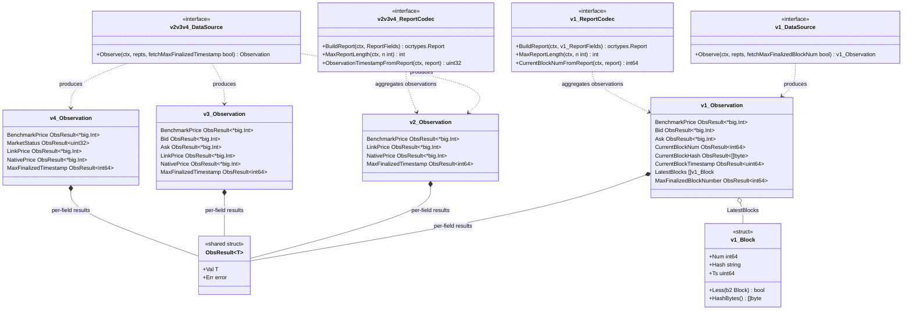
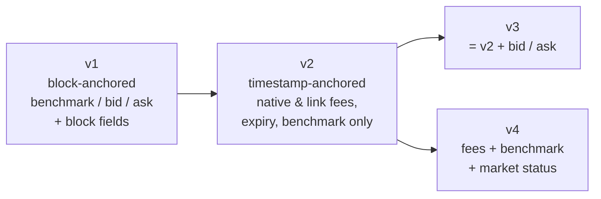
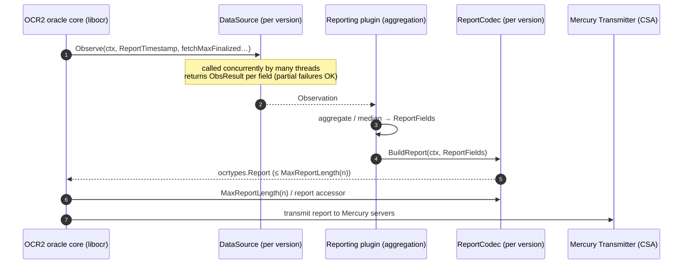
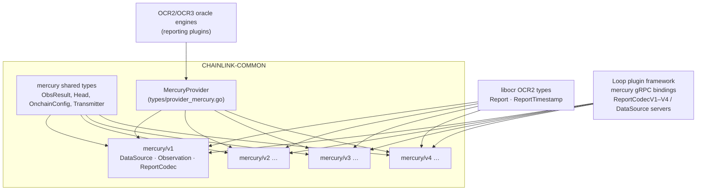

# Mercury Report Codecs (v1–v4)

The `types-mercury-llo_report-codecs` module defines the **versioned data contracts for Mercury data-stream reports**. Under `chainlink-common/pkg/types/mercury/v1` … `v4`, it specifies the three cooperating abstractions an OCR2 (Off-Chain Reporting 2) reporting plugin needs to produce a Mercury report: a `DataSource` for gathering per-oracle observations, an `Observation` envelope built from generic `mercury.ObsResult[T]` values, and a pure `ReportCodec` that serializes median-aggregated `ReportFields` into a signed `ocrtypes.Report`.

Mercury reports are **not broadcast on-chain** — they are delivered to the Mercury server network over CSA by a `mercury.Transmitter` (see [Mercury shared types](types-mercury-llo_mercury.md)). Mercury is the direct predecessor of Low-Latency Oracle (LLO); the LLO successor types are covered in [LLO types](types-mercury-llo_llo.md).

---

## 1. Package layout

All four packages live in the `github.com/smartcontractkit/chainlink-common` Go module ([`chainlink-common/go.mod`](../../../repo/chainlink-common/go.mod), line 1), which pins `github.com/smartcontractkit/libocr` for the OCR2 types (`ocrtypes.Report`, `ocrtypes.ReportTimestamp`) used throughout these contracts.

| Package | File | Core components |
|---|---|---|
| `types/mercury/v1` | `v1/types.go` | `DataSource`, `Observation`, `ReportFields` (+ `ReportCodec`, `Block`/`NewBlock` helpers) |
| `types/mercury/v2` | `v2/types.go` | `DataSource`, `Observation`, `ReportCodec`, `ReportFields` |
| `types/mercury/v3` | `v3/types.go` | `DataSource`, `Observation`, `ReportCodec`, `ReportFields` |
| `types/mercury/v4` | `v4/types.go` | `DataSource`, `Observation`, `ReportCodec`, `ReportFields` |

The generic result wrapper `mercury.ObsResult[T]` (`Val T` + `Err error`) comes from the shared package and is documented in [Mercury shared types](types-mercury-llo_mercury.md).

## 2. Core abstractions

Every version exposes the same shape of contract, with version-specific fields:

### `DataSource`

- **Purpose** — queries the external market-data source for one round of observations.
- **Signature** — `Observe(ctx, repts ocrtypes.ReportTimestamp, fetchMaxFinalized…) (Observation, error)`. The boolean flag tells the source whether to also fetch the max-finalized anchor: v1 uses *block-number* anchoring (`fetchMaxFinalizedBlockNum`), v2–v4 use *timestamp* anchoring (`fetchMaxFinalizedTimestamp`).
- Every field of the returned `Observation` is an `mercury.ObsResult[T]`, so a source can report **partial success** (some values, some errors) rather than failing the whole round.

### `Observation`

The per-oracle observation envelope. Its composition per version is shown in the class diagram above; the field-level evolution is summarized in §3.

### `ReportFields` / `ReportCodec`

- `ReportFields` is the *aggregated* (e.g., median) set of values that goes into a report.
- `ReportCodec` is the version-specific serializer with exactly three operations:
  1. `BuildReport(ctx, ReportFields) (ocrtypes.Report, error)` — encode fields into a report;
  2. `MaxReportLength(ctx, n int) (int, error)` — the maximum encoded size for `n` oracles, which `BuildReport` must respect;
  3. a report *accessor* used for monitoring/bookkeeping:
     - v1: `CurrentBlockNumFromReport(ctx, report) (int64, error)` — median current block number;
     - v2–v4: `ObservationTimestampFromReport(ctx, report) (uint32, error)` — the observation timestamp.

### v1 `Block` helper

v1 is block-anchored, so it ships a small `Block` struct (`Num`, stringified `Hash`, `Ts`) with:

- `NewBlock(num, hash, ts)` — wraps raw hash bytes (the hash is *not* hex, castable directly to `[]byte`);
- `Less(b2)` — total ordering: lower block number first; on equal numbers, the *oldest* timestamp; on full ties, the **largest** hash as tie-break;
- `String()` — `"%d-0x%x-%d"` formatting; `HashBytes()` for raw access.

`LatestBlocks []Block` in the v1 `Observation` lets oracles converge on the freshest consistent chain head.

## 3. Version evolution

### ReportFields comparison

| Field | v1 | v2 | v3 | v4 |
|---|:-:|:-:|:-:|:-:|
| `Timestamp` (uint32) | ✅ | ✅ | ✅ | ✅ |
| Valid-from anchor | `ValidFromBlockNum` (int64) | `ValidFromTimestamp` (uint32) | `ValidFromTimestamp` | `ValidFromTimestamp` |
| `BenchmarkPrice` | ✅ | ✅ | ✅ | ✅ |
| `Bid` / `Ask` | ✅ | ❌ | ✅ | ❌ |
| `NativeFee` / `LinkFee` | ❌ | ✅ | ✅ | ✅ |
| `ExpiresAt` | ❌ | ✅ | ✅ | ✅ |
| `MarketStatus` (uint32) | ❌ | ❌ | ❌ | ✅ |
| Block fields (`CurrentBlockNum/Hash/Timestamp`) | ✅ | ❌ | ❌ | ❌ |

### Observation comparison

| Aspect | v1 | v2 | v3 | v4 |
|---|---|---|---|---|
| Anchoring | block number/hash/timestamp | timestamp | timestamp | timestamp |
| Market prices observed | Benchmark, Bid, Ask | Benchmark, Link, Native | Benchmark, Bid, Ask, Link, Native | Benchmark, MarketStatus, Link, Native |
| Finalized anchor observed | `MaxFinalizedBlockNumber` | `MaxFinalizedTimestamp` | `MaxFinalizedTimestamp` | `MaxFinalizedTimestamp` |
| Extra state | `LatestBlocks []Block` | — | — | — |
| Report accessor | `CurrentBlockNumFromReport` | `ObservationTimestampFromReport` | `ObservationTimestampFromReport` | `ObservationTimestampFromReport` |

**Type-symmetry note:** v1 imports libocr as `types`, v2–v4 as `ocrtypes`; the `ReportTimestamp` passed to `Observe` is the same underlying struct — v3 and v4 carry an explicit `TODO/WARNING` comment acknowledging this inconsistency.

## 4. OCR round data flow

The transmitter side (CSA-authenticated delivery, stubbed `LatestConfigDigestAndEpoch`, CSA public key as `FromAccount`) is defined by `mercury.Transmitter` and documented in [Mercury shared types](types-mercury-llo_mercury.md). Value bounds applied to report prices come from `mercury.OnchainConfig` (`Min`/`Max`) via the `OnchainConfigCodec`, which is exposed alongside the codecs on `MercuryProvider`.

## 5. Implementation contract

Implementers of these interfaces (the Mercury plugins themselves) must honor the following, taken directly from the interface docs:

- **Thread safety** — `DataSource` implementations must be thread-safe; `Observe` may be called by many threads concurrently. All `ReportCodec` functions must be **pure and thread-safe**.
- **Untrusted inputs** — implementers may assume at most one `ParsedAttributedObservation` per observer and that observers are valid, but observation values, timestamps, etc. must all be treated as **untrusted** and carefully validated/parsed.
- **Context discipline** — the context passed to `Observe` times out after `MaxDurationObservation`, but implementations must not assume specific timeout behavior. Once expired, `Observe` should return as quickly as possible, may still perform only cheap computations (e.g., medianize results already received before expiry) rather than error, and must **not** perform expensive work such as database access.
- **Size bound** — `BuildReport` output must respect `MaxReportLength(n)`.
- **Version pinning** — report format is fixed per version; consumers must use the matching `ReportCodec` for the job's feed version.

## 6. How this module fits into the overall system

- **Provider surface** — `MercuryProvider` (embedded in the relayer's `PluginProvider`) exposes `ReportCodecV1()` … `ReportCodecV4()`, `OnchainConfigCodec()`, `MercuryServerFetcher()` and `MercuryChainReader()`. This is the single point where reporting plugins obtain the codecs; see [types-core providers](../types-core/types-core_providers.md) for the `PluginProvider` contract.
- **Plugin-process isolation (Loop)** — the Mercury plugin can run in-process or as an external process; the Loop framework marshals these exact interfaces over gRPC via per-version bindings (`mercury/v1..v4/datasource_v*_grpc.pb.go`, `reportcodec_v*_grpc.pb.go`) and the aggregate `mercury_loop_grpc.pb.go` (`UnsafeReportCodecV1Server`…`UnsafeReportCodecV4Server`, `UnsafeDataSourceServer`, `UnsafeServerFetcherServer`, `UnsafeMercuryChainReaderServer`, `UnsafeOnchainConfigCodecServer`, `UnsafeMercuryAdapterServer`). Details: [Loop gRPC bindings — Mercury](../../Plugin_Process_Framework_(Loop)/loop-grpc-bindings/loop-grpc-bindings_mercury.md).
- **OCR2 execution** — the contracts are consumed by OCR2-based oracle engines that drive `Observe` → aggregate → `BuildReport` each round; see [OCR engines](../../Oracle_Engines___Data_Pipelines/ocr.md) for the engine-side delegate/config wiring.
- **Successor product (LLO)** — Mercury's on-chain-signed-report model evolved into LLO; the LLO-side report type (`ReportInfo`) is documented in [LLO types](types-mercury-llo_llo.md). Both are grouped under the parent page [types-mercury-llo](../types-mercury-llo.md).

## 7. Build & maintenance notes

- The types are plain Go (no protobuf) and ship inside the `github.com/smartcontractkit/chainlink-common` module ([`chainlink-common/go.mod`](../../../repo/chainlink-common/go.mod)); the libocr dependency supplying `ocrtypes` is pinned there (line 54).
- The module is linted/generated with the rest of `chainlink-common` — see the `lint`, `generate`, and `gomodtidy` targets in [`chainlink-common/Makefile`](../../../repo/chainlink-common/Makefile).

## 8. Related documentation

- [types-mercury-llo (parent module)](../types-mercury-llo.md)
- [Mercury shared types — `Head`, `ObsResult`, `OnchainConfig`, `Transmitter`](types-mercury-llo_mercury.md)
- [LLO types — `ReportInfo`](types-mercury-llo_llo.md)
- [types-core — providers (`MercuryProvider`, `PluginProvider`)](../types-core/types-core_providers.md)
- [Loop gRPC bindings — Mercury](../../Plugin_Process_Framework_(Loop)/loop-grpc-bindings/loop-grpc-bindings_mercury.md)
- [Oracle engines & data pipelines (OCR2/OCR3)](../../Oracle_Engines___Data_Pipelines/ocr.md)
