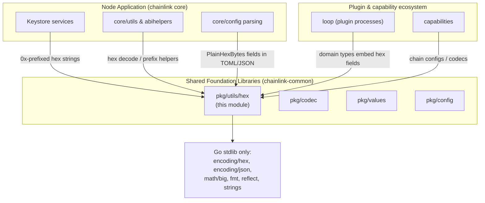
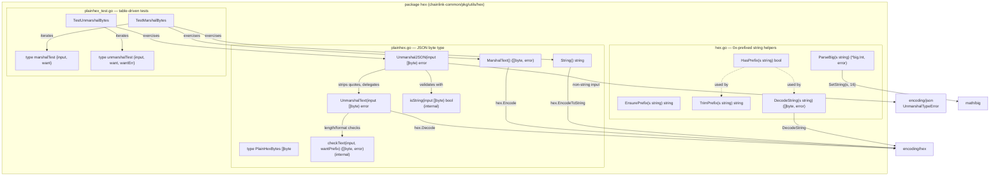
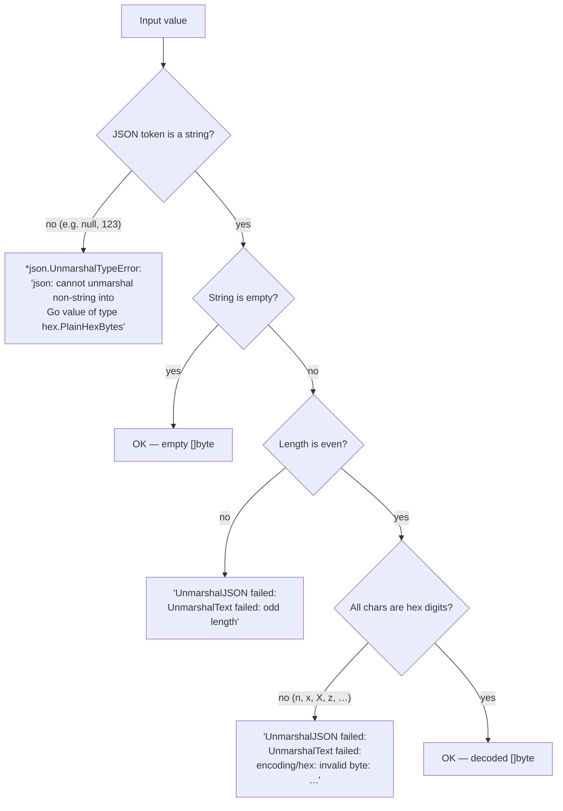
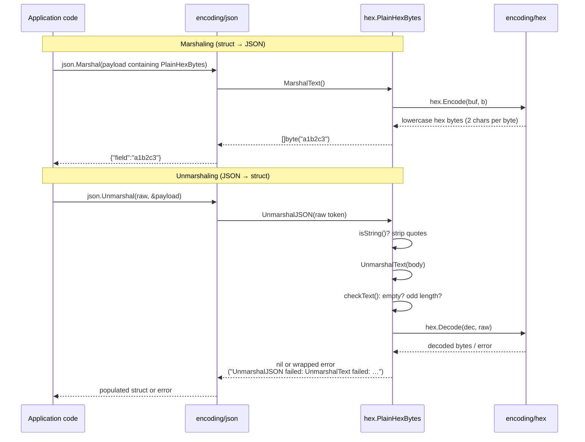
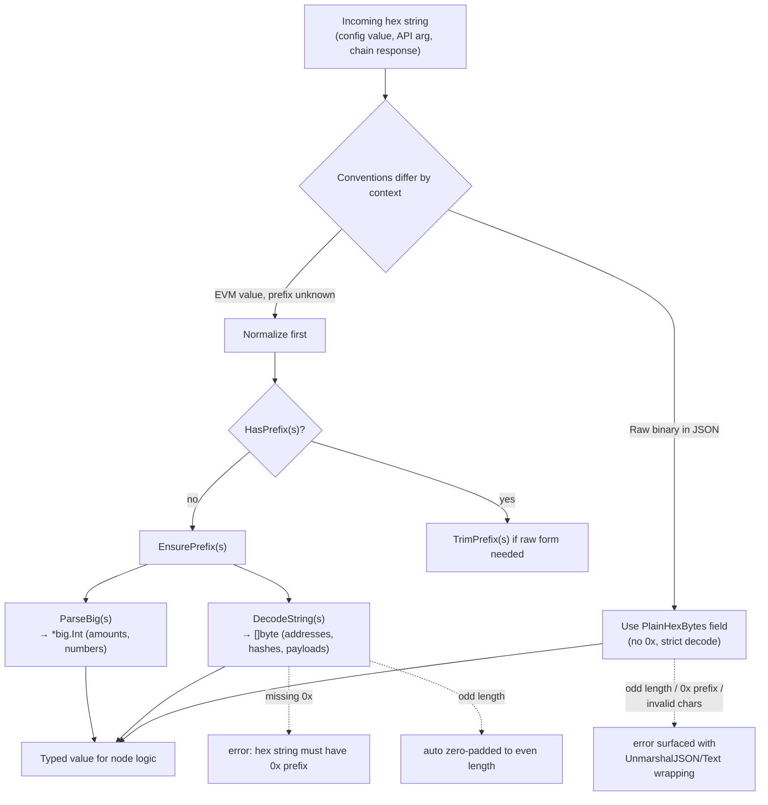
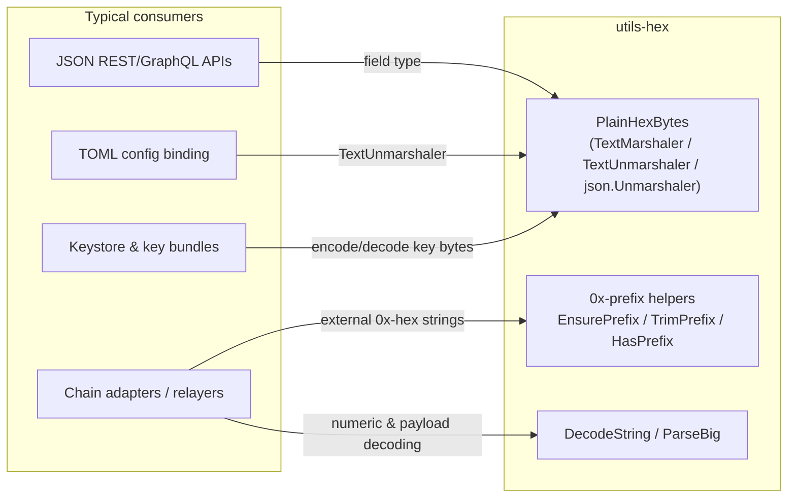
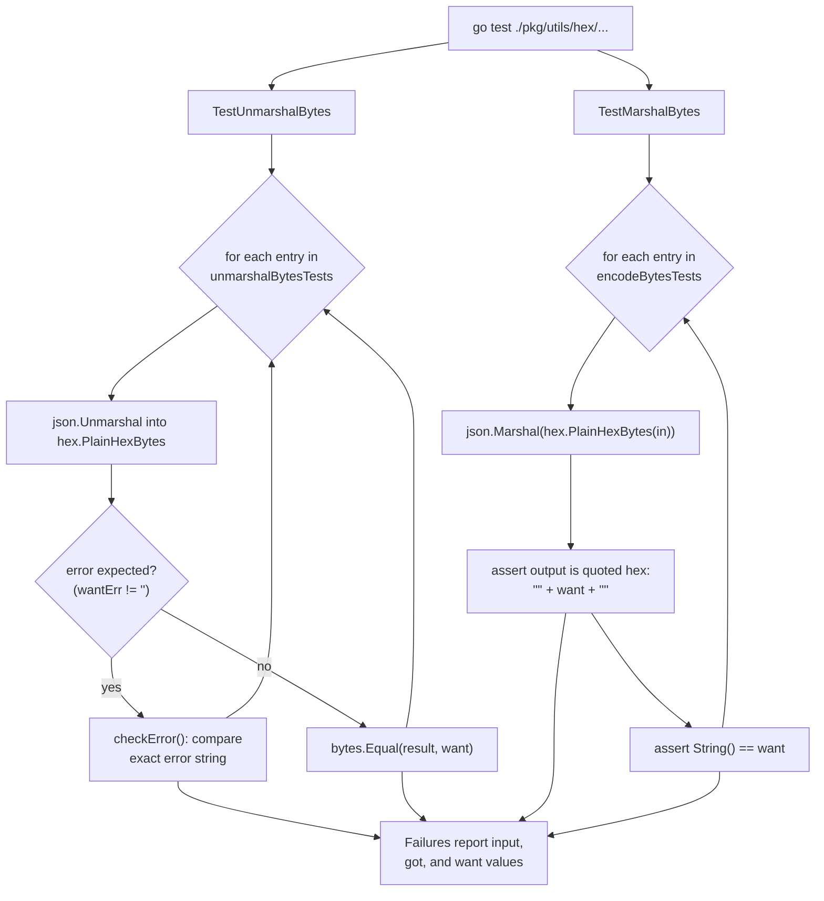

# utils-hex

> Part of the [Shared Foundation Libraries & Domain Types](../Shared_Foundation_Libraries___Domain_Types.md) module group.

## 1. Introduction

The `utils-hex` module is a small, dependency-free hex-encoding utility package located at `chainlink-common/pkg/utils/hex` within the `github.com/smartcontractkit/chainlink-common` Go module (see `chainlink-common/go.mod`). It provides two complementary pieces of functionality that appear at nearly every boundary of the Chainlink system:

1. **`PlainHexBytes`** (`plainhex.go`) — a JSON-serializable byte-slice type that encodes to a *plain* hex string, i.e. **without** the `0x` prefix that go-ethereum's `hexutil.Bytes` assumes. The empty slice marshals as `""`.
2. **Hex-string helpers** (`hex.go`) — small utilities for the *prefixed* (`0x`-style) hex strings used throughout the EVM-facing parts of the node: prefix detection/normalization, `big.Int` parsing, and prefixed hex decoding.

The module is a classic **leaf utility**: it depends only on the Go standard library (`encoding/hex`, `encoding/json`, `errors`, `fmt`, `math/big`, `reflect`, `strings`) and imposes no transitive dependencies on its consumers. It is mirrored in spirit by the node-local utilities documented in [Core Shared Utilities](../Node_Application_Core___Interfaces/core_shared_utilities.md) (e.g. `abihelpers`), which build on top of such primitives.

---

## 2. Purpose and Role in the System

Binary blobs (key material, signatures, addresses, chain-specific payloads) frequently cross a JSON boundary in Chainlink:

| Boundary | Hex convention | Provided by |
|---|---|---|
| JSON APIs / TOML config for *non-EVM-specific* fields | plain hex, no `0x` | `PlainHexBytes` (`plainhex.go`) |
| EVM-facing values (addresses, hashes, tx payloads) | `0x`-prefixed (go-ethereum `hexutil` style) | helpers in `hex.go` |

Because the two conventions are easy to confuse, the package keeps them in one place with explicit, well-tested semantics:

- `PlainHexBytes` **rejects** any `0x`/`0X` prefix (the `x` is not a valid hex digit) and rejects odd-length input.
- `DecodeString` **requires** a `0x` prefix and silently zero-pads odd-length input (go-ethereum `FromHex`-like semantics).

This asymmetry is intentional and is covered by exhaustive, table-driven tests (see [§6 Testing](#6-testing)).

### Architectural position



Being a leaf with zero external dependencies, it is safe to import from almost any other module — including the standalone Go modules (`chainlink-common/keystore`, `chainlink-common/pkg/values`, the `capabilities/*` modules) that cannot depend on the root `chainlink-common` module itself.

---

## 3. Package Architecture



### 3.1 `PlainHexBytes` — JSON-friendly byte slice (`plainhex.go`)

```go
// PlainHexBytes marshals/unmarshals as a JSON string without a 0x prefix.
// The empty slice marshals as "".
type PlainHexBytes []byte
```

| Method | Behavior |
|---|---|
| `MarshalText()` | Encodes bytes to lowercase hex via `encoding/hex.Encode`; never fails for byte input. |
| `String()` | `hex.EncodeToString(b)` — same representation as `MarshalText`, returned as a `string`. |
| `UnmarshalJSON(input)` | Rejects non-string JSON values with `*json.UnmarshalTypeError{Value: "non-string"}`; otherwise strips the surrounding quotes and delegates to `UnmarshalText`. Errors are wrapped as `UnmarshalJSON failed: %w`. |
| `UnmarshalText(input)` | Empty string → empty slice. Odd-length input → `odd length` error. Invalid characters are rejected by `encoding/hex.Decode`. Errors are wrapped as `UnmarshalText failed: %w`. |

**Key semantic:** unlike go-ethereum's `hexutil.Bytes`, the `0x` prefix is *not* accepted. The literal `"0x"` fails with `encoding/hex: invalid byte: U+0078 'x'` — this is deliberately covered by the test table.

> Implementation note: `checkText(input, wantPrefix)` accepts a `wantPrefix` parameter for parity with go-ethereum's `hexutil`, but the current implementation ignores it (plain hex never wants a prefix). Empty input short-circuits to a `nil` slice; odd length yields the `odd length` error.

### 3.2 Prefixed hex-string helpers (`hex.go`)

| Function | Behavior |
|---|---|
| `EnsurePrefix(s)` | Prepends `0x` unless already present. Note: it checks only for a lowercase `0x` literal, so a string already starting with `0X` would gain a second prefix (`0x0X…`). |
| `HasPrefix(s)` | `true` if `s` starts with `0x` **or** `0X` (case-insensitive check). |
| `TrimPrefix(s)` | Strips a leading `0x`/`0X` (uses `HasPrefix`, so both cases are handled). |
| `ParseBig(s)` | Parses via `big.Int` `SetString(s, 16)`; on failure returns `failed to convert "%s" as hex to big.Int`. Because `math/big` accepts the `0x`/`0X` prefix for base 16, both plain and prefixed forms parse successfully. |
| `DecodeString(s)` | **Requires** a `0x` prefix (`hex string must have 0x prefix` otherwise), then zero-pads odd-length remainder and delegates to `encoding/hex.DecodeString`. Follows the semantics of go-ethereum's `FromHex`. |

### 3.3 Error taxonomy

Every failure mode is deterministic and string-asserted in tests:



Concrete reference table (as asserted by the test suite):

| JSON input | Result |
|---|---|
| *(empty JSON buffer)* | `unexpected end of JSON input` |
| `null` | `json: cannot unmarshal non-string into Go value of type hex.PlainHexBytes` |
| `"null"` | `UnmarshalJSON failed: UnmarshalText failed: encoding/hex: invalid byte: U+006E 'n'` |
| `"0x"` / `"0X"` | `UnmarshalJSON failed: UnmarshalText failed: encoding/hex: invalid byte: U+0078 'x'` / `'X'` |
| `"0"` | `UnmarshalJSON failed: UnmarshalText failed: odd length` |
| `"xx"`, `"01zz01"` | `UnmarshalJSON failed: UnmarshalText failed: encoding/hex: invalid byte: …` |
| `""` | empty byte slice |
| `"02"` | `[]byte{0x02}` |
| `"00000102"` | `[]byte{0x00, 0x00, 0x01, 0x02}` |

---

## 4. Data Flow

### 4.1 JSON round-trip through `PlainHexBytes`



### 4.2 Prefixed-hex helper usage flow



**Guidance:** choose `PlainHexBytes` when *you* control both ends of the JSON contract and want strict, prefix-free encoding (TOML/JSON config fields, feeds configuration, non-EVM payloads). Use `DecodeString`/`ParseBig`/`EnsurePrefix` when consuming *external* EVM-style hex strings, which may or may not carry the prefix.

---

## 5. Component Interaction

`utils-hex` interacts with the rest of the system through plain Go interfaces — chiefly the standard library's `encoding.TextMarshaler`, `encoding.TextUnmarshaler`, and `json.Unmarshaler` contracts that `PlainHexBytes` implements. This means:

- **JSON APIs and config loaders** get correct hex handling automatically whenever a struct field is typed as `PlainHexBytes` — no custom marshal hooks required.
- **TOML configuration** (the node's primary config format, parsed via the TOML tooling in [Core Shared Utilities](../Node_Application_Core___Interfaces/core_shared_utilities.md) and validated by the patterns in [Config Validation](config-validation.md)) can bind hex fields directly, since TOML decoders honor `TextUnmarshaler`.
- **Domain types** elsewhere in `chainlink-common` — relayers, keystore bundles, and chain payloads (see [types-core](types-core.md), [types-chains](types-chains.md), and [Keystore](../Node_Platform_Services/keystore.md)) — rely on the same strict-decode behavior when serializing binary fields, keeping "plain hex" and "0x-prefixed hex" conventions consistent across module boundaries.
- **Encoding pipelines** that need richer struct-mapping should use the dedicated [codec](codec.md) module instead; `utils-hex` intentionally covers only flat byte-slice ↔ hex-string conversion.



---

## 6. Testing

The module is validated by exhaustive, table-driven tests in `plainhex_test.go`. The two core test fixtures are:

```go
type marshalTest struct {
    input any    // typically []byte
    want  string // expected hex (without JSON quotes)
}

type unmarshalTest struct {
    input   string // raw JSON token
    want    any    // expected []byte (when valid)
    wantErr string // exact expected error string ("" when valid)
}
```

Two data tables drive the suite:

- `unmarshalBytesTests` — covers invalid encodings (empty input, `null`, non-hex characters like `n`/`x`/`X`/`z`, odd length) and valid encodings (`""`, `"02"`, long strings).
- `encodeBytesTests` — covers marshaling edge cases (`[]byte{}` → `""`, `[]byte{0}` → `"00"`, multi-byte values).



Supporting helpers:

- `referenceBytes(s)` — decodes a reference hex literal via `encoding/hex.DecodeString`, panicking on programmer error (expected never to fail for valid test fixtures).
- `checkError(t, input, got, want)` — asserts the *exact* error string (both absence and presence are validated), which pins the wrapping conventions (`UnmarshalJSON failed: UnmarshalText failed: …`) as part of the public contract.

Tests run with plain `go test` inside the `chainlink-common` module; repo-wide linting for the module is provided by the `lint` / `lint-workspace` targets in `chainlink-common/Makefile` (backed by `script/lint.sh` and golangci-lint). API browsing is available via the `docs` target (`go doc -http`).

---

## 7. Related Documentation

- [Shared Foundation Libraries & Domain Types](../Shared_Foundation_Libraries___Domain_Types.md) — parent module group containing this package.
- [codec](codec.md) — full struct-level binary encoding/decoding pipeline (modifiers, builders, gRPC service); use for structured on-chain data rather than flat hex strings.
- [values](values.md) — the `values` package for chain-agnostic value wrapping.
- [types-core](types-core.md) / [types-chains](types-chains.md) — domain types whose binary fields typically serialize with the conventions defined here.
- [Keystore](../Node_Platform_Services/keystore.md) — a major consumer of strict hex handling for key material.
- [Core Shared Utilities](../Node_Application_Core___Interfaces/core_shared_utilities.md) — node-local utility packages (e.g. `abihelpers`) that operate at the layer above raw hex conversion.
- [Config Validation](config-validation.md) — validation patterns for configuration, including hex-typed fields bound from TOML/JSON.
