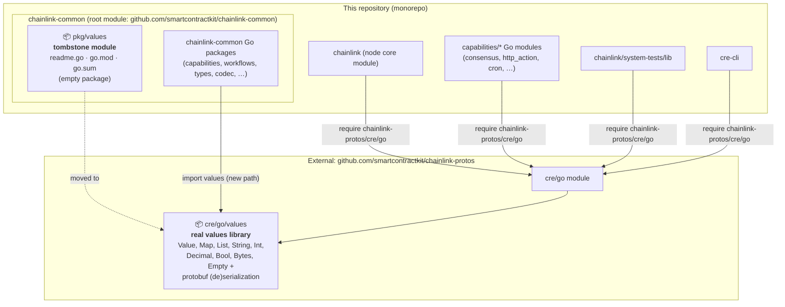
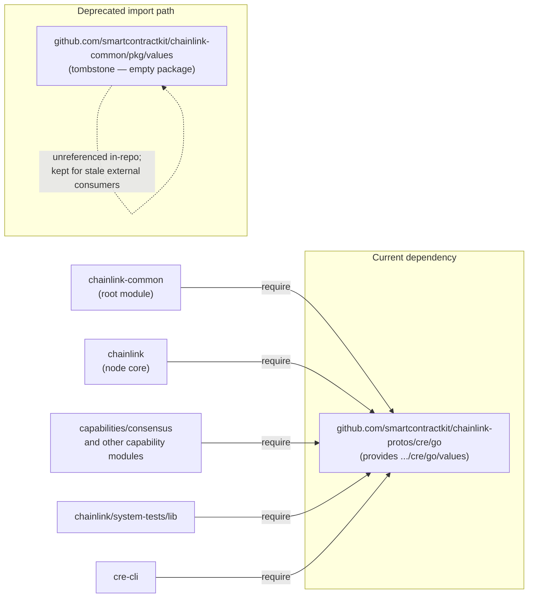
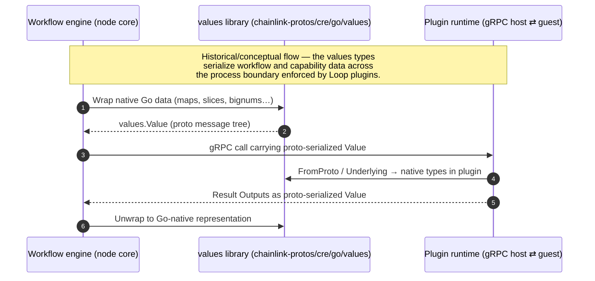
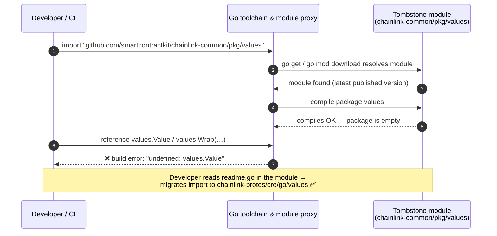

# Values (`chainlink-common/pkg/values`)

## Introduction

The `values` module (`github.com/smartcontractkit/chainlink-common/pkg/values`) is a **relocation tombstone**: a deliberately minimal Go module that marks where the values library used to live and points to where it lives now.

The values library itself — the dynamically-typed, protobuf-serializable value system used to carry workflow inputs/outputs, capability payloads and trigger data across process boundaries — was **moved out of this repository** to:

> **`github.com/smartcontractkit/chainlink-protos/cre/go/values`**

This decision is recorded in the module's only source file, [`chainlink-common/pkg/values/readme.go`](../chainlink-common/pkg/values/readme.go):

```go
// values was moved to github.com/smartcontractkit/chainlink-protos/cre/go/values
package values
```

The module is kept in the tree (rather than deleted) so that the old import path still resolves in the Go module graph, the repository's release tooling remains consistent, and any stale consumer that still imports the old path fails loudly at the point of use rather than silently linking against an outdated copy.

> **For contributors:** the actual `values` types and serialization logic are **not** documented here, because they no longer live in this repository. This page documents the tombstone module, its integration with the build system, and how sibling modules relate to it.

---

## Module composition

The module consists of exactly three files:

| File | Contents | Purpose |
| --- | --- | --- |
| `chainlink-common/pkg/values/go.mod` | Module path + `go 1.26.6` directive | Establishes `pkg/values` as an independent Go module, separate from the root `chainlink-common` module |
| `chainlink-common/pkg/values/go.sum` | Empty | Confirms the module has **zero dependencies** — it builds with the Go standard library alone |
| `chainlink-common/pkg/values/readme.go` | Single comment + `package values` declaration | The tombstone itself; compiles as an empty Go package and documents the move |

### `go.mod` (verbatim)

```text
module github.com/smartcontractkit/chainlink-common/pkg/values

go 1.26.6
```

Key observations:

- **Standalone module.** Although the directory sits under `chainlink-common/pkg/`, it is *not* part of the root `github.com/smartcontractkit/chainlink-common` module. A `go.mod` file in the directory makes it a module in its own right, with its own version history on the Go module proxy.
- **Version skew is intentional and harmless.** The `go 1.26.6` directive is older than the `go 1.27.1` directive used by the root module and most sibling modules (see `chainlink-common/go.mod`, `chainlink/go.mod`). Because the module contains no dependencies and no code beyond a package clause, any newer toolchain can build it; the directive only pins the minimum language version.
- **Empty `go.sum`.** No third-party dependencies are required, so `go.sum` is empty. There is nothing to audit, pin, or refresh here.

---

## Architecture

The diagram below shows where the tombstone module sits relative to the repository's other Go modules and the external module that now hosts the real implementation.



Two structural facts follow from this layout:

1. **No in-repo consumer still requires the old module.** A survey of the repository's consumer `go.mod` files confirms every module that historically used values now requires `github.com/smartcontractkit/chainlink-protos/cre/go` instead:
   - `chainlink-common/go.mod` (the root common module)
   - `chainlink/go.mod` (the node core)
   - `capabilities/consensus/go.mod` (representative of the `capabilities/*` modules)
   - `chainlink/system-tests/lib/go.mod` (system tests)
   - `cre-cli/go.mod` (the CRE CLI)

2. **The tombstone module is still a first-class module** for build and release tooling purposes (see [Build & release integration](#build--release-integration)).

---

## Dependency graph

The following diagram maps the Go module dependency edges relevant to values. Edges marked **require** are declared in each module's `go.mod`; the tombstone module requires nothing and is required by nothing inside this repository.



> **Note on stale external consumers.** Any *published* Go module outside this repository that still declares `require github.com/smartcontractkit/chainlink-common/pkg/values` will resolve to the tombstone. Its builds compile (the package is syntactically valid) but fail with `undefined` errors wherever `values.Value`, `values.Wrap`, etc. are referenced — which surfaces the migration rather than silently substituting old behavior.

---

## The values library (now at its new home)

Although the implementation lives in the external `chainlink-protos/cre/go` module, an understanding of what values *is* explains why the module is preserved as a tombstone and which subsystems depend on it. The description below is a conceptual reference — consult the `chainlink-protos` repository for the authoritative code.

### What it provides

Values is the shared, dynamically-typed value system of the Chainlink runtime:

- A common **`Value`** interface with concrete typed wrappers — `Map`, `List`, `String`, `Int` (arbitrary precision), `Decimal` (arbitrary precision floating point), `Bool`, `Bytes`, and an `Empty` variant — plus helpers such as `Wrap` (Go-native → `Value`) and `Underlying`/`FromProto` (the reverse).
- **Protobuf-backed serialization**, so the same payload can cross the gRPC boundary between the node core and out-of-process plugin runtimes without lossy conversions. This is the mechanism by which workflow and capability data traverses the plugin process isolation described in [Plugin_Process_Framework_(Loop)](../Plugin_Process_Framework_(Loop).md).
- Deterministic conversion behavior on the wire, which matters for multi-node consensus: every node in a DON must serialize the same logical payload identically.

### Where it is used today

Within this repository, values appears wherever structured data crosses a boundary:

- **Workflow execution results.** `chainlink-common/pkg/workflows/exec/results.go` models each step's `Inputs` and `Outputs` as `values.Value` (imported from the new path):

  ```go
  import "github.com/smartcontractkit/chainlink-protos/cre/go/values"

  type Result struct {
          Inputs  values.Value
          Outputs values.Value
          Error   error
  }
  ```

- **Capability payloads.** Trigger and action capabilities exchange dynamically-typed configuration and payloads (see [Workflow___Capability_Runtime_(CRE_Engine)](../Workflow___Capability_Runtime_(CRE_Engine).md) and its capability runtime pages, e.g. [workflows engine](../Workflow___Capability_Runtime_(CRE_Engine)/workflows/workflows_engine.md)).
- **TypeScript SDK parity.** The TypeScript CRE SDK mirrors the value system for workflow authors (see its value serializer/aggregator test suites under `cre-sdk-typescript/packages/cre-sdk/src/sdk/utils/values/`), keeping TS-authored workflows wire-compatible with the Go runtime.

### Conceptual data flow across the plugin boundary



For the transport machinery that carries these payloads, see [Plugin_Process_Framework_(Loop)](../Plugin_Process_Framework_(Loop).md) and the gRPC binding definitions in [chain-grpc-protos](chain-grpc-protos.md).

---

## Lifecycle: what happens when the old path is imported

The tombstone is designed to fail *usefully*. The sequence below traces what a developer (or CI pipeline) experiences when code still imports the deprecated path.



Design intent of this behavior:

- **Loud, localized failure.** The error appears exactly at the code that needs migrating, not as a silent behavioral change.
- **Self-documenting.** The fix is spelled out in the comment at the top of `readme.go`.
- **No stale behavior.** Unlike a redirect shim that re-exports old types, the empty package cannot mask drift between the old and new libraries.

---

## Build & release integration

The tombstone participates in the repository's Go module tooling like any other module:

- **Module discovery.** [`chainlink-common/script/go-modules.sh`](../chainlink-common/script/go-modules.sh) enumerates every directory containing a `go.mod` file (via `git ls-files '*go.mod'`). `chainlink-common/pkg/values` is therefore treated as a discrete release candidate module.
- **Release automation.** [`chainlink-common/script/release-modules.sh`](../chainlink-common/script/release-modules.sh) rewrites the module dropdown in the release workflow (`.github/workflows/release.yml`) from the output of `go-modules.sh`, so the tombstone remains selectable when publishing module versions — intentional, since published versions of the path must continue to exist on the Go module proxy.
- **Generation and tidying.** The root `chainlink-common/Makefile` targets `generate` and `gomodtidy` (backed by `gomods`) operate on `./...`, which includes this module; tidying is a no-op given the empty `go.sum`.
- **Linting.** The module falls under the standard golangci-lint configuration of the `chainlink-common` workspace (see [Build,_CI___Release_Infrastructure](../Build,_CI___Release_Infrastructure.md)).

Maintenance notes:

- **Do not add code to this module.** It exists solely as a tombstone. New shared value functionality belongs in `chainlink-protos/cre/go/values` (or the sibling libraries of this repo, such as [codec](codec.md)).
- **Keep the tombstone buildable.** It must remain a valid Go package (it is) so that `go build ./...` and module tidy operations across the repo succeed.
- **Do not delete the module casually.** Published versions persist on the Go module proxy forever; removing the source would break `go get`/`go mod download` reproducibility for stale consumers and complicate release tooling. Coordinate any removal with the release process owners.

---

## Related modules

| Module | Relationship to values |
| --- | --- |
| [Shared_Foundation_Libraries___Domain_Types](../Shared_Foundation_Libraries___Domain_Types.md) | Parent hub for shared foundation libraries and domain types |
| [codec](codec.md) | Sibling library providing struct-tag-driven on-chain/off-chain codecs — complements values for ABI-shaped data transformations |
| [types-core](types-core.md) | Domain interfaces (relayers, providers, plugin services) whose data payloads are expressed with values |
| [chain-grpc-protos](chain-grpc-protos.md) | Chain gRPC proto definitions — the same protobuf transport paradigm values relies on |
| [Plugin_Process_Framework_(Loop)](../Plugin_Process_Framework_(Loop).md) | The plugin process framework across which values payloads are serialized |
| [Workflow___Capability_Runtime_(CRE_Engine)](../Workflow___Capability_Runtime_(CRE_Engine).md) | The workflow/capability runtime that consumes values for inputs, outputs and capability payloads |
| [Build,_CI___Release_Infrastructure](../Build,_CI___Release_Infrastructure.md) | Build and release tooling that manages this module as part of the workspace |
