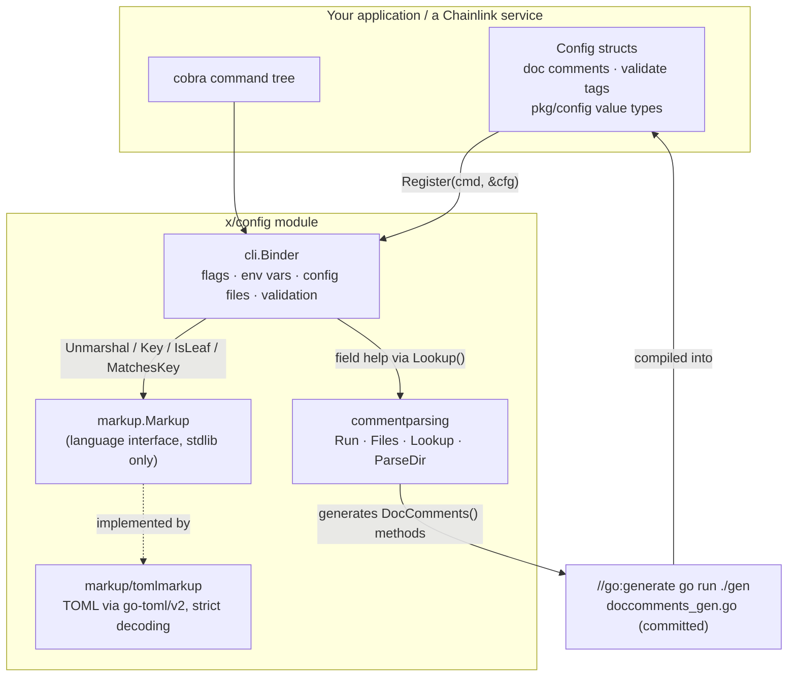
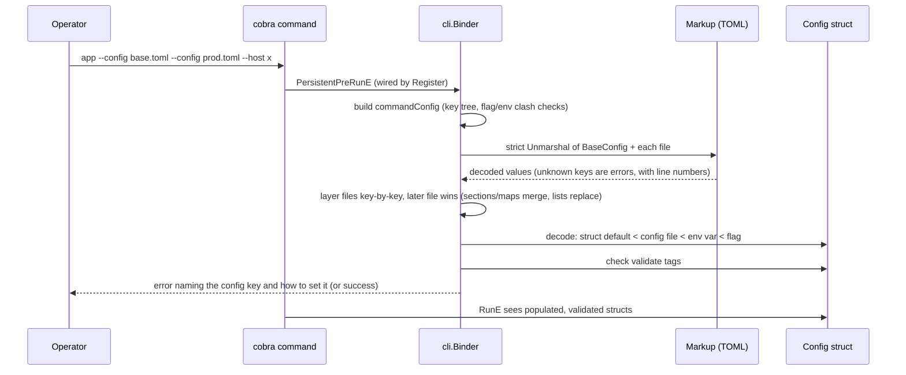
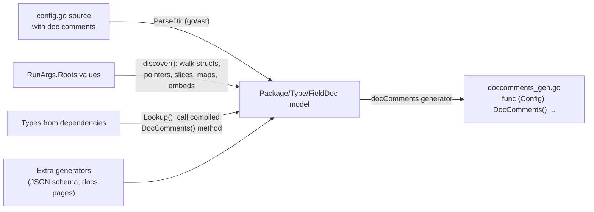

# x-config-framework

The `x/config` framework is a standalone Go module (`github.com/smartcontractkit/chainlink-common/x/config`, defined in `chainlink-common/x/config/go.mod`) that provides declarative, self-documenting configuration for Chainlink programs. It answers three questions in one coherent design:

1. **How does a Go program receive configuration?** — Bind a config struct to a [cobra](https://github.com/spf13/cobra) command; every field is settable by flag, environment variable, config file, or the struct's own default value, in that order of precedence (`cli` package).
2. **In what language is the configuration written?** — Configuration file formats are abstracted behind a small `Markup` interface, with a strict TOML implementation in `markup/tomlmarkup`. A program links only the language it uses.
3. **How does a running binary describe its own configuration?** — Doc comments on config structs — the one thing Go compilation discards — are recovered into the compiled package as generated `DocComments()` methods, so `--help` text and documentation can be rendered at run time, even for types that come from a dependency (`commentparsing` package).

The framework is intentionally a **separate module**: it can pin its own dependencies (cobra, pflag, go-toml/v2, go-playground validator, strcase) without imposing them on importers, and it depends on nothing from the rest of Chainlink except the sibling value-type library [`pkg/config`](config-validation.md), which supplies the bound types (`Duration`, `SecretString`, `URL`, …) whose `MarshalText`/`UnmarshalText` methods drive flag parsing, defaults display, and secret redaction.

> **Related pages**
> - Value types and validation semantics of `pkg/config`: [config-validation](config-validation.md)
> - Parent library group: [Shared Foundation Libraries & Domain Types](../Shared_Foundation_Libraries___Domain_Types.md)

---

## Architecture overview

The framework has three packages with a strict dependency direction: `cli` consumes both `commentparsing` (for help text) and `markup` (for config file decoding); `commentparsing` consumes `markup` only to know where a type walk stops; `markup` depends only on the standard library.

### Run-time configuration flow

When a command executes, the `Binder` — wired into cobra's initialization and root `PersistentPreRunE` hooks by `Register` — merges every source into the target structs:

### Build-time documentation flow

Doc comments cannot survive compilation, so `commentparsing` turns them into code. This happens under `go generate` (wired into the repository's `chainlink-common/Makefile` `generate` target, which runs `go generate ./...` across the module and fails CI on any resulting diff):

---

## Sub-modules

Detailed documentation for each sub-module was generated under [`Shared_Foundation_Libraries___Domain_Types/x-config-framework/`](x-config-framework/) — read them together with this page; they contain the per-package component responsibilities, API details, and behavior specifications:

| Sub-module | Package(s) | Purpose | Documentation |
|---|---|---|---|
| **CLI config binding** | `x/config/cli` | `Binder`, `Options`, `RegisterOption`: binds config structs to cobra commands with flag/env/file precedence, layered `--config` files, map-entry flags, `validate` tag checking, and doc-comment-driven help text | [x-config-framework_cli-binder](x-config-framework/x-config-framework_cli-binder.md) |
| **Markup languages** | `x/config/markup`, `x/config/markup/tomlmarkup` | The `Markup` interface (stdlib-only) that abstracts config file formats, and the strict TOML implementation | [x-config-framework_markup](x-config-framework/x-config-framework_markup.md) |
| **Doc-comment codegen** | `x/config/commentparsing` | Carries doc comments into compiled packages via generated `DocComments()` methods; `Run`/`Files` orchestration, type-tree discovery, and run-time `Lookup` | [x-config-framework_commentparsing](x-config-framework/x-config-framework_commentparsing.md) |

Cross-references between the pages:

- The **CLI binding** page depends on the **Markup** page (`Binder` delegates all file decoding to `markup.Markup`) and on the **Doc-comment codegen** page (flag help text comes from `commentparsing.Lookup`).
- The **Doc-comment codegen** page references the **Markup** page for the `IsLeaf` rule that decides where the type walk stops.
- The **Markup** page is self-contained (stdlib only) and defines the contract both other sub-modules code against.

---

## Module structure and dependencies

The module definition (`chainlink-common/x/config/go.mod`) declares:

- **Module path:** `github.com/smartcontractkit/chainlink-common/x/config` (Go 1.27.1)
- **Direct dependencies:**
  - `github.com/go-playground/validator/v10` — `validate` tag checking performed by the `cli` binder
  - `github.com/iancoleman/strcase` — key-name casing (kebab-case flags, etc.)
  - `github.com/pelletier/go-toml/v2` — the TOML decoder/encoder behind `tomlmarkup`
  - `github.com/spf13/cobra` / `github.com/spf13/pflag` — command tree and flag parsing
  - `github.com/smartcontractkit/chainlink-common` — the sibling `pkg/config` value types (`Duration`, `SecretString`, `URL`) used in tests/examples
  - `golang.org/x/mod` — `go.mod` parsing for module-boundary discovery in `commentparsing`

### Component inventory (core components)

| Component | File | Role |
|---|---|---|
| `cli.Options` | `chainlink-common/x/config/cli/options.go` | Binder configuration: env-var `Prefixes` (tried in order), required `Markup`, embedded `BaseConfig` bytes, `DefaultConfigPath` |
| `cli.RegisterOption[T]` | `chainlink-common/x/config/cli/options.go` | Extensible per-`Register` option (none exist yet; the parameter reserves compatibility) |
| `cli` test suite (`hasSelfSplittingList`, `nestsItself`, …) | `cli/binder_test.go`, `cli/entries_test.go` | Behavioral specification: precedence, layering, clash detection, map entries, numeric ranges, help text, secret redaction |
| `commentparsing` test fixtures (`LookupCycle`, `ambiguous*`, `lookupEmbeds*`, `lookupUndocumented`, `LookupOwnMethod`, `lookupPromoted`) | `commentparsing/commentparsing_test.go` | Specification of doc-comment lookup/generation edge cases: self-embedding cycles, promoted docs through embeds, ambiguous promotion, generics |
| `tomlmarkup.readsTextByPointer` | `markup/tomlmarkup/tomlmarkup_test.go` | Leaf detection: a type read whole through its `(*T).UnmarshalText` |
| `go.mod` | `x/config/go.mod` | Module boundary and dependency set |

### How it fits into the wider system

- **Foundation library role:** `x/config` sits under [Shared Foundation Libraries & Domain Types](../Shared_Foundation_Libraries___Domain_Types.md) alongside [`pkg/config`](config-validation.md). `pkg/config` defines the *value types* (with text marshaling and validation semantics); `x/config` defines the *binding machinery* that populates them from operator input.
- **Consumers:** any Chainlink binary that parses operator configuration through cobra commands. The `cli/examples` and `commentparsing/examples` directories ship runnable reference programs (`simple`, `nested`, `namespaced`, `separate_module_use`).
- **Build/CI wiring:** generated `doccomments_gen.go` files are committed artifacts. `chainlink-common/Makefile`'s `generate` target (which drives `go generate ./...`) regenerates them; CI fails on any diff, which keeps the committed files from drifting from the source comments. Deleting a documented type requires removing its stale generated file by hand, since the package then fails to compile (see the sub-module READMEs for this and other known limitations).
