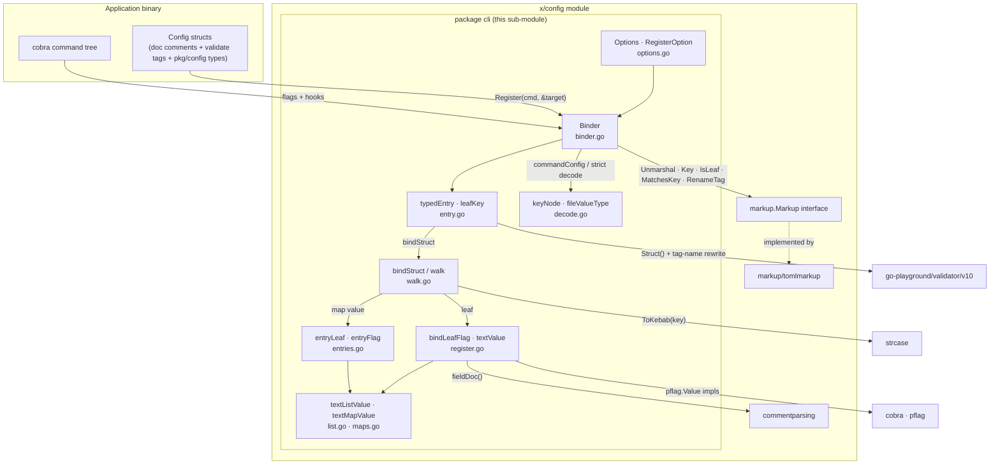
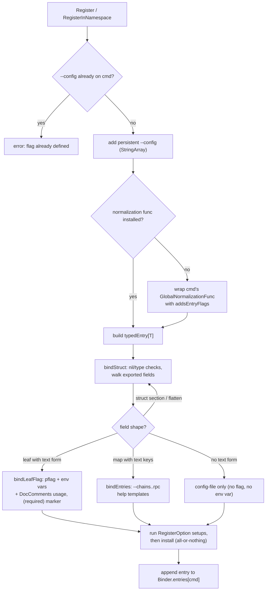
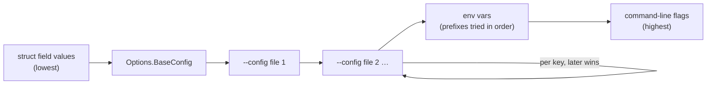
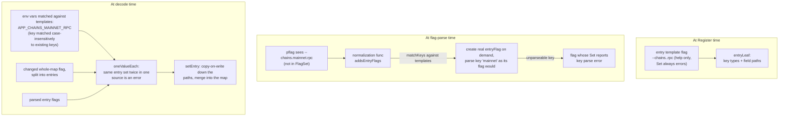

# x-config-framework: CLI Config Binder (`x/config/cli`)

The **CLI config binder** is the operator-facing heart of the [x-config-framework](../x-config-framework.md): package `chainlink-common/x/config/cli` fills plain Go config structs from a [cobra](https://github.com/spf13/cobra) command's inputs, so application code never touches flag parsing, environment lookup, or file decoding. Every field of a registered struct is settable from four sources, applied in a fixed order of precedence:

```text
struct default  <  config file  <  environment variable  <  command-line flag
```

A single call — `binder.Register(cmd, &cfg)` — wires everything: it adds flags (persistent, so subcommands inherit them), derives kebab-case flag names and prefixed env-var names, adds a repeatable `--config` flag for layered file loading, generates help text from the struct's doc comments (via the sibling [commentparsing](x-config-framework_commentparsing.md) package), and, when the command runs, decodes and validates the struct before `RunE` executes. Validation failures are operator-actionable: they name the config key and every way to set it.

> **Related pages**
> - Parent framework: [x-config-framework](../x-config-framework.md)
> - Config file languages (`Markup` interface, TOML implementation): [x-config-framework_markup](x-config-framework_markup.md)
> - Doc-comment recovery for help text: [x-config-framework_commentparsing](x-config-framework_commentparsing.md)
> - Value types bound by this module (`Duration`, `SecretString`, `URL`): [config-validation](../config-validation.md)
> - Library group: [Shared Foundation Libraries & Domain Types](../../Shared_Foundation_Libraries___Domain_Types.md)

---

## Responsibilities

The `cli` package owns, exclusively and end-to-end:

1. **Flag generation** — one persistent pflag per field that has a *text form* (scalars, `time.Duration`, `[]byte`, any `encoding.TextUnmarshaler`, and lists/maps of those). Types without a text form (interfaces, pointer/interface lists, maps with non-text keys) are **config-file only**.
2. **Env-var generation** — upper-cased, `.`/`-` folded to `_`, optionally tried under several `Prefixes` in order (first prefix that is set wins).
3. **Config file loading** — a repeatable `--config` flag; files layer over `Options.BaseConfig`, later files winning *per key* (sections and maps merge; lists replace, so a later file can shorten one).
4. **Decoding with strict keys** — a config file key no registered struct holds is an error naming the key and line, so typos fail loudly instead of silently no-oping.
5. **Conflict detection** — a key, flag, or env var shared by a command and one of its ancestors fails *every* command in the tree when it executes (siblings may reuse keys).
6. **Validation** — `validate` tags are checked after decoding, with error messages rewritten to use config keys rather than Go field paths.
7. **Help text** — flag usage strings come from generated `DocComments()` methods, list each flag's env vars in prefix order, mark `required` fields, and render defaults through the type's own `MarshalText` so secrets (`config.SecretString`) display redacted.
8. **Map-entry binding** — a map's entries are settable one at a time like struct fields (`--chains.mainnet.rpc`, `APP_CHAINS_MAINNET_RPC`), with `--help` showing the placeholder form `--chains.<key>.rpc`.

---

## Source layout

All sources live in `chainlink-common/x/config/cli/` (module root `chainlink-common/x/config/go.mod`, module path `github.com/smartcontractkit/chainlink-common/x/config`):

| File | Contents |
|---|---|
| `doc.go` | Package overview: precedence model and hook wiring summary |
| `README.md` | Author-facing guide: config files, subcommands, namespaces, map entries, types, secrets |
| `binder.go` | `Binder`, `New`, `Register`, `RegisterInNamespace`, `Undocumented`, `IsBuiltinCommand`, `commandConfig` merge, `loadConfigFiles`, `wire`/`preRun` hook plumbing |
| `options.go` | **`Options`** and **`RegisterOption[T]`** (the two core components of this sub-module) |
| `entry.go` | `targetEntry` interface, `typedEntry[T]`, `leafKey`; per-key source resolution (`sources`), decoding, and validation with config-key error rewriting |
| `register.go` | `bindLeafFlag`, `newFlag`, the `textValue` pflag implementation, `setText`/`parseText` (flags and env vars parse identically), default rendering via `MarshalText` |
| `walk.go` | Reflection walk over the target struct (`bindStruct`, `walk`, `walkField`, `isLeaf`), embedded-struct flattening, text-form detection (`canText`, `readsText`) |
| `entries.go` | Map-entry machinery: `entryLeaf` templates, on-demand `entryFlag` creation via a flag-normalization wrapper, env-var entry matching, layered `decodeEntries`, double-set detection |
| `decode.go` | `keyNode` key tree (per-command strict schema), generated `fileValuesType` for strict decoding, per-key layering (`overlay`), `fromFile` key re-parsing, unsafe-key rejection (`holdsIdentityKind`, `mapKey` duplicate detection) |
| `maps.go` | `textMapValue` (`--map key=value,...` whole-map flag), key-wise `mergeMaps` |
| `list.go` | `textListValue` (CSV elements, first occurrence replaces then appends) |
| `examples/` | Runnable programs: `simple`, `nested`, `namespaced` |
| `binder_test.go`, `entries_test.go`, `register_test.go`, `helpers_test.go` | The behavioral specification (see [Testing](#testing-the-behavioral-specification)) |

---

## Core API

### `Options` — binder configuration (`options.go`)

```go
type Options struct {
    Prefixes          []string      // env-var prefixes, tried in order; nil/empty == {""}
    Markup            markup.Markup // required: the config-file language (e.g. tomlmarkup.New())
    BaseConfig        []byte        // layered under every --config file; usually embedded
    DefaultConfigPath string        // read when no --config is given; empty == config.<ext> in cwd
}
```

- `Prefixes` model product inheritance: with `{"CRE", "CL"}`, `chain.id` reads `CRE_CHAIN_ID` then `CL_CHAIN_ID`; the empty prefix `""` reads bare `CHAIN_ID`. Help text lists the env vars in the order tried.
- `Markup` has **no default** — `New` fails with `markup.Err` if unset — so a binary only links the config language it uses (this is why `Markup` is an injected interface rather than a package-global; see [x-config-framework_markup](x-config-framework_markup.md)).
- `BaseConfig` ships compile-time defaults in a file operators can read; it is validated like any config file (malformed content or unknown keys error even before any `--config` is parsed).
- `DefaultConfigPath` replaces the default `config.<extension>` in the working directory; a named `--config` always overrides it.

### `RegisterOption[T]` — forward-compatible extensibility

```go
type RegisterOption[T any] struct {
    setup func(*typedEntry[T]) (func(), error)
}
```

No options exist yet. Options are *validated before any take effect* (`RegisterInNamespace` runs every `setup` first, then installs the returned closures), so an errored option leaves the entry unregistered and no flags half-added. The generic parameter exists so options can be added without breaking callers.

### `Binder` — the public surface (`binder.go`)

| Member | Purpose |
|---|---|
| `New(opts Options) (*Binder, error)` | Creates a binder; requires `opts.Markup`. Sets `cobra.EnableTraverseRunHooks = true` (decoding must run even for subcommands with their own hooks) and registers `wire` via `cobra.OnInitialize` |
| `Register[T](cmd, target, opts...)` | Attaches one config struct to one command; delegates to `RegisterInNamespace` with an empty namespace |
| `RegisterInNamespace[T](cmd, ns, target, opts...)` | Same, with every key prefixed (`"Database"` → `--database.url`, `APP_DATABASE_URL`, and a `Database` file section) so several structs on one command can share field names |
| `Undocumented() []string` | Sorted keys of flags that got no help text (their struct package lacks generated `DocComments`) — designed for `require.Empty(t, b.Undocumented())` in CI |
| `IsBuiltinCommand(cmd)` | Reports `help`/`completion`/shell-completion commands, which skip decoding entirely so help works without valid config |

Registration invariants: `--config` (a `StringArray`, so a path may contain a comma) is added once per command and may not already exist; a command may hold several registered structs but their keys/flags/env vars must not collide; a command runs with the structs of *all* its ancestors, so ancestor-vs-descendant collisions fail every command in the tree at execute time.

---

## Architecture

The binder is a small set of cooperating types around one idea: **walk the struct once at registration to build a schema, then rebuild the schema per command at execution to decode strictly**. Package dependencies point inward — `cli` depends on `cobra`/`pflag`/`validator`/`strcase` plus the framework's own `markup` and `commentparsing`; nothing outside the `x/config` module depends back on `cli`.



Two roles inside the binder are worth distinguishing:

- **Registration-time schema** — `bindStruct` walks exported fields recursively (flattening embedded structs, kebab-casing names via the markup's `Key`, honoring pointer sections). Each walk produces `leafKey`s; leaves with a text form get a real pflag, maps additionally get *entry templates* (`--chains.<key>.rpc`).
- **Execution-time schema** — `commandConfig` merges the `leafKey`s of the running command *and all its ancestors* into one `keyNode` tree, from which `fileValuesType` synthesizes a Go struct type whose fields are exactly the keys the command accepts. Config files are decoded into that synthesized type — which is how unknown keys are rejected and how per-key layering works (`overlay`).

---

## Registration flow



Flags are **persistent** by design: a struct registered on the root is settable from any subcommand, and a subcommand's own struct only extends the usable surface (subject to the collision rules below).

---

## Execution flow: from `Execute()` to populated structs

The binder deliberately avoids imposing a hook contract on the application. Decoding is wired in *lazily and non-destructively*:

1. `New` registers `wire` via `cobra.OnInitialize` (runs at the start of every `Execute`).
2. `wire` wraps each root's existing `PersistentPreRunE` with `preRun` — once per root, remembering the original so hooks assigned *after* `Register` still run, and still see the decoded structs.
3. `preRun` decodes first, then calls the original `PersistentPreRunE` (and, for parity, a pre-existing `PersistentPreRun`, which cobra would otherwise skip once `PersistentPreRunE` is set).

```mermaid
sequenceDiagram
    participant Op as Operator
    participant C as cobra Execute
    participant N as normalization func
    participant B as Binder
    participant M as Markup (e.g. TOML)
    participant S as target structs
    participant V as validator

    Op->>C: app --config base.toml --config prod.toml --host x
    C->>N: pflag parses each flag name
    N->>B: unknown name? try entry templates<br/>(--chains.mainnet.rpc → entry flag)
    C->>B: cobra.OnInitialize → wire()
    B->>B: wrap root PersistentPreRunE with preRun
    C->>B: preRun (before RunE)
    B->>B: IsBuiltinCommand? help/completion: skip all decoding
    B->>B: clash-check every registered command in the tree<br/>(key case-collisions, flag/env var clashes)
    B->>B: loadConfigFiles: BaseConfig, then --config files<br/>(or DefaultConfigPath / config.<ext>)
    B->>M: strict Unmarshal into synthesized fileValuesType
    M-->>B: values; unknown key = error with line number
    B->>B: overlay files key-by-key (later wins;<br/>sections/maps merge, lists replace)
    loop each leafKey of each entry
        B->>S: sources(): collect flag/env/file values, highest precedence first
        B->>S: allocateField (allocate pointer sections only when touched), set or merge maps
    end
    B->>V: Struct(target) with config-key tag names
    V-->>B: ValidationErrors
    B->>B: rewrite errors: "Value failed on the 'required' tag;<br/>set it with --value, TEST_VALUE, Value in a config file"
    B-->>C: joined errors or nil
    C->>S: RunE sees populated, validated structs
```

Notable behaviors in the flow:

- **All-or-nothing error joining** — every entry decodes and validates even if an earlier one failed; all messages are joined, so one run reports both `Value failed` and `Other failed` (see `TestMultipleTargetsBothReportTheirOwnErrors`).
- **Maps merge across sources** — `--map a=flag` over only key `a`; the file's and the default's other keys survive. A map with a text form read *whole* (its `UnmarshalText`) is one value and is replaced instead.
- **Optional pointer sections stay nil** unless something touches them, so `required_without`/`excluded_with` rules behave; once a section's key is set, the section is allocated and its own required rules apply.

---

## Source precedence and config-file layering



| Concern | Rule |
|---|---|
| Files | `--config` repeats; files layer over `BaseConfig`; a later file wins **per key**. Sections and maps merge so partial overrides compose (`TestConfigFilesAreLayeredInOrder`). |
| Lists | One value, replaced by whichever source set them last — otherwise no later file could ever shorten one. |
| Env vars | Empty string counts as *unset* (a stray export cannot blank a file value). Parsed exactly as the flag would be, so both accept identical input. |
| Map keys | Treated as text everywhere; two texts that parse to one key (`16` and `0x10`, or case-folding via a custom `UnmarshalText`) are an error, never a silent overwrite (`mapKey` in `decode.go`). |

---

## Map entries: setting maps like struct fields

The signature convenience of this binder is that for `Chains map[string]Chain`, `--chains.mainnet.rpc x` and `APP_CHAINS_MAINNET_RPC=x` set `RPC` of entry `mainnet` while leaving the config file's `WS` for `mainnet` alone — because **map entries merge by key at every source**. The mechanism is subtle enough to deserve its own picture:



Rules enforced along the way (all exercised in `entries_test.go`):

- A key is **one segment**: no `.` in a flag name, no `_` in an env-var name. `--chains.main.net.rpc` is simply an unknown flag; such keys go through whole-map flags or config files.
- Env-var entry keys match an *existing* key ignoring case (`MainNet`), else fall back to lower case; an ambiguous match is an error.
- `--map a=1` and `--map.a 2` (and the env-var equivalents) set the same value twice — an error. Across env-var prefixes, the first prefix wins, as for any env var.
- A hand-defined flag like `Flags().String("map.a", …)` would shadow the entry mechanism and is rejected ("would set `--map.<key>`; rename it").
- Recursion is supported: `type nestsItself struct{ Children map[string]nestsItself }` (the `nestsItself` core component of `entries_test.go`) registers and produces nested entry templates without infinite recursion, because the walk tracks ancestor types.

---

## Conflict detection

Because a command runs with its ancestors' structs, ambiguous configuration would silently double-set fields. The binder rejects, at execute time (so even commands attached after `Register` are covered), across each command *and its ancestors*:

| Conflict | Example | Error |
|---|---|---|
| Two keys differing only in case | `Twin` / `TWIN` | `Twin and TWIN differ only in case` |
| Key vs. section with the same name | `Value` and `Value BasicConfig` | `two fields hold Value` |
| Keys folding to the same env var | `value.value` / `value-value` | `… are both TEST_VALUE_VALUE` |
| Map-entry env-var ambiguity | `Map` + `MapKey` field | `map-key and map.<key> could both be TEST_MAP_KEY` |
| Caller-defined flag collisions | `--config`, or a flag matching an entry template | `flag --config is already defined on app` |

Siblings may freely reuse keys; only the ancestor path must stay disjoint.

---

## Validation and error messages

Validation runs **after** the full decode (so cross-field rules see every value) using `go-playground/validator`. Two rewrites make messages operator-friendly:

1. **Tag-name function** — the validator is told to name fields by their markup key, so a field renamed `toml:"Renamed"` reports as `Renamed.Value`, list indices and map keys appear as `Structs.1.renamed`, and flattened embeds add no segment. The validator's Go-style namespace never leaks (`assert.NotContains(err, "Key: ")`).
2. **"How to set it" suffix** — for keys the binder knows, the error appends every source: `set it with --renamed.value, TEST_RENAMED_VALUE, Renamed.Value in a config file`.

Rule parameters that reference sibling fields are translated to config keys too (`excluded_with=RenamedExcluder`).

---

## Help text and secrets

Flag usage strings are assembled from three ingredients:

- The field's doc comment, joined to one line, via `commentparsing.Lookup` on the compiled `DocComments()` method (see [x-config-framework_commentparsing](x-config-framework_commentparsing.md)). A struct without generated docs still binds, but its flags appear in `Undocumented()` — CI can require that list to be empty.
- Env vars in the order prefixes are tried: `[env CRE_HOST, CL_HOST]`.
- `(required)` for fields whose `validate` tag starts with `required` (before any `dive`), unless the field sits in an optional (pointer) section.

Defaults render through the type's own `MarshalText`, which gives two properties used by the test suite: a default can be *passed back in* on the command line and reproduce the value, and `config.SecretString` prints `xxxxx` (redacted) in `--help`. A type with `UnmarshalText` but no `MarshalText` shows `<cannot display>` rather than a value the flag could not parse back.

---

## Testing: the behavioral specification

The test files double as an executable specification of the precedence, layering, and binding rules above. The module tree highlights two representative fixtures:

- **`hasSelfSplittingList`** (`binder_test.go`) — a `[]int` whose `UnmarshalText` splits on `+`. The test proves that a *self-decoding slice owns its form*: with `TEST_LIST=80+443` and no flag at all, the field decodes to `{80, 443}`. This pins down the invariant that env vars parse exactly as flags do and that a type implementing `UnmarshalText` controls its own text format even as a list element (unlike a plain `[]byte`, which is treated as raw text — JSON/PEM — and never comma-split).
- **`nestsItself`** (`entries_test.go`) — `struct{ Children map[string]nestsItself }`, a self-referential map type. Its use in `TestMapEntryHelp` pins down that recursive map values still produce help templates (`--tree.<key>.…`) and that flag generation terminates, complementing the registration rejections (`TestRegistrationRejects`) for non-string-keyed recursive types.

Other groups cover: precedence across all three sources (`TestPrecedence`, `everySource` helper), env-prefix ordering, file layering and merge semantics, collision rejection in every shape, numeric flag sizing (256 overflows a `uint8`), CSV list/map syntax and quoting, default round-tripping, hook preservation (`TestPersistentHooks`), builtin-command skipping, and error-message key rewriting.

The suite runs under the repository's standard Go tooling (`chainlink-common/Makefile`, which lints this module through `chainlink-common/script/lint.sh`); the module's own dependency set is pinned in `chainlink-common/x/config/go.mod` (cobra 1.10, pflag 1.0.10, go-toml/v2 2.4, validator 10.26, strcase 0.3).

---

## Usage in one page

```go
type Config struct {
    // Host is the host to dial.
    Host string `validate:"required"`
    // LogLevel is the minimum level to log.
    LogLevel string
}

var cfg = Config{Host: "localhost"}   // struct-level defaults

root := &cobra.Command{Use: "app", RunE: run}

b, err := cli.New(cli.Options{
    Markup:   tomlmarkup.New(),          // required: pick the config language
    Prefixes: []string{"APP"},           // --host / APP_HOST / Host in the file
})
err = b.Register(root, &cfg)           // also adds the repeatable --config flag

// later, in RunE: cfg is populated, validated, and its failures are actionable:
// invalid configuration: Host failed on the 'required' tag;
// set it with --host, APP_HOST, Host in a config file
```

Runnable variants live in `chainlink-common/x/config/cli/examples/` (`simple`, `nested` with a struct section, `namespaced` with `RegisterInNamespace`). For the doc-comment generation step that makes the help text appear, see [x-config-framework_commentparsing](x-config-framework_commentparsing.md); for the strictness and key-naming rules of the TOML decoder used in the examples, see [x-config-framework_markup](x-config-framework_markup.md).
