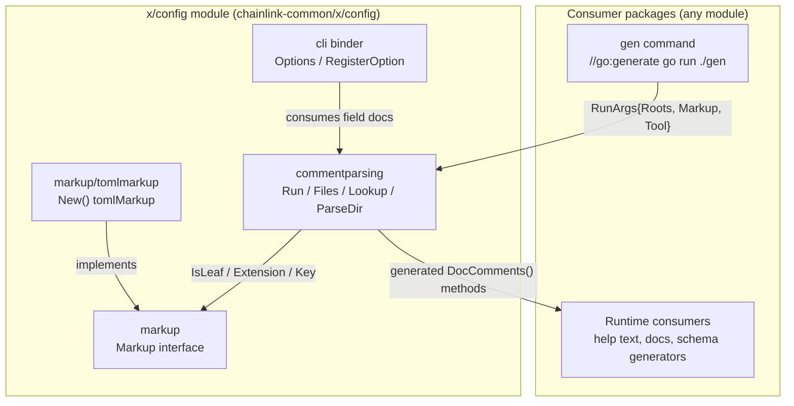
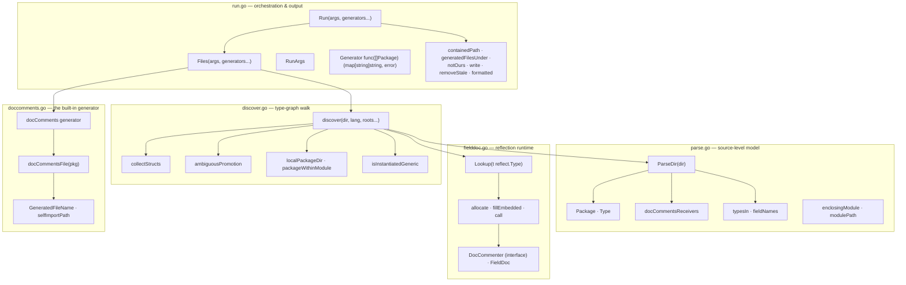
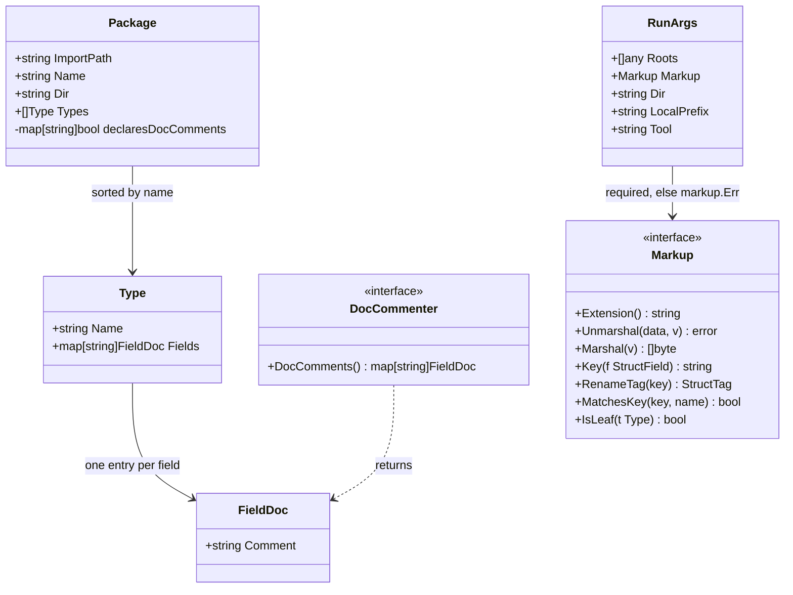
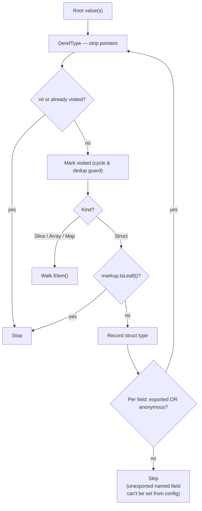
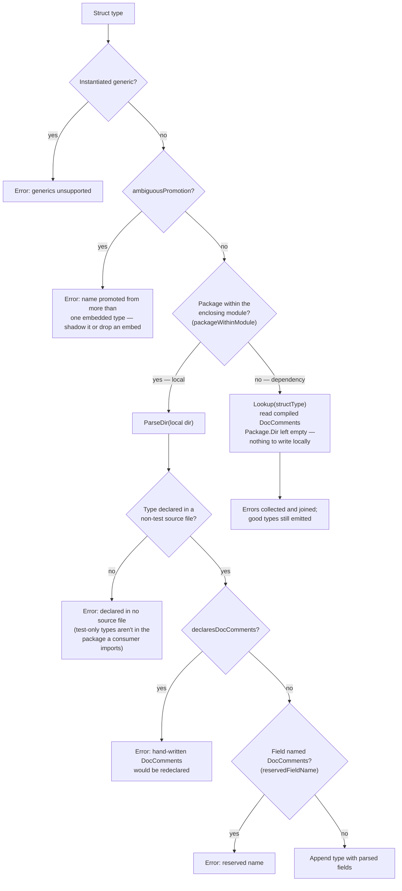
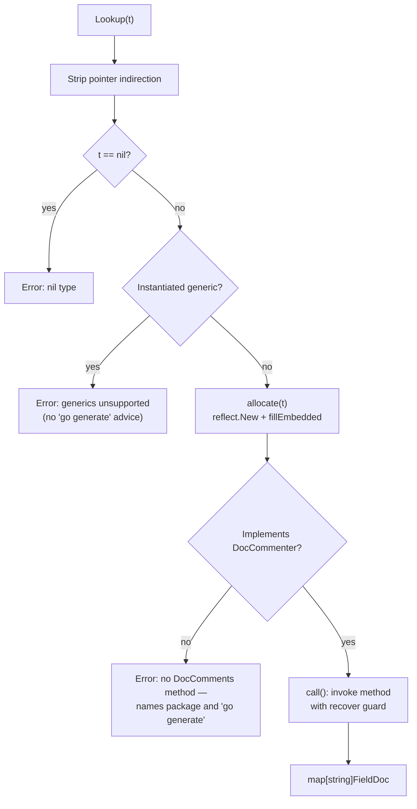
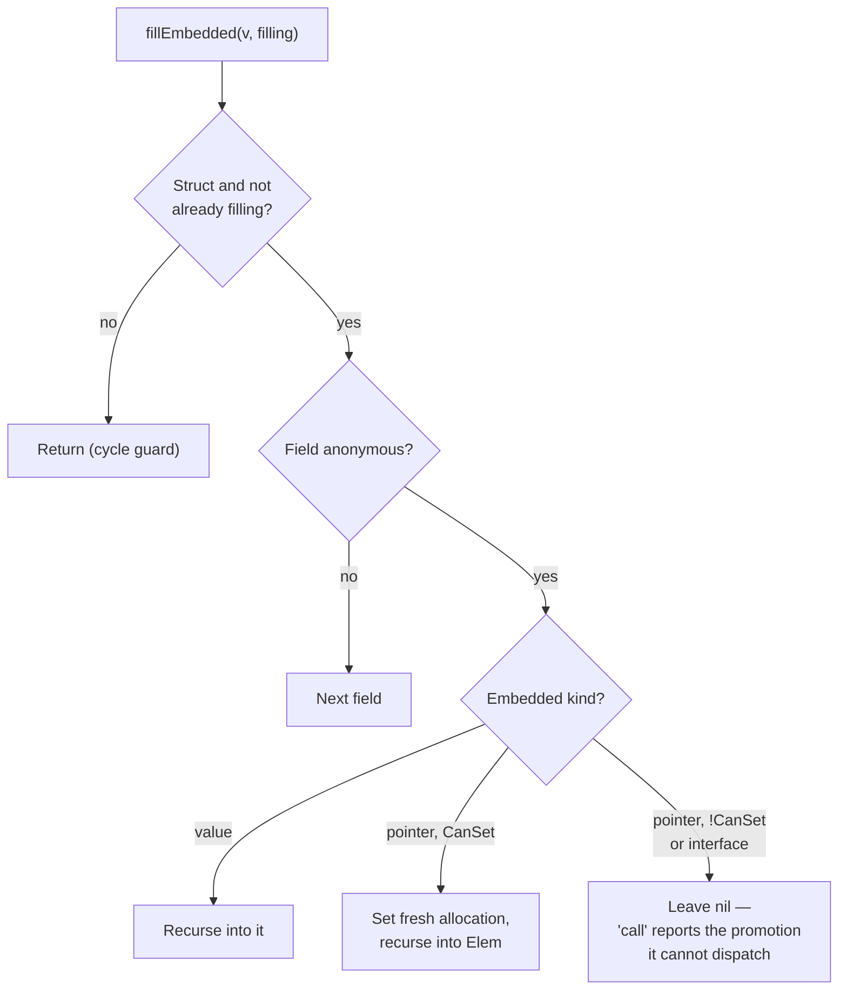
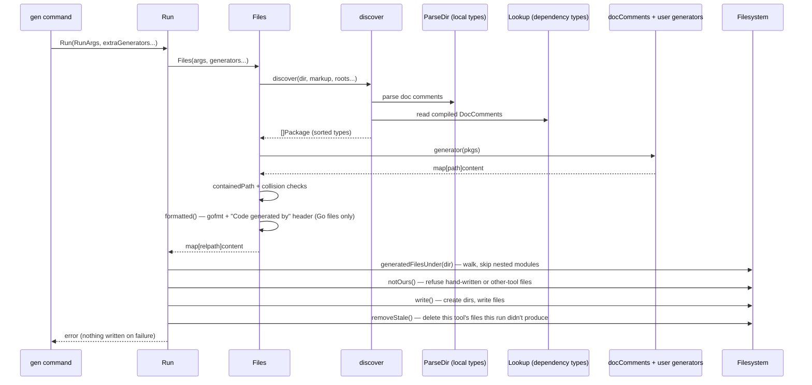

# commentparsing — Carrying Config Doc Comments into Compiled Packages

> **Module:** `github.com/smartcontractkit/chainlink-common/x/config/commentparsing`
> **Source:** `chainlink-common/x/config/commentparsing/` (its own Go module: [`chainlink-common/x/config/go.mod`](../../../repo/chainlink-common/x/config/go.mod))
> **Package README:** `chainlink-common/x/config/commentparsing/README.md`

## Introduction

`commentparsing` solves a narrow but fundamental problem of configuration handling in Go: **a field's doc comment is the one thing about a struct field that compilation discards**. Struct tags (`toml:"…"`, `validate:"…"`) survive into the binary and are readable via reflection; doc comments do not. Anything that wants to describe a configuration at runtime — CLI help text, generated reference docs, TOML schema output — needs those comments, and needs them for types that may come from **dependencies whose source is not available** (the read-only module cache).

The package closes this gap with a code-generation convention:

1. A generator command calls [`Run`](#run-lifecycle), which walks the type tree of declared config roots, parses the doc comments of types the local module declares, and **writes a `DocComments()` method into every local package it reaches** (file `doccomments_gen.go`).
2. Downstream modules regenerate the same way, reading a dependency's already-generated methods through reflection instead of its source.
3. At runtime, [`Lookup`](#lookup-reading-compiled-documentation) recovers a `map[string]FieldDoc` for any type — no source, no Go toolchain, no module cache required.

The design rationale for generation over resolving dependency source with `go list` is documented in the package README: reading documentation stays a *library* operation (a stripped container has no Go toolchain), `go list` needs a resolvable module graph (cold caches and sandboxes break it), and a package that never generated is **named with the fix** rather than failing as an unrecognizable path.

This module is one of three pillars of the [x-config-framework](../x-config-framework.md):

| Pillar | Role |
| --- | --- |
| [cli-binder](x-config-framework_cli-binder.md) | Binds config structs to CLI flags/options |
| [markup](x-config-framework_markup.md) | Describes configuration languages (TOML via `tomlmarkup`) |
| **commentparsing** (this page) | Recovers field documentation and feeds generators |

---

## Architecture

### Position within the framework



The `Markup` interface is the single integration point with a configuration language: its `IsLeaf(t reflect.Type) bool` tells the type walk where to stop (a type the decoder reads whole has no field-level documentation to collect). TOML is the only implementation shipped beside it, so a program linking TOML carries no other language's code.

### Internal component map

The package is split by concern across six source files (plus `doc.go`, the package comment, and an `examples/` directory):



### Core types



Key type semantics:

- **`Package`** — carries `ImportPath` (what reflection reports), `Name` (the package clause), `Dir` (where generated files belong; the walk rewrites `ParseDir`'s absolute directory relative to the run directory), and `Types` **sorted by name** so regenerating an unchanged package produces byte-identical output — the property that makes CI diff checks meaningful. `declaresDocComments` records types whose own source already declares the method (the generated file itself is never read, so a method from an earlier run does not count).
- **`FieldDoc`** — `Comment` holds the field's *whole* doc comment, not just the first sentence. Struct tags are deliberately **not** collected: they survive compilation and consumers read them off the type directly.
- **`DocCommenter`** — the interface generated methods satisfy. It is also the runtime contract `Lookup` dispatches on.

---

## How it works

### 1. The discovery walk (`collectStructs`)

`discover` starts from the `Roots []any` in `RunArgs` and walks the reflect type graph:



Notable behaviours pinned by tests:

- **Memory across roots.** The `visited` map is shared by all roots, so a type reached from several roots (or reachable six ways through value, pointer, slice, array, map, and self-embed — the `repeatedRoot` fixture) is emitted exactly once. A walk without shared memory would never finish on a cycle.
- **Leaf stop.** A type the markup language reads whole (per `Markup.IsLeaf`) is never entered; its fields are not configured one at a time.
- **Unexported embeds still contribute.** An unexported *anonymous* field is walked because its exported fields are promoted and settable from config; an unexported *named* field is not.
- **Anonymous structs and non-struct roots** are skipped — they belong to no package to document.
- **Generics are refused at the root and at every node** (`isInstantiatedGeneric` checks for `[` in the reflected name): a generated receiver needs a type-parameter list that reflection cannot supply, so the error names the type (`genericConfig[string]`) and explains why instead of pointing at `go generate`.

### 2. Local package vs. dependency — the decision point

For each collected struct type, `discover` classifies it:



**Module boundary handling** is deliberate and subtle:

- `enclosingModule(dir)` walks up from the run directory to the nearest `go.mod`; `modulePath` parses the directive the way the go tool accepts it — inline comments, tab separators, and quoted paths — so every local type doesn't misclassify as a dependency's.
- `packageWithinModule` requires a **path-component** match, not a string prefix: `example.com/app-extra` is not inside module `example.com/app`. A prefix-only match would read a directory the string manipulation lands on rather than resolve through `Lookup`.
- `localPackageDir` re-verifies that the directory computed for an import path still belongs to *this* module: a **nested module's** package shares the parent's path prefix but belongs to its own run, which owns header and staleness handling for its files.

Errors are accumulated (`errors.Join`), so one bad type does not suppress documentation for the healthy ones.

### 3. Parsing local source (`ParseDir`)

`ParseDir` reads a package directory with `go/parser` and returns a `*Package`:

- Reads only non-test `.go` files, skipping `GeneratedFileName` (a leftover generated file is not source) and anything the **build in hand does not select** (`build.Default.MatchFile` honours `//go:build ignore` and `GOOS` suffixes). Collecting a build-excluded type would yield a receiver for a type this build does not compile.
- Parses with `parser.ParseComments | parser.SkipObjectResolution`.
- `typesIn` records only declarations that are struct type specs — constants, aliases, and interfaces are skipped. Generic struct declarations are excluded ("no receiver can be written for it").
- `fieldNames` keys fields by **the names reflect reports** — embedded fields appear under the embed's name (`Local`, `Remote`, or an instantiated generic's `Single`, `Pair`), and one comment covering `Host, Port string` documents both names.
- `docCommentsReceivers` extracts the receiver types of any hand-written `DocComments` methods, resolving named receivers to their underlying type.
- Types are sorted by name for deterministic output; a directory with no Go package, an unparseable file, or a missing directory are reported as errors (`fs.ErrNotExist` preserved for the latter).

### 4. Reading compiled documentation (`Lookup`)

`Lookup(t reflect.Type)` is the runtime half — it answers *"what does this type's documentation say?"* without any source:



`allocate` is the interesting part: a generated method has a **value receiver**, so only a `*T` can be constructed from the type alone (`reflect.New`), and **embedded pointer fields are filled in with fresh allocations** (`fillEmbedded`) so promotions through them can be dispatched:



The `call` helper wraps the invocation in `recover`: a promotion through an embedded field that could not be constructed surfaces as an error naming the type and the fix (generate in the declaring package), rather than a panic.

### 5. Code generation (`docComments`)

The built-in `docComments` generator always runs as the first generator in `Files`. It emits **one file per local package**, written at `<package dir>/doccomments_gen.go` (`GeneratedFileName`):

- Renders, per type, `func (T) DocComments() map[string]FieldDoc { … }` — a value receiver, so `*T` carries the method too.
- Imports `selfImportPath` (this package) and qualifies `FieldDoc`, **except** when generating for `commentparsing` itself, which documents itself unqualified.
- Skips fields whose comment compiled to nothing — a bare field is left out entirely.
- Adds **no** `// Code generated by` header of its own; the `Run` pipeline adds it uniformly so it is never duplicated.
- Output is deterministic (sorted types, sorted field names) and valid Go (pinned by a `parser.ParseFile` round-trip in tests).
- Packages skipped: dependencies (no local `Dir` to write into) and packages with no reached types.

### 6. Run lifecycle

`Run` is a thin, strictly ordered wrapper around `Files`:



**Guard rails, each pinned by a test:**

| Guard | Behaviour |
| --- | --- |
| `Tool` empty | Refused — the header must name its generator. |
| `Markup` nil | Refused with `markup.Err` ("no markup language set: …"); no language is chosen silently on the caller's behalf. |
| Path collision | Two generators claiming one path — even spelled differently (`./clash.md` vs `clash.md`) — are an error, not last-write-wins. |
| Path containment | Absolute paths and paths escaping the run directory (`../escaped.md`) are refused before anything is written. A package discovered above the run directory fails for the same reason. |
| Failure atomicity | A generator error (or any refusal) means **nothing reaches disk**. |
| Formatting | Only Go source is gofmt'd and headed; any other file passes through untouched. |

**File ownership and staleness:**

- `notOurs` refuses to overwrite a file under `GeneratedFileName` that (a) has no generated-by header at all ("reserved for generated files") or (b) names another `Tool` ("already generated by …"). A header below a build constraint still marks the file generated (gofmt hoists the constraint above the header, so the whole comment block is read).
- `removeStale` deletes files **this tool** wrote that this run no longer produces — so a package that stops documenting anything doesn't leave a committed file declaring methods on vanished types. It never touches another tool's file, a nested module's file (skipped during the walk), or a hand-written file nothing generated over.
- Path identity is `filepath.Clean`-based, so `./out/../out/thing.md` and `out/thing.md` are the same file.

**`Files` vs `Run`:** `Files` returns the would-be-written map without touching disk — exactly what a CI check needs to verify committed files are up to date.

### 7. Extra generators

`Run`/`Files` accept any number of additional `Generator` functions, each handed the discovered `[]Package` — import path, package clause, directory, and reached types with resolved field comments (whether they came from local source or a dependency's compiled methods). A JSON-schema generator or a settings-docs page therefore needs neither the walk nor the parsing:

```go
commentparsing.Run(args, myJSONSchema, (&configDocs{Dir: "docs/config"}).Generate)
```

---

## Behavioural contracts (test fixtures)

The listed core components of this module are the fixture types in `commentparsing_test.go`. They encode the exact semantics the implementation must preserve; treat any change to them as a breaking contract change.

### `Lookup` semantics

| Fixture | Shape | Contract |
| --- | --- | --- |
| `lookupUndocumented` | Struct, no `DocComments` method | `Lookup` errors naming the package (`commentparsing.lookupUndocumented`) and telling the caller to `go generate`. |
| `lookupPromoted` | Value-embeds `lookupTarget`; own field `Extra` | A promoted method documents **what the embed brought** (`Endpoint`) and is silent about the embedder's own undocumented fields — how any undocumented field reads. |
| `lookupEmbedsPointer` | Embeds exported `*LookupEmbeddable` | `allocate` can set exported embedded pointers, so promotion through them works. |
| `lookupEmbedsUnexportedPointer` | Embeds unexported `*lookupTarget` | Cannot be set from the type alone → error: "promotes DocComments through an embedded field that cannot be constructed". |
| `lookupEmbedsInterface` | Embeds `DocCommenter` interface | No implementation to pick → same error as above. |
| `LookupOwnMethod` | Embeds unexported pointer **and** declares its own `DocComments` | The outer method **shadows** the promotion; it answers for its own fields without needing the unsettable receiver. |
| `LookupCycle` | Embeds `*LookupCycle` (self-embed) | `fillEmbedded`'s `filling` map stops the recursion; documentation still resolves. |

Edge cases also pinned: pointer-to-pointer (`**T`) works; a type with no package path (anonymous struct) reports the "no DocComments method" error; a nil type is an error, not a panic.

### Ambiguous promotion (`ambiguousPromotion`)

Go leaves a selector ambiguous between two embedded types legal to declare but illegal to use — there is no name a config file could set. Generation refuses such types:

| Fixture | Shape | Verdict |
| --- | --- | --- |
| `repeatedRoot` (control) | One type reached six ways + self-embed | OK — no name promoted twice *at the same depth*. |
| `ambiguousOuter` | Two value embeds both declaring `Region` | **Refused** — "Region promoted from more than one embedded type". |
| `ambiguousDeepOuter` | Collision two levels down, via embeds of embeds | **Refused**. |
| `ambiguousShadowed` | Outer type declares `Region` itself | OK — the outer type wins at the shallower depth. |
| `ambiguousDeepShadowed` | A shallower embed shadows a deeper tie | OK. |
| `ambiguousUnexported` | Unexported `region` promoted twice | OK — unexported names are out of a config file's reach regardless. |
| `ambiguousPolymorphic` / `ambiguousDeepPolymorphic` | Two **pointer** embeds tying (incl. two levels down) | OK — the polymorphic-section idiom: one embed per variant, all nil but the selected one, so the tied fields never exist at once. |
| `ambiguousMixed` | Pointer embed tying with **value** embed | **Refused** — the value embed's field always exists, so the tie stands. |
| `ambiguousDiamond` | Same inner type reached via pointer embed and value embed, deep enough that the pointer-free path is found by recursion | **Refused** — a walk keyed on type alone would remember the first arrival and wrongly call the name optional. |

### Other contracts in the test file

- `TestCollectStructsStopsAtALeaf` — the `isLeaf` predicate short-circuits field descent.
- `TestDiscoverEmitsEachTypeOnce` — each type appears exactly once in discovery output, and the generated file has exactly one `DocComments` method per type (two methods on one receiver would not compile).
- `TestPackageWithinModule` — path-component matching for module membership.
- `TestModulePath` — `module` directive parsing tolerates inline comments, tabs, and quotes.
- `TestReservedFieldName` — a **field** named `DocComments` is refused (`example.com/app.Config has a field named DocComments`): Go allows a type whose field and method share a name, so it compiles only until its documentation is generated. The parsed source is where this must be caught.
- `TestDocCommentsReceivers` — named, unnamed, and pointer receivers all resolve to the declared type.

---

## Guarantees and known limitations

Summarised from the package README (`chainlink-common/x/config/commentparsing/README.md`):

**Guarantees**

- Regenerating an unchanged package produces **byte-identical output** (sorted types and fields; generators added by callers must sort map iteration too) — which is what makes a CI diff meaningful.
- A package that stops documenting anything has its generated file **removed**, limited to files the same `Tool` wrote within the module being generated.
- Only non-test files are read, and only those the build in hand selects, as `go build` selects them.
- A package that has not generated is **named, with the fix**, everywhere: `Lookup`, `discover`, and `Files` all report which package to regenerate.

**Limitations**

1. **A config type must exist on every platform that compiles its package.** The generated file carries no build constraint of its own, while source is filtered by the running build; a type declared only in `config_linux.go` is missed elsewhere. Declare config types unconditionally.
2. **`DocComments` is reserved** on documented types (field or hand-written method).
3. **Ambiguous promotion is refused** except the all-pointer (polymorphic) idiom; shadow the name on the outer type or drop an embed.
4. **Promotion through an embedded interface or unexported embedded pointer cannot be read** at runtime; generate in the declaring package to give the outer type a method of its own.
5. **Generic types cannot be documented** — reported, not generated.

One manual edit remains: **deleting a documented type**. The committed file still declares a method on it, so the package no longer compiles and a `gen` command that imports it cannot even start. Delete the stale `doccomments_gen.go` (or have the recipe `rm` artifacts first) and regenerate.

---

## Integration guide

### Generate

In the package declaring your config:

```go
//go:generate go run ./gen

func main() {
    if err := commentparsing.Run(commentparsing.RunArgs{
        Roots:       []any{&Config{}},
        Markup:      tomlmarkup.New(),
        Tool:        "example.com/app/gen",
        LocalPrefix: "example.com",
    }); err != nil {
        log.Fatal(err)
    }
}
```

List **every type a consumer may reach on its own** as a root — a package exposing a config and a secrets file, or two independently embeddable sections, needs all of them. One call covers a config tree spanning several packages of the module. Commit the generated files; regenerate in CI and fail on a diff.

### Read it back

```go
fields, err := commentparsing.Lookup(reflect.TypeFor[simple.Config]())
fmt.Println(fields["Timeout"].Comment)
```

A type from a dependency reads the same way, provided that dependency generated.

### Dry-run freshness checks

```go
files, err := commentparsing.Files(args, extraGenerators...) // no disk writes
```

### Worked examples

Whole working commands ship in `chainlink-common/x/config/commentparsing/examples/`: `simple` (one package), `nested` (two packages of one module via an embed), and `separate_module_use` (a true module boundary consuming a dependency's documentation without its source).

---

## Related documentation

- [x-config-framework](../x-config-framework.md) — the framework this package belongs to.
- [x-config-framework_cli-binder](x-config-framework_cli-binder.md) — CLI flag binding, a downstream consumer of the generated field documentation.
- [x-config-framework_markup](x-config-framework_markup.md) — the `Markup` interface and the TOML implementation; supplies `IsLeaf` to the walk and is required by `RunArgs`.
- [config-validation](../config-validation.md) — the complementary `pkg/config` validation errors (`Validated`, `KeyNotFoundError`) for config value checking.
- [Shared_Foundation_Libraries___Domain_Types](../../Shared_Foundation_Libraries___Domain_Types.md) — the foundation-library catalogue this module sits in.

**Build context:** this package is its own Go module (`github.com/smartcontractkit/chainlink-common/x/config`, Go 1.27.1) declared in [`chainlink-common/x/config/go.mod`](../../../repo/chainlink-common/x/config/go.mod), with deliberately small dependencies (`go-toml/v2`, `strcase`, `cobra`/`pflag`, `validator`, `golang.org/x/mod`) — keeping the framework linkable without dragging node runtime dependencies into consumers.
