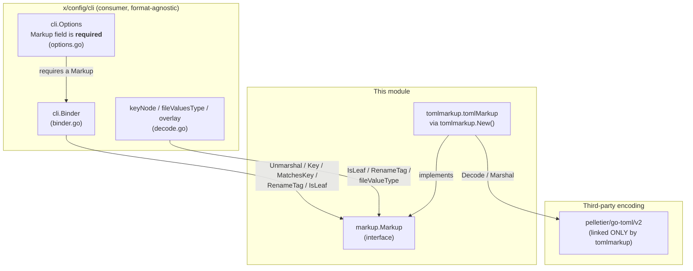
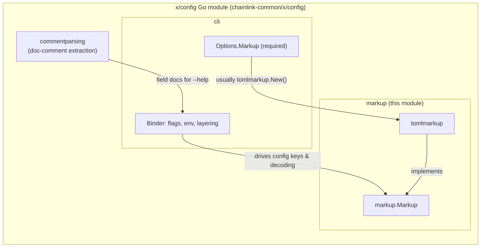
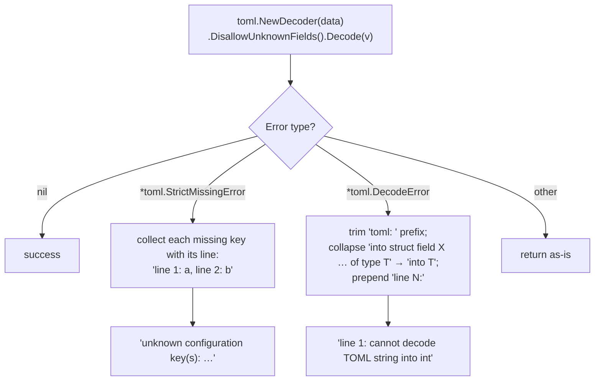

# x-config-framework: Markup (TOML Serialization)

## Introduction

The **markup** module provides the file-format serialization layer of the [x-config-framework](../x-config-framework.md). It defines the `markup.Markup` interface — the abstraction through which the rest of the framework reads and writes configuration documents — and ships a production implementation for TOML built on [`github.com/pelletier/go-toml/v2`](../../../repo/chainlink-common/x/config/go.mod).

The module has two Go packages:

| Package | Path | Role |
|---|---|---|
| `markup` | `chainlink-common/x/config/markup` | The `Markup` interface: the format-agnostic contract used by every other part of the framework |
| `tomlmarkup` | `chainlink-common/x/config/markup/tomlmarkup` | The TOML implementation of that contract, and the only place the TOML library is linked |

The design intent is stated in the package comment of `tomlmarkup.go`:

> *"It is a package of its own so that only a program configured in TOML links a TOML library."*

In other words, the interface/implementation split is a **compile-time dependency-isolation strategy**: an application configured in YAML links only a YAML implementation of `Markup`, and never pulls `go-toml` into its binary. This module page focuses on the TOML adapter; the framework-wide picture is in [x-config-framework](../x-config-framework.md), and the two sibling consumers are [x-config-framework_cli-binder](x-config-framework_cli-binder.md) and [x-config-framework_commentparsing](x-config-framework_commentparsing.md).

Source of truth for this page:

- `chainlink-common/x/config/markup/markup.go` — the `Markup` interface
- `chainlink-common/x/config/markup/tomlmarkup/tomlmarkup.go` — the TOML adapter
- `chainlink-common/x/config/markup/tomlmarkup/tomlmarkup_test.go` — behavioral specification (tests)
- `chainlink-common/x/config/cli/{options,binder,register,decode}.go` — the primary consumer
- `chainlink-common/x/config/go.mod` — the module's dependency manifest

---

## Architecture

The `Markup` interface sits between the format-agnostic machinery of the framework (the CLI binder, which owns flags, env vars, layering, and validation) and a concrete encoding library. Everything that varies by format is funneled through seven methods.



### The `Markup` interface contract

Defined in `chainlink-common/x/config/markup/markup.go`:

| Method | Purpose | TOML-specific semantics |
|---|---|---|
| `Extension() string` | File suffix (no dot), used for the default config path (`config.<extension>`) | `"toml"` |
| `Unmarshal(data []byte, v any) error` | Decode a whole document; **rejects keys the target has no field for, naming them** | Strict via `DisallowUnknownFields()`; rewrites go-toml errors into `"line N: …"` messages |
| `Marshal(v any) ([]byte, error)` | Encode `v` exactly as the language's own encoder would | Direct `toml.Marshal` |
| `Key(f reflect.StructField) (string, bool)` | The document key that names field `f`; `ok == false` if the decoder never reads `f`; `""` if the field's own fields are read into the parent's table (anonymous embedding) | Reads the `toml:` tag; see [key derivation rules](#key-derivation-rules) |
| `RenameTag(key string) reflect.StructTag` | Synthesizes a struct tag that makes the decoder read a field by `key` — built from the key alone, never copied from an existing field | Returns ``toml:"key"``; a bare `"-"` becomes ``toml:"-,"`` so it names the key `-` rather than dropping the field |
| `MatchesKey(key, name string) bool` | Whether the decoder reads document key `key` as field keyed `name` | Case-insensitive, mirroring go-toml's key lowercasing (see [Case handling](#case-handling)) |
| `IsLeaf(t reflect.Type) bool` | Whether the decoder reads a value of type `t` *whole*, through a method of `t`, rather than field by field | `true` iff `t` or `*t` implements `encoding.TextUnmarshaler` |

### Relationship to sibling modules



- The **CLI binder** ([x-config-framework_cli-binder](x-config-framework_cli-binder.md)) *requires* a `Markup` in `cli.Options` — `New` returns an error when it is nil — and states in its own doc: *"Markup is required, usually `x/config/markup/tomlmarkup`. It decodes config files and decides config keys."* (`chainlink-common/x/config/cli/options.go`).
- **commentparsing** ([x-config-framework_commentparsing](x-config-framework_commentparsing.md)) does not consume `Markup` directly; it supplies the doc comments that the binder puts in flag usage strings.
- Validation of loaded values (`validate:` tags, e.g. via `go-playground/validator` in `go.mod`) happens after decoding, in the binder; the framework-level `Validated` contract is documented in [config-validation](../config-validation.md).

---

## Component deep-dive: `tomlmarkup`

`chainlink-common/x/config/markup/tomlmarkup/tomlmarkup.go` implements all seven methods on a stateless `tomlMarkup` struct, exposed as `New() markup.Markup`.

### Strict unmarshalling and error shaping

`Unmarshal` is deliberately stricter than go-toml's default and reshapes its errors for operator ergonomics:



Two deliberate behaviors worth calling out (from the code comments):

1. **Strictness.** `DisallowUnknownFields` exists *"so a typo can't silently leave a default"* — an unknown key in a config file is a hard error listing file line numbers, not a silent no-op.
2. **Error message targets the field's type, not the wrapper struct.** The message rewrite strips the `into struct field … of type …` phrasing because *"a caller may build that struct only to decode into"* — most importantly the binder, which synthesizes throwaway decode-target structs at runtime (see `fileValuesType` in `chainlink-common/x/config/cli/decode.go`, which names fields `F0`, `F1`, …). Surfacing `F3` in an error would be meaningless to operators; `cannot decode TOML string into int` is not.

### Key derivation rules

`Key(f reflect.StructField)` decides, per field, how a config file can name it. The rules mirror go-toml's decoder exactly:

```mermaid
flowchart TD
    S["struct field f"] --> T1{"tag == toml:\"-\"?"}
    T1 -- yes --> X1["(\"\", false) — never read"]
    T1 -- no --> T2{"anonymous embed?"}
    T2 -- "yes, no tag" --> T2a{"(deref'd) kind is struct?"}
    T2a -- yes --> X2["(\"\", true) — fields read into parent's table"]
    T2a -- no --> X3["(\"\", false)"]
    T2 -- "yes, with tag" --> X4["(tag key, true)"]
    T2 -- no --> T3{"exported?"}
    T3 -- no --> X5["(\"\", false)"]
    T3 -- yes --> T4{"tag present?"}
    T4 -- no --> X6["(f.Name, true)"]
    T4 -- yes --> X7["(tag key, true)"]
```

All cases are pinned by `TestKey` in `tomlmarkup_test.go`, including the pointer-to-struct anonymous embed (`*struct{}`), which is read into the parent's table like a value embed.

### Case handling

`MatchesKey` returns `key == name || strings.ToLower(key) == strings.ToLower(name)`.

```go
//nolint:staticcheck // SA6005: go-toml lowercases; EqualFold differs on some runes
```

The implementation deliberately avoids `strings.EqualFold`: go-toml/v2 implements case-insensitivity by **lowercasing** keys, and `EqualFold` performs Unicode *simple folding*, which diverges from plain lowercasing on some runes. Matching the encoder's exact algorithm prevents false positives (e.g. `MatchesKey("chainid", "ChainID") == true`, but `MatchesKey("chain_id", "ChainID") == false` — snake_case is **not** equivalent).

This predicate is security-relevant for the binder: `keyNode.add` in `chainlink-common/x/config/cli/decode.go` uses it to reject struct definitions whose fields would collide in a config file —

> *"A key the markup can't tell from another, such as `Value` and `VALUE` when it matches case-insensitively, would set both fields, so it is rejected too."*

### Leaf detection and dynamic decode targets

`IsLeaf` reports whether the decoder treats a type atomically:

```go
func (tomlMarkup) IsLeaf(t reflect.Type) bool {
    return t.Implements(textUnmarshaler) || reflect.PointerTo(t).Implements(textUnmarshaler)
}
```

The binder walks registered config types with `IsLeaf` (`fileValueType` in `decode.go`) to decide when to stop recursing, and with `RenameTag` to **synthesize** decode-target structs that track exactly which keys each config file set (a `nil` pointer in the synthetic struct means "file left this key out", preserving defaults). `IsLeaf` accepts both value- and pointer-receiver `UnmarshalText` implementations — the test type `readsTextByPointer` in `tomlmarkup_test.go` pins the pointer-receiver case:

```go
type readsTextByPointer struct{}
func (*readsTextByPointer) UnmarshalText([]byte) error { return nil }
```

`RenameTag`'s special case matters here too: the generated structs use tags built from keys alone, and a key of `-` must not accidentally mean "skip this field" — hence `RenameTag("-")` returns `toml:"-,"` (the bare `-` tag drops the field; the comma form names it literally).

---

## Data flow: a config file reaching a bound struct

The end-to-end path of a TOML file through the framework (orchestration details of the binder itself are in [x-config-framework_cli-binder](x-config-framework_cli-binder.md)):

```mermaid
sequenceDiagram
    participant Op as Operator
    participant Cmd as cobra command run
    participant Bd as cli.Binder (binder.go)
    participant Kn as keyNode (decode.go)
    participant Mk as tomlmarkup (this module)
    participant Gt as go-toml/v2
    participant Cfg as Registered config structs

    Op->>Cmd: app --config base.toml --config prod.toml
    Cmd->>Bd: PersistentPreRunE → wire()
    Bd->>Kn: build key tree from registered structs<br/>(Key, MatchesKey, IsLeaf at register time)
    loop each --config file, in order
        Bd->>Mk: Unmarshal(fileBytes, &syntheticFileValues)
        Mk->>Gt: Decode with DisallowUnknownFields
        Gt-->>Mk: value / StrictMissingError / DecodeError
        Mk-->>Bd: decoded file values (nil ptr = key absent)<br/>or "unknown configuration key(s): line N: …"
        Bd->>Kn: overlay(dst, src)
        Note over Kn: later keys win per key;<br/>lists replace, never merge
    end
    Bd->>Cfg: merge flags + env vars + layered files
    Bd->>Cfg: check validate: tags (required, dive, …)
```

Key properties of this flow:

- **Layering over defaults.** `cli.Options.BaseConfig` (usually an embedded TOML file) is layered under every `--config` file; files layer over each other in CLI order, *"later keys winning per key"* (`binder.go`). `Marshal` supports generating such default/sample files.
- **Lists replace, maps merge by key.** The overlay logic notes *"A list replaces rather than merges, or a later file could never shorten it"* — a semantic guaranteed by the binder, with the `Markup` deciding *which* keys exist at all.
- **Config-file-only fields.** Types with no text form (per `IsLeaf` and the binder's flag rules) are settable only through files — making the markup layer the sole ingress for complex config such as nested maps of chains.

---

## Design rationale

| Decision | Rationale |
|---|---|
| Separate `tomlmarkup` package from `markup` interface | So *"only a program configured in TOML links a TOML library"* — a YAML-configured binary ships without go-toml (package comment, `tomlmarkup.go`) |
| Separate `x/config` Go module | `chainlink-common/x/config/go.mod` isolates the framework's deps (`cobra`, `pflag`, `validator`, `go-toml`) from consumers that only need types |
| Strict unknown-key rejection | *"so a typo can't silently leave a default"* — fail fast on operator mistakes (`Unmarshal`) |
| `strings.ToLower` over `EqualFold` | Match go-toml's own lowercasing algorithm; `EqualFold`'s simple folding differs on some runes (`MatchesKey` nolint comment) |
| Error rewrite dropping synthetic struct-field names | The binder decodes into dynamically built `F0…Fn` structs; users should see *"into int"*, not `F3` (`Unmarshal` comment; `fileValuesType` in `cli/decode.go`) |
| `Key` returns `("", true)` for anonymous structs | Preserves Go embedding semantics: an embedded section's fields live in the parent's TOML table |
| Tag-based, not name-based, key identity in decode targets | *"Tags, not names, match keys, so the `F<n>` names only show in the markup's errors"* (`cli/decode.go`) |

## Testing

`tomlmarkup_test.go` is effectively the executable specification of the interface. Every test exercises the shared `New()` adapter, so the behavior is pinned against `Markup`'s consumers' expectations:

| Test | Behavior pinned |
|---|---|
| `TestExtension` | `Extension() == "toml"` |
| `TestUnmarshal` | Unknown keys rejected with line-precise message; type mismatch message names the target type (`"line 1: cannot decode TOML string into int"`); non-pointer decode rejected (`"decoding can only be performed into a pointer, not struct"`) |
| `TestMarshal` | Round-trip output matches go-toml (`"Port = 1\n"`) |
| `TestMatchesKey` | Case-insensitive (`chainid` ≡ `ChainID`); snake_case *not* equivalent (`chain_id` ≢ `ChainID`) |
| `TestKey` | All seven derivation rules of the [flowchart above](#key-derivation-rules) |
| `TestRenameTag` | ``toml:"k"`` for a normal key; ``toml:"-,"`` for `"-"` (avoids field drop) |
| `TestIsLeaf` | Pointer-receiver `TextUnmarshaler` (`readsTextByPointer`) is a leaf; empty struct is not |

Run with `go test ./x/config/...` from the `chainlink-common` workspace; the module builds against Go 1.27.1 per `chainlink-common/x/config/go.mod`.

## Dependencies

From `chainlink-common/x/config/go.mod` (module `github.com/smartcontractkit/chainlink-common/x/config`):

| Dependency | Used by this module for |
|---|---|
| `github.com/pelletier/go-toml/v2` | The actual TOML encoding/decoding engine — the only direct consumer is this module |
| `github.com/stretchr/testify` | Assertions in the behavioral tests |
| `github.com/spf13/cobra`, `github.com/spf13/pflag` | (Framework-wide) CLI binding — the binder that consumes `Markup` |
| `github.com/go-playground/validator/v10` | (Framework-wide) `validate:` tag checking after decode |
| `github.com/iancoleman/strcase`, `golang.org/x/mod` | (Framework-wide) key casing and module tooling |

The import direction is strictly one-way: `tomlmarkup` imports `markup`; `cli` imports `markup`; nothing in `markup` imports `cli` or `tomlmarkup` — which is what keeps the TOML library linkable in isolation.

## Extending the framework with a new format

Because every format-varying behavior is captured by the seven interface methods, adding e.g. YAML support means:

1. Create `chainlink-common/x/config/markup/yamlmarkup` (its own package, so only TOML-configured binaries link go-toml — same isolation rationale).
2. Implement `Markup`, choosing deliberately per method: extension, strictness policy, key-matching case behavior (must mirror your decoder exactly, or the binder's ambiguity checks misfire), leaf semantics, and tag renaming.
3. Wire it into `cli.Options.Markup` — no changes to the binder or this module are required.

Refer to `tomlmarkup.go` as the reference implementation and `tomlmarkup_test.go` as the minimum behavioral bar a new adapter should match.

## Related documentation

- [x-config-framework](../x-config-framework.md) — framework overview and module map
- [x-config-framework_cli-binder](x-config-framework_cli-binder.md) — flags/env/config-file binding; the primary consumer of `Markup`
- [x-config-framework_commentparsing](x-config-framework_commentparsing.md) — doc-comment extraction feeding `--help` text
- [config-validation](../config-validation.md) — the `Validated` contract and error types applied after decoding
- [Shared_Foundation_Libraries___Domain_Types](../../Shared_Foundation_Libraries___Domain_Types.md) — the shared-library domain this module belongs to
