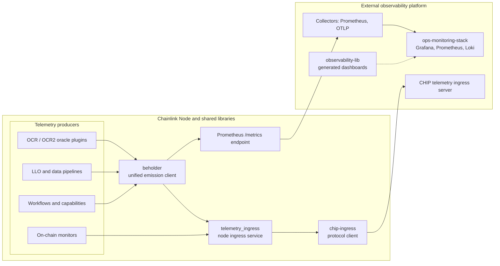
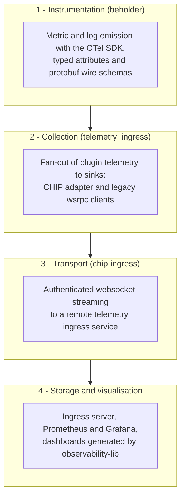
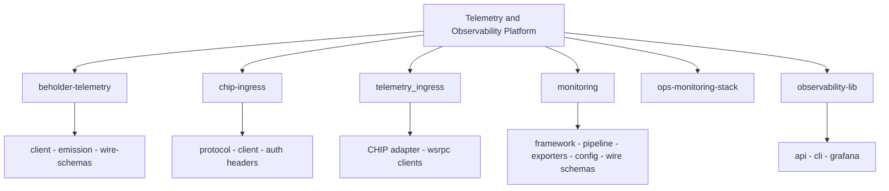

# Telemetry & Observability Platform

## Purpose

The `Telemetry___Observability_Platform` module consolidates the libraries, node services and ops tooling that the Chainlink stack uses to **emit, collect, transport and visualise operational telemetry**. It is the shared instrumentation backbone consumed by node core, oracle engines (OCR/OCR2, LLO), pipelines and the workflow/capability runtime, and it provides the off-node plumbing (ingress protocols, exporters, dashboards) required to operate those systems in production.

Its responsibilities break down into four concerns:

| Concern | Component | Location |
|---|---|---|
| **Emission** | [beholder-telemetry](<Telemetry___Observability_Platform/beholder-telemetry.md>) | `chainlink-common/pkg/beholder` |
| **Ingress** | [telemetry_ingress](<Telemetry___Observability_Platform/telemetry_ingress.md>) | `chainlink/core/services/synchronization` |
| **Transport** | [chip-ingress](<Telemetry___Observability_Platform/chip-ingress.md>) | `chainlink-common/pkg/chipingress` |
| **On-chain monitoring** | [monitoring](<Telemetry___Observability_Platform/monitoring.md>) | `chainlink-common/pkg/monitoring` |
| **Ops tooling** | [ops-monitoring-stack](<Telemetry___Observability_Platform/ops-monitoring-stack.md>) · [observability-lib](<Telemetry___Observability_Platform/observability-lib.md>) | `chainlink-common/ops/monitoring` · `chainlink-common/observability-lib` |

## Architecture

### High-level telemetry flow

Producers inside the node and shared libraries emit telemetry through **beholder**, the single OpenTelemetry-based façade. Beholder either exposes metrics on the node's `/metrics` endpoint or hands payloads to the node-resident **telemetry ingress** service, which forwards them off-node over the CHIP protocol (or legacy wsrpc clients). On the platform side, collectors and the ops monitoring stack store and visualise the data, with dashboards generated by `observability-lib`.

### Layered responsibilities

The module is organised as a pipeline of layers, each owned by one core component:

### Module composition

## Core components

- **[beholder-telemetry](<Telemetry___Observability_Platform/beholder-telemetry.md>)** — the uniform telemetry emission API used across nodes, plugins and capabilities. `client` bootstraps the OpenTelemetry SDK and exporters (Prometheus, OTLP); `emission` provides typed helpers for counters, gauges and histograms with consistent attribute keys and message signing; `wire-schemas` holds the protobuf definitions shared with downstream consumers.

- **[chip-ingress](<Telemetry___Observability_Platform/chip-ingress.md>)** — client-side implementation of the CHIP streaming protocol used to ship telemetry off-node. `protocol` defines message framing, `client` provides the reconnecting websocket client, and `auth_headers` implements the signed authentication headers required by the ingress service.

- **[telemetry_ingress](<Telemetry___Observability_Platform/telemetry_ingress.md>)** — the node-resident telemetry ingress service (in `core/services/synchronization`) that fans out telemetry emitted by oracle plugins, pipelines and other services to configured remote endpoints. The `chip_adapter` bridges internal telemetry onto the CHIP protocol, while the `wsrpc_clients` are the legacy websocket-rpc clients used for Mercury-style telemetry delivery.

- **[monitoring](<Telemetry___Observability_Platform/monitoring.md>)** — a declarative framework for building on-chain monitors: `framework` defines the source/printer abstractions and lifecycle, `configuration` and `data_pipeline` handle shared config and batching, `exporters` plug into Prometheus, CloudWatch and InfluxDB, `balance` ships ready-made balance monitors, and `wire_schemas`/`testutils` provide generated exporter code and test fakes.

- **[ops-monitoring-stack](<Telemetry___Observability_Platform/ops-monitoring-stack.md>)** — Docker Compose definitions for a ready-made observability stack (Prometheus, Grafana and companions) that scrapes node metrics; used for local development and ops deployments, pairing naturally with `observability-lib` output.

- **[observability-lib](<Telemetry___Observability_Platform/observability-lib.md>)** — library plus CLI for observability configuration as code: `api` exposes typed builders, `grafana` renders Grafana dashboards from them, and `cli` wires everything into a command-line tool for CI and ops workflows.

## Integration points

Other modules depend on this platform rather than implementing observability themselves: node application config (observability section in `core/config`) wires beholder/telemetry settings into the node lifecycle, oracle engines and workflows emit through beholder, and plugin processes (Loop) forward telemetry over the same wire schemas — making this module the single source of truth for how Chainlink systems are instrumented and observed.