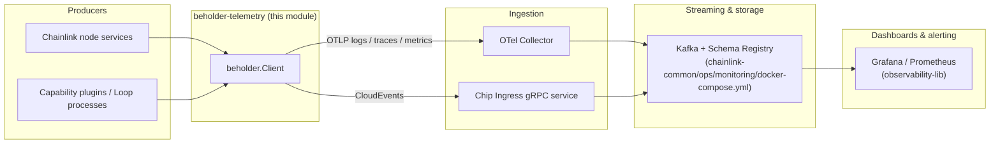
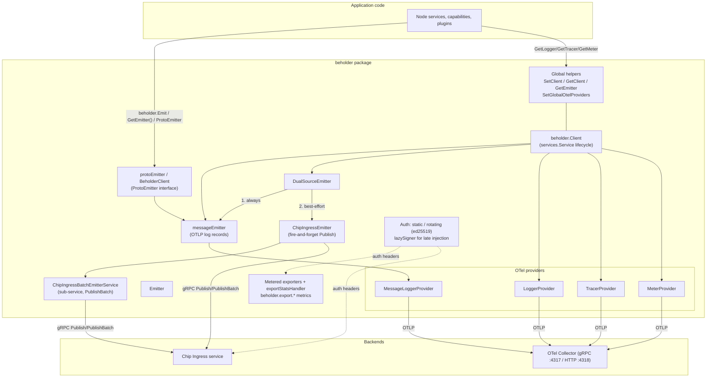
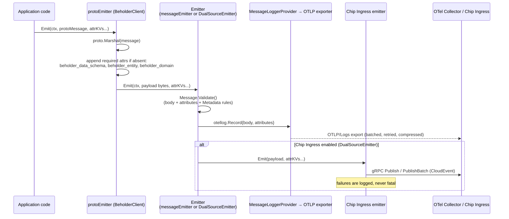

# Beholder Telemetry SDK (`beholder-telemetry`)

> Parent module: [Telemetry & Observability Platform](../Telemetry___Observability_Platform.md)

## 1. Overview

**Beholder** (`chainlink-common/pkg/beholder`) is the standard telemetry client used across Chainlink nodes and capability plugins. It wraps the **OpenTelemetry Go SDK** behind a single small surface — a `Client` that exposes a `Logger`, `Tracer`, `Meter`, `Emitter`, and (optionally) a `Chip` client — so any subsystem can emit **custom messages**, **logs**, **traces**, and **metrics** without knowing how or where the data is shipped.

Core responsibilities:

| Concern | What Beholder provides |
|---|---|
| **Custom messages** | Typed protobuf payloads with mandatory routing metadata (`beholder_domain`, `beholder_entity`, `beholder_data_schema`), exported as OTLP log records to an OpenTelemetry Collector (gRPC **or** HTTP). |
| **Chip Ingress migration path** | Optional `DualSourceEmitter` that fans every custom message to the legacy OTLP path **and** the [Chip Ingress](chip-ingress.md) gRPC service, with a batched emitter variant for throughput. |
| **Standard OTel signals** | Log streaming (batch/simple processors), trace sampling (`TraceSampleRatio`) and metric collection with per-instrument cardinality limits and view-based attribute denial. |
| **Security** | Static auth headers or **rotating ed25519-signed** auth headers (V2 format) attached to every OTLP export and Chip Ingress publish. |
| **Self-observability** | Metered exporters and gRPC stats handlers recording `beholder.export.bytes` / `beholder.export.duration` for the SDK's own exports. |
| **Zero-risk defaults** | A global no-op client (`NewNoopClient`) installed at package init, so telemetry calls never panic before initialization. |

The module lives inside the `chainlink-common` Go module (see `chainlink-common/go.mod`) and has no runtime dependency on other Chainlink services — its only external integration points are the OTel Collector endpoint and the Chip Ingress service.

## 2. Position in the Telemetry & Observability Platform

Beholder is the **producer-side SDK** of the platform. The sibling modules own the downstream pieces:

Related pages:

- [chip-ingress](chip-ingress.md) — the gRPC CloudEvent ingestion service that `Client.Chip`, `ChipIngressEmitter`, and `ChipIngressBatchEmitterService` publish to.
- [telemetry_ingress](telemetry_ingress.md) — the node's telemetry-ingress brokers (a separate, contract-specific ingest path, not Beholder).
- [monitoring](monitoring.md) — the standalone OCR2 monitoring stack (independent exporter tooling, consumes similar protobuf configs).
- [observability-lib](observability-lib.md) — Go library that deploys Grafana dashboards/folders on top of the collected data.
- [ops-monitoring-stack](ops-monitoring-stack.md) — the Kafka / Schema Registry / Zookeeper compose stack (`chainlink-common/ops/monitoring/docker-compose.yml`) typically sitting behind the Collector/Chip Ingress.
- Node-side configuration wiring (endpoints, auth) is surfaced through the node config system — see [core_config_observability](../Node_Application_Core___Interfaces/core_config/core_config_observability.md).

## 3. Architecture overview

### 3.1 Component map

### 3.2 `beholder.Client` at a glance

| Field | Role |
|---|---|
| `Logger` / `LoggerProvider` | OTel log streaming of node logs (toggle with `LogStreamingEnabled`; no-op provider when disabled). |
| `MessageLoggerProvider` | Separate `LoggerProvider` feeding the custom-message emitter (distinct resource attribute `beholder_data_type=custom_message`). |
| `Tracer` / `TracerProvider` | Distributed tracing with parent-based ratio sampling and optional additional span exporter. |
| `Meter` / `MeterProvider` | Metrics with periodic reader, cardinality limit (`DefaultMetricCardinalityLimit = 100000`), deny-attribute views and per-workflow histogram views (`metricviews`). |
| `Emitter` | Custom-message emitter: `messageEmitter`, or `DualSourceEmitter` when Chip Ingress is enabled. |
| `Chip` | Direct `chipingress.Client` (a `NoopClient` when Chip Ingress is not configured). |
| `lazySigner` | Thread-safe signer slot enabling rotating auth when the keystore is injected after client construction (`SetSigner` / `IsSignerSet`). |
| `OnClose` | Joins shutdown of all four OTel providers. |

Construction paths: `NewClient` (validates exactly one exporter endpoint, then delegates), `NewGRPCClient` (default; injectable exporter factory for tests), `NewHTTPClient` (OTLP/HTTP; no rotating auth), `NewNoopClient` (no-op providers). `ForName`/`ForPackage` return a copy scoped to a package/component name so telemetry is attributed per emitter.

### 3.3 Sub-modules

The module splits into three sub-modules, each documented in detail on its own page:

| Sub-module | Contents | Documentation page |
|---|---|---|
| **Client runtime & config** | `Client` lifecycle and construction (gRPC/HTTP/no-op), `Config`/`RetryConfig` defaults, global client singleton, authentication (static + rotating V2), lazy signer, metered exporters and export stats, test seams (`OTLPExporter` interface, `MockExporter`). | [beholder-telemetry_client](beholder-telemetry/beholder-telemetry_client.md) |
| **Emission pipeline** | The `Emitter` interface and its implementations (`messageEmitter`, `ChipIngressEmitter`, `ChipIngressBatchEmitterService`, `DualSourceEmitter`), the `ProtoEmitter`/`BeholderClient` protobuf wrapper, the `Message`/`Metadata` model with validation, attribute keys and schema-path derivation. | [beholder-telemetry_emission](beholder-telemetry/beholder-telemetry_emission.md) |
| **Wire schemas** | The protobuf contracts for custom messages: `BaseMessage` (msg + labels + timestamp) and the `TestCustomMessage` example used in tests. | [beholder-telemetry_wire-schemas](beholder-telemetry/beholder-telemetry_wire-schemas.md) |

Where to go for details, by topic:

- **Custom-message flow, validation, and attribute/schema derivation** (sections 4–5 above) → [beholder-telemetry_emission](beholder-telemetry/beholder-telemetry_emission.md) and [beholder-telemetry_wire-schemas](beholder-telemetry/beholder-telemetry_wire-schemas.md).
- **Client construction, configuration defaults, authentication, and export instrumentation** (sections 6–7 above) → [beholder-telemetry_client](beholder-telemetry/beholder-telemetry_client.md).
- **How emitted events reach the downstream pipeline** → the Chip Ingress gRPC contract is documented in [chip-ingress](chip-ingress.md); dashboarding of the collected data in [observability-lib](observability-lib.md).

## 4. Custom-message data flow

Design intent (from `dual_source_emitter.go`): during the migration from OTLP to Chip Ingress, both paths receive every custom message; the Chip Ingress leg is best-effort (errors only logged), while the OTLP leg keeps its error semantics.

## 5. Message contract

- **Required attributes** (validated on every emit):
  - `beholder_domain` — first package component of the proto full name (e.g. `platform.on_chain...` → `platform`).
  - `beholder_entity` — protobuf message short name.
  - `beholder_data_schema` — schema-registry path, auto-derived by `toSchemaPath`, e.g. `platform.on_chain.forwarder.ReportProcessed` → `<schemaBasePath>/platform/on-chain/forwarder/report_processed.proto`.
- **Validation rules** (`message.go`): body must be non-nil, attributes non-empty, domain/entity must match `^[a-zA-Z0-9._-]+$` and must not contain `__`.
- **Wire format**: `pb/base_message.proto` defines `BaseMessage{ msg, map<string,string> labels, timestamp }`; producers are expected to extend it per use case (composition is discouraged until INFOPLAT-1386 lands).
- **Optional metadata**: node version, CSA key/signature, DON id, network name, workflow id/name/owner/spec/execution, capability contract address/id/version/name — encoded by `Metadata.Attributes()` and parsed back with `NewMetadata`.

## 6. Authentication

Two modes selected by `Config.AuthHeadersTTL`:

1. **Static** (`TTL == 0`): `AuthHeaders` map is attached as-is (per-RPC credentials for gRPC, headers for HTTP, token auth for Chip Ingress).
2. **Rotating** (`TTL > 0`): requires `AuthPublicKeyHex` and a `Signer` (keystore-backed, injectable after construction via `SetSigner`); header format V2 is `<version>:<pubkey_hex>:<timestamp_nanos>:<signature_hex>` over `pubkey ‖ timestamp`, with a minimum TTL of 10 minutes.

Auth is shared across the log/trace/metric exporters and the Chip Ingress client, so a rotating token is refreshed exactly once per TTL for all signals.

## 7. Configuration reference (highlights)

Key fields of `Config` (defaults from `DefaultConfig()`):

| Group | Fields (default) |
|---|---|
| Transport | `OtelExporterGRPCEndpoint` (`localhost:4317`) **xor** `OtelExporterHTTPEndpoint`; `InsecureConnection`; `CACertFile` |
| Message emitter | `EmitterBatchProcessor` (true), `EmitterExportInterval` (1s), `EmitterExportMaxBatchSize` (512), `EmitterMaxQueueSize` (2048) |
| Logs | `LogStreamingEnabled` (true), `LogLevel` (info), `LogBatchProcessor` (true), `LogExportInterval` (1s), `LogExportMaxBatchSize` (512) |
| Traces | `TraceSampleRatio` (1.0), `TraceBatchTimeout` (1s), `TraceSpanExporter` (optional extra exporter) |
| Metrics | `MetricReaderInterval` (1s), `MetricCardinalityLimit` (100000), `MetricViews`/`MetricViewsDenyAttributes`, `MetricProducers` (e.g. Prometheus bridge) |
| Chip Ingress | `ChipIngressEmitterEnabled`, `ChipIngressEmitterGRPCEndpoint`, `ChipIngressInsecureConnection`, `ChipIngressBatchEmitterEnabled` + buffer/batch/timeout/drain knobs (batch: 10000 buffer, 1000 max batch, 500ms interval, 10 concurrent sends, 10 MiB request cap) |
| Auth | `AuthHeaders`, `AuthHeadersTTL` (0), `AuthKeySigner`, `AuthPublicKeyHex` |
| Retry | `LogRetryConfig`, `TraceRetryConfig`, `MetricRetryConfig` (5s initial / 30s max / 1m total, disabled with `MaxElapsedTime=0`) |

`TestDefaultConfig()` disables batching/retries/cardinality aggregation for deterministic tests.

## 8. Lifecycle & failure semantics

- The client embeds `services.Service` (`BeholderClient` engine, `chainlink-common/pkg/services`). `Start` marks it ready; `Ready()` fails with "not started" before that; `Close` joins the emitter close and all provider shutdowns.
- When the batch emitter is enabled it is registered as a **sub-service**, so it starts/stops with the client; `DualSourceEmitter` never closes it directly (wrapped in `noCloseEmitter`).
- Emit failures on the OTLP path are returned/logged through the OTel error handler; callers are expected to treat them as non-fatal (the SDK logs `Failed to marshal` / `Failed to client.Emitter.Emit` via `protoEmitter`).
- `beholder.config.info` gauge (`RecordConfigMetric`) publishes the active configuration as metric attributes for fleet-wide config auditing.

## 9. Build & testing notes

- Protobuf code for `pb/*.proto` is generated with the workspace tooling (`make cre-protoc` in `chainlink-common/Makefile`).
- Test seams: the injectable exporter factories in `NewGRPCClient`/`NewHTTPClient`, the mockable `internal/exporter.go::OTLPExporter` interface, `client_test.go::MockExporter`, and the `beholdertest` helper package.
- End-to-end wiring is exercised in `client_test.go` against a real Chip Ingress gRPC server (auth-header coexistence test) and against stdout/writer exporters (`NewStdoutClient`, `NewWriterClient`).
- Local infrastructure referenced by this module: Kafka/Schema Registry/Zookeeper compose file `chainlink-common/ops/monitoring/docker-compose.yml` and the Prometheus/Grafana/Alertmanager stack `chainlink/tools/docker/docker-compose.observability.yaml`.

## 10. Key source files

| File | Purpose |
|---|---|
| `chainlink-common/pkg/beholder/client.go` | `Client`, `Emitter` interface, gRPC construction, resource assembly, config metric |
| `chainlink-common/pkg/beholder/httpclient.go` | OTLP/HTTP construction path |
| `chainlink-common/pkg/beholder/config.go` | `Config`, `RetryConfig`, defaults |
| `chainlink-common/pkg/beholder/proto_emitter.go` | `BeholderClient`, `ProtoEmitter` |
| `chainlink-common/pkg/beholder/message_emitter.go` / `dual_source_emitter.go` / `chip_ingress_emitter.go` / `batch_emitter_service.go` | Emitter implementations |
| `chainlink-common/pkg/beholder/message.go` / `attributes.go` / `schema.go` | Message model, attribute keys, schema-path mapping |
| `chainlink-common/pkg/beholder/auth.go` / `lazy_signer.go` | Static & rotating auth |
| `chainlink-common/pkg/beholder/metered_exporter.go` / `meter_provider.go` / `metric_export_batching.go` / `metricviews/` | Export instrumentation and metric views |
| `chainlink-common/pkg/beholder/noop.go` / `global.go` | No-op client, global accessors |
| `chainlink-common/pkg/beholder/internal/exporter.go` | `OTLPExporter` mock seam |
| `chainlink-common/pkg/beholder/pb/base_message.proto`, `pb/example.proto` | Wire schemas |
