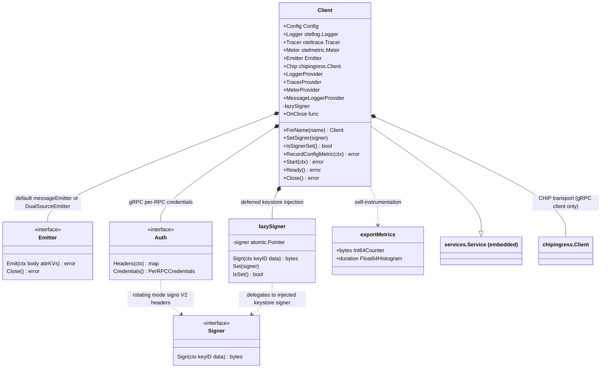
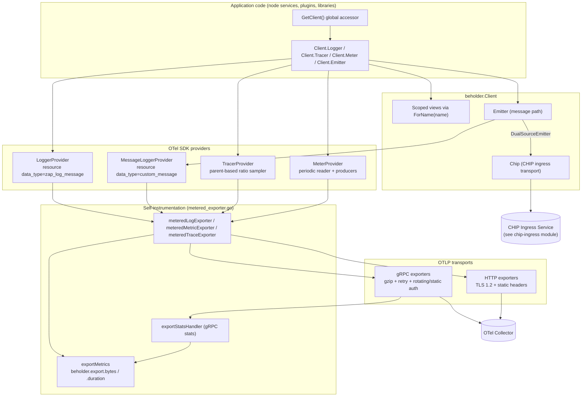
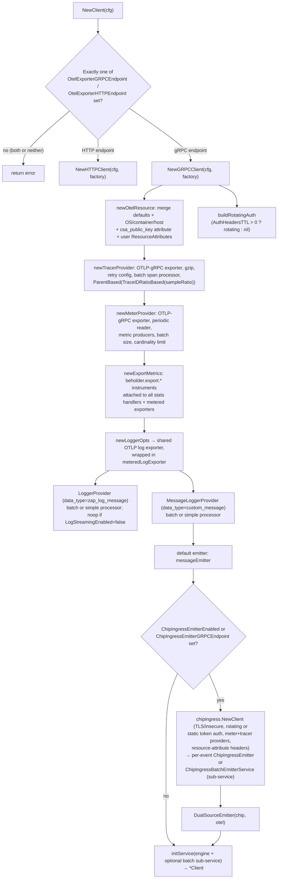
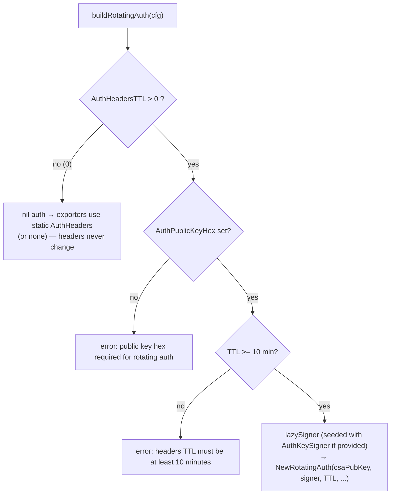
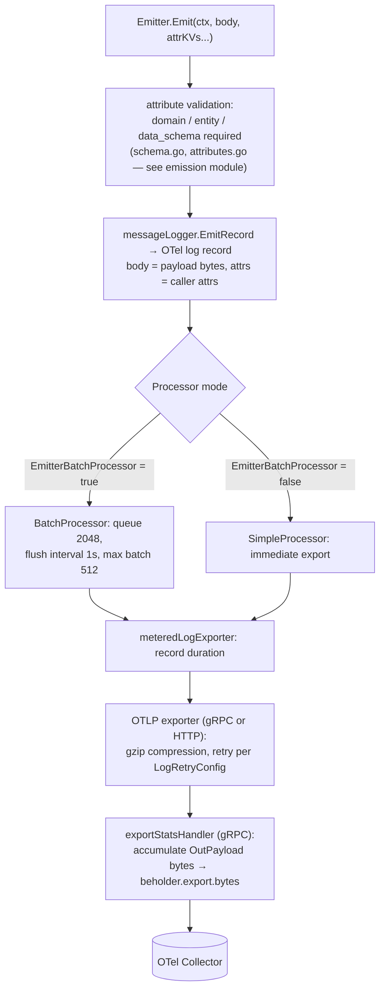
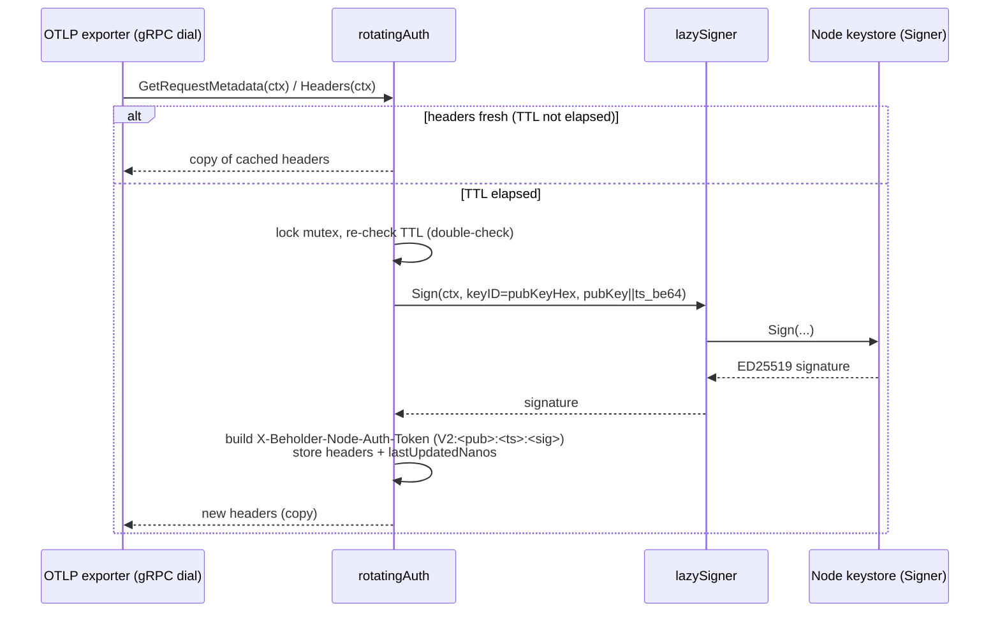
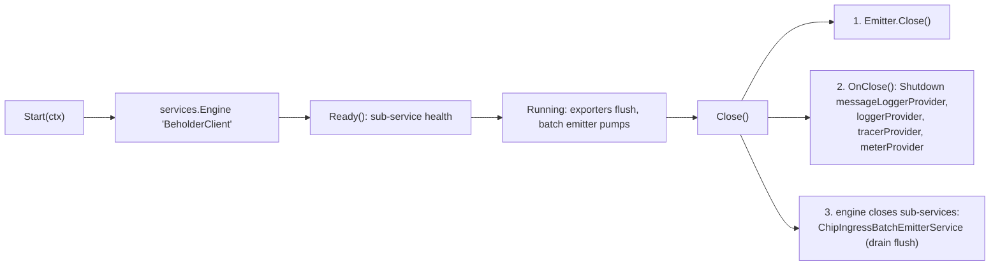
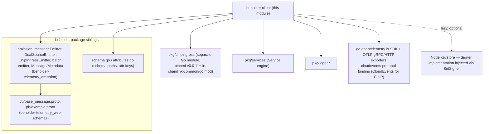

# Beholder Telemetry Client

> **Module path:** `chainlink-common/pkg/beholder` (Go module `github.com/smartcontractkit/chainlink-common`)
> **Parent module:** [beholder-telemetry](../beholder-telemetry.md) · **Platform:** [Telemetry & Observability Platform](../../Telemetry___Observability_Platform.md)

## Introduction

The `beholder` client is the single entry point through which Chainlink node code and libraries emit OpenTelemetry (OTel) telemetry — structured logs, traces, metrics, and custom protobuf messages. It wraps the OTel SDK with:

- **One managed lifecycle** — the `Client` implements `services.Service` so providers are started, health-checked, and shut down with the rest of the node's service tree.
- **Two transport options** — OTLP over **gRPC** (default, with rotating node-keystore auth and gzip compression) or OTLP over **HTTP** (static headers only).
- **A unified message emitter** — a single `Emitter` interface that routes custom messages either straight to the OTel collector (log-record path) or, when enabled, **dually** to the CHIP ingress service (see [chip-ingress](../chip-ingress.md)).
- **Built-in self-observability** — every export batch is metered (`beholder.export.*`), so telemetry pipeline health is itself observable.
- **Safe defaults** — a process-wide noop client ensures telemetry calls never crash or block a node that has not been explicitly configured.

The client is deliberately separated from *what* is emitted: message construction, schema validation (`domain` / `entity` / `data_schema` attributes), and emitter variants (`messageEmitter`, `ChipIngressEmitter`, `DualSourceEmitter`, batching) live in the sibling module documented at [beholder-telemetry_emission](beholder-telemetry_emission.md), and the protobuf wire definitions (`base_message.proto`) are covered in [beholder-telemetry_wire-schemas](beholder-telemetry_wire-schemas.md).

---

## Architecture

### Component composition

The `Client` struct aggregates four OTel providers, one emitter, the CHIP client, transport auth, and self-instrumentation. It embeds `services.Service` (from `pkg/services`) and delegates its lifecycle to a `services.Engine`.

### Layered architecture

---

## Key components

### `Client` — the central orchestrator (`client.go`)

`Client` wires every OTel signal into one struct and exposes them as ready-to-use handles:

| Field | Type | Purpose |
|---|---|---|
| `Logger` | `otellog.Logger` | Application log streaming (records tagged `data_type=zap_log_message`) |
| `Tracer` | `oteltrace.Tracer` | Distributed tracing |
| `Meter` | `otelmetric.Meter` | Metrics, including beholder's own self-metrics |
| `Emitter` | `Emitter` | Custom message emission (`Emit(ctx, body, attrKVs...)`) |
| `Chip` | `chipingress.Client` | Direct CHIP ingress handle (no-op when chip ingress is disabled; `nil` on the HTTP client) |
| `LoggerProvider` / `MessageLoggerProvider` / `TracerProvider` / `MeterProvider` | OTel providers | Shut down on `Close()`; used to derive scoped views |
| `lazySigner` | `*lazySigner` | Thread-safe slot for the node keystore signer (gRPC client only) |
| `OnClose` | `func() error` | Provider shutdown hook joined into `close()` |

Key behaviors:

- **`ForName(name)`** — derives a lightweight copy of the client whose `Logger`, `Tracer`, `Meter`, and `Emitter` are all scoped to `name`. Use a package name for package-scoped telemetry, or a fully qualified name for component-scoped instances. (The old `ForPackage` is deprecated and inlines to `ForName`.)
- **`SetSigner` / `IsSignerSet`** — injects (or queries) the rotating-auth signer *after* client construction, which is required because the keystore is often not available at init time. See [Deferred keystore injection](#deferred-keystore-injection-lazy_signergo).
- **`RecordConfigMetric`** — emits a `beholder.config.info` gauge whose attributes capture the effective configuration (log streaming, batching, trace sample ratio, compressors, chip ingress settings, …), making each node's telemetry configuration queryable in the observability backend.
- **Lifecycle** — `initService` wraps the client in a `services.Engine` named `"BeholderClient"`. `close()` joins `Emitter.Close()` with the provider shutdowns in `OnClose`.

### Construction: `NewClient` / `NewGRPCClient` / `NewHTTPClient`

`NewClient` is the intended entry point. It validates that **exactly one** exporter endpoint is configured and dispatches to the corresponding transport-specific constructor. Both constructors accept an injected log-exporter factory — a test seam used by `client_test.go` (via `MockExporter` and the `internal.OTLPExporter` interface copy) to substitute exporters without real connections.

Details that matter to maintainers:

- **Transport credentials** — gRPC uses `insecure.NewCredentials()` unless `InsecureConnection == false && CACertFile != ""`, in which case a TLS credential is loaded from the CA file. HTTP builds an `x509` cert pool with `MinVersion: tls.VersionTLS12`.
- **Auth is selected per-signal, uniformly** — rotating auth (if configured) is attached as gRPC per-RPC credentials on the trace/metric/log dial options; otherwise static `AuthHeaders` are attached as exporter headers; otherwise no auth.
- **Compression** — `TraceCompressor` / `MetricCompressor` / `LogCompressor`; empty or `"none"` disables, the default is `"gzip"` (`defaultGRPCCompressor`).
- **Retry** — each signal accepts a `*RetryConfig`; when set it overrides the OTel SDK defaults (see [Configuration](#configuration-config--defaultconfig--retryconfig)).
- **Leak safety** — `NewGRPCClient` defers `tracerProvider.Shutdown` / `meterProvider.Shutdown` on any construction failure so gRPC connections and the metric periodic-reader goroutine are never leaked.
- **CHIP ingress wiring** — the chip client reuses the same rotating/static auth and OTel providers (via `chipingress.WithMeterProvider` / `WithTracerProvider`), and forwards sanitized resource-attribute headers. When `ChipIngressBatchEmitterEnabled` is true, the batch service is owned by the client's service engine and wrapped in `noCloseEmitter` so `DualSourceEmitter.Close()` cannot double-close it.
- **HTTP limitations** — `NewHTTPClient` supports only static header auth (`lazySigner` is always `nil`), has no CHIP client (`Chip == nil`), and no gRPC stats-based byte metering.

### Configuration: `Config`, `DefaultConfig`, `RetryConfig`

`Config` is grouped by concern; every field has a documented default in `DefaultConfig()`:

| Group | Fields (defaults) |
|---|---|
| Connection | `InsecureConnection` (true), `CACertFile`, `OtelExporterGRPCEndpoint` (`localhost:4317`), `OtelExporterHTTPEndpoint` |
| Resource | `ResourceAttributes` (`package_name=beholder`; merged last so they override detected values) |
| Message emitter | `EmitterExportTimeout` (30s), `EmitterExportInterval` (1s), `EmitterExportMaxBatchSize` (512), `EmitterMaxQueueSize` (2048), `EmitterBatchProcessor` (true) |
| Trace | `TraceSampleRatio` (1), `TraceBatchTimeout` (1s), `TraceSpanExporter` (optional extra exporter), `TraceRetryConfig`, `TraceCompressor` (gzip) |
| Metric | `MetricExportBatchSize`, `MetricReaderInterval` (1s), `MetricRetryConfig`, `MetricViews`, `MetricViewsDenyAttributes`, `MetricCardinalityLimit` (**100000** — a production safety valve against high-cardinality attribute sets), `MetricCompressor` (gzip), `MetricProducers` (e.g. a Prometheus bridge) |
| Chip ingress | `ChipIngressEmitterEnabled`, `ChipIngressEmitterGRPCEndpoint`, `ChipIngressInsecureConnection`, batch-emitter tuning: `ChipIngressBufferSize` (10000), `ChipIngressMaxBatchSize` (1000), `ChipIngressSendInterval` (500ms), `ChipIngressSendTimeout` (10s), `ChipIngressDrainTimeout` (30s), `ChipIngressMaxConcurrentSends` (10), `ChipIngressMaxGRPCRequestSize` (10 MiB), `ChipIngressLogger` (**required** when the batch emitter is enabled) |
| Log | `LogExportTimeout` (30s), `LogExportInterval` (1s), `LogExportMaxBatchSize` (512), `LogMaxQueueSize` (2048), `LogBatchProcessor` (true), `LogRetryConfig`, `LogStreamingEnabled` (true — when false, a discarding provider is installed), `LogLevel` (zap InfoLevel), `LogCompressor` (gzip) |
| Auth | `AuthHeaders` (static headers *and* seed headers for rotating mode), `AuthHeadersTTL` (0 = static mode), `AuthKeySigner`, `AuthPublicKeyHex` |

`RetryConfig` mirrors the OTel SDK defaults (initial 5s, max interval 30s, max elapsed 1min, retry **enabled**). `Enabled()` requires all three durations to be positive; nil-safe getters avoid pointer dereferences.

Two test helpers intentionally disable all asynchronous and retry behavior for deterministic tests:

- `TestDefaultConfig()` — simple (non-batched) processors, retries disabled, cardinality limit disabled.
- `TestDefaultConfigHTTPClient()` — same, but for the HTTP endpoint (`localhost:4318`).

### Authentication: `Auth`, `Signer`, `buildRotatingAuth` (`auth.go`)

The client authenticates to the OTel collector (and CHIP ingress) using a signed CSA node token carried in the `X-Beholder-Node-Auth-Token` header. Two modes are supported, selected by `AuthHeadersTTL`:

- **Header format (V1):** `<version>:<public_key_hex>:<signature_hex>` — the signed message is the raw public key bytes. Produced by `NewAuthHeaders` / the deprecated `BuildAuthHeaders`.
- **Header format (V2, used by rotating auth):** `<version>:<public_key_hex>:<timestamp_nanos>:<signature_hex>` — the signed message is `public_key || timestamp_be64`, produced by `NewAuthHeaderV2`. The timestamp makes replay windows enforceable downstream.
- **`rotatingAuth`** is concurrency-safe: headers are stored in an `atomic.Value`, refresh is guarded by a mutex with a TTL double-check, a 5s signer timeout is applied, and callers always receive a **copy** of the header map to prevent concurrent read/write. It implements both `chipingress.HeaderProvider` and gRPC `PerRPCCredentials`, so the same object serves HTTP-style header providers and gRPC dial options (`authDialOpt`).
- **`NewStaticAuth`** wraps fixed headers with an optional transport-security requirement; `NewStaticAuthHeaderProvider` is deprecated and inlines to it.

#### Deferred keystore injection: `lazySigner` (`lazy_signer.go`)

`lazySigner` is a zero-value-usable, thread-safe (`atomic.Pointer[Signer]`) wrapper that resolves the chicken-and-egg problem where the beholder client must start with rotating auth configured, but the node keystore is only available later. Until a signer is set, `Sign` returns `"keystore not yet available for signing"`; `Client.SetSigner(...)` installs it at any time.

### Self-instrumentation: `exportMetrics` and the metered exporters (`metered_exporter.go`)

The telemetry pipeline observes itself with two instruments on the beholder `MeterProvider`:

| Metric | Instrument | Semantics |
|---|---|---|
| `beholder.export.bytes` | `Int64Counter` (unit `By`) | Uncompressed OTLP proto bytes per export batch, **success only**, recorded once per RPC by the `exportStatsHandler` gRPC stats handler |
| `beholder.export.duration` | `Float64Histogram` (unit `s`) | Wall-clock export duration **including all retries/backoff**, recorded on success *and* failure, once per logical batch (exporters sit above the OTLP retry loop) |

The histogram uses explicit network-scaled buckets (`0.005s` → `60s`) because the SDK's default millisecond buckets would place nearly every export in the first bucket. Every measurement is labeled with `otel_signal` (`logs` / `metrics` / `traces`), `csa_public_key` (or `not-configured`), and `error`.

A notable engineering detail: **lazy instrument wiring**. The metered metric/trace exporters and gRPC stats handlers are constructed *before* the beholder `MeterProvider` exists (a chicken-and-egg inherent to self-metering), so they hold `lazyMetered`/`atomic.Pointer` slots and become active only when `attachMetrics` is called during construction. Until then they degrade to plain passthrough.

### Global access: `GetClient`, `SetGlobalOtelProviders` (`global.go`)

A process-wide `atomic.Pointer[Client]` is initialized in `init()` to `NewNoopClient()`, so any code path may call `GetClient()` (plus the `GetLogger` / `GetTracer` / `GetMeter` / `GetEmitter` conveniences) **before** initialization without nil panics or data races. The application entrypoint replaces it via `SetClient` once the real client is built.

`SetGlobalOtelProviders()` additionally installs the client's providers into the *global* OTel APIs — `otellogglobal.SetLoggerProvider`, `otel.SetTracerProvider`, `otel.SetTextMapPropagator(TraceContext + Baggage)`, and `otel.SetMeterProvider` — which lets any dependency that instruments itself with plain `go.opentelemetry.io` (e.g. `otelgrpc` handlers, `otelsql`) flow its telemetry through the same configured pipeline.

### Noop and debug clients (`noop.go`)

- **`NewNoopClient()`** — noop OTel logger/tracer/meter providers, `noopMessageEmitter`, and `chipingress.NoopClient`; used as the default global fallback. Config-wise it carries `DefaultConfig()` values but emits nothing.
- **`NewStdoutClient()` / `NewWriterClient(w)`** — stdout / custom-`io.Writer` exporters (simple processors, 100ms metric reader) for tests and local debugging.
- **`BeholderNoopLoggerProvider()`** — a real `*sdklog.LoggerProvider` that drops all records; installed when `LogStreamingEnabled=false` so logger usage stays panic-free while streaming is off.

### Test support (`client_test.go`, `internal/exporter.go`)

- `internal.OTLPExporter` is a copy of `sdklog.Exporter` used for mocking; `client_test.go::MockExporter` (testify mock) injects it through the exported-factory seams of `NewGRPCClient` / `NewHTTPClient`.
- Coverage includes: Emit round-trips on both transports (body + attribute assertions, including required `domain`/`entity`/`data_schema` attributes), `NewClient` endpoint validation, CHIP endpoint validation (missing port, malformed, empty, whitespace-only, IPv4/IPv6), rotating-auth setup and failure modes, static-auth fallback, and a `capturingChipServer` integration test asserting that the CSA auth token and sanitized resource attributes **coexist** on a real gRPC connection.
- Lifecycle tests verify the batch emitter's sub-service semantics: `Ready()` reports "not started" before `Start`, a valid `Emit` still succeeds before start (the OTLP path is always active; the batch path's error is swallowed and logged by `DualSourceEmitter`), `Close` before `Start` returns `services.ErrCannotStopUnstarted`, and a missing `ChipIngressLogger` is a construction error.

---

## Data flow

### Custom message emission (OTLP path)

### gRPC trace/metric export

Traces flow through a `BatchSpanProcessor` (timeout `TraceBatchTimeout`) and metrics through a `PeriodicReader` (interval `MetricReaderInterval`, optional `MetricProducers` and export batch size, guarded by `MetricCardinalityLimit`) into their metered exporters and finally the OTLP gRPC transport, which carries rotating-auth per-RPC credentials, gzip compression, and the retry policy.

### Rotating auth refresh

Failure handling: if the signer fails (or the lazy signer has no keystore yet), `Headers` returns an error surfaced as `beholder: failed to create auth header`; static headers (when supplied as initial headers) keep working until the first successful refresh.

---

## Lifecycle management

The `Client` participates in the standard Chainlink service lifecycle (`pkg/services`), the same framework used by node services (see [Platform Services → job service lifecycle](../../Node_Platform_Services/job_service/job_service_lifecycle.md) for the general pattern):

- The `ChipIngressBatchEmitterService` (created when `ChipIngressBatchEmitterEnabled`) is registered as a **sub-service** of the client's engine, so it starts and drains with the client. It is wrapped in `noCloseEmitter` when handed to `DualSourceEmitter`, preventing double-close — ownership belongs solely to the engine.
- `Close()` before `Start()` returns `services.ErrCannotStopUnstarted` (strict service semantics).
- Provider shutdown errors are joined (`errors.Join`) so one failing provider does not mask the others.

---

## Dependencies

Notes on dependencies:

- `pkg/chipingress` is itself a standalone module (it declares its own `go.mod`, see `chainlink-common/pkg/chipingress/go.mod`), versioned independently and consumed by the client as a library; its service contract is documented in [chip-ingress](../chip-ingress.md).
- The local ops stack (`chainlink-common/ops/monitoring/docker-compose.yml`: Kafka + Schema Registry + Zookeeper) and `chainlink/tools/docker/docker-compose.observability.yaml` (Prometheus/Grafana/Alertmanager) exist for local verification of collector-side ingestion; the client itself only needs the OTLP collector endpoint.
- For plugin-process telemetry, the `loop` framework exposes a `Telemetry` gRPC surface (`loop/internal/pb/telemetry_grpc.pb.go`), and the shared abstraction `TelemetryClient` / `TelemetryClientEndpoint` / `MonitoringEndpointGenerator` lives in [types-core plugin-services](../../Shared_Foundation_Libraries___Domain_Types/types-core/types-core_plugin-services.md) — those are the interfaces node code implements *on top of* beholder's client.

---

## Interaction with other modules

| Area | Relationship |
|---|---|
| [beholder-telemetry (parent)](../beholder-telemetry.md) | This module implements the client/runtime half of the beholder package; the parent page maps the whole package. |
| [beholder-telemetry_emission](beholder-telemetry_emission.md) | The client builds emitter instances (message, chip-ingress, dual-source, batch service); that page documents their behavior, message envelope, and schema validation. |
| [beholder-telemetry_wire-schemas](beholder-telemetry_wire-schemas.md) | `BaseMessage` (`msg`, `labels`, `timestamp`) is the recommended protobuf payload carried through `Emitter.Emit`. |
| [chip-ingress](../chip-ingress.md) | Optional custom-message transport; the client owns the chip `Client` instance and feeds it auth headers, resource attributes, and OTel providers. |
| [telemetry_ingress](../telemetry_ingress.md) | The node-side legacy telemetry ingress clients (`NoopTelemetryIngressClient` etc.) serve a parallel ingestion path; beholder is the OTel-native replacement track for custom messages (the code notes the dual-source path is transitional: *"eventually we will remove the dual source emitter and just use chip ingress"*). |
| [core_config_observability](../../Node_Application_Core___Interfaces/core_config/core_config_observability.md) | Node configuration (tracing / telemetry ingress settings) is where operator-facing knobs that feed the beholder `Config` are surfaced. |
| [monitoring](../monitoring.md) | Avro/Kafka-based chain monitoring stack — independent of the OTLP client but co-located in the same platform. |
| [observability-lib](../observability-lib.md) | Grafana provisioning library used to build dashboards over the telemetry this client produces. |

---

## Usage notes for maintainers

1. **Always create clients via `NewClient(cfg)`** — it enforces the exactly-one-endpoint invariant and picks gRPC vs HTTP. Use `NewGRPCClient` / `NewHTTPClient` directly only when injecting an exporter factory (tests).
2. **Prefer `ForName` for scoping** — never create additional clients per component; derived views share providers and connections.
3. **Rotating auth needs late-bound keys** — configure `AuthHeadersTTL`, `AuthPublicKeyHex` (TTL ≥ 10 min) up front; call `SetSigner` when the keystore becomes available. Static headers remain a valid fallback for non-node deployments.
4. **Watch the cardinality valve** — `MetricCardinalityLimit` (default 100000) prevents metric explosions; adjust `MetricViews` / `MetricViewsDenyAttributes` rather than raising it casually.
5. **Self-metrics are your pipeline monitor** — alert on `beholder.export.duration{error=true}` spikes and `beholder.export.bytes` stalls per `otel_signal`; call `RecordConfigMetric` at startup so dashboards can group by effective configuration.
6. **Batch emitter lifecycle is engine-owned** — do not close the `ChipIngressBatchEmitterService` manually; the `noCloseEmitter` wrapper and engine sub-service teardown handle ordering.
