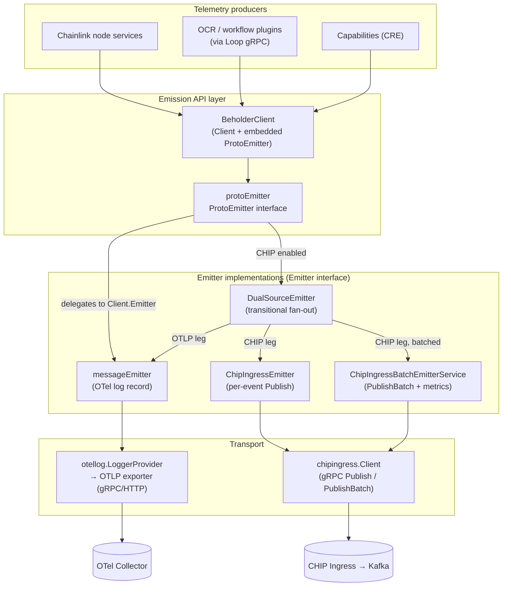
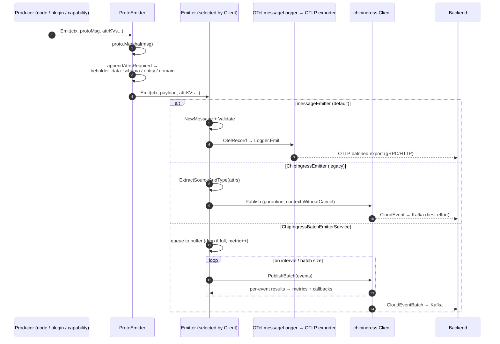

# Beholder Telemetry — Emission (`chainlink-common/pkg/beholder`)

## 1. Introduction

The **emission module** is the "last mile" of the Beholder telemetry platform (`chainlink-common/pkg/beholder`). It is responsible for taking a telemetry payload — most commonly a **protobuf message** plus a set of **key/value attributes** — and reliably delivering it to one or more telemetry backends:

1. **OpenTelemetry Collector** via OTLP (gRPC or HTTP) — custom messages are carried as OTel log records.
2. **CHIP Ingress service** — events are converted to CloudEvents and published over gRPC (`Publish` / `PublishBatch`) for downstream consumption (e.g., Kafka pipelines).

The module implements a small `Emitter` abstraction with several interchangeable backends, a **`ProtoEmitter`** convenience layer that derives mandatory Beholder attributes (`beholder_data_schema`, `beholder_entity`, `beholder_domain`) directly from protobuf descriptors, and a self-describing **`Message`/`Metadata`** model with validation.

> **Module position:** This page documents only the *emission* concern. Client construction, OTel provider/auth/exporter wiring, and configuration loading are covered in [beholder-telemetry_client](beholder-telemetry_client.md); the wire payload schemas are covered in [beholder-telemetry_wire-schemas](beholder-telemetry_wire-schemas.md); the platform overview is at [Beholder Telemetry](../beholder-telemetry.md).

### Core components at a glance

| File | Components | Role |
|---|---|---|
| `proto_emitter.go` | `BeholderClient`, `ProtoEmitter`, `protoEmitter` | Typed protobuf emission API; marshals messages and stamps required attributes |
| `message_emitter.go` | `NewMessageEmitter` (`messageEmitter`) | Default emitter; converts messages into OTel log records |
| `chip_ingress_emitter.go` | `ChipIngressEmitter`, `ExtractSourceAndType` | Legacy per-event CHIP Ingress publisher (fire-and-forget goroutine) |
| `batch_emitter_service.go` | `ChipIngressBatchEmitterService` | Batched CHIP Ingress publisher with buffering, backpressure and OTel metrics |
| `dual_source_emitter.go` | `DualSourceEmitter` | Transitional fan-out emitter (OTel Collector **and** CHIP Ingress) |
| `message.go` | `Message`, `Metadata`, `OtelAttr` | Message model, attribute parsing, metadata validation, OTel attribute mapping |
| `schema.go` | `toSchemaPath` (+ helpers) | Derives Beholder schema paths and required attributes from protobuf descriptors |
| `attributes.go` | `AttrKeyDataSchema`, `AttrKeyEntity`, `AttrKeyDomain`, `AttrKeyDataType` | Canonical attribute key constants |

---

## 2. Architecture

### 2.1 Component relationships

Every emitter implements the package-level `Emitter` interface (`Emit(ctx, body []byte, attrKVs ...any) error` + `io.Closer`, defined in `client.go`). `ProtoEmitter` sits on top and delegates to `Client.Emitter`. The [client module](beholder-telemetry_client.md) selects and wires the concrete emitter at construction time (see `NewGRPCClient` / `NewHTTPClient` in `chainlink-common/pkg/beholder/client.go`):

- **Default:** `messageEmitter` (OTel log record path).
- **CHIP Ingress enabled** (`ChipIngressEmitterEnabled` or `ChipIngressEmitterGRPCEndpoint` set): a `DualSourceEmitter` wrapping the OTel emitter **and** either the `ChipIngressBatchEmitterService` (when `ChipIngressBatchEmitterEnabled`) or the legacy `ChipIngressEmitter`. When the batch emitter is used it is registered as a **sub-service** of `Client` and wrapped in a `noCloseEmitter` so `DualSourceEmitter.Close()` does not double-close it — its lifecycle is owned by the client's service engine.



### 2.2 Type model

```mermaid
classDiagram
    class Emitter {
        <<interface>>
        +Emit(ctx, body []byte, attrKVs ...any) error
        +Close() error
    }
    class ProtoEmitter {
        <<interface>>
        +Emit(ctx, m proto.Message, attrKVs ...any) error
        +EmitWithLog(ctx, m proto.Message, attrKVs ...any) error
    }
    class protoEmitter {
        -lggr logger.Logger
        -client *Client
        -schemaBasePath string
        +appendAttrsRequired(attrKVs, m) []any
    }
    class messageEmitter {
        -messageLogger otellog.Logger
    }
    class ChipIngressEmitter {
        -client chipingress.Client
        -stopCh services.StopChan
        -wg services.WaitGroup
        -closed atomic.Bool
    }
    class ChipIngressBatchEmitterService {
        -batchClient batch.Client
        -metrics batchEmitterMetrics
        -metricAttrsCache sync.Map
        +Emit(ctx, body, attrKVs...) error
        +EmitWithCallback(ctx, body, callback, attrKVs...) error
    }
    class DualSourceEmitter {
        -chipIngressEmitter Emitter
        -otelCollectorEmitter Emitter
        -lggr logger.Logger
    }
    class Message {
        +Attrs Attributes
        +Body []byte
        +Validate() error
        +OtelRecord() otellog.Record
        +Copy() Message
    }
    class Metadata {
        +BeholderDomain string
        +BeholderEntity string
        +BeholderDataSchema string
        +NodeVersion string
        +WorkflowID string
        +DonID string
        +Validate() error
    }

    Emitter <|.. messageEmitter
    Emitter <|.. ChipIngressEmitter
    Emitter <|.. ChipIngressBatchEmitterService
    Emitter <|.. DualSourceEmitter
    ProtoEmitter <|.. protoEmitter
    protoEmitter --> Emitter : "client.Emitter"
    DualSourceEmitter --> ChipIngressEmitter
    DualSourceEmitter --> ChipIngressBatchEmitterService
    DualSourceEmitter --> messageEmitter
    ChipIngressEmitter --> "chipingress.Client" : Publish
    ChipIngressBatchEmitterService --> "chipingress/batch.Client" : QueueMessage/PublishBatch
    messageEmitter --> Message : NewMessage().Validate().OtelRecord()
    Message --> Metadata : NewMetadata / Validate
```

---

## 3. Component reference

### 3.1 `proto_emitter.go` — protobuf emission API

- **`BeholderClient`** — thin extension of `*Client` that embeds a `ProtoEmitter`, giving callers a single handle for both the raw `Emitter` and typed protobuf emission.
- **`ProtoEmitter`** (interface) — `Emit(ctx, m proto.Message, attrKVs ...any)` and `EmitWithLog(...)`. `EmitWithLog` additionally logs the message as JSON (`protojson`, `UseProtoNames` + `EmitUnpopulated`) before sending — useful for debugging event payloads.
- **`protoEmitter`** — the implementation:
  1. `proto.Marshal(m)` — errors are logged (`[Beholder] Failed to marshal`) because emit errors are normally swallowed by callers and are not considered critical-path failures.
  2. `appendAttrsRequired(attrKVs, m)` — injects the three mandatory attributes (unless the caller-supplied `context` carries `CtxKeySkipAppendAttrs = "skip_append_attrs"`, which `EmitWithLog` uses internally to avoid double-appending).
  3. Delegates to `Client.Emitter.Emit(ctx, payload, attrKVs...)` (emission failures are likewise logged, not propagated as panics).

Required attributes appended per message (see §4):

| Attribute | Value source |
|---|---|
| `beholder_data_schema` | `toSchemaPath(m, schemaBasePath)` — full proto name mapped to a schema file path |
| `beholder_entity` | Short proto message name (`Descriptor().Name()`), e.g. `ReportProcessed` |
| `beholder_domain` | First component of the proto full name, e.g. `platform` from `platform.on_chain.forwarder.ReportProcessed`; `unknown` when the name has no dot |

Existing caller attributes always win: `appendRequiredAttr*` helpers skip a key if it is already present.

### 3.2 `message_emitter.go` — OTel log record emitter

`NewMessageEmitter(otellog.Logger) Emitter` builds the default backend. `Emit`:

1. Wraps `body` + `attrKVs` into a `Message` via `NewMessage` and **validates** it (`Message.Validate`) — body must be non-nil, attributes non-empty, and the derived `Metadata` must pass validation.
2. Converts to an `otellog.Record` (`Message.OtelRecord`) and hands it to the OTel message logger.

The record is then exported asynchronously by the shared, metered OTLP log exporter constructed by the [client module](beholder-telemetry_client.md) — batching, queue sizes and retry behaviour are governed by `Config.EmitterExportTimeout`, `EmitterExportInterval`, `EmitterExportMaxBatchSize`, `EmitterMaxQueueSize`, and `EmitterBatchProcessor`.

### 3.3 `chip_ingress_emitter.go` — legacy per-event CHIP emitter

`ChipIngressEmitter` wraps a synchronous `chipingress.Client.Publish` call executed in a **fire-and-forget goroutine**, so callers are never blocked:

- `ExtractSourceAndType(attrKVs...)` resolves the CloudEvent `source` (domain) and `type` (entity) from the attributes, accepting either the plain ChIP names (`"source"`, `"type"`) or the Beholder names (`beholder_domain`, `beholder_entity`) — plain names take precedence. Missing values produce errors.
- `chipingress.NewEvent` → `chipingress.EventToProto` → `Publish` under `context.WithoutCancel(ctx)` combined with the emitter's `StopChan`.
- Publish failures are logged at info level (`failed to emit to chip ingress`) — delivery is best-effort.
- **Resource attributes are not stamped per event**; they travel once per request as gRPC metadata configured on the client (see `chipingress.WithResourceAttributeHeaders`).
- `Close` is idempotence-guarded (`atomic.Bool`), closes the stop channel, waits on the wait group, then closes the underlying client.

### 3.4 `batch_emitter_service.go` — batched CHIP emitter (recommended)

`ChipIngressBatchEmitterService` is a lifecycle-managed `services.Service` (see `chainlink-common/pkg/services`) that buffers events and delivers them via `chipingress/batch.Client.PublishBatch`:

- **Queuing:** `emitInternal` extracts `domain`/`entity`, builds and converts the CloudEvent proto, then calls `batchClient.QueueMessage(eventPb, callback)`. Queuing is non-blocking; **a full buffer silently drops the event** (counted in metrics).
- **Callbacks:** `EmitWithCallback` accepts a `func(error)` that fires exactly once when the event's fate is determined (nil on success). If the queue rejects the message, the callback is invoked synchronously with the error. Per-event `*batch.PublishError` outcomes (e.g. `PUBLISH_ERROR_CODE_SCHEMA_MISSING` — see the wire contract in `chainlink-common/pkg/chipingress/pb/chip_ingress.proto`) are counted in metrics but **not** logged, since they are persistent per-event server-side conditions that would spam logs at fleet volume.
- **Metrics** (instrumented on `otel.Meter("beholder/chip_ingress_batch_emitter")`):
  - `chip_ingress.events_sent` — counter, attrs: `domain`, `entity`, `client_name` (cached per `(domain, entity)` pair via `sync.Map` to keep the hot path allocation-free).
  - `chip_ingress.events_dropped` — counter, attrs: `domain`, `entity`, `client_name`, `error_code` (never cached; `error_reason` deliberately excluded to bound metric cardinality — the full reason remains on the corresponding log line).
- **Lifecycle:** `Start` launches the batcher on a **fresh engine context** (never the caller's `Start` ctx, per the services contract); `stop` calls `batchClient.Stop()` with the configured drain timeout. When wired through the client (see §2.1), the service runs as a client sub-service.

Tunables (all fall back to `DefaultConfig()` values when zero):

| `Config` field | Default | Meaning |
|---|---|---|
| `ChipIngressBufferSize` | 10000 | Message buffer size |
| `ChipIngressMaxBatchSize` | 1000 | Max events per `PublishBatch` call |
| `ChipIngressSendInterval` | 500ms | Flush interval |
| `ChipIngressSendTimeout` | 10s | Timeout per `PublishBatch` call |
| `ChipIngressDrainTimeout` | 30s | Max flush time on shutdown |
| `ChipIngressMaxConcurrentSends` | (client default) | Max concurrent `PublishBatch` calls |
| `ChipIngressMaxGRPCRequestSize` | 10 MiB | Max serialized request size |
| `ChipIngressLogger` | required | Required when `ChipIngressBatchEmitterEnabled` is true |

The full `Config` (endpoints, TLS, auth, OTel batching) is documented in [beholder-telemetry_client](beholder-telemetry_client.md).

### 3.5 `dual_source_emitter.go` — transitional fan-out

`DualSourceEmitter` exists to migrate custom-message delivery **from OTLP to CHIP Ingress**: it emits to the OTel Collector first (hard failure → error returned), then to CHIP Ingress (failure logged at info, not propagated). `Close` joins both sub-emitters' close errors (`errors.Join`). This emitter will be removed once the cutover to CHIP Ingress is complete — see the wiring logic and timeline notes in the [client module](beholder-telemetry_client.md).

### 3.6 `message.go` — message model, attributes and metadata

- **`Message{Body []byte, Attrs Attributes}`** — `Attributes` is `map[string]any`. `newAttributes` parses a variadic key/value list (`string`, value pairs) and also accepts pre-built `Attributes` maps that are copied in.
- **`OtelAttr(key, value)`** — maps Go values to `attribute.KeyValue` (string, []string, int/int64, float64, bool, []byte, nil → empty value, `attribute.Value` passthrough; unknown types are rendered as a descriptive placeholder string).
- **`Metadata`** — the canonical, self-describing attribute set:

  | Field (required) | Attribute key |
  |---|---|
  | `BeholderDomain` | `beholder_domain` |
  | `BeholderEntity` | `beholder_entity` |
  | `BeholderDataSchema` | `beholder_data_schema` |

  Optional fields: `node_version`, `node_csa_key`, `node_csa_signature`, `don_id`, `network_name` ([]string), `workflow_id`, `workflow_name`, `workflow_owner_address`, `workflow_spec_id`, `workflow_execution_id`, `capability_contract_address`, `capability_id`, `capability_version`, `capability_name`, `network_chain_id`.
- **Validation** — `Metadata.Validate` uses `go-playground/validator` with a custom `domain_entity` rule: values must match `^[a-zA-Z0-9._-]+$` and must not contain `__`. `Message.Validate` additionally requires a non-nil body and non-empty attributes. The validator instance is built once via `sync.OnceValues`.
- **Round-tripping** — `FromAttributes`/`NewMetadata` reconstruct `Metadata` from an attribute map; `Message.Copy` performs a deep copy.

### 3.7 `schema.go` — schema path derivation

`toSchemaPath(m proto.Message, basePath string)` converts a protobuf full name into a Beholder schema path:

```
platform.on_chain.forwarder.ReportProcessed
  → replace "." → "/" and "_" → "-"  ⇒ platform/on/chain/forwarder/ReportProcessed
  → snake_case the last segment      ⇒ .../forwarder/report_processed
  → append ".proto"                  ⇒ <basePath>/platform/on-chain/forwarder/report_processed.proto
```

Helper utilities: `toSnakeCase` (Unicode-aware CamelCase splitting), `toSchemaName` (short name), `ToSchemaFullName` (exported full name), and `appendRequiredAttrDataSchema/Entity/Domain` used by `protoEmitter.appendAttrsRequired`.

### 3.8 `attributes.go` — canonical attribute keys

Constants `beholder_data_schema`, `beholder_entity`, `beholder_domain`, and `beholder_data_type` are the single source of truth for required attribute names used across emission, validation, and CHIP event construction.

---

## 4. Emission data flow

### 4.1 End-to-end pipeline



### 4.2 Batch emitter state model

```mermaid
stateDiagram-v2
    [*] --> Created : NewChipIngressBatchEmitterService
    Created --> Running : Start (engine ctx)
    Running --> Running : Emit / EmitWithCallback<br/>(queue → buffer; drop on full)
    Running --> Running : PublishBatch flush<br/>(events_sent++ / events_dropped++)
    Running --> Stopped : Stop / client teardown
    Stopped --> [*] : batchClient.Stop (drain timeout)
    note right of Stopped
        Emit after stop returns error
        via eng.IfStarted
    end note
```



### 4.3 Attribute precedence rules

1. Caller-supplied attributes are parsed first (`newAttributes`).
2. Required Beholder attributes are appended by `protoEmitter` **only if absent** — callers can override `beholder_data_schema`, `beholder_entity`, or `beholder_domain` by supplying them explicitly.
3. For CHIP emission, `source`/`type` (ChIP names) take precedence over `beholder_domain`/`beholder_entity` when resolving the CloudEvent routing keys.

---

## 5. Integration with the rest of the platform

- **Client wiring & configuration** — emitter selection, OTLP transport (gRPC/HTTP), TLS, static vs rotating CSA-key auth (`AuthHeaders`, `AuthHeadersTTL`, `lazySigner`) and global client accessors (`GetClient`) are documented in [beholder-telemetry_client](beholder-telemetry_client.md).
- **Wire payloads** — `BaseMessage` (`chainlink-common/pkg/beholder/pb/base_message.proto`: `msg`, `labels`, `timestamp`) is the canonical base event; use-case messages extend it (see `pb/example.proto`). Regenerate with the protoc tooling (`make cre-protoc` / `make generate` in `chainlink-common/Makefile`; sources: `chainlink-common/pkg/beholder/pb/generate.go`). Details: [beholder-telemetry_wire-schemas](beholder-telemetry_wire-schemas.md).
- **CHIP Ingress service contract** — `Publish`, `PublishBatch` (partial delivery vs. all-or-nothing `PublishOptions.transaction_enabled`), per-event `PublishResult`/`PublishError` codes (`VALIDATION_FAILED`, `SCHEMA_MISSING`, `ENCODE_ERROR`, `DOMAIN_MISCONFIGURATION`), and `RegisterSchema`: [chip-ingress](../chip-ingress.md), wire spec at `chainlink-common/pkg/chipingress/pb/chip_ingress.proto`.
- **Alternative node-side telemetry path** — the legacy per-job `TelemetryIngress` clients (`chainlink/core/services/synchronization/telemetry_ingress_*`) are a separate mechanism, unrelated to Beholder emitters: [telemetry_ingress](../telemetry_ingress.md).
- **Plugin consumption** — reporting plugins running out-of-process receive a Beholder `TelemetryClient` through the Loop keystore/telemetry gRPC surfaces (`chainlink-common/pkg/types/core/telemetry.go`): [types-core plugin services](../../Shared_Foundation_Libraries___Domain_Types/types-core/types-core_plugin-services.md) and the [Loop plugin framework](../../Plugin_Process_Framework_(Loop)/loop-plugin-core.md).
- **Downstream visualization** — events land in the ops monitoring stack (Kafka / Grafana): [ops-monitoring-stack](../ops-monitoring-stack.md); dashboard-as-code lives in [observability-lib](../observability-lib.md).

---

## 6. Operational guidance

### Error-handling philosophy

| Path | Behaviour |
|---|---|
| `proto.Marshal` failure | Logged (`Errorw`), error returned; emission errors are non-critical by design |
| OTel export failure | Handled/retried by the metered OTLP exporter (client module); not visible to the emitter caller |
| CHIP `Publish` failure (legacy emitter) | Logged at info; fire-and-forget |
| Buffer full (batch emitter) | **Silent drop**, counted in `chip_ingress.events_dropped`; `EmitWithCallback` callback receives the error |
| Per-event `PublishError` (batch emitter) | Counted with `error_code`; not logged (persistent condition); callback invoked |
| Queue rejection / stopped service | Logged (`Errorw`), counted, callback invoked synchronously |

### Choosing an emitter

- **Default (no CHIP):** `messageEmitter` — simplest, rides the existing OTel Collector pipeline.
- **CHIP migration period:** `DualSourceEmitter` — guarantees dual delivery while downstream consumers move.
- **CHIP steady state:** `ChipIngressBatchEmitterService` — throughput, backpressure visibility, and drain-on-shutdown semantics. Requires a dedicated `ChipIngressLogger` and schema registration on the CHIP side (an unregistered schema is the most common cause of `PUBLISH_ERROR_CODE_SCHEMA_MISSING` drops).

### Testing surfaces

Unit coverage for every emitter lives alongside the code (`message_emitter_test.go`, `chip_ingress_emitter_test.go`, `batch_emitter_service_test.go`, `dual_source_emitter_test.go`, `message_test.go`, `schema_test.go`). `MockExporter` (`client_test.go`) and the [client module's](beholder-telemetry_client.md) `NewNoopClient` provide seams for consumer-side tests; the [node status reporter](../../Node_Platform_Services/node_status_reporter.md) and [CRE system tests](../../Dev,_Test___Simulation_Environments/system-tests.md) exercise the full emission path end-to-end.

---

## 7. Related pages

- Parent: [Beholder Telemetry](../beholder-telemetry.md)
- Siblings: [beholder-telemetry_client](beholder-telemetry_client.md) · [beholder-telemetry_wire-schemas](beholder-telemetry_wire-schemas.md)
- Platform: [chip-ingress](../chip-ingress.md) · [telemetry_ingress](../telemetry_ingress.md) · [monitoring](../monitoring.md) · [ops-monitoring-stack](../ops-monitoring-stack.md) · [observability-lib](../observability-lib.md)
