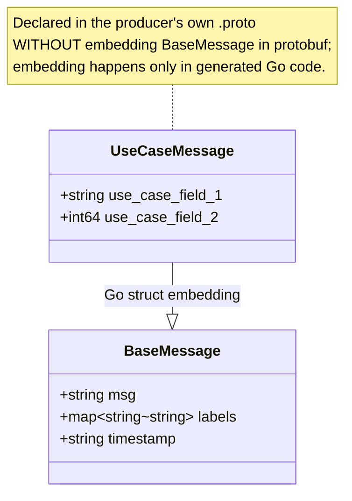
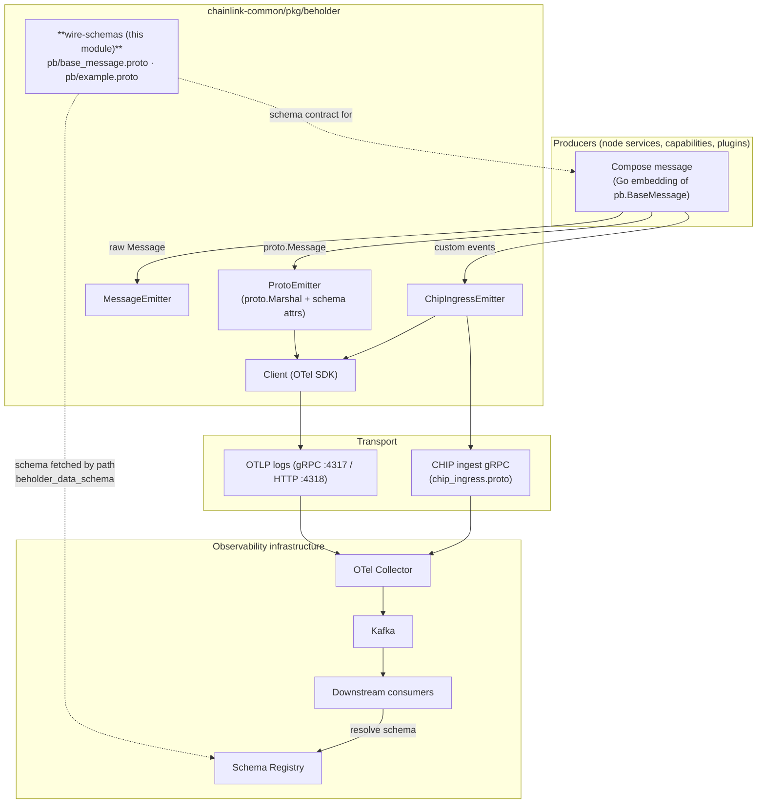
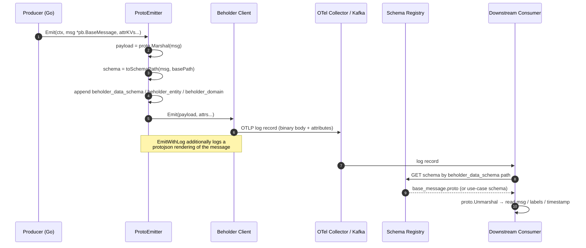

# Beholder Wire Schemas (`pkg/beholder/pb`)

The **wire-schemas** module defines the on-the-wire protobuf contracts for [Beholder](../beholder-telemetry.md), Chainlink's telemetry platform. It contains the canonical `.proto` definitions under `chainlink-common/pkg/beholder/pb/` that producers serialize and downstream consumers deserialize. Its centrepiece is **`BaseMessage`**, the foundational envelope that every Beholder custom-message payload is either used directly or extended from.

This page documents the schema contracts themselves. For how messages are *emitted*, see [beholder-telemetry_emission](beholder-telemetry_emission.md), and for how the emitting *client* is configured and authenticated, see [beholder-telemetry_client](beholder-telemetry_client.md).

---

## 1. Purpose and Scope

| Concern | Owned here (wire-schemas) | Owned elsewhere |
|---|---|---|
| Payload structure (`BaseMessage`, test messages) | ✅ `chainlink-common/pkg/beholder/pb/*.proto` | — |
| Schema identity attributes (`beholder_data_schema`, `beholder_entity`, `beholder_domain`) | Contract defined here | Derived at runtime by the emitter ([emission](beholder-telemetry_emission.md)) |
| OTel / gRPC / HTTP transport, batching, retries | — | [beholder-telemetry_client](beholder-telemetry_client.md) |
| Emitter implementations (`ProtoEmitter`, `MessageEmitter`, `ChipIngressEmitter`) | — | [beholder-telemetry_emission](beholder-telemetry_emission.md) |
| CHIP ingress gRPC wire protocol | — | [chip-ingress](../chip-ingress.md) |
| Kafka / Schema Registry / consumer tooling | — | [ops-monitoring-stack](../ops-monitoring-stack.md) |

The module is deliberately tiny — two `.proto` files — because its value is as a **shared, versioned contract** between many independent producers (node services, capabilities, plugins) and downstream data consumers.

### File inventory

| File | Messages | Role |
|---|---|---|
| `chainlink-common/pkg/beholder/pb/base_message.proto` | `BaseMessage` | Production envelope schema |
| `chainlink-common/pkg/beholder/pb/example.proto` | `TestCustomMessage` | Test-only schema demonstrating all scalar wire types |

Both files declare:

```protobuf
syntax = "proto3";
option go_package = "github.com/smartcontractkit/chainlink-common/pkg/beholder/pb/";
package pb;
```

Generated Go code is produced with `protoc` via the `cre-protoc` target in [`chainlink-common/Makefile`](../../../repo/chainlink-common/Makefile) (toolchain installed by [`chainlink-common/script/install-protoc.sh`](../../../repo/chainlink-common/script/install-protoc.sh), wired through [`chainlink-common/script/generate.sh`](../../../repo/chainlink-common/script/generate.sh)).

---

## 2. Wire Schema Reference

### 2.1 `BaseMessage` — `base_message.proto`

```protobuf
message BaseMessage {
  string msg = 1;
  map<string, string> labels = 2;
  string timestamp = 3;
}
```

| # | Field | Type | Semantics |
|---|---|---|---|
| 1 | `msg` | `string` | The human/agent-readable message content. |
| 2 | `labels` | `map<string, string>` | Key–value label pairs. **proto3 map semantics:** if the value for a key is empty, *nothing is serialized* for that entry — empty labels are indistinguishable from absent labels on the wire. |
| 3 | `timestamp` | `string` | Set by the *producer* (the `BaseMessage` consumer in API terms). **Ingestion timestamps must be applied downstream**, not trusted from this field. When producers compose `BaseMessage` into a larger message, downstream consumers must respect the *outermost* message's timestamp. |

**Documented limitation (from the schema itself):**

> *“NOTE: do not compose protos for Beholder until INFOPLAT-1386 is completed”*

That is, `.proto`-level composition (embedding `BaseMessage` in another proto message) is **not allowed yet**. The sanctioned composition mechanism is Go-level struct embedding of the generated type — see [§4 Composition and Evolution Rules](#4-composition-and-evolution-rules).

### 2.2 `TestCustomMessage` — `example.proto`

```protobuf
message TestCustomMessage {
  bool bool_val = 1;
  int64 int_val = 2;
  float float_val = 3;
  string string_val = 4;
  bytes bytes_val = 5;
}
```

A **test-only** message used by the Beholder test-suites and examples. It exists to exercise every scalar wire type an extension message might use. It is **not** a production schema, and no downstream consumer should depend on it. Note also that its message name (`TestCustomMessage`) does not match its file name (`example.proto`) — acceptable only because it is test-only; production schemas must follow the file-naming contract in [§3](#3-schema-identity-and-path-derivation).

---

## 3. Schema Identity and Path Derivation

Every emitted message carries its schema identity as OpenTelemetry log-record attributes. These are attached automatically by the [emitter](beholder-telemetry_emission.md) (`schema.go` → `appendAttrsRequired`) and validated on the ingest side (`message.go` → `Metadata.Validate`, with `beholder_domain`/`beholder_entity` restricted to `^[a-zA-Z0-9._-]+$` and no `__`).

| Attribute | Required | Value for `pb.BaseMessage` | Derivation |
|---|---|---|---|
| `beholder_data_schema` | ✅ | `<basePath>/pb/base_message.proto` | See below |
| `beholder_entity` | ✅ | `BaseMessage` | Short protobuf message name |
| `beholder_domain` | ✅ | `pb` (real producers use e.g. `platform`) | First package component of the full name; `unknown` if unqualified |

### Path derivation contract

`toSchemaPath` converts the message's *full* proto name (e.g. `platform.on_chain.forwarder.ReportProcessed`) into a schema-registry path:

1. Replace `.` → `/` (package components become directories).
2. Replace `_` → `-` (directories are kebab-case).
3. Convert the final component (message name) to `snake_case` and append `.proto`.
4. Join onto the configured schema base path (injected when the `ProtoEmitter` is constructed via `NewProtoEmitter(lggr, client, schemaBasePath)`).

```mermaid
flowchart LR
    A["proto.Message<br/>e.g. platform.on_chain.forwarder.ReportProcessed"] -->|"ToSchemaFullName"| B["Full name:<br/>platform.on_chain.forwarder.ReportProcessed"]
    B -->|"dots → slashes"| C["platform/on_chain/forwarder/ReportProcessed"]
    C -->|"underscores → dashes"| D["platform/on-chain/forwarder/ReportProcessed"]
    D -->|"last segment → snake_case"| E["platform/on-chain/forwarder/report_processed"]
    E -->|"append .proto"| F["platform/on-chain/forwarder/report_processed.proto"]
    F -->|"join basePath"| G["&lt;schemaBasePath&gt;/platform/on-chain/forwarder/report_processed.proto"]
```



**Consequence — repo layout mirrors the contract:** the derived path for `pb.BaseMessage` is `<base>/pb/base_message.proto`, exactly matching its on-disk location `chainlink-common/pkg/beholder/pb/base_message.proto` (relative to the `chainlink-common` module root). New production schemas **must** be created at their derived location, or the `beholder_data_schema` attribute published by producers will not resolve to a real schema file for consumers.

---

## 4. Composition and Evolution Rules

### Composition pattern (until INFOPLAT-1386)

Because proto-level composition is blocked, use-case messages compose `BaseMessage` in **Go**, by embedding the generated struct and adding use-case fields:



When emitting, the outermost message type is what the emitter reflects on, so `beholder_entity`, `beholder_domain`, and the derived `beholder_data_schema` path all describe the **outer** use-case message, while the wire payload still contains the `BaseMessage` fields per its embedded field numbers.

### Evolution rules (protobuf compatibility)

- **proto3, explicit field numbers.** Never change a field number or wire type; never reuse a number of a removed field (mark it `reserved` instead).
- **Adding new fields is backward compatible** for producers and consumers on different versions.
- **`labels` map:** empty-string values are not serialized — do not rely on `""` being observable downstream; use a sentinel value if "present-but-empty" matters.
- **`timestamp`:** producer-set; downstream ingestion timestamps take precedence for pipeline accounting, and the outermost composed message's timestamp wins.
- **No proto composition** of Beholder messages until INFOPLAT-1386 lands; use Go embedding (above).

---

## 5. Role in the Telemetry Pipeline

### Architecture



The CHIP transport and its own wire protocol (`chip_ingress.proto`, `chip_common.proto`) are documented separately in [chip-ingress](../chip-ingress.md); the legacy synchronization telemetry clients are in [telemetry_ingress](../telemetry_ingress.md).

### Emission data flow



Key implementation details visible in `protoEmitter.Emit`:

- The **body** is the `proto.Marshal` binary payload (attached to the OTel log record as a byte-slice body).
- Required schema attributes are appended once; a context flag (`CtxKeySkipAppendAttrs`) prevents duplication when `EmitWithLog` wraps `Emit`.
- Emit failures are logged and returned, but are intentionally non-fatal for callers — telemetry must never take down business logic.
- On the ingest side, `ExtractSourceAndType` accepts both CHiP-style keys (`source`/`type`) and the legacy Beholder keys (`beholder_domain`/`beholder_entity`), giving consumers a stable way to route messages regardless of which naming convention the producer used.

---

## 6. Relationships to Other Modules

| Related module | Relationship |
|---|---|
| [beholder-telemetry](../beholder-telemetry.md) | Parent module — Beholder platform overview. |
| [beholder-telemetry_client](beholder-telemetry_client.md) | Constructs and configures the OTel client that transports payloads defined by these schemas; owns auth, retries, batching. |
| [beholder-telemetry_emission](beholder-telemetry_emission.md) | Emitters that serialize messages against these schemas and attach the schema-identity attributes. |
| [chip-ingress](../chip-ingress.md) | Alternative transport for custom events with its own protobuf wire protocol; `ChipIngressEmitter` bridges Beholder messages onto it. |
| [telemetry_ingress](../telemetry_ingress.md) | Legacy sync telemetry ingress clients (pre-Beholder path). |
| [ops-monitoring-stack](../ops-monitoring-stack.md) | Dockerized Kafka / Schema Registry / Zookeeper stack where published schemas are registered and consumed. |
| [monitoring](../monitoring.md) | Separate Avro-based OCR2 monitoring framework (independent of Beholder protobuf schemas). |
| [Telemetry & Observability Platform](../../Telemetry___Observability_Platform.md) | Top-level platform grouping. |

---

## 7. Usage Checklist for New Schemas

1. Create `my_use_case_message.proto` under a package directory that becomes the schema path (e.g. `pkg/beholder/pb/…` or a product-specific package such as `platform.on_chain.forwarder`), declaring `package pb` only for shared envelopes — prefer meaningful, dotted packages so `beholder_domain` is useful.
2. **Do not** embed/extend `BaseMessage` at the proto level (INFOPLAT-1386); define standalone fields and compose in Go.
3. Regenerate Go code: `make -C chainlink-common cre-protoc` (see [`chainlink-common/Makefile`](../../../repo/chainlink-common/Makefile)).
4. Place the file so that its repo path matches the derived `<basePath>/...` schema path ([§3](#3-schema-identity-and-path-derivation)).
5. Emit via `BeholderClient.ProtoEmitter.Emit` / `EmitWithLog` (see [emission](beholder-telemetry_emission.md) and [client](beholder-telemetry_client.md)).
6. Register the schema with the schema registry consumed by the [ops monitoring stack](../ops-monitoring-stack.md) before enabling producers in production.

---

## References

- `chainlink-common/pkg/beholder/pb/base_message.proto` — `BaseMessage` schema (source of truth)
- `chainlink-common/pkg/beholder/pb/example.proto` — `TestCustomMessage` test schema
- `chainlink-common/pkg/beholder/schema.go` — `ToSchemaFullName`, `toSchemaPath`, required-attribute appenders
- `chainlink-common/pkg/beholder/proto_emitter.go` — `ProtoEmitter`, `BeholderClient`, attribute appending and marshaling
- `chainlink-common/pkg/beholder/message.go` — `Message`, `Metadata`, validation (`^[a-zA-Z0-9._-]+$`, no `__`), `ExtractSourceAndType` consumer contract
- `chainlink-common/pkg/beholder/attributes.go` — `beholder_data_schema` / `beholder_entity` / `beholder_domain` / `beholder_data_type` key constants
- [`chainlink-common/Makefile`](../../../repo/chainlink-common/Makefile) — `cre-protoc` code-generation target
