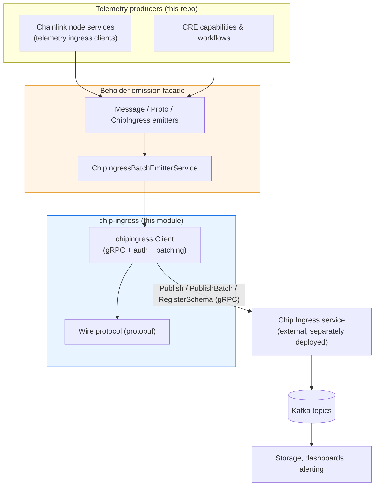
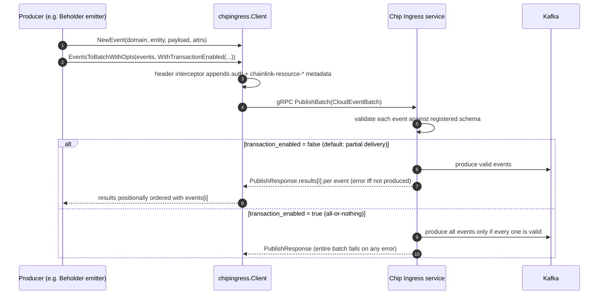
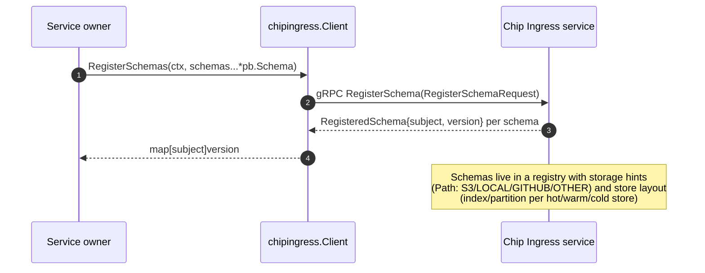

# chip-ingress

> **Module path:** `chainlink-common/pkg/chipingress` (standalone Go module)
> **Parent module:** [Telemetry & Observability Platform](../Telemetry___Observability_Platform.md)

## 1. Purpose

`chip-ingress` is the **producer-side SDK for the Chip Ingress telemetry pipeline**. It gives every component in the Chainlink ecosystem a single, uniform way to publish structured telemetry — [CloudEvents](https://cloudevents.io) — over gRPC to a central **Chip Ingress service**, which validates the events against registered schemas and fans them out to Kafka topics for downstream storage and analytics.

The library is deliberately small and self-contained:

- It is an **independent Go module** (own `go.mod`, retracted initial versions `v1.0.0`–`v1.0.1`), so it can be consumed by the node, Beholder, capabilities, and tooling without dragging in the whole `chainlink-common` dependency graph.
- It defines the **wire contract** (protobuf service + schema-registry messages) and the **gRPC client** that implements it.
- It owns the **authentication and metadata conventions** used on that wire: basic auth, CSA-key token auth, rotating ed25519-signed headers, and whitelisted `chainlink-resource-*` resource-attribute headers.

In one sentence: *chip-ingress turns "emit a telemetry event" into a validated, schema-checked, authenticated CloudEvent on Kafka.*

## 2. Position in the Telemetry & Observability Platform

chip-ingress sits at the **ingestion boundary** of the observability platform. It does not decide *what* to emit (that is Beholder's job) nor *how* telemetry is stored/visualized (that is the ops monitoring stack's job):



Related module pages (do not duplicate their content here):

| Concern | Where documented |
|---|---|
| Emission facade that wraps `chipingress.Client` (`ChipIngressEmitter`, `ChipIngressBatchEmitterService`) | [beholder-telemetry](beholder-telemetry.md) |
| Node-side telemetry ingress services and their no-op/mock implementations | [telemetry_ingress](telemetry_ingress.md) |
| Chain-level monitoring agents (separate Avro/Kafka pipeline) | [monitoring](monitoring.md) |
| Kafka / schema-registry infrastructure the service fans out into | [ops-monitoring-stack](ops-monitoring-stack.md) |
| Grafana dashboards built from the ingested telemetry | [observability-lib](observability-lib.md) |

Outside the observability platform, the module also appears in:

- **Node configuration** — `TelemetryIngress.ChipIngressEnabled()` decides whether the node routes telemetry through Chip Ingress; documented in [core_config_observability](../Node_Application_Core___Interfaces/core_config/core_config_observability.md).
- **Dev / test environments** — the CRE environment scripts deploy a `chip-ingress` stack (`chip_ingress_stack.go`) and system tests expose a `ChipIngressConfig`; see [operations_scripts](../Dev,_Test___Simulation_Environments/operations_scripts.md) and [system-tests](../Dev,_Test___Simulation_Environments/system-tests.md).

## 3. Architecture

The package has three cooperating layers. Each is documented in detail in its own sub-module page:

```mermaid
flowchart LR
    subgraph API["Client layer — chip-ingress_client"]
        IFC["Client interface<br/>NewClient + Opt options"]
        EVH["Event helpers<br/>NewEvent / EventsToBatch"]
        NOOP["NoopClient"]
    end

    subgraph AUTH["Auth &amp; metadata layer — chip-ingress_auth_headers"]
        HP["HeaderProvider<br/>(static / rotating ed25519)"]
        AUTH["Basic-auth &amp; CSA token credentials"]
        SAN["SanitizeMetadataHeaders whitelist"]
    end

    subgraph WIRE["Wire protocol layer — chip-ingress_protocol"]
        SVC_DEF["chip_ingress.proto<br/>ChipIngress service"]
        SCHEMA_DEF["chip_common.proto<br/>Schema registry types"]
        GEN["Generated gRPC stubs"]
    end

    IFC -->|"metadata via interceptors"| AUTH
    IFC -->|"encodes events with"| EVH
    IFC -->|"invokes"| GEN
    SVC_DEF -.->|generates| GEN
    SCHEMA_DEF -.->|generates| GEN

    style API fill:#e8f4ff,stroke:#1a73e8
    style AUTH fill:#eafff1,stroke:#1e8e3e
    style WIRE fill:#fef3f2,stroke:#d93025
```

### Sub-module documentation

All three sub-module pages were generated under `Telemetry___Observability_Platform/chip-ingress/`:

- **[chip-ingress/chip-ingress_client.md](chip-ingress/chip-ingress_client.md)** — gRPC client, functional options, event/batch helpers, `NoopClient`, module dependencies.
- **[chip-ingress/chip-ingress_auth_headers.md](chip-ingress/chip-ingress_auth_headers.md)** — static & rotating header providers, basic/CSA-token auth, `SanitizeMetadataHeaders` whitelist.
- **[chip-ingress/chip-ingress_protocol.md](chip-ingress/chip-ingress_protocol.md)** — `ChipIngress` gRPC service contract, batch transaction semantics, per-event error codes, schema-registry types.

| Sub-module | Files | Responsibility |
|---|---|---|
| [chip-ingress_client](chip-ingress/chip-ingress_client.md) | `client.go`, `go.mod` | The `Client` interface, `NewClient` with functional options (TLS, auth, retry, observability, headers), CloudEvent construction and batch helpers, `NoopClient` for tests, module dependencies. |
| [chip-ingress_auth_headers](chip-ingress/chip-ingress_auth_headers.md) | `header_provider.go` / `auth.go` surface (exercised by `header_provider_test.go`) | Static vs rotating header providers, ed25519 rotating auth with TTL rules, basic-auth / CSA-token credentials, and the `SanitizeMetadataHeaders` resource-attribute whitelist that keeps gRPC metadata safe. |
| [chip-ingress_protocol](chip-ingress/chip-ingress_protocol.md) | `pb/chip_ingress.proto`, `pb/chip_common.proto`, `pb/chip_ingress_grpc.pb.go` | The gRPC service contract (`Publish`, `PublishBatch`, `Ping`, `StreamEvents`, `RegisterSchema`), batch transaction semantics, per-event error codes, and the schema-registry message types. |

### Key design decisions

1. **Opt-in retries.** gRPC retries can replay *non-idempotent* RPCs such as `Publish`, so they are **disabled unless** the caller passes `WithRetryPolicy` (see [chip-ingress_client](chip-ingress/chip-ingress_client.md)). The service config is generated from typed structs (`RetryPolicy` + a default throttling policy) instead of a hand-written JSON literal — an earlier hand-written literal was malformed and gRPC silently discarded it.
2. **Comparable config surface.** `clientConfig` must remain comparable (compile-time guard `var _ = map[clientConfig]struct{}{}`); breaking comparability is caught by api-diff CI because the exported `Opt` type references it.
3. **Resource attributes travel once per request, not per event.** Producer-describing attributes (node ID, DON ID, zone, service SHA, …) are attached as gRPC metadata via `WithResourceAttributeHeaders`, and the Chip Ingress service fans them out onto every Kafka record produced by that request. Individual events carry only event-specific attributes (see [chip-ingress_auth_headers](chip-ingress/chip-ingress_auth_headers.md)).
4. **Partial delivery is the explicit default.** `EventsToBatch` sets `PublishOptions.transaction_enabled = false` on the wire so client intent is unambiguous; all-or-nothing batching is available via `WithTransactionEnabled(true)` (see [chip-ingress_protocol](chip-ingress/chip-ingress_protocol.md)).

## 4. Data flow

### Publishing a batch of events



### Registering schemas

Events must map to a **registered schema** keyed by the subject derived from the event's `source` + `type`. Publishing before registration yields `PUBLISH_ERROR_CODE_SCHEMA_MISSING` per event:



## 5. Component map

| Component | File | Role |
|---|---|---|
| `Client` (interface) | `client.go` | Embeds `pb.ChipIngressClient`; adds `Close()`, batch `RegisterSchemas()`, and `Conn()` for raw-codec publishing. |
| `client` / `clientConfig` + `Opt` | `client.go` | gRPC connection assembly: TLS, keepalive (10 s / 1 s, without stream), 16 MB max receive size, otelgrpc instrumentation, user-agent, header interceptors, opt-in retry service config. |
| Event helpers | `client.go` | `NewEvent`, `EventToProto`/`ProtoToEvent`, `EventsToBatch(WithOpts)`, `WithTransactionEnabled`. |
| `NoopClient` | `client.go` | Compile-time-checked no-op implementation for tests and disabled telemetry. |
| `HeaderProviderConfig` / `NewHeaderProvider` | `header_provider.go` | Chooses rotating (ed25519, TTL ≥ 10 min) vs static vs nil header provider. |
| `SanitizeMetadataHeaders` | `header_provider.go` | Whitelist of 10 resource attributes → `chainlink-resource-*` gRPC metadata headers; deterministic, collision-proof, gRPC-charset-safe. |
| `RetryPolicy` | `retry_policy.go` | Typed gRPC retry policy (max attempts, backoff, retryable status codes) rendered into a JSON service config. |
| `ChipIngress` service (generated) | `pb/chip_ingress.proto` + `pb/chip_ingress_grpc.pb.go` | `Publish`, `PublishBatch`, `Ping`, `StreamEvents` (experimental), `RegisterSchema`; client/server stubs and service descriptor. |
| Schema types (generated) | `pb/chip_common.proto` | `Schema`, `SchemaType` (PROTOBUF/AVRO/JSON), `SchemaReference`, `MetaData` + `Store` (index/partition), `Path`/`PathType`. |

## 6. Module facts (`go.mod`)

- **Module:** `github.com/smartcontractkit/chainlink-common/pkg/chipingress` — a standalone module, `go 1.26.6`.
- **Core dependencies:** CloudEvents SDK v2 + its protobuf binding (`io.cloudevents.v1.CloudEvent` wire type), `google.golang.org/grpc` (with otelgrpc instrumentation), OpenTelemetry metric/trace APIs, `google/uuid`, `zap`, `testify`.
- **Versioning:** versions `[v1.0.0, v1.0.1]` are retracted (initial development); the `clientConfig` comparability constraint is enforced by api-diff CI.
