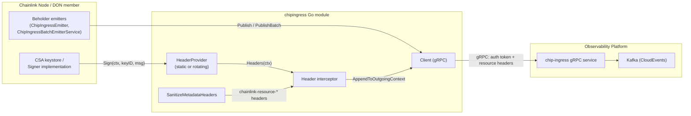
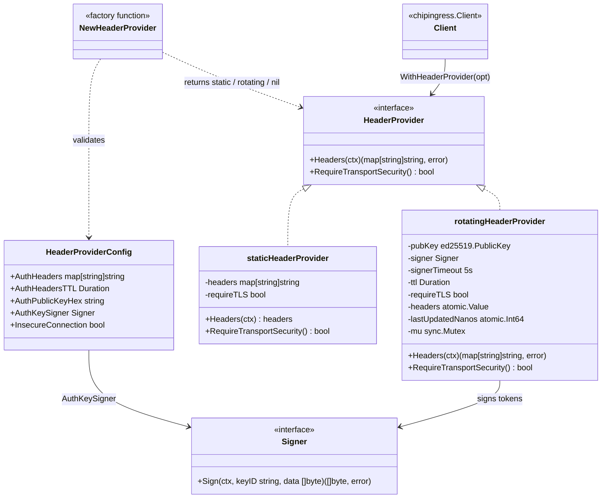
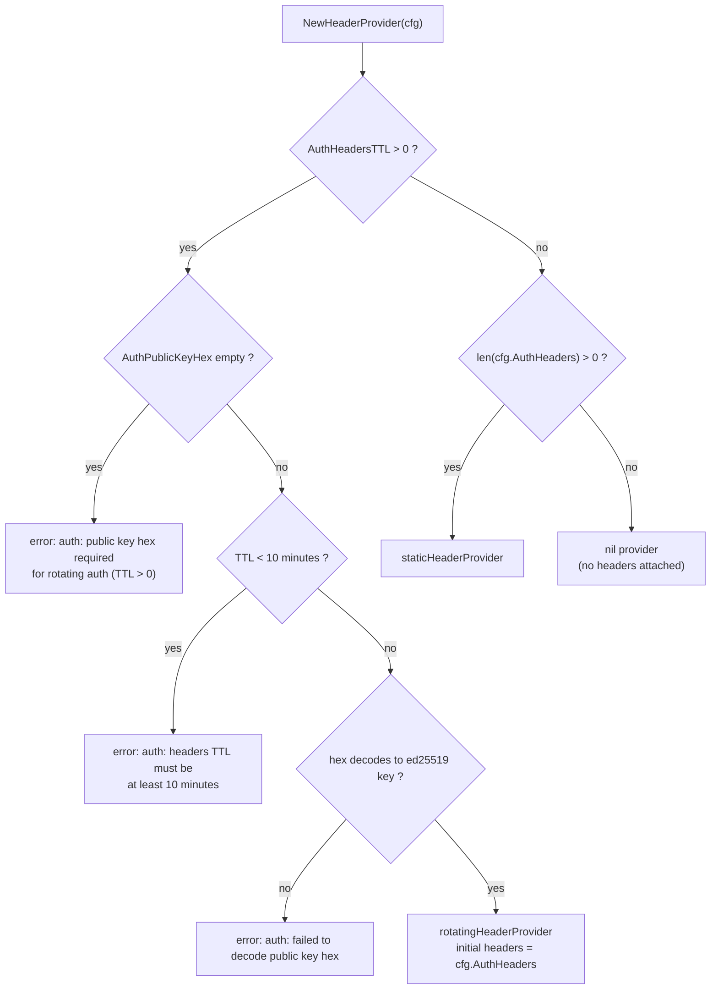
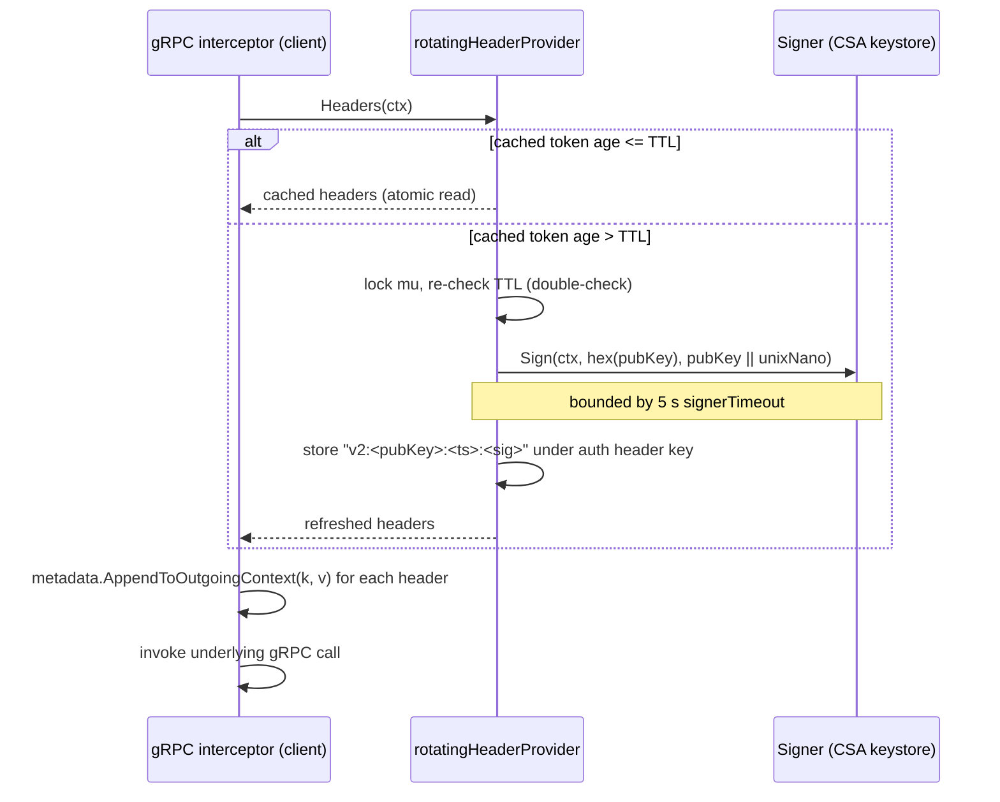
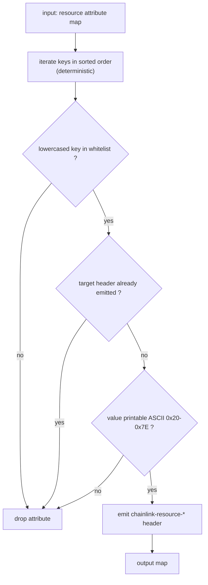
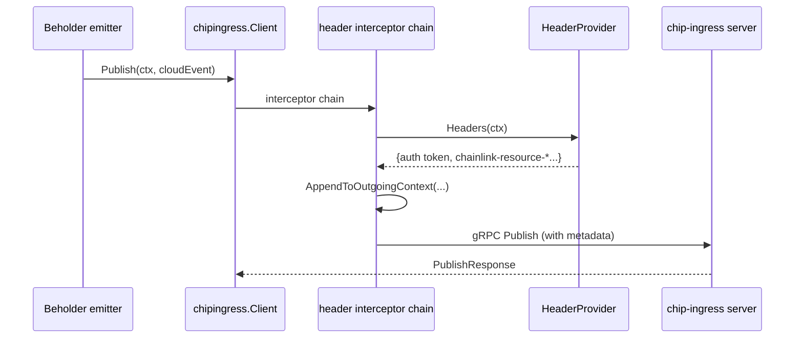

# Chip-Ingress Auth Headers

`chainlink-common/pkg/chipingress/header_provider.go` — header authentication and resource-attribution headers for the chip-ingress gRPC client.

This module is the **auth-header subsystem** of the [chip-ingress client library](../chip-ingress.md). It supplies the machinery that decides *which gRPC metadata headers* accompany every Publish/PublishBatch call to the chip-ingress service, and it guarantees those headers are wire-safe:

1. **Authenticated identity headers** — either a fixed set of static headers or a rotating, ed25519-signed auth token (the CSA auth header), refreshed on a TTL.
2. **Resource-attribution headers** — a *sanitized, whitelisted* projection of OpenTelemetry-style resource attributes (node id, DON id, host, service sha, …) into `chainlink-resource-*` gRPC metadata keys.

It is a leaf dependency with no runtime state of its own: it produces `HeaderProvider` values that are plugged into the [chip-ingress client](chip-ingress_client.md), which is in turn consumed by the [Beholder telemetry emitters](../beholder-telemetry.md).

---

## 1. Position in the Telemetry Platform

Chip-ingress is the gRPC front door of the observability platform: it accepts CloudEvents from Chainlink nodes and produces them to Kafka (see the [protocol definition](chip-ingress_protocol.md)). Every RPC a node makes must carry (a) proof of identity — the signed CSA auth token — and (b) enough resource metadata for downstream attribution and filtering. This module produces both header families; the [client](chip-ingress_client.md) attaches them via interceptors.



Consumers in the wider system:

| Consumer | Role |
| --- | --- |
| [Beholder emitters](../beholder-telemetry.md) (`ChipIngressEmitter`, `ChipIngressBatchEmitterService`, `DualSourceEmitter`) | wrap `chipingress.Client`; the auth header becomes the CSA node-identity token on every telemetry event |
| [Core telemetry ingress service](../telemetry_ingress.md) | the legacy/core-side counterpart that forwards node telemetry; chip-ingress is its successor transport |
| CRE system tests & devenv (`ChipIngressConfig` in `chainlink/system-tests/lib/cre/environment/config/config.go`, chip-ingress stack in `chainlink/core/scripts/cre/environment/environment/chip_ingress_stack.go`) | deploy a chip-ingress stack whose public key and connection mode feed the header-provider configuration |

---

## 2. Architecture

The module is built around a single interface, `HeaderProvider`, deliberately shaped like gRPC's `credentials.PerRPCCredentials` (`Headers` + `RequireTransportSecurity`). Two implementations exist behind one factory:



### Component reference

| Component | File | Purpose |
| --- | --- | --- |
| `HeaderProvider` | `header_provider.go` | Interface: produce current headers per RPC + declare transport-security requirement |
| `HeaderProviderConfig` | `header_provider.go` | Configuration: static headers, TTL, hex-encoded ed25519 public key, signer, insecure flag |
| `NewHeaderProvider(cfg)` | `header_provider.go` | Factory / validator: selects static, rotating, or nil provider |
| `NewStaticHeaderProvider(headers)` | `header_provider.go` | Public constructor for a fixed header set (`requireTLS = false`) |
| `staticHeaderProvider` | `header_provider.go` | Returns the configured map verbatim |
| `rotatingHeaderProvider` | `header_provider.go` | Thread-safe TTL-based rotation of a signed auth header |
| `newAuthHeaderV2` | `header_provider.go` | Builds the signed `v2` auth header value |
| `Signer` | `header_provider.go` | Pluggable signing abstraction (backed by the node's CSA keystore; `nil`-tolerant for lazy injection) |
| `SanitizeMetadataHeaders(in)` | `header_provider.go` | Whitelist translation of resource attributes into wire-safe `chainlink-resource-*` headers |
| `isPrintableASCII` | `header_provider.go` | Printable-ASCII check (`0x20`–`0x7E`) used by the sanitizer |
| `newHeaderInterceptor` | `client.go` | Client-side interceptor that appends provider headers to outgoing metadata |

---

## 3. Header Provider Factory

`NewHeaderProvider` is the single entry point. Its decision logic encodes the security policy of the whole subsystem:



### Selection and validation rules

| Configuration | Result |
| --- | --- |
| TTL ≤ 0, no headers (incl. negative TTL) | `nil` provider — client attaches no headers from this path |
| TTL ≤ 0, `AuthHeaders` non-empty | **static** provider; `RequireTransportSecurity() = !InsecureConnection` |
| TTL > 0 | **rotating** provider (rotating takes precedence over `AuthHeaders`, which are used as the *initial* headers until the first rotation) |
| TTL > 0 and empty `AuthPublicKeyHex` | error `"auth: public key hex required for rotating auth (TTL > 0)"` |
| TTL > 0 and TTL < 10 min | error `"auth: headers TTL must be at least 10 minutes"` (the 10-minute floor bounds the timestamp validity window / clock skew the server must tolerate) |
| Malformed or odd-length `AuthPublicKeyHex` | error `"auth: failed to decode public key hex: …"` |
| TTL > 0 with `AuthKeySigner = nil` | succeeds — signer may be injected later (lazy signer pattern) |

Because a `nil` provider is legal, callers can pass the factory result straight into [`WithHeaderProvider`](chip-ingress_client.md) and get a no-op when no auth is configured.

### Transport-security semantics

`RequireTransportSecurity()` mirrors gRPC's `credentials.PerRPCCredentials` contract: it reports whether the credentials must never be sent over plaintext. It is derived from the inverse of `HeaderProviderConfig.InsecureConnection` for both provider types. The public `NewStaticHeaderProvider` constructor always reports `false`, so static headers created through it are suitable for insecure/test connections. The test file pins these semantics with an inline structural-type assertion:

```go
// header_provider_test.go
type tsr interface {
    RequireTransportSecurity() bool
}
```

This checks that every returned provider implements the gRPC requirer contract *without* depending on an exported assertion helper.

---

## 4. Static Provider

`staticHeaderProvider` returns its configured `map[string]string` verbatim for every call — no locking, no rotation. Typical uses are environment tags (`chain_id`, `environment`) and pre-sanitized resource headers produced by `SanitizeMetadataHeaders`.

---

## 5. Rotating Provider (Signed Auth Header)

The rotating provider emits a fresh, signed auth token every `TTL`. Internals:

- `headers` is stored in an `atomic.Value` and `lastUpdatedNanos` in an `atomic.Int64`, giving a lock-free fast path when the cached token is still fresh.
- Rotation takes a `sync.Mutex` and **double-checks the TTL after acquiring it**, so concurrent RPCs trigger at most one signing operation.
- Signing is bounded by a 5-second context timeout (`signerTimeout`); a failure returns the wrapped error `chipingress: failed to create auth header: …` and the RPC is not sent (the [client interceptor](chip-ingress_client.md) fails the call before dialing).

### Signed header format (`newAuthHeaderV2`)

```text
message   = pubKey (32 bytes, ed25519) || bigEndian uint64(unixNano timestamp)
keyID     = hex(pubKey)                  // passed to Signer.Sign
signature = Signer.Sign(ctx, keyID, message)

header value = "<v2-tag>:<pubKey-hex>:<unixNano>:<signature-hex>"
```

The value is emitted under the fixed auth header key — the CSA node-auth metadata key (`X-Beholder-Node-Auth-Token`). That key is reserved: the sanitizer (§6) guarantees no resource attribute can ever emit it, so the signed token can never be shadowed or duplicated by attributed metadata.

### Rotation sequence



Notes:

- If initial headers were supplied, `lastUpdatedNanos` is seeded with *now*, so the first real rotation happens one TTL after startup; with no initial headers the first `Headers(ctx)` call rotates immediately.
- The `Signer` interface (`Sign(ctx, keyID, data)`) is intentionally minimal. Production signers come from the node's CSA keystore; Beholder wraps them in a `lazySigner` when the keystore becomes available only after startup — which is why the factory tolerates a `nil` signer at construction time.

---

## 6. Metadata Sanitization (`SanitizeMetadataHeaders`)

Nodes run OpenTelemetry resource attributes with keys such as `host.name`, `service.name`, or `csa_public_key`. These cannot be shipped as gRPC metadata as-is: **grpc-go hard-fails the entire RPC with `codes.Internal` when an outgoing metadata pair violates its charset rules** (dots, non-printable bytes). `SanitizeMetadataHeaders` converts a resource-attribute map into the fixed, wire-safe header set the chip-ingress service expects — it is a *whitelist*, not a sanitizer-by-escaping, so failures are omissions rather than rewrites.



### Wire contract: whitelisted attributes

The output header names are a fixed set; this table **is** the contract with the chip-ingress service (the test suite pins it verbatim so the two sides cannot drift):

| Resource attribute (case-insensitive) | gRPC metadata header |
| --- | --- |
| `deployed_by` | `chainlink-resource-deployed-by` |
| `host.name` | `chainlink-resource-host-name` |
| `internal_node_id` | `chainlink-resource-internal-node-id` |
| `node_id` | `chainlink-resource-node-id` |
| `donID` | `chainlink-resource-don-id` |
| `platformEnv` | `chainlink-resource-platform-env` |
| `zone` | `chainlink-resource-zone` |
| `csa_public_key` | `chainlink-resource-csa-public-key` |
| `service.name` | `chainlink-resource-service-name` |
| `service.sha` | `chainlink-resource-service-sha` |

### Guarantees

- **Collision safety.** The client interceptor *appends* to outgoing metadata (`metadata.AppendToOutgoingContext`) rather than replacing it. If an attribute could land on a reserved key, the RPC would carry two values under one key — which silently breaks CSA authentication. Because emitted names are the fixed `chainlink-resource-*` set, no configured attribute can reach reserved gRPC keys (`X-Beholder-Node-Auth-Token`, `x-include-nop-info`, `authorization`, `te`, `content-type`, `cookie`, `host`, `user-agent`, `grpc-timeout`, `grpc-encoding`). This property is explicitly asserted by a guard test.
- **Determinism.** Keys are processed in sorted order, matching is case-insensitive, and the first occurrence of a case-variant wins deterministically (ASCII order puts upper-case first, so `DonID` beats `donid`).
- **Silent omission.** Non-whitelisted keys and values containing non-printable bytes are dropped entirely — never rewritten.
- **RPC-failure prevention.** A regression test spins up a real in-process gRPC chip-ingress server and demonstrates that unsanitized headers (`csa_public_key` containing a `\x01` byte) make the whole `Ping` RPC fail with `codes.Internal`, while the sanitized (here: empty) header set succeeds.

---

## 7. Integration with the Client

The [client](chip-ingress_client.md) consumes header providers in `NewClient`:

- `WithHeaderProvider(provider)` stores the provider in `clientConfig.headerProvider`.
- `NewClient` wraps it in `newHeaderInterceptor` and registers it with `grpc.WithChainUnaryInterceptor` — chained, not last-one-wins — so the auth/resource provider and the separate NOP-info header provider compose instead of overriding each other.
- The interceptor calls `provider.Headers(ctx)` per unary RPC and appends each pair to the outgoing metadata context; an error from the provider (e.g. a signing failure) aborts the RPC with `failed to get headers: …`.
- **Unary only**: streaming RPCs (`StreamEvents`) do not get header interception (an explicit limitation noted in `client.go`).



---

## 8. Testing

All behaviour is covered by `chainlink-common/pkg/chipingress/header_provider_test.go`:

| Test | What it pins |
| --- | --- |
| `TestNewHeaderProvider` | every factory rule from §3: nil providers, static vs rotating selection, rotating-over-static precedence, TTL boundary (exactly 10 min passes, below fails), invalid/odd-length hex, negative TTL, nil-tolerant signer, per-provider `RequireTransportSecurity` via the inline `tsr` interface |
| `TestNewStaticHeaderProvider` | verbatim header pass-through and `requireTLS = false` |
| `TestSanitizeMetadataHeaders` | the ten-entry wire-contract table, case-insensitive matching, omission of non-whitelisted keys, the reserved-key collision guard, non-printable value omission, deterministic case-variant resolution |
| `TestSanitizeMetadataHeaders_AvoidsRPCFailure` | end-to-end regression against a live in-process gRPC server: unsanitized headers ⇒ `codes.Internal`; sanitized headers ⇒ success |

Test doubles are deliberately minimal: `fakeSigner` implements `Signer` returning a dummy signature (never invoked unless rotation actually fires), and `pingServer` is a stub `pb.ChipIngressServer` answering `Ping`.

---

## 9. Build & Dependency Notes

The chip-ingress client library is its own Go module, `github.com/smartcontractkit/chainlink-common/pkg/chipingress` (see `chainlink-common/pkg/chipingress/go.mod`, Go 1.26.6). The header-provider subsystem itself adds no external dependencies beyond the standard library (`crypto/ed25519`, `encoding/hex`, `sync/atomic`) plus `google.golang.org/grpc` metadata types used by the interceptor; the module's remaining requirements (otel, cloudevents, protobuf, zap) belong to the client and protocol layers documented in [chip-ingress client](chip-ingress_client.md) and [chip-ingress protocol](chip-ingress_protocol.md).

---

## 10. Related Documentation

- [chip-ingress module overview](../chip-ingress.md) — parent module: purpose, deployment, and relationship to the observability stack
- [chip-ingress client](chip-ingress_client.md) — `Client`, options, retry policy, OTel instrumentation
- [chip-ingress protocol](chip-ingress_protocol.md) — `ChipIngress` gRPC service, CloudEvents, publish semantics
- [Beholder telemetry](../beholder-telemetry.md) — primary consumers of the header provider (emitters, auth signers)
- [Telemetry ingress (core service)](../telemetry_ingress.md) — the core-node telemetry ingress configuration this platform succeeds
- [CRE system tests](../../Dev,_Test___Simulation_Environments/system-tests.md) — test-environment chip-ingress stack configuration (`ChipIngressConfig`)
- [Telemetry & Observability Platform](../../Telemetry___Observability_Platform.md) — platform root
