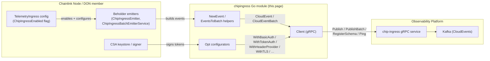
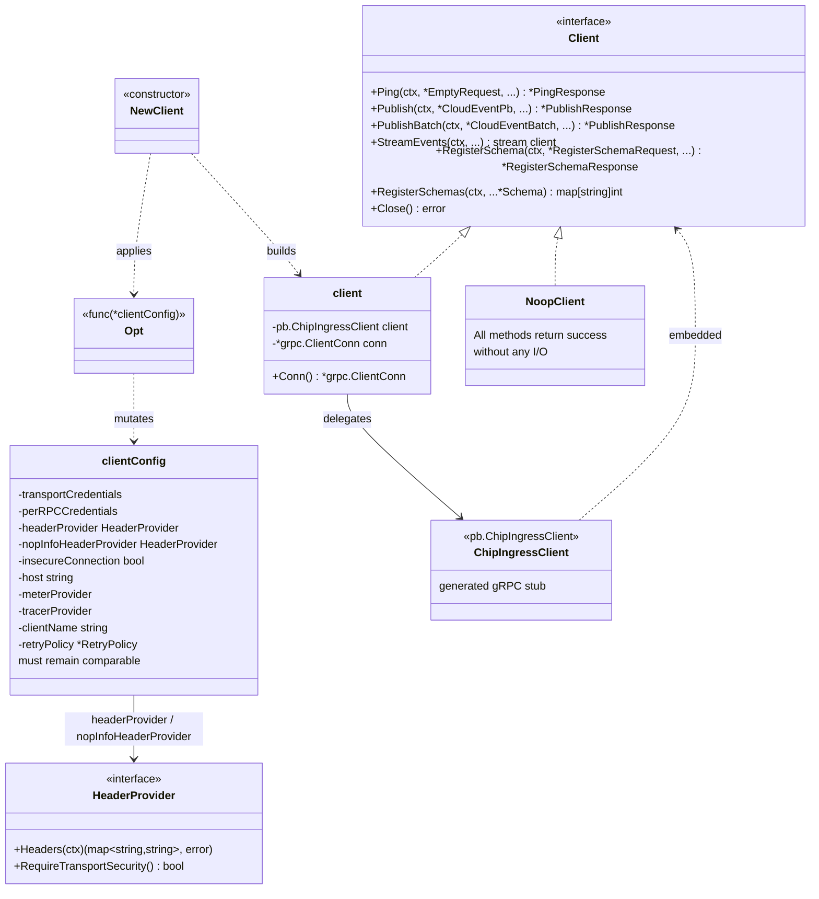
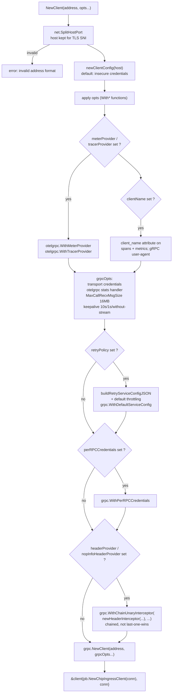
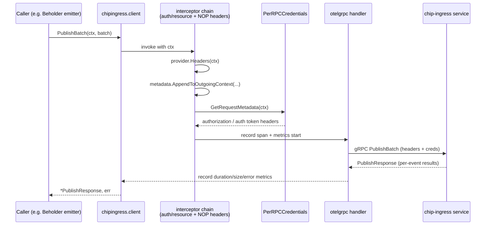
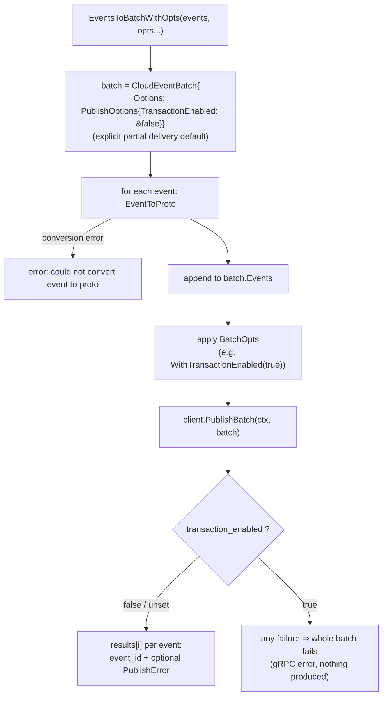

# Chip-Ingress Client

`chainlink-common/pkg/chipingress/client.go` — the gRPC client library for the chip-ingress service.

This module is the **sender-side SDK** of the [chip-ingress subsystem](../chip-ingress.md): it is what a Chainlink node uses to connect to the chip-ingress gRPC front door of the observability platform and produce [CloudEvents](chip-ingress_protocol.md) onto Kafka. It packages, in one `Client` value, everything a publisher needs:

1. **Transport** — a hardened gRPC channel (TLS or insecure, keepalives, 16 MB receive limit, opt-in retries).
2. **Identity** — pluggable per-RPC authentication (basic auth or CSA-token auth) and dynamic metadata headers (see [auth headers](chip-ingress_auth_headers.md)).
3. **Observability** — first-class OpenTelemetry instrumentation of every call (spans + metrics via `otelgrpc`).
4. **Event plumbing** — helpers to build CloudEvents, convert them to protobuf, and assemble batches with explicit delivery semantics.

It ships as its **own Go module** (`github.com/smartcontractkit/chainlink-common/pkg/chipingress`, see [`go.mod`](#9-go-module-boundaries)) so that publishers can depend on a minimal, telemetry-focused dependency graph instead of the whole `chainlink-common` tree.

---

## 1. Position in the Telemetry Platform

Chip-ingress accepts CloudEvents from nodes and produces them to Kafka (the wire contract is the [protocol definition](chip-ingress_protocol.md)). This client is the only sanctioned way for Chainlink processes to talk to that service. In production the client is almost never used directly: it is wrapped by the [Beholder telemetry emitters](../beholder-telemetry.md), which own buffering, retries at the application layer, and metrics around emission.



Consumers in the wider system:

| Consumer | Role |
| --- | --- |
| [Beholder emitters](../beholder-telemetry.md) (`ChipIngressEmitter`, `ChipIngressBatchEmitterService`, `DualSourceEmitter`) | wrap `chipingress.Client`; the batch emitter additionally uses the sibling `batch/` subpackage of the same Go module, which buffers events and splits batches against the gRPC size limit |
| Core node configuration (`TelemetryIngress` / `TelemetryIngressEndpoint` in `chainlink/core/config/telemetry_ingress_config.go`) | the `ChipIngressEnabled()` switch and endpoint wiring that decide whether a node instantiates this client |
| [Core telemetry ingress service](../telemetry_ingress.md) | the legacy/core-side forwarding path; chip-ingress is its successor transport |
| CRE tooling & tests (`chip_ingress_stack.go` in `chainlink/core/scripts/cre/environment/environment/`, `ChipIngressConfig` in `chainlink/system-tests/lib/cre/environment/config/config.go`) | deploy the chip-ingress service whose address, TLS mode and public key feed the client's options |
| `chainlink-common/pkg/chipingress/mocks/client.go` | generated mock of `Client` for injecting into consumers' tests |

---

## 2. Architecture

The public surface is a single interface, `Client`, with three implementations: the real gRPC client, a no-op client for tests, and (outside this page) the buffering wrapper in the `batch/` subpackage. Configuration is done exclusively through functional options (`Opt`), which mutate a private, strictly comparable `clientConfig` struct.



### Component reference

| Component | File | Purpose |
| --- | --- | --- |
| `Client` | `client.go` | Public interface: the generated `pb.ChipIngressClient` RPCs plus `Close` and the `RegisterSchemas` convenience helper |
| `client` | `client.go` | Real implementation; owns the `*grpc.ClientConn`, delegates every RPC, exposes `Conn()` for advanced use |
| `clientConfig` | `client.go` | Private configuration holder; kept comparable on purpose (see §3.2) |
| `Opt` + `With*` functions | `client.go`, `retry_policy.go` | Functional configuration (full list in §3.3) |
| `newHeaderInterceptor` | `client.go` | Unary interceptor that appends `HeaderProvider.Headers(ctx)` to outgoing metadata |
| `NewEvent` | `client.go` | Builds a CloudEvent with sensible defaults (`source`, `type`, UUID `id`, `recordedtime`) |
| `EventToProto` / `ProtoToEvent` | `client.go` | Conversions between the CloudEvents SDK event and its protobuf wire form |
| `EventsToBatch(WithOpts)`, `WithTransactionEnabled`, `BatchOpt` | `client.go` | Batch assembly with explicit delivery semantics (§5.3) |
| `NoopClient` | `client.go` | Compile-time-verified no-op `Client` for tests and disabled modes |
| `RetryPolicy`, `DefaultRetryPolicy`, `WithRetryPolicy`, `buildRetryServiceConfigJSON` | `retry_policy.go` | Opt-in gRPC-level retries (§6) |
| `newBasicAuthCredentials`, `newTokenAuthCredentials` | `auth.go` | `credentials.PerRPCCredentials` implementations (basic / token auth) |
| `IdempotencyKeyAttr` | `types.go` | Name of the `idempotencykey` CloudEvent extension used for downstream deduplication |
| `batch.Client` | `batch/client.go` | Buffering/splitting batch publisher built on top of `Client` (consumed by Beholder; see [beholder-telemetry](../beholder-telemetry.md)) |

---

## 3. Client Construction and Configuration

### 3.1 Construction flow

`NewClient(address, opts ...Opt)` validates the address, applies the options, and assembles the gRPC dial options. The order matters: transport credentials, instrumentation, size/keepalive limits, user agent, retries, per-RPC auth, and finally the header interceptors.



### 3.2 The comparability contract

`clientConfig` carries a compile-time guard:

```go
// Compile-time assertion that clientConfig stays comparable (fails to build otherwise).
var _ = map[clientConfig]struct{}{}
```

Because `Opt` is an exported type that references `clientConfig`, adding a non-comparable field (e.g. a slice) would be a **breaking API change** — gRPC's `With*` ecosystems occasionally rely on option equality. The guard makes such a change fail the build immediately, and `retryPolicy` is deliberately a pointer (`*RetryPolicy`) to preserve comparability. This is enforced in CI via api-diff.

### 3.3 Option reference

| Option | Effect |
| --- | --- |
| *(default)* | Insecure transport credentials; no auth; no headers; global OpenTelemetry providers |
| `WithBasicAuth(user, pass)` | Per-RPC `authorization: Basic base64(user:pass)` credentials; requires TLS unless the connection is insecure |
| `WithTokenAuth(provider)` | Token-based per-RPC credentials built from a `HeaderProvider` — the CSA-key authentication path (see [auth headers](chip-ingress_auth_headers.md)) |
| `WithTransportCredentials(creds)` | Custom transport credentials (e.g. mTLS) |
| `WithHeaderProvider(provider)` | Dynamic headers attached by a chained unary interceptor on every unary RPC (non-auth headers; for CSA auth use `WithTokenAuth`) |
| `WithResourceAttributeHeaders(attrs)` | Convenience: `WithHeaderProvider(NewStaticHeaderProvider(SanitizeMetadataHeaders(attrs)))` — emits only the whitelisted `chainlink-resource-*` headers (§7) |
| `WithInsecureConnection()` | Explicitly disables TLS |
| `WithTLS()` | TLS with `ServerName` = address host (SNI/cert SAN) and `NextProtos: ["h2"]` to force HTTP/2 |
| `WithMeterProvider(p)` / `WithTracerProvider(p)` | Custom OpenTelemetry providers for the `otelgrpc` handler; otherwise the global providers are used |
| `WithClientName(name)` | Sent as the gRPC user-agent and recorded as a `client_name` attribute on otelgrpc spans and metrics; identifies the publisher to chip-ingress and in telemetry |
| `WithNOPLookup()` | Adds the `x-include-nop-info: true` header, asking chip-ingress to resolve NOP (node operator profile) info for the authenticated CSA key |
| `WithRetryPolicy(policy)` | Opt-in gRPC-level retries (§6) |

### 3.4 Transport hardening

Independent of any option, every connection gets:

- **Receive limit** — `grpc.MaxCallRecvMsgSize(16 MB)` (`maxMessageSize`), sized for large batch responses.
- **Keepalives** — pings every 10 s with a 1 s timeout, permitted without an active stream, so idle connections through load balancers are not silently reaped.
- **Instrumentation** — `otelgrpc.NewClientHandler` as the stats handler, so every RPC produces spans, duration/size/error-rate metrics, and (with `WithClientName`) a `client_name` attribute for attribution.

---

## 4. Authentication and Header Attachment

The details of *which* headers are produced — the rotating CSA auth token and the sanitized `chainlink-resource-*` resource headers — live in the [auth headers module](chip-ingress_auth_headers.md). The client's role is limited to attachment:

1. **Per-RPC credentials** (`WithBasicAuth`, `WithTokenAuth`) are handed to gRPC via `grpc.WithPerRPCCredentials`; gRPC calls them per request and enforces the `RequireTransportSecurity()` contract.
2. **Dynamic headers** (`WithHeaderProvider`, `WithNOPLookup`, and therefore `WithResourceAttributeHeaders`) are attached by `newHeaderInterceptor`, a unary interceptor that calls `provider.Headers(ctx)` and appends each pair via `metadata.AppendToOutgoingContext`. A provider error (e.g. a signing failure in the rotating provider) aborts the RPC *before dialing* with `failed to get headers: …`.
3. **Chaining**: interceptors are registered with `grpc.WithChainUnaryInterceptor` so the auth/resource provider and the NOP-info provider *compose*; `grpc.WithUnaryInterceptor` would be last-one-wins and silently drop one of them.
4. **Unary only**: there is deliberately no stream interceptor; `StreamEvents` does not carry provider headers (an explicit limitation noted in `client.go`).



---

## 5. Publishing Telemetry

### 5.1 Creating events — `NewEvent`

`NewEvent(domain, entity string, payload []byte, attributes map[string]any)` builds a CloudEvents SDK event:

| Field | Source |
| --- | --- |
| `source` | `domain` |
| `type` | `entity` |
| `id` | fresh `uuid.New()` |
| `recordedtime` (extension) | `attributes["recordedtime"]` if a non-zero `time.Time`, else `time.Now()` — always UTC, truncated to milliseconds |
| `time` | optional, from `attributes["time"]` (UTC) |
| `datacontenttype` | optional, from `attributes["datacontenttype"]` |
| `dataschema` | optional, from `attributes["dataschema"]` |
| `subject` | optional, from `attributes["subject"]` |
| `idempotencykey` (extension) | optional, from `attributes[IdempotencyKeyAttr]` — becomes the `ce_idempotencykey` Kafka header for downstream deduplication |
| `data` | `payload`, always stored with the **protobuf** content type (`ceformat.ContentTypeProtobuf`) |

Resource attributes (node id, DON id, service sha, …) are **deliberately not** stamped here: they describe the producer, not any single event, so they travel once per request as gRPC metadata via `WithResourceAttributeHeaders` instead of being repeated on every event in a batch.

### 5.2 Conversions

`EventToProto` / `ProtoToEvent` bridge the CloudEvents SDK event and the `io.cloudevents.v1.CloudEvent` protobuf wire form used by the [protocol](chip-ingress_protocol.md). The package also exports type aliases in `types.go` (`CloudEvent`, `CloudEventPb`, `CloudEventBatch`, `PublishResult`, …) so consumers never need to import the generated `pb` package directly.

### 5.3 Batch assembly and delivery semantics

`EventsToBatch(events)` (equivalently `EventsToBatchWithOpts(events)`) converts a slice of events into a `CloudEventBatch`. By default the batch carries an **explicit** `PublishOptions{TransactionEnabled: &false}` so the wire form unambiguously reflects client intent:

| `transaction_enabled` | Semantics |
| --- | --- |
| unset or `false` (client default) | **Partial delivery**: valid events are produced to Kafka; invalid ones are skipped, and per-event errors are returned positionally in `PublishResponse.results[i]` for `events[i]`. The server treats unset and explicit `false` identically. |
| `true` (`WithTransactionEnabled(true)`) | **All-or-nothing**: any per-event failure fails the entire batch. |

`PublishResult` carries the invariant *error is set if and only if the event was not produced*, with a typed `PublishErrorCode` (`VALIDATION_FAILED`, `SCHEMA_MISSING`, `ENCODE_ERROR`, `DOMAIN_MISCONFIGURATION`) and a human-readable `reason`. The full wire contract, including when a failure is a per-event code versus a gRPC status, is documented in the [protocol definition](chip-ingress_protocol.md).



### 5.4 Schema registration

`RegisterSchemas(ctx, schemas ...*pb.Schema)` wraps the `RegisterSchema` RPC: it sends a `RegisterSchemaRequest` with all schemas at once and returns `map[subject]version` from the `RegisteredSchema` list. Registering a schema (PROTOBUF/AVRO/JSON, with storage metadata per [chip_common.proto](chip-ingress_protocol.md)) is a prerequisite for publishing events of that `source`/`type` — otherwise publishes fail with `PUBLISH_ERROR_CODE_SCHEMA_MISSING`.

### 5.5 Not implemented: `StreamEvents`

The client implements `StreamEvents` by returning `not implemented: StreamEvents is experimental and not supported yet`. The bidi-streaming RPC exists in the [protocol](chip-ingress_protocol.md) but is explicitly experimental; consumers must use `Publish`/`PublishBatch`.

### 5.6 Escape hatch: `Conn()`

`client.Conn()` exposes the underlying `*grpc.ClientConn` for advanced use cases such as raw-codec `PublishBatch` calls that bypass protobuf marshal/unmarshal overhead (used by high-throughput emitters).

---

## 6. Retry Policy (Opt-In)

gRPC-level retries are **disabled by default** and enabled per client with `WithRetryPolicy` — because the policy applies to the whole `ChipIngress` service, enabling it can replay non-idempotent RPCs (`Publish`, `PublishBatch`, `RegisterSchema`) after the server already did the work, producing duplicate events. Callers that enable retries should set the `idempotencykey` extension (`IdempotencyKeyAttr`) on their events so downstream consumers can deduplicate.

`DefaultRetryPolicy()`:

| Field | Value |
| --- | --- |
| `MaxAttempts` | 3 (1 original + 2 retries) |
| `InitialBackoff` | 100 ms |
| `MaxBackoff` | 1 s |
| `BackoffMultiplier` | 2 |
| `RetryableStatusCodes` | `Unavailable`, `ResourceExhausted` |

Whenever a policy is installed, `NewClient` also installs gRPC **retry throttling** (fixed at 10 tokens, refilled 0.1 per success; retries stop once the bucket drops to half full) so retries cannot pile load onto a failing server. Internally, `buildRetryServiceConfigJSON` serializes the typed `RetryPolicy` into the gRPC service-config JSON — durations as protobuf-JSON seconds (`"0.1s"`) — after validating that all status codes are well-known gRPC codes. This typed path exists because a previous hand-written JSON literal was silently discarded by gRPC's parser.

Full timing tables, throttling details and implementation notes live in the module's own document at `chainlink-common/pkg/chipingress/docs/retry-policy.md` in the repository.

---

## 7. Resource-Attribute Headers Contract

`WithResourceAttributeHeaders(attrs)` is the recommended way to tag every published request with producer metadata. It composes `SanitizeMetadataHeaders` (whitelist + printable-ASCII validation, described in [auth headers](chip-ingress_auth_headers.md)) with `NewStaticHeaderProvider`, so only the safe, whitelisted path can be taken. Attributes are attached **once per request**, not per event: chip-ingress fans them out onto every Kafka record the request produces (`chainlink-resource-service-name` becomes `resource_service.name` on the record, per the wire contract in `types.go`). Attributes outside the whitelist are silently ignored.

---

## 8. Testing Support

- **`NoopClient`** — a full `Client` implementation (`var _ Client = (*NoopClient)(nil)`) whose every method succeeds without I/O. Use it to disable telemetry in tests or when the service is intentionally not configured.
- **`mocks/client.go`** — mockery-generated mock of `Client` for asserting publish behavior in consumers' unit tests (see `MockChipIngressService`-style usage in `chainlink/core/services/telemetry/chip_ingress_test.go`).
- The package's own tests (`client_test.go`, `auth_test.go`, `retry_policy_test.go`, `header_provider_test.go`) exercise a real in-process gRPC server, including the sanitizer-vs-`codes.Internal` regression test covered in [auth headers](chip-ingress_auth_headers.md).

---

## 9. Go Module Boundaries

The package is an independent Go module (`chainlink-common/pkg/chipingress/go.mod`, `go 1.26.6`), deliberately decoupled from the main `chainlink-common` module:

| Dependency | Why |
| --- | --- |
| `github.com/cloudevents/sdk-go/v2` + `.../binding/format/protobuf/v2` | CloudEvent model and protobuf wire format |
| `google.golang.org/grpc`, `google.golang.org/protobuf` | transport and generated stubs (`pb/`) |
| `go.opentelemetry.io/otel` (+ `metric`, `trace`, `sdk/metric`) and `otelgrpc` | built-in tracing/metrics instrumentation |
| `github.com/google/uuid` | event IDs |
| `go.uber.org/zap` | logging (used by the `batch/` subpackage) |
| `github.com/stretchr/testify` | tests only |

Notes:

- Versions `v1.0.0`–`v1.0.1` of the module are **retracted** (initial-development releases); pin a later version.
- The `batch/` subpackage (buffering batch publisher used by Beholder) and the generated `pb/` bindings live inside this module, so all chip-ingress client concerns ship together.
- Because the module boundary is a release unit, the `clientConfig` comparability guard (§3.2) is additionally monitored by api-diff CI.

---

## 10. Related Documentation

- [Chip-Ingress (parent)](../chip-ingress.md) — subsystem overview and deployment model
- [Chip-Ingress Auth Headers](chip-ingress_auth_headers.md) — `HeaderProvider` implementations, CSA token rotation, metadata sanitization
- [Chip-Ingress Protocol](chip-ingress_protocol.md) — `chip_ingress.proto` / `chip_common.proto` wire contract and error codes
- [Beholder Telemetry](../beholder-telemetry.md) — the emitters that wrap this client, including the batch emitter
- [Telemetry Ingress (core)](../telemetry_ingress.md) — the legacy core-side forwarding service and node configuration
