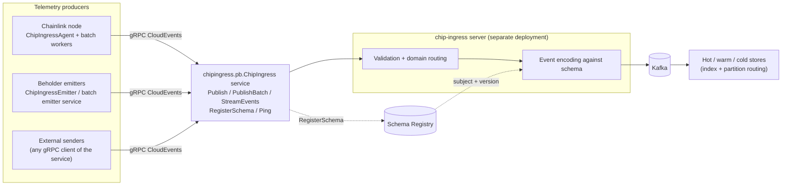
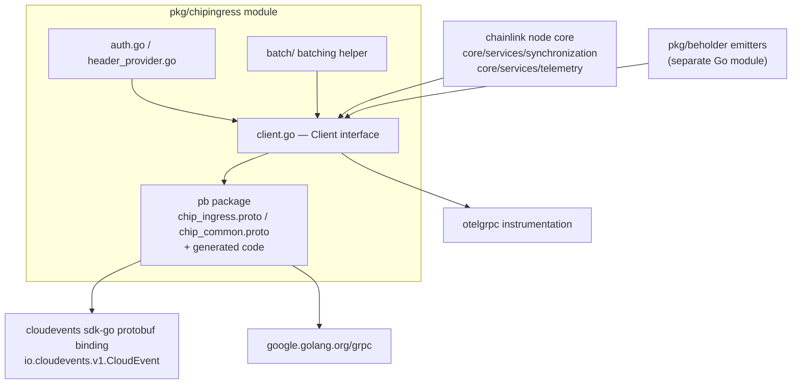
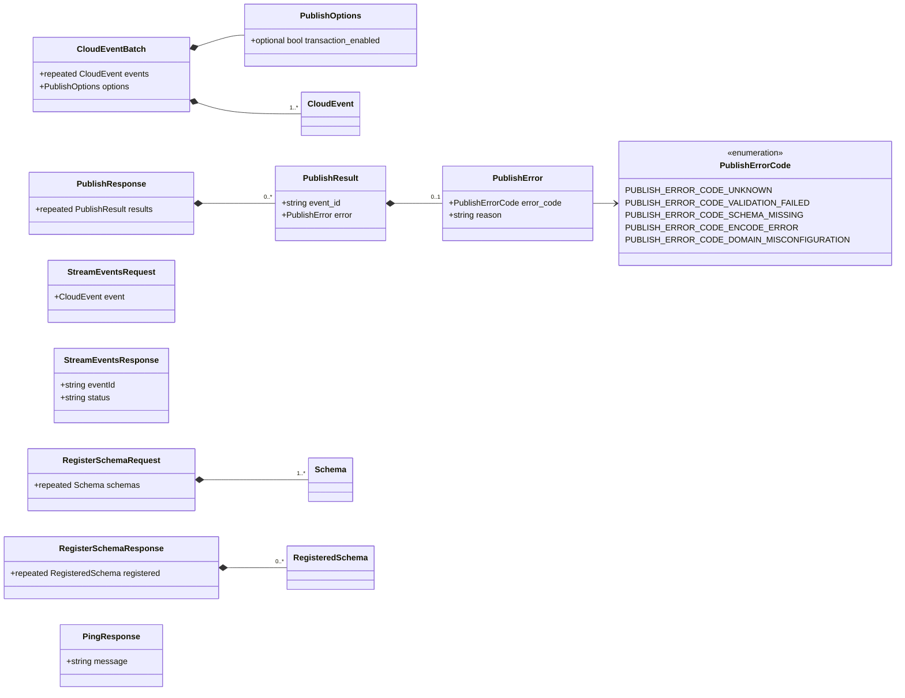
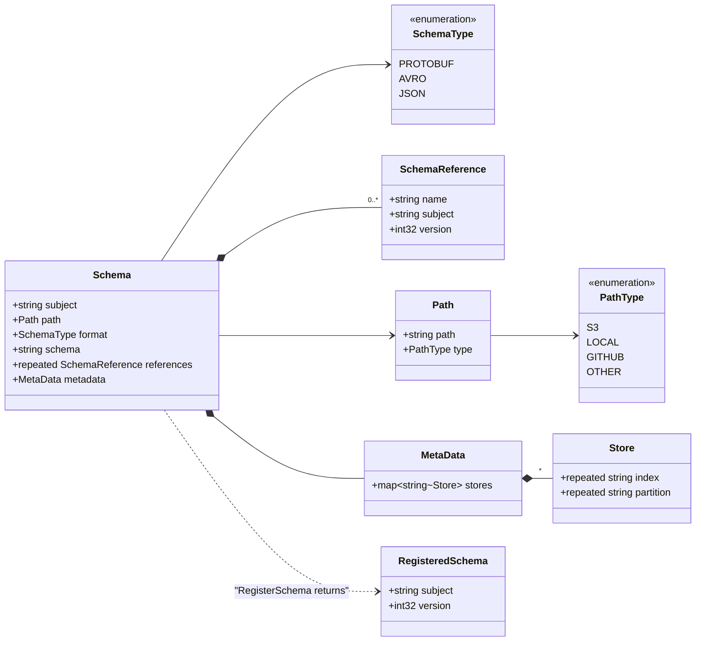
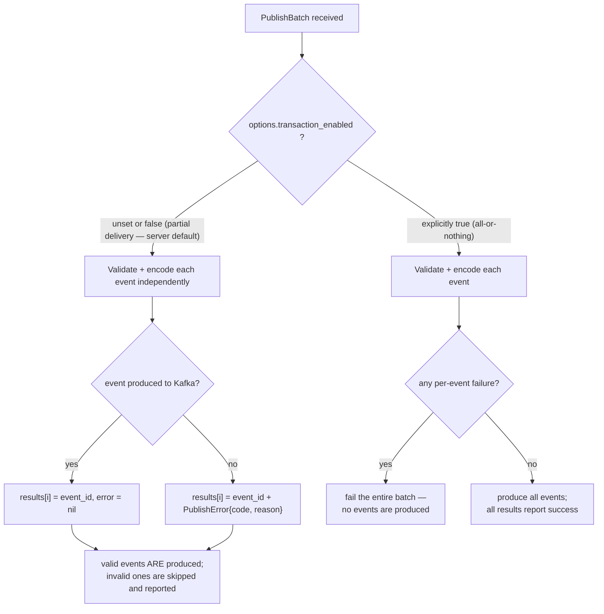
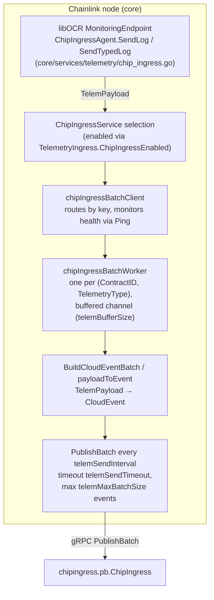
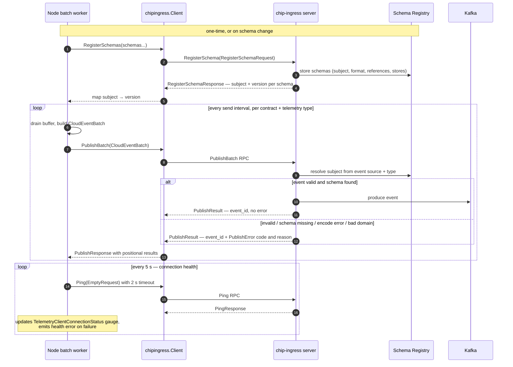

# Chip-Ingress Protocol (`chipingress.pb`)

| | |
|---|---|
| **Go module** | `github.com/smartcontractkit/chainlink-common/pkg/chipingress` (standalone module, see `chainlink-common/pkg/chipingress/go.mod`) |
| **Proto package** | `chipingress.pb` (`chip_ingress.proto`), `chip_common` (`chip_common.proto`) |
| **gRPC service** | `chipingress.pb.ChipIngress` |
| **Event wire format** | [`io.cloudevents.v1.CloudEvent`](https://github.com/cloudevents/sdk-go) protobuf binding (CloudEvents SDK v2.16.1) |
| **Purpose** | gRPC contract for producing CloudEvents to Kafka via the chip-ingress service, with schema-registry-backed validation |

The **chip-ingress protocol** is the wire contract between telemetry *producers* (Chainlink nodes, Beholder emitters, and any external gRPC client) and the *chip-ingress service*, a server-side deployment that validates events against a schema registry and produces them to Kafka. This module owns the protocol definition (`chip_ingress.proto`, `chip_common.proto`) and the generated gRPC bindings (`chip_ingress_grpc.pb.go`); the client wrapper that turns these bindings into a usable Go client is documented separately in the [chip-ingress client](chip-ingress_client.md) page.

## Role in the observability platform

Within the [Telemetry & Observability Platform](../chip-ingress.md), this protocol is the contract layer of the chip-ingress stack:



Key characteristics of the contract:

- **CloudEvents native** — the unit of data is the standard `io.cloudevents.v1.CloudEvent` protobuf message, not a custom envelope. Chainlink-specific context travels in CloudEvent *extensions* and in whitelisted gRPC metadata headers.
- **Schema-governed** — every event's payload must be encodable against a schema previously registered in the schema registry for the subject derived from the event's `source` and `type`.
- **Batch-first** — although a single-event `Publish` exists, the primary production path is `PublishBatch`, with well-defined partial-delivery or all-or-nothing semantics.
- **Kafka-backed delivery** — the service is the only component in the stack that writes to Kafka; producers never touch Kafka directly.

## Module layout and dependencies

The protocol lives in its own Go module so it can be consumed by both the node (`chainlink/...`) and Beholder (`chainlink-common/pkg/beholder`, a different module) without creating dependency cycles.

```
chainlink-common/pkg/chipingress/
├── pb/
│   ├── chip_ingress.proto          # service + publish/stream messages (this page)
│   ├── chip_common.proto           # schema registry message types (this page)
│   ├── chip_ingress_grpc.pb.go     # generated gRPC client/server bindings (this page)
│   ├── chip_ingress.pb.go          # generated message code
│   └── chip_common.pb.go           # generated message code
├── client.go                       # Client wrapper (→ chip-ingress_client page)
├── auth.go / header_provider.go    # Per-RPC auth + rotating headers (→ chip-ingress_auth_headers page)
├── types.go                        # type aliases + header whitelist constants
├── retry_policy.go                 # opt-in gRPC retry policy
├── batch/                          # client-side batching helper
└── go.mod                          # standalone module definition
```

Direct dependencies (from `chainlink-common/pkg/chipingress/go.mod`):

| Dependency | Role in the protocol |
|---|---|
| `github.com/cloudevents/sdk-go/binding/format/protobuf/v2` | Provides the `io.cloudevents.v1.CloudEvent` message used as the publish payload |
| `github.com/cloudevents/sdk-go/v2` | In-memory `Event` type used by the client helpers |
| `google.golang.org/grpc` / `google.golang.org/protobuf` | Transport and serialization |
| `go.opentelemetry.io/contrib/.../otelgrpc` + `otel` | Automatic spans/metrics for every RPC (client-side, see [client page](chip-ingress_client.md)) |

> The module retracts versions `[v1.0.0, v1.0.1]` ("initial development versions"); do not depend on those tags.

### Package dependency graph



The `Signer` interface needed for rotating auth is deliberately re-declared in `pkg/chipingress` rather than imported from `pkg/beholder` to avoid inverting the module dependency edge (see `chainlink-common/pkg/chipingress/header_provider.go`).

## Service contract

`chip_ingress.proto` defines one service, `chipingress.pb.ChipIngress`, described in its own comment as *"a way for senders to produce CloudEvents messages to Kafka"*. Five RPCs are exposed (four unary, one bidirectional stream):

| RPC | Full method name | Semantics |
|---|---|---|
| `Publish` | `/chipingress.pb.ChipIngress/Publish` | Send a single `io.cloudevents.v1.CloudEvent`. Returns a `PublishResponse` with one `PublishResult`. |
| `PublishBatch` | `/chipingress.pb.ChipIngress/PublishBatch` | Send many events in one call. Default is **partial delivery**; `PublishOptions.transaction_enabled = true` switches to **all-or-nothing**. Results are positionally ordered: `results[i]` corresponds to `events[i]`. |
| `Ping` | `/chipingress.pb.ChipIngress/Ping` | Liveness check. Used by node-side health monitoring. |
| `StreamEvents` | `/chipingress.pb.ChipIngress/StreamEvents` | **EXPERIMENTAL** bidirectional stream of `StreamEventsRequest`/`StreamEventsResponse`; API may change. |
| `RegisterSchema` | `/chipingress.pb.ChipIngress/RegisterSchema` | Register one or more schemas that define the structure of CloudEvent *data* payloads. |

### Generated bindings (`chip_ingress_grpc.pb.go`)

The file is generated by `protoc-gen-go-grpc v1.6.2` / `protoc v5.29.3` and requires **gRPC-Go v1.64.0 or later** (compile-time assertion `grpc.SupportPackageIsVersion9`). What it exposes:

- **`ChipIngressClient`** interface and `NewChipIngressClient(grpc.ClientConnInterface)` constructor — the client surface every producer programs against. All unary calls use `grpc.StaticMethod()`; `StreamEvents` uses the generic `grpc.BidiStreamingClient[StreamEventsRequest, StreamEventsResponse]` type, with the alias `ChipIngress_StreamEventsClient` kept for backwards compatibility.
- **`ChipIngressServer`** interface — server implementations must embed `UnimplementedChipIngressServer` **by value** for forward compatibility. `RegisterChipIngressServer` runs a `testEmbeddedByValue` check at registration time and panics early if the unimplemented server was embedded as a nil pointer (which would cause runtime nil dereferences on unimplemented methods).
- **`UnsafeChipIngressServer`** — opt-out of forward compatibility (not recommended; adding methods will break compilation of implementers).
- **`ChipIngress_ServiceDesc`** — the service descriptor (4 methods + 1 bidi stream), intended only for `grpc.RegisterService`.

## Message model

### Publishing and streaming messages (`chip_ingress.proto`)



The `CloudEvent` shown above is `io.cloudevents.v1.CloudEvent` from the CloudEvents protobuf binding (spec-version `1.0`, with `id`, `source`, `type`, `specversion` and the extension-attribute map used heavily by producers — see [Event construction conventions](#event-construction-conventions-producer-side)).

**Core invariant** (documented on `PublishResult`): *`error` is set if and only if the event was not produced to Kafka.* A `PublishResult` with an empty `error` is an ack of durable production; with an error it is a per-event rejection. `PublishResponse.results` preserves input ordering, so callers can map outcomes back to events by index or by `event_id`.

### Error taxonomy

| Code | Meaning (from proto comments) | Typical cause / remedy |
|---|---|---|
| `PUBLISH_ERROR_CODE_UNKNOWN` (0) | Default value. | — |
| `PUBLISH_ERROR_CODE_VALIDATION_FAILED` (1) | The CloudEvent structure is invalid. | Missing required fields (`id`, `source`, `type`, `specversion`), a nil attribute value, or an unsupported attribute type in the extensions map. Fix the event and retry. |
| `PUBLISH_ERROR_CODE_SCHEMA_MISSING` (2) | No schema found in the registry for the subject derived from the event's `source` + `type`. | Register the schema first. Note: schema-registry **connectivity** failures surface as a gRPC `INTERNAL` error instead, not this code. |
| `PUBLISH_ERROR_CODE_ENCODE_ERROR` (3) | Payload could not be encoded against its registered schema. | Data bytes are not valid protobuf (e.g. JSON was sent instead of `proto.Marshal`), or the event `type` matches no message descriptor in the registered schema. |
| `PUBLISH_ERROR_CODE_DOMAIN_MISCONFIGURATION` (4) | The event `source` does not map to a recognized domain. | `source` is unknown or missing; verify it matches a domain configured in chip-ingress. |

### Schema registry messages (`chip_common.proto`)



A `Schema` registration therefore carries everything the registry and downstream storage need:

- **`subject`** — registry subject, derived from the event's `source` and `type` at publish time.
- **`format`** — `PROTOBUF`, `AVRO`, or `JSON`; `schema` holds the raw definition *with annotations*.
- **`references`** — named references to other schemas (name + subject + version), enabling composed schemas.
- **`path`** — where the schema artifact itself lives (`S3`, `LOCAL`, `GITHUB`, `OTHER`).
- **`metadata.stores`** — map of store tier (`hot`, `warm`, `cold`) to a `Store` with `index` and `partition` lists, telling downstream consumers how data for this schema should be indexed and partitioned.

`RegisterSchema` accepts a batch of schemas and returns one `RegisteredSchema` (subject + assigned version) per input, mirroring the positional-results style of publishing.

## Delivery semantics

### Partial vs. transactional batches



Because the default is partial delivery, a batch containing one malformed event does *not* lose the other events — callers must inspect `PublishResponse.results` rather than only the RPC error. Switching `transaction_enabled` on trades throughput-optimism for atomicity.

### Retries, duplicates, and idempotency

gRPC-level retries are **disabled by default** and opt-in via the client (`WithRetryPolicy`); because the policy applies service-wide it can replay `Publish`/`PublishBatch` after the server has already produced events, producing **duplicates**. The protocol therefore defines a deduplication hook: setting the `idempotencykey` CloudEvent extension (`chipingress.IdempotencyKeyAttr` in `types.go`) makes the key travel as a `ce_idempotencykey` Kafka header via the CloudEvents Kafka binding, letting downstream consumers deduplicate. Full policy, timing, and throttling details are maintained in [`chainlink-common/pkg/chipingress/docs/retry-policy.md`](https://github.com/smartcontractkit/chainlink-common/blob/main/pkg/chipingress/docs/retry-policy.md) (default: `MaxAttempts` 3, 100 ms → 1 s exponential backoff, retryable codes `Unavailable`/`ResourceExhausted`, token-bucket retry throttling).

## Event construction conventions (producer side)

Producers do not invent their own envelope; they populate standard CloudEvents. The reference producer is the Chainlink node, which packages OCR telemetry for the ingress:



Files: `chainlink/core/services/telemetry/chip_ingress.go` (the `ChipIngressAgent` implementing `commontypes.MonitoringEndpoint`), `chainlink/core/services/synchronization/chip_ingress_batch_client.go` and `chip_ingress_batch_worker.go`. The feature is toggled by the node config flag `TelemetryIngress.ChipIngressEnabled()` (`chainlink/core/config/telemetry_ingress_config.go`); the legacy WebSocket-based ingress is documented in [telemetry ingress](../telemetry_ingress.md).

Conventions applied by the node producer (`payloadToEvent` in `chip_ingress_batch_worker.go`):

| Field | Value |
|---|---|
| `source` | Domain derived from the telemetry type (`TelemetryTypeToDomainAndEntity`); **must** match a domain configured on the chip-ingress server or the event is rejected with `DOMAIN_MISCONFIGURATION`. |
| `datacontenttype` | `application/protobuf` — payload must be protobuf-encoded bytes (see `ENCODE_ERROR`). |
| `time` attribute | Event creation time (UTC). |
| Extension `telemetrytype` | The node telemetry type. |
| Extension `chainselector` | Chain selector resolved via the `chain-selectors` package from network + chain ID. |
| Extension `contractid` | Job's contract address; also the worker key. |
| Extension `networkname` | Network name. |
| Extension `sentat` | RFC 3339 send timestamp. |
| Extensions `nodeoperatorname`, `nodename`, `nodecsapublickey` | Sent empty by clients; **set server-side** from the verified auth token. |
| Extension `idempotencykey` (optional) | Enables downstream dedup when retries are enabled. |

### End-to-end protocol flow



Buffer management is producer-local: if a worker's channel is full, messages are **dropped** (never blocking telemetry emitters), with a `TelemetryClientMessagesDropped` metric and exponential-backoff warning logs; successful batch sends increment `TelemetryClientMessagesSent` (see `chip_ingress_batch_client.go` / `chip_ingress_batch_worker.go`).

### Resource-attribute headers (metadata wire contract)

Alongside the payload, the protocol carries a **closed whitelist** of producer resource attributes as gRPC metadata, defined in `types.go` (`resourceAttributeHeaders`) and applied via `SanitizeMetadataHeaders`:

| Attribute | gRPC header | Kafka header emitted by server |
|---|---|---|
| `csa_public_key` | `chainlink-resource-csa-public-key` | `resource_csa_public_key` |
| `deployed_by` | `chainlink-resource-deployed-by` | `resource_deployed_by` |
| `donid` | `chainlink-resource-don-id` | `resource_don_id` |
| `host.name` | `chainlink-resource-host-name` | `resource_host.name` |
| `internal_node_id` | `chainlink-resource-internal-node-id` | `resource_internal_node_id` |
| `node_id` | `chainlink-resource-node-id` | `resource_node_id` |
| `platformenv` | `chainlink-resource-platform-env` | `resource_platformenv` |
| `service.name` | `chainlink-resource-service-name` | `resource_service.name` |
| `service.sha` | `chainlink-resource-service-sha` | `resource_service_sha` |
| `zone` | `chainlink-resource-zone` | `resource_zone` |

This mapping is the deliberate wire contract with the chip-ingress server (`chip-ingress/internal/constants`): the server reads exactly these header names and forwards them onto every Kafka record. The set is closed on purpose so no operator-defined attribute can shadow the reserved auth header or `ce_*` headers, and the duplicate definition across repositories must be kept in sync or forwarding silently stops. Whitelisted values that are not printable ASCII are omitted, never rewritten.

## Security and authentication

Authentication is transport-level metadata, orthogonal to the message bodies on this page:

- **Auth token header** — `X-Beholder-Node-Auth-Token`. Static tokens or rotating V2 tokens (`<version>:<public_key_hex>:<timestamp_nanos>:<signature_hex>`, ed25519 signature over `pubkey ‖ big-endian uint64 nanos`, TTL ≥ 10 minutes). Full detail: [chip-ingress auth headers](chip-ingress_auth_headers.md).
- **Basic auth** — `PerRPCCredentials`-based `authorization: Basic …` header (see `auth.go`), as an alternative to token auth.
- **TLS enforcement** — token/basic credentials declare `RequireTransportSecurity()` derived from whether the client connection is insecure; auth headers are refused on plaintext connections by that mechanism.
- **Server-derived identity** — `nodeoperatorname` / `nodename` / `nodecsapublickey` extensions are set by the server from the verified token, so clients cannot forge node identity through the event body.

The Beholder emitters ([beholder telemetry emission](../beholder-telemetry/beholder-telemetry_emission.md)) build an equivalent header provider from `beholder.Config` fields; `chipingress.NewHeaderProvider` documents the exact field mapping so both paths are observationally identical.

## Deployment context

The protocol targets the ops monitoring stack defined in [`chainlink-common/ops/monitoring/docker-compose.yml`](https://github.com/smartcontractkit/chainlink-common/blob/main/ops/monitoring/docker-compose.yml) — Zookeeper + Confluent Kafka + Schema Registry with `full_transitive` compatibility and enlarged message limits (see [ops monitoring stack](../ops-monitoring-stack.md)). In test/simulation environments the chip-ingress server, Kafka, and schema registry are wired together through `ChipIngressConfig` in the CRE environment configuration (`chainlink/system-tests/lib/cre/environment/config/config.go`, `chip_ingress` + `kafka` sections; see [system tests](../../Dev,_Test___Simulation_Environments/system-tests.md)).

## Compatibility and versioning notes

- `syntax = "proto3"`; Go generation targets `option go_package = "./pb"` — all message types are re-exported via aliases in `types.go` so consumers program against `chipingress.*` names, not `pb.*`.
- Generated gRPC code requires **gRPC-Go ≥ v1.64.0**; regenerate with `protoc-gen-go-grpc` v1.6.x to stay interface-compatible.
- `StreamEvents` is explicitly **experimental** and may change; build production paths on `Publish`/`PublishBatch`.
- `PublishOptions.transaction_enabled` is `optional` — its *absence* is meaningful (partial delivery), so treat "unset" and `false` identically when constructing batches.
- Schema registry compatibility for the target stack is `full_transitive`; registering a breaking schema version is a protocol-level operation that should be coordinated with data consumers.

## Source files

| File | Contents |
|---|---|
| `chainlink-common/pkg/chipingress/pb/chip_ingress.proto` | `ChipIngress` service, publish/batch/stream/schema messages, `PublishErrorCode` |
| `chainlink-common/pkg/chipingress/pb/chip_common.proto` | `Schema`, `SchemaType`, `SchemaReference`, `MetaData`, `Store`, `Path`, `RegisteredSchema` |
| `chainlink-common/pkg/chipingress/pb/chip_ingress_grpc.pb.go` | Generated client/server interfaces, handlers, service descriptor |
| `chainlink-common/pkg/chipingress/go.mod` | Standalone module definition and dependencies |
| `chainlink-common/pkg/chipingress/types.go` | Type aliases, `IdempotencyKeyAttr`, resource-attribute header whitelist |
| `chainlink-common/pkg/chipingress/docs/retry-policy.md` | Retry policy semantics and duplicate-delivery caveat |
| `chainlink/core/services/synchronization/chip_ingress_batch_client.go`, `chip_ingress_batch_worker.go` | Node-side reference producer for `PublishBatch`/`Ping` |
| `chainlink/core/services/telemetry/chip_ingress.go` | `ChipIngressAgent` — libOCR `MonitoringEndpoint` adapter |
| `chainlink/core/config/telemetry_ingress_config.go` | `TelemetryIngress.ChipIngressEnabled()` feature flag |

## Related documentation

- [chip-ingress overview](../chip-ingress.md) — module family overview
- [chip-ingress client](chip-ingress_client.md) — `Client` wrapper, options, OpenTelemetry instrumentation
- [chip-ingress auth headers](chip-ingress_auth_headers.md) — static/rotating token header construction
- [beholder telemetry — emission](../beholder-telemetry/beholder-telemetry_emission.md) — `ChipIngressEmitter` and `ChipIngressBatchEmitterService`, the Beholder-side producers
- [telemetry ingress](../telemetry_ingress.md) — the legacy node-side ingress path and its config
- [ops monitoring stack](../ops-monitoring-stack.md) — Kafka / Schema Registry deployment the protocol writes into
- [monitoring](../monitoring.md) — alternative (non-CloudEvents) monitoring producers
