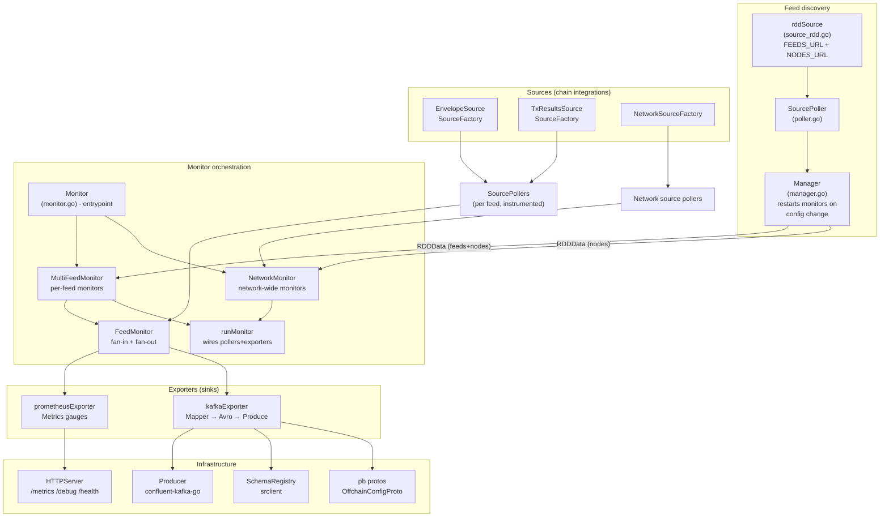
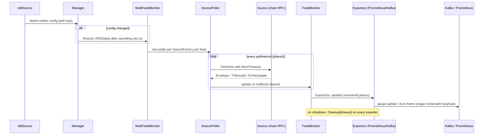
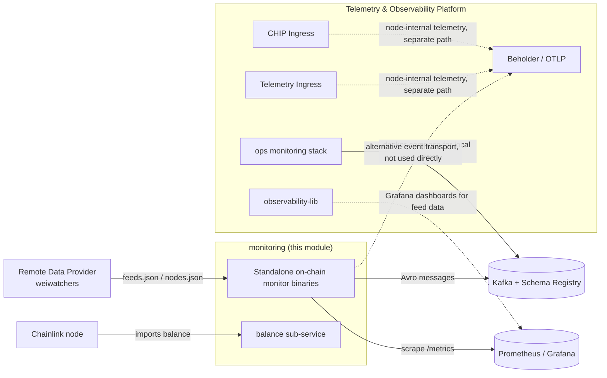

# Monitoring — On-Chain Monitor Framework

> **Module root:** `chainlink-common/pkg/monitoring` (standalone Go module, see [go.mod](../../repo/chainlink-common/pkg/monitoring/go.mod))
>
> Part of the [Telemetry & Observability Platform](../Telemetry___Observability_Platform.md) — see also [Beholder telemetry](beholder-telemetry.md), [CHIP Ingress](chip-ingress.md), [Telemetry Ingress](telemetry_ingress.md), [Ops Monitoring Stack](ops-monitoring-stack.md) and [Observability Lib](observability-lib.md).

### Documentation map

| Page | Focus |
|---|---|
| [monitoring_framework.md](monitoring/monitoring_framework.md) | `Monitor` entrypoint, feed/network monitor orchestration, config-change Manager |
| [monitoring_data_pipeline.md](monitoring/monitoring_data_pipeline.md) | `Source`/`Poller`/`Updater`/`Exporter` contracts, RDD feed discovery, `Envelope`/`TxResults` |
| [monitoring_exporters.md](monitoring/monitoring_exporters.md) | Kafka & Prometheus exporters, `Producer`, `SchemaRegistry`, metrics, HTTP endpoints |
| [monitoring_configuration.md](monitoring/monitoring_configuration.md) | Env-var `config.Parse`, `ChainConfig`/`FeedConfig`/`NodeConfig` extension points |
| [monitoring_wire_schemas.md](monitoring/monitoring_wire_schemas.md) | Avro DSL, Kafka payload mappings, OCR2 offchain-config protobufs |
| [monitoring_balance.md](monitoring/monitoring_balance.md) | In-node generic balance monitor with OTel gauges & `ExecutionMetadata` |
| [monitoring_testutils.md](monitoring/monitoring_testutils.md) | Fakes & generators for writing chain-integration tests |

## 1. Purpose

The `monitoring` module is a **chain-agnostic framework for building standalone on-chain monitors** (e.g. the `cmd/monitoring` binaries deployed per chain). An on-chain monitor continuously reads OCR/OCR2 aggregator state and transmission activity directly from chain RPC endpoints, and publishes the results to two kinds of sinks:

1. **Prometheus** — gauges/counters/histograms scraped via a built-in HTTP server (`/metrics`).
2. **Kafka** — Avro-encoded `transmission` and `config_set_simplified` messages, whose schemas are managed in a Confluent Schema Registry, for downstream data pipelines.

The framework is designed so that a **chain integration** only has to supply:

- a `ChainConfig` implementation (chain RPC endpoint, poll interval, network identity),
- `Source` factories that read chain-specific data (e.g. an `Envelope` source and a `TxResults` source),
- optional `NetworkSourceFactory` implementations for network-wide (non-feed) metrics,
- parsers for the RDD feeds & nodes JSON documents.

Everything else — polling lifecycle, feed discovery, hot-reconfiguration, fan-out to exporters, metric instrumentation, Avro encoding, Kafka delivery and HTTP endpoints — is provided by the framework.

The module also ships a smaller companion service, `balance`, a **generic chain-agnostic account-balance monitor** intended to run *inside* Chainlink nodes (rather than as a standalone binary), reporting keystore account balances as OpenTelemetry gauges.

### Module declaration

The module is declared in `chainlink-common/pkg/monitoring/go.mod` and pulls in:

- `confluent-kafka-go/v2` — Kafka producer backend,
- `linkedin/goavro/v2` + `riferrei/srclient` — Avro encoding and Confluent Schema Registry client,
- `prometheus/client_golang` — Prometheus metrics,
- `smartcontractkit/libocr` — OCR2 types (`types.Account`, `types.ContractConfig`, …),
- `go.opentelemetry.io/otel` — used by the `balance` sub-service.

## 2. Architecture

### 2.1 Component map

### 2.2 Data flow of a single update

### 2.3 Design principles

The package [README](../../repo/chainlink-common/pkg/monitoring/README.md) sets the ground rules that shape the architecture:

- **Abstractions only around IO** (`Source`, `Exporter`, `Producer`, `SchemaRegistry`, `HTTPServer`) composed via dependency injection in `NewMonitor()`.
- **Concurrency in one place**: `utils.Subprocesses` goroutine groups, `services.StopChan`/`StopRChan` contexts and buffered channels; pollers, monitors and the manager are the only concurrent components.
- **Clean shutdown**: every goroutine is owned by a context; `Monitor.Run()` handles `SIGINT`/`SIGTERM`, cancels the root context and waits for all subprocesses; exporter `Cleanup()` runs under a dedicated timeout.
- **Errors as interface**: `ErrNoUpdate` is a sentinel interpreted by pollers to mean "successful fetch, nothing new".
- **Benchmarks** (`manager_benchmark_test.go`, `multi_feed_monitor_benchmark_test.go`) act as regression references for performance changes.

## 3. Sub-modules

Detailed documentation for each sub-module lives under [`monitoring/`](monitoring/):

| Sub-module | Contents | Documentation |
|---|---|---|
| **Framework core** | `Monitor` entrypoint & dependency injection, `MultiFeedMonitor`, `NetworkMonitor`, `FeedMonitor`, `Manager`, `runMonitor` | [monitoring_framework.md](monitoring/monitoring_framework.md) |
| **Data pipeline** | `Source`/`SourceFactory`/`NetworkSourceFactory`, `Poller`/`Updater`, `Exporter` interfaces, RDD discovery source, `Envelope`/`TxResults` outputs, source instrumentation | [monitoring_data_pipeline.md](monitoring/monitoring_data_pipeline.md) |
| **Exporters & sinks** | Kafka exporter + `Pipeline`, Prometheus exporter, `Producer`, `SchemaRegistry`, `Metrics`/`ChainMetrics`, `HTTPServer` | [monitoring_exporters.md](monitoring/monitoring_exporters.md) |
| **Configuration** | `config.Config` env-var parsing/validation, `ChainConfig`, `FeedConfig`, `NodeConfig` interfaces and parsers | [monitoring_configuration.md](monitoring/monitoring_configuration.md) |
| **Wire schemas** | Avro schema DSL (`avro` package), Kafka mapping functions, OCR2 offchain-config protobufs | [monitoring_wire_schemas.md](monitoring/monitoring_wire_schemas.md) |
| **Balance monitor** | `balance` package: chain-agnostic keystore balance monitor with OTel gauges and `ExecutionMetadata` | [monitoring_balance.md](monitoring/monitoring_balance.md) |
| **Test utilities** | Fake sources/exporters/producers/schemas/pollers and data generators in `testutils.go` | [monitoring_testutils.md](monitoring/monitoring_testutils.md) |

## 4. Relationship to the rest of the platform

Key relationships:

- **Complementary telemetry paths.** The monitoring framework ships *feed-health* data from standalone monitor processes, whereas [Beholder](beholder-telemetry.md), [CHIP Ingress](chip-ingress.md) and [Telemetry Ingress](telemetry_ingress.md) move telemetry *from inside the node*. The two systems are independent: `pkg/monitoring` does not import Beholder or CHIP.
- **Kafka infrastructure.** The Kafka topics, SASL credentials and schema-registry URL consumed via `config.Config` are the same infrastructure that [ops-monitoring-stack](ops-monitoring-stack.md) (`chainlink-common/ops/monitoring/docker-compose.yml` — zookeeper, kafka, schema-registry with `full_transitive` compatibility) provides for local development, and that [observability-lib](observability-lib.md) builds Grafana assets on top of.
- **Foundation libraries.** The module builds on the shared [logger](../Shared_Foundation_Libraries___Domain_Types/logger.md), [services](../Shared_Foundation_Libraries___Domain_Types/services.md) (StopChan/tickers/subprocesses) and [settings](../Shared_Foundation_Libraries___Domain_Types/settings.md) libraries from [Shared Foundation Libraries](../Shared_Foundation_Libraries___Domain_Types.md); the `balance` service uses `core.Keystore` defined in [types-core](../Shared_Foundation_Libraries___Domain_Types/types-core.md) and reports via OpenTelemetry in the style of `ExecutionMetadata` (see [monitoring_balance.md](monitoring/monitoring_balance.md)).
- **Node integration.** `NewGenericBalanceMonitor` is wired into node application startup by the services assembled in [Node Application Core & Interfaces](../Node_Application_Core___Interfaces.md); node-side status reporting counterparts live in [Node Platform Services → node_status_reporter](../Node_Platform_Services/node_status_reporter.md).

## 5. Configuration surface (summary)

All runtime configuration arrives via environment variables parsed by `config.Parse()` (full reference in [monitoring_configuration.md](monitoring/monitoring_configuration.md)):

| Group | Variables | Used by |
|---|---|---|
| Kafka | `KAFKA_BROKERS`, `KAFKA_CLIENT_ID`, `KAFKA_SECURITY_PROTOCOL`, `KAFKA_SASL_*`, `KAFKA_TRANSMISSION_TOPIC`, `KAFKA_CONFIG_SET_SIMPLIFIED_TOPIC` | `Producer`, `KafkaExporterFactory` |
| Schema Registry | `SCHEMA_REGISTRY_URL`, `SCHEMA_REGISTRY_USERNAME`, `SCHEMA_REGISTRY_PASSWORD` | `SchemaRegistry.EnsureSchema` |
| Feeds | `FEEDS_URL`, `FEEDS_RDD_READ_TIMEOUT`, `FEEDS_RDD_POLL_INTERVAL`, `FEEDS_IGNORE_IDS`, `FEEDS_EXPORTER_CLEANUP_TIMEOUT` | `rddSource`, `Manager`, cleanup |
| Nodes | `NODES_URL` | `rddSource` |
| HTTP | `HTTP_ADDRESS` | `HTTPServer` (`/metrics`, `/debug`, `/health`) |

Chain-specific settings (RPC endpoint, poll interval, read timeout) are supplied in code by the per-chain `ChainConfig` implementation, not via env vars.

## 6. Where the schemas live

- **Avro wire schemas** for Kafka payloads are defined in Go (`schemas.go`: `TransmissionAvroSchema`, `ConfigSetSimplifiedAvroSchema`) using the `avro` DSL and registered/looked up against the Confluent Schema Registry at startup — see [monitoring_wire_schemas.md](monitoring/monitoring_wire_schemas.md).
- **Protobuf schemas** under `pb/` model the *on-chain* OCR2 offchain config blob (`OffchainConfigProto`) and the median plugin's config (`NumericalMedianConfigProto`); they are required to decode contract config before building `config_set_simplified` messages.

## 7. Further reading

- [Chainlink blueprints: monitoring architecture & integration tutorial](https://github.com/smartcontractkit/chainlink-blueprints/blob/main/monitoring/README.md) (referenced by the package README)
- Godoc: `github.com/smartcontractkit/chainlink-common/pkg/monitoring`
- [Test utilities reference](monitoring/monitoring_testutils.md) for writing chain integrations' tests
