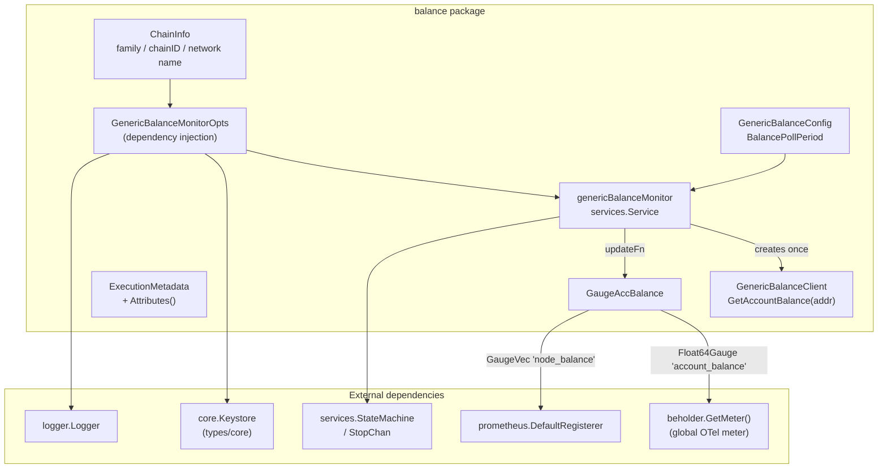
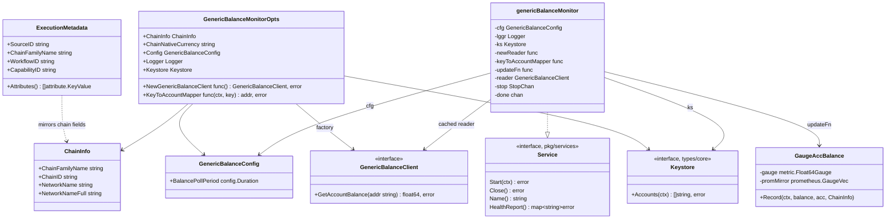
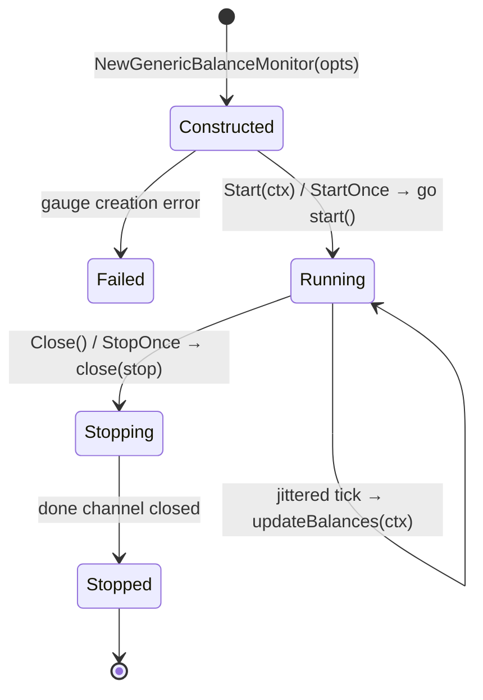
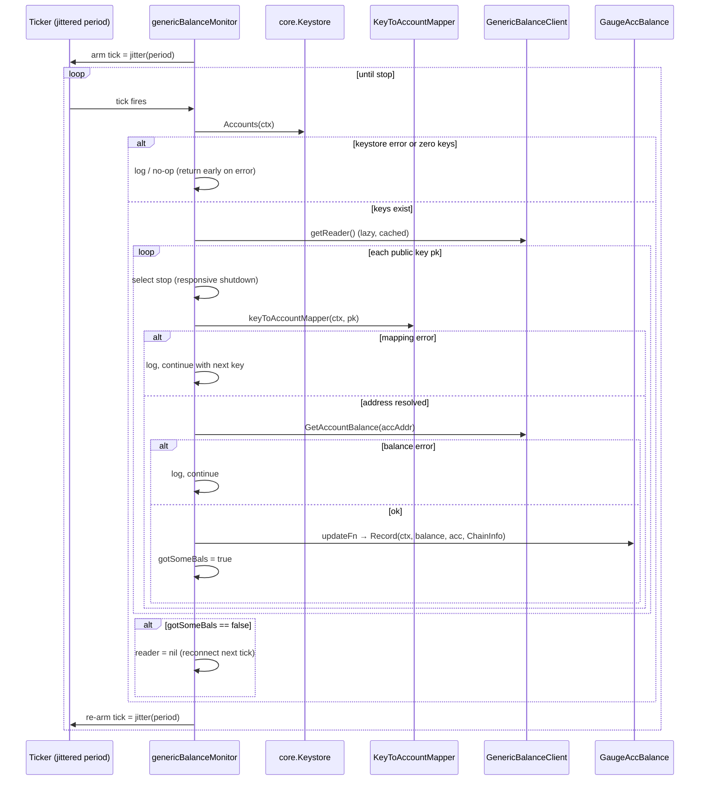
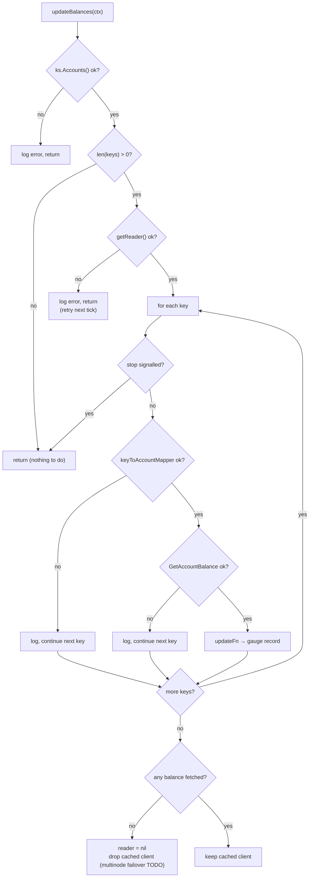
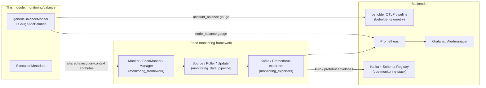

# Monitoring Balance (`chainlink-common/pkg/monitoring/balance`)

## 1. Introduction

The `balance` package implements a **generic, chain-agnostic account balance monitoring service**. It periodically polls the native-currency balance of every account held in a node's keystore and exposes the results as an **OpenTelemetry (OTel) gauge** with an additional **Prometheus mirror gauge** for Node Operator (NOP) scraping.

The package lives inside the `github.com/smartcontractkit/chainlink-common/pkg/monitoring` Go module ([`chainlink-common/pkg/monitoring/go.mod`](../../../repo/chainlink-common/pkg/monitoring/go.mod)) and is deliberately much simpler than the feed-oriented monitoring framework in the same module (see [monitoring_framework](monitoring_framework.md)): instead of the `Source → Exporter → Producer` pipeline with Kafka/Avro envelopes, the balance monitor is a **standalone lifecycle-managed `services.Service`** that records metrics directly via the [beholder](../beholder-telemetry.md) OTel meter.

| Aspect | Detail |
|---|---|
| Package | `chainlink-common/pkg/monitoring/balance` |
| Module | `github.com/smartcontractkit/chainlink-common/pkg/monitoring` |
| Exports | `NewGenericBalanceMonitor`, `GenericBalanceClient`, `GenericBalanceMonitorOpts`, `GenericBalanceConfig`, `ChainInfo`, `ExecutionMetadata`, `NewGaugeAccBalance`, `GaugeAccBalance` |
| Emission | OTel `Float64Gauge` `account_balance` (via beholder meter) + Prometheus `node_balance` `GaugeVec` |
| Dependency surface | `services` (lifecycle), `logger`, `config`, `timeutil`, `types/core.Keystore`, `beholder`, `go.opentelemetry.io/otel`, `prometheus/client_golang` |
| Extensibility | Chain families inject a balance client factory and an optional key→account mapper |

---

## 2. Architecture

The module follows an **inversion-of-control design**: the generic monitor owns *when* and *what* to report, while chain-specific runtimes own *how* to read balances and *how* to map keys to on-chain accounts.

### 2.1 Component architecture



### 2.2 Component reference

#### `NewGenericBalanceMonitor(opts GenericBalanceMonitorOpts) (services.Service, error)`

Factory that assembles the monitor:

1. Creates the `GaugeAccBalance` for the given native currency unit via `NewGaugeAccBalance(opts.ChainNativeCurrency)`. A failure here fails construction immediately (fail-fast).
2. Wraps the supplied logger as `"BalanceMonitor"` (`logger.Named`), which also becomes the service `Name()`.
3. Wires the `updateFn` closure that logs `"Account balance updated"` (unit, account, balance) and calls `gauge.Record(ctx, balance, acc, opts.ChainInfo)`. The closure is *overridable for testing*.
4. Returns the `genericBalanceMonitor` service with fresh `stop`/`done` channels.

#### `GenericBalanceMonitorOpts`

| Field | Purpose |
|---|---|
| `ChainInfo ChainInfo` | Chain dimension labels: `ChainFamilyName`, `ChainID`, `NetworkName`, `NetworkNameFull`. |
| `ChainNativeCurrency string` | Used as the OTel metric **unit** (e.g. wei-style unit for the chain's native token). |
| `Config GenericBalanceConfig` | `BalancePollPeriod config.Duration` — the polling interval. |
| `Logger logger.Logger` | Base logger; a named child (`"BalanceMonitor"`) is derived. See [logger](../../Shared_Foundation_Libraries___Domain_Types/logger.md). |
| `Keystore core.Keystore` | Source of truth for the accounts to watch (`Accounts(ctx)`). See [types-core plugin services](../../Shared_Foundation_Libraries___Domain_Types/types-core/types-core_plugin-services.md). |
| `NewGenericBalanceClient func() (GenericBalanceClient, error)` | **Chain-specific factory** producing a balance reader (RPC/chain service). Lazily invoked and cached. |
| `KeyToAccountMapper func(ctx, string) (string, error)` | Optional mapper from keystore public key to on-chain account address. If nil-equivalent behaviour is desired, inject an identity function. Required in practice — chains like Aptos derive addresses differently from raw keys (see code comment on key rotation). |

#### `GenericBalanceClient`

The single-method chain abstraction:

```go
GetAccountBalance(addr string) (float64, error)
```

Each chain family (EVM, Aptos, Solana, …) provides an implementation through the factory in `GenericBalanceMonitorOpts`. Implementations may themselves implement multi-node failover — the monitor treats a client that returns no balances as *suspicious* and discards it (see §5.3).

#### `ExecutionMetadata` (metadata.go)

A reusable execution-context struct capturing four dimensions used to enrich metrics:

* **Source** — `SourceID`
* **Chain** — `ChainFamilyName`, `ChainID`, `NetworkName`, `NetworkNameFull`
* **Workflow** — `WorkflowID`, `WorkflowOwner`, `WorkflowExecutionID`, `WorkflowName` (hex-encoded; decoded by `decodeWorkflowName`), `WorkflowDonID`, `WorkflowDonConfigVersion`, `ReferenceID`
* **Capability** — `CapabilityType`, `CapabilityID`, `CapabilityTimestampStart`, `CapabilityTimestampEmit`

Its `Attributes()` method converts the metadata into `[]attribute.KeyValue` for OTel metrics, applying these **cardinality controls**:

* Every string field is routed through `ValOrUnknown`, which substitutes `"unknown"` for empty values. This is required to avoid export errors when sending OTel metrics to Prometheus (see INFOPLAT-1349 referenced in code).
* Timestamps are **intentionally excluded** (high cardinality).
* A short-form `workflow_execution_id_short` attribute (first 3 chars via `ValShortOrUnknown`, ≈4,096 possibilities — "mid-high" cardinality) exists but is **disabled behind a TODO** until PromQL alerts are validated against it.
* A `TODO` notes the struct should eventually be refactored into a shared proto (aligning with the shared monitoring execution-context schema in [capabilities_shared_libs_monitoring](../../Workflow___Capability_Runtime_(CRE_Engine)/capabilities_shared_libs/capabilities_shared_libs_monitoring.md)).

#### Metrics (`metrics.go`)

`GaugeAccBalance` performs **dual emission**:

| Metric | Backend | Name | Labels / unit | Notes |
|---|---|---|---|---|
| OTel gauge | `beholder.GetMeter().Float64Gauge(...)` | `account_balance` | unit = chain native currency; description `"Balance for configured WT account"` | Flows through the beholder OTLP pipeline (see [beholder-telemetry](../beholder-telemetry.md)). |
| Prometheus mirror | `prometheus.NewGaugeVec` | `node_balance` | labels: `account`, `chainID`, `chainFamily`; help `"Account balances"` | Registered on `prometheus.DefaultRegisterer` for direct scraping by NOPs. |

`nodeBalanceGauge()` uses a `sync.Once` singleton and tolerates `prometheus.AlreadyRegisteredError` by **reusing the existing collector**, so multiple monitors (e.g. multiple chains in one process) can share the metric safely. Registration errors are captured and returned on subsequent calls.

---

## 3. Type relationships



> `ExecutionMetadata` deliberately duplicates the `ChainInfo` field set so chain metadata can be attached both to balance gauges (`ChainInfo`) and to workflow/capability-spanning telemetry (`Attributes()`).

---

## 4. Runtime behaviour

### 4.1 Service lifecycle

The monitor embeds `services.StateMachine` and follows the standard start-once/stop-once contract:



* `Name()` returns the derived logger name (`"BalanceMonitor"`).
* `HealthReport()` returns `{Name(): Healthy()}` — consumed by the node's health endpoints.
* `Close()` closes the stop channel and **blocks until the monitor goroutine exits** (`<-m.done`), guaranteeing no in-flight writes after return.

### 4.2 Poll cycle (sequence)

The `start()` goroutine uses a **jittered ticker** — every tick is `timeutil.JitterPct(0.1).Apply(period)` (±10 % of `BalancePollPeriod`) — including the *initial* delay, which spreads poll storms across a fleet of nodes.



### 4.3 Error handling and resilience decisions



Key resilience properties:

1. **Per-account isolation** — one failing account or RPC error never aborts the whole sweep; errors are logged (`Errorw`) and iteration continues.
2. **Responsive shutdown** — the per-key loop re-checks the stop channel each iteration because `GetAccountBalance` may block on slow chains.
3. **Client rejuvenation** — if *no* account produced a balance, the cached client is dropped so the next tick constructs a fresh one via the factory. The code marks this as groundwork for multi-node client rotation.
4. **Failure-tolerant metrics** — the Prometheus mirror tolerates duplicate registration (multiple monitors in one process reuse the same `GaugeVec`).

### 4.4 Cardinality management

Because these metrics feed Prometheus, label cardinality is actively bounded:

* `ValOrUnknown` guarantees non-empty label values (empty labels break OTel→Prometheus export).
* `workflow_execution_id` is *not* exported directly; only a disabled short-form variant (`ValShortOrUnknown`, 3 hex chars) is prepared.
* Capability timestamps are excluded from `Attributes()`.
* Balance gauge labels are limited to `account` + chain dimensions from `ChainInfo`.

---

## 5. Integration guide

Chain runtimes wire the monitor by supplying a chain-family client factory and mapper, then adding the returned service to their service graph:

```go
mon, err := balance.NewGenericBalanceMonitor(balance.GenericBalanceMonitorOpts{
    ChainInfo: balance.ChainInfo{
        ChainFamilyName: "evm",
        ChainID:         chainID.String(),
        NetworkName:     network,
        NetworkNameFull: networkFull,
    },
    ChainNativeCurrency: "wei",
    Config: balance.GenericBalanceConfig{
        BalancePollPeriod: config.Duration{Duration: time.Minute},
    },
    Logger:   lggr,
    Keystore: ks, // core.Keystore from the shared types (see types-core docs)
    NewGenericBalanceClient: func() (balance.GenericBalanceClient, error) {
        return newEVMBalanceClient(...) // chain-specific RPC reader
    },
    KeyToAccountMapper: keystore.EVMAddressFromKey, // or identity-like mapper
})
// register `mon` alongside the node's other services; its HealthReport()
// participates in node health reporting.
```

Notes for implementers:

* The OTel gauge flows through the **global beholder meter**, so the process must have beholder's global OTel providers initialised (see [beholder-telemetry](../beholder-telemetry.md)).
* The Prometheus `node_balance` gauge registers on the **default** registry; it is intended to be scraped from the node's metrics endpoint by the NOP's Prometheus stack (see §6).
* `KeyToAccountMapper` is the extension point for chains where addresses are not trivially derivable from the public key (e.g. Aptos account derivation). The code notes that if key rotation is introduced, the keystore should store addresses explicitly instead.

---

## 6. Position in the observability platform

The balance monitor is a leaf emitter within the [Telemetry & Observability Platform](../../Telemetry___Observability_Platform.md) and coexists with — but does **not** use — the feed-monitoring pipeline:



* **Unlike** the feed monitors ([monitoring_framework](monitoring_framework.md), [monitoring_data_pipeline](monitoring_data_pipeline.md), [monitoring_exporters](monitoring_exporters.md)), the balance monitor does not use `Updater`, `Exporter`/`ExporterFactory`, Kafka producers, or schema registries. It is a direct gauge emitter, appropriate for low-frequency, per-node operational signals rather than per-feed transmissions.
* **Configuration** for the monitoring stack (feeds, nodes, Kafka, schema registry) that the feed framework consumes lives in [monitoring_configuration](monitoring_configuration.md) and is unrelated to `GenericBalanceConfig`, which is injected programmatically via `GenericBalanceMonitorOpts`.
* The reference backend stack — Kafka, Zookeeper and Schema Registry for the feed pipeline — is defined in [`chainlink-common/ops/monitoring/docker-compose.yml`](../../../repo/chainlink-common/ops/monitoring/docker-compose.yml); the Prometheus/Grafana/Alertmanager stack that scrapes the `node_balance` mirror is defined in [`chainlink/tools/docker/docker-compose.observability.yaml`](../../../repo/chainlink/tools/docker/docker-compose.observability.yaml) (services `prometheus`, `grafana`, `alertmanager`). See [ops-monitoring-stack](../ops-monitoring-stack.md).

---

## 7. Build and dependency notes

* The module is governed by [`chainlink-common/pkg/monitoring/go.mod`](../../../repo/chainlink-common/pkg/monitoring/go.mod), pinning `go.opentelemetry.io/otel` (+`metric`) and `github.com/prometheus/client_golang` — the two metric backends used here — alongside `libocr`, `goavro` and `confluent-kafka-go` (the latter two are used by the sibling feed framework, not by this package).
* `config.Duration` comes from the shared configuration package documented in [config-validation](../../Shared_Foundation_Libraries___Domain_Types/config-validation.md) family pages; the `services` lifecycle primitives (`StateMachine`, `StopChan`, `Service`) are the node-standard service contracts.

## 8. Testing notes

* `updateFn` is explicitly overridable, so tests can intercept balance recording without touching OTel/Prometheus backends.
* The lazy `getReader()` plus factory indirection makes it easy to inject fake `GenericBalanceClient` implementations, including failing clients to exercise the reader-reset path (§4.3).
* `GaugeAccBalance` construction validates both backends up front (`NewGaugeAccBalance` returns an error if either the OTel gauge cannot be created or the Prometheus vector cannot be registered).

## 9. Related documentation

* Parent module: [monitoring](../monitoring.md)
* Framework siblings: [monitoring_framework](monitoring_framework.md) · [monitoring_data_pipeline](monitoring_data_pipeline.md) · [monitoring_exporters](monitoring_exporters.md) · [monitoring_configuration](monitoring_configuration.md) · [monitoring_wire_schemas](monitoring_wire_schemas.md) · [monitoring_testutils](monitoring_testutils.md)
* Telemetry transport: [beholder-telemetry](../beholder-telemetry.md) · [chip-ingress](../chip-ingress.md) · [telemetry_ingress](../telemetry_ingress.md)
* Shared types: [types-core](../../Shared_Foundation_Libraries___Domain_Types/types-core.md) (`Keystore`) · [logger](../../Shared_Foundation_Libraries___Domain_Types/logger.md)
* Operations: [ops-monitoring-stack](../ops-monitoring-stack.md)
