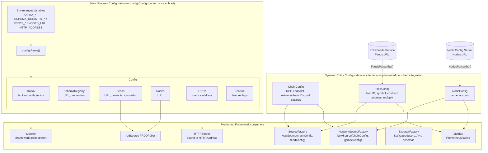
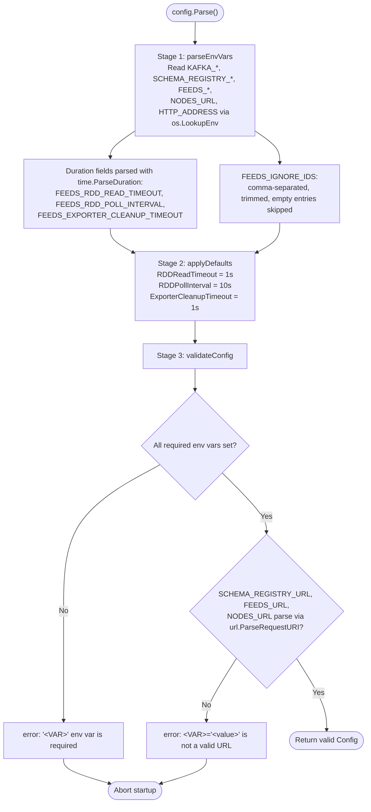
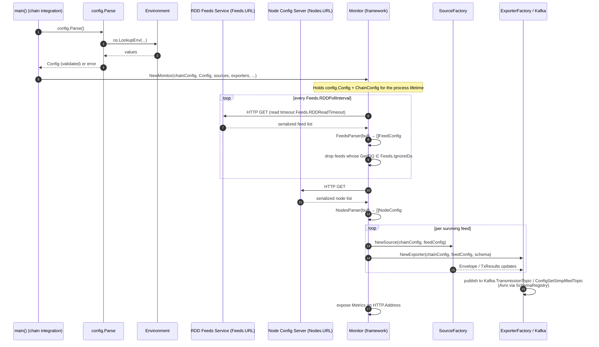
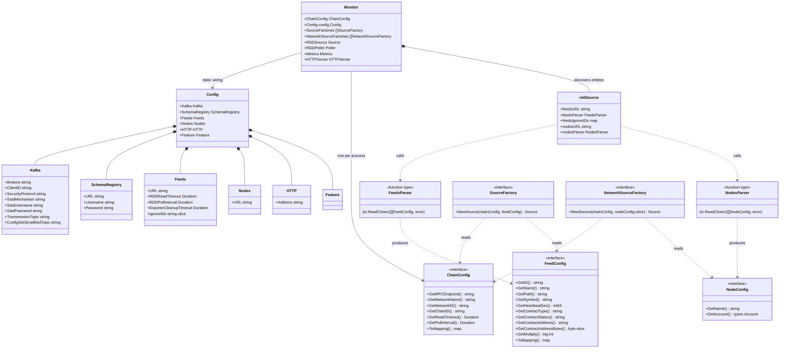

# Monitoring Configuration

> **Module path:** `chainlink-common/pkg/monitoring/config`, `chainlink-common/pkg/monitoring/config_chain.go`, `config_node.go`, `config_feed.go`
> **Parent page:** [monitoring](../monitoring.md) · **Platform:** [Telemetry & Observability Platform](../../Telemetry___Observability_Platform.md)

## Introduction

The **monitoring_configuration** module defines *how the Offchain Reporting monitoring binary discovers what to monitor and where to deliver results*. It is the entry point of every monitoring process and separates concerns into two distinct configuration layers:

1. **Static process configuration** (`config.Config`) — infrastructure wiring (Kafka, Schema Registry, HTTP server, RDD endpoints) supplied once at process start via environment variables and parsed by `config.Parse()`.
2. **Dynamic entity configuration** (`ChainConfig`, `FeedConfig`, `NodeConfig` interfaces) — chain-, feed-, and node-operator-specific data discovered at runtime from external sources (the RDD feeds service and node configuration servers) and abstracted behind chain-integration-provided interfaces.

This configuration module is consumed by every other part of the monitoring framework: the [monitoring framework](monitoring_framework.md) orchestrators (`Monitor`, `MultiFeedMonitor`, `Manager`), the [data pipeline](monitoring_data_pipeline.md) (`SourceFactory`, `Poller`), the [exporters](monitoring_exporters.md), and the [wire schemas](monitoring_wire_schemas.md) used for Avro serialization.

---

## Architecture Overview

The module exposes two complementary configuration models. The static model is a concrete struct parsed at boot; the dynamic models are **interfaces implemented by each chain integration**, allowing chains to add extra fields (e.g., Solana program IDs, EVM proxy addresses) while satisfying the subset the framework requires.

The monitoring binary is built as its own Go module (`chainlink-common/pkg/monitoring/go.mod`) with direct dependencies on `confluent-kafka-go` (Kafka producers), `goavro`/`srclient` (Avro + Confluent Schema Registry), and `prometheus/client_golang` (metrics) — mirroring exactly the sections of `config.Config`.

---

## Component Reference

### 1. Static Process Configuration — `config.Config`

Defined in `chainlink-common/pkg/monitoring/config/types.go`. The package doc states its contract plainly: *"parses flags, environment variables and json object to build a Config object that's used throughout the monitor."* All fields are plain data (no behavior), populated exclusively by `Parse()`.

| Section | Fields | Purpose |
|---|---|---|
| `Kafka` | `Brokers`, `ClientID`, `SecurityProtocol`, `SaslMechanism`, `SaslUsername`, `SaslPassword`, `TransmissionTopic`, `ConfigSetSimplifiedTopic` | Connection and authentication for the Kafka cluster, plus the two output topics for transmission envelopes and simplified config sets (see [monitoring_exporters](monitoring_exporters.md)). |
| `SchemaRegistry` | `URL`, `Username`, `Password` | Confluent Schema Registry access used to register/resolve Avro schemas (see [monitoring_wire_schemas](monitoring_wire_schemas.md)). |
| `Feeds` | `URL`, `RDDReadTimeout`, `RDDPollInterval`, `ExporterCleanupTimeout`, `IgnoreIDs` | Location of the RDD (feeds) service, HTTP read and polling cadence, exporter teardown timeout, and the **ignore-list**: feed IDs present in the RDD that must *not* be monitored. Ignore IDs are matched against `FeedConfig.GetID()`; a match causes the feed to be skipped. |
| `Nodes` | `URL` | Location of the node-operator configuration server (e.g. weiwatchers.com). |
| `HTTP` | `Address` | Bind address for the Prometheus scrape endpoint exposed by the metrics service. |
| `Feature` | *(empty, extensible)* | Reserved carrier for temporary feature flags on the binary. |

### 2. Parsing Pipeline — `config.Parse`

Defined in `chainlink-common/pkg/monitoring/config/parse.go`. `Parse()` is the single entry point executed once at process start; it runs three deterministic stages and returns either a fully-validated `Config` or an error identifying the offending environment variable.

**Behavioral details:**

- **Presence-based assignment.** `parseEnvVars` only assigns a field when the corresponding `os.LookupEnv` returns `isPresent == true`. Unset optional variables leave the field at its zero value, which the defaults stage then fills for the three durations.
- **Required variables** (validation fails the process if empty): `KAFKA_BROKERS`, `KAFKA_CLIENT_ID`, `KAFKA_SECURITY_PROTOCOL`, `KAFKA_SASL_MECHANISM`, `KAFKA_TRANSMISSION_TOPIC`, `KAFKA_CONFIG_SET_SIMPLIFIED_TOPIC`, `SCHEMA_REGISTRY_URL`, `FEEDS_URL`, `NODES_URL`, `HTTP_ADDRESS`. Notably, SASL credentials (`KAFKA_SASL_USERNAME` / `KAFKA_SASL_PASSWORD`) and Schema Registry credentials are **optional** — supporting clusters that do not use SASL authentication.
- **Duration parsing errors** wrap `time.ParseDuration` failures with a doc link (`https://pkg.go.dev/time#ParseDuration`) so operators can self-diagnose format mistakes (e.g. `FEEDS_RDD_POLL_INTERVAL=10` instead of `10s`).
- **Fail-fast philosophy.** There are no retry or partial-startup semantics: an invalid configuration prevents the monitor from starting at all, which keeps misconfigured deployments from publishing bad telemetry.

#### Environment Variable Reference

| Env Var | Target Field | Required | Default | Validation / Notes |
|---|---|:---:|---|---|
| `KAFKA_BROKERS` | `Kafka.Brokers` | ✅ | — | Comma-separated broker list |
| `KAFKA_CLIENT_ID` | `Kafka.ClientID` | ✅ | — | |
| `KAFKA_SECURITY_PROTOCOL` | `Kafka.SecurityProtocol` | ✅ | — | e.g. `PLAINTEXT`, `SASL_SSL` |
| `KAFKA_SASL_MECHANISM` | `Kafka.SaslMechanism` | ✅ | — | e.g. `PLAIN` |
| `KAFKA_SASL_USERNAME` | `Kafka.SaslUsername` | ❌ | — | Only needed for SASL clusters |
| `KAFKA_SASL_PASSWORD` | `Kafka.SaslPassword` | ❌ | — | Only needed for SASL clusters |
| `KAFKA_TRANSMISSION_TOPIC` | `Kafka.TransmissionTopic` | ✅ | — | Topic for transmission envelopes |
| `KAFKA_CONFIG_SET_SIMPLIFIED_TOPIC` | `Kafka.ConfigSetSimplifiedTopic` | ✅ | — | Topic for simplified config sets |
| `SCHEMA_REGISTRY_URL` | `SchemaRegistry.URL` | ✅ | — | Must parse as a valid URI |
| `SCHEMA_REGISTRY_USERNAME` | `SchemaRegistry.Username` | ❌ | — | |
| `SCHEMA_REGISTRY_PASSWORD` | `SchemaRegistry.Password` | ❌ | — | |
| `FEEDS_URL` | `Feeds.URL` | ✅ | — | RDD feeds service; must parse as a valid URI |
| `FEEDS_RDD_READ_TIMEOUT` | `Feeds.RDDReadTimeout` | ❌ | `1s` | `time.ParseDuration` format |
| `FEEDS_RDD_POLL_INTERVAL` | `Feeds.RDDPollInterval` | ❌ | `10s` | `time.ParseDuration` format |
| `FEEDS_EXPORTER_CLEANUP_TIMEOUT` | `Feeds.ExporterCleanupTimeout` | ❌ | `1s` | `time.ParseDuration` format |
| `FEEDS_IGNORE_IDS` | `Feeds.IgnoreIDs` | ❌ | — | Comma-separated; matched against `FeedConfig.GetID()`; matching feeds are skipped |
| `NODES_URL` | `Nodes.URL` | ✅ | — | Node config server; must parse as a valid URI |
| `HTTP_ADDRESS` | `HTTP.Address` | ✅ | — | Prometheus scrape endpoint bind address |

### 3. Dynamic Configuration Interfaces

These three interfaces live in the root `monitoring` package and form the contract between the framework and chain integrations. Each is deliberately minimal — implementations may add arbitrary extra fields, but the listed accessors are what the framework requires.

#### `ChainConfig` (`config_chain.go`)

Chain-specific configuration supplied by the integration at startup (not fetched from a server). Accessors:

| Method | Consumed by |
|---|---|
| `GetRPCEndpoint()` | Chain sources reading on-chain state |
| `GetNetworkName()`, `GetNetworkID()`, `GetChainID()` | Prometheus label dimensions on every metric; embedded in Kafka messages |
| `GetReadTimeout()`, `GetPollInterval()` | Polling cadence of chain sources — the dynamic counterpart to the static `Feeds.RDD*` durations |
| `ToMapping()` | Serialized into Avro messages; *"Check the latest version of the transmission schema to see what the exact return format should be"* (see [monitoring_wire_schemas](monitoring_wire_schemas.md)) |

#### `FeedConfig` (`config_feed.go`)

Per-feed configuration **deserialized from the RDD** via the `FeedsParser` function type (`func(buf io.ReadCloser) ([]FeedConfig, error)`). Accessors:

- **Identity:** `GetID()` (also the key matched against `Feeds.IgnoreIDs`), `GetName()`, `GetPath()`, `GetSymbol()`.
- **Contract metadata:** `GetContractType()`, `GetContractStatus()`, `GetContractAddress()`, `GetContractAddressBytes()`.
- **Scheduling:** `GetHeartbeatSec()`.
- **`GetMultiply()`** (`*big.Int`) — a documented misnomer kept for historical reasons: it is used as a **divisor** to convert big on-chain integers (balances, observations) into Prometheus-friendly `float64` values.
- **`ToMapping()`** — feed attributes encoded into Kafka messages.

#### `NodeConfig` (`config_node.go`)

Node-operator configuration **deserialized from the node configuration server** via the `NodesParser` function type (`func(buf io.ReadCloser) ([]NodeConfig, error)`). Accessors: `GetName()` and `GetAccount()` (`libocr` `types.Account`). Node configs are consumed at the *network* level — `NetworkSourceFactory.NewSource(chainConfig, []NodeConfig)` — and their name/account appear as Prometheus label dimensions (`oracleName`, `sender`).

---

## Data Flow

The sequence below shows how the two configuration layers combine into a running monitor.

Key structural properties of this flow:

- **One-time static, repeated dynamic.** `config.Config` is parsed once; feed and node configs are re-fetched on every `Feeds.RDDPollInterval` tick so feed additions/removals are picked up without a restart. Feed lifecycle churn (create/destroy exporters and metrics) is bounded by `Feeds.ExporterCleanupTimeout`.
- **Ignore-list filtering happens post-parse.** `Feeds.IgnoreIDs` is applied after `FeedsParser` succeeds, so a bad ID in the list never corrupts parsing — it simply excludes the matching feed.
- **Factory injection.** Neither `SourceFactory` nor `ExporterFactory` see `config.Config` directly; they receive the already-extracted `ChainConfig`/`FeedConfig`/`[]NodeConfig` objects. This keeps the [data pipeline](monitoring_data_pipeline.md) and [exporters](monitoring_exporters.md) decoupled from the environment.

---

## Component Interaction (Type Dependencies)

---

## Integration With the Rest of the Platform

| Consumer | How it uses this module | Details |
|---|---|---|
| [monitoring_framework](monitoring_framework.md) | `Monitor`, `FeedMonitor`, `MultiFeedMonitor`, `Manager` hold `config.Config` and one `ChainConfig`; the framework translates feed lists into per-feed monitor loops and wires the `Manager` HTTP handler into `HTTP.Address`. | Orchestration & lifecycle |
| [monitoring_data_pipeline](monitoring_data_pipeline.md) | `SourceFactory`/`NetworkSourceFactory` receive `ChainConfig`+`FeedConfig`/`NodeConfig`; `rddSource` consumes `Feeds.URL`, `Feeds.RDDReadTimeout`, `Feeds.RDDPollInterval`, `Feeds.IgnoreIDs`, `Nodes.URL`, and the parser function types. | Sources & pollers |
| [monitoring_exporters](monitoring_exporters.md) | Kafka producer configured from `Kafka.*`; Schema Registry client from `SchemaRegistry.*`; Prometheus metrics/HTTP server from `HTTP.Address`. Cleanup cadence from `Feeds.ExporterCleanupTimeout`. | Producers & metrics |
| [monitoring_wire_schemas](monitoring_wire_schemas.md) | `FeedConfig.ToMapping()` and `ChainConfig.ToMapping()` supply per-entity attributes embedded in Avro transmission and config-set messages. | Avro schemas |
| [monitoring_balance](monitoring_balance.md) | Balance monitors use `FeedConfig.GetMultiply()` to scale on-chain big-integer balances into `float64` gauge values. | Balance monitoring |
| [monitoring_testutils](monitoring_testutils.md) | Provides `fakeFeedsParser`, `fakeNodesParser`, and fake config generators standing in for `FeedsParser`/`NodesParser` in tests. | Test doubles |

For neighboring platform concerns this module does **not** cover — in-process OTLP telemetry ([beholder-telemetry](../beholder-telemetry.md)), the CHIP Ingress gRPC transport ([chip-ingress](../chip-ingress.md)), node-side telemetry egress ([telemetry_ingress](../telemetry_ingress.md)), and Grafana dashboard provisioning ([observability-lib](../observability-lib.md)) — see their respective pages.

---

## Deployment Context

The monitoring binary is deployed against the Confluent stack provisioned in [`chainlink-common/ops/monitoring/docker-compose.yml`](../ops-monitoring-stack.md), which runs **zookeeper**, **kafka**, and **schema-registry** services. The `KAFKA_*` and `SCHEMA_REGISTRY_*` environment variables consumed by `config.Parse()` correspond directly to this stack: the compose file advertises Kafka on `localhost:29092` (`PLAINTEXT://kafka:9092` internally) and Schema Registry on `http://schema-registry:8989`, so a locally deployed monitor would typically set `KAFKA_BROKERS=localhost:29092` and `SCHEMA_REGISTRY_URL=http://localhost:8989`. The compose stack enforces `full_transitive` schema compatibility, which the `SchemaRegistry` credentials in this module authenticate against when exporters register new schema versions.

Because the `monitoring` module carries its own `go.mod` (separate from the main `chainlink` module), the binary is built and released independently; its dependency set (`confluent-kafka-go`, `goavro`, `srclient`, `prometheus/client_golang`, `libocr`) is the direct consequence of the configuration surface defined here.

---

## Extension Guide: Adding a New Chain Integration

A new chain integration (like the existing OCR2 monitoring used for median feeds) plugs into this module in three steps:

1. **Implement `ChainConfig`** for the chain (RPC endpoint, network/chain identifiers, read timeout, poll interval, `ToMapping()` consistent with the current transmission schema).
2. **Implement `FeedConfig` and provide a `FeedsParser`** that deserializes the chain's RDD feed JSON into the interface; include chain-specific extras (e.g., feed proxy addresses) as additional fields.
3. **Implement `NodeConfig` and provide a `NodesParser`** for the chain's node-operator listing, exposing name and signing account.

No changes to `config.Config` or `Parse()` are needed unless the integration requires *infrastructure* (not chain-level) settings — in that case, add the field to `types.go`, read the corresponding env var in `parseEnvVars`, apply any default in `applyDefaults`, and add it to the required-set or URL validation in `validateConfig` as appropriate. Local testing can lean on the prebuilt fakes in [monitoring_testutils](monitoring_testutils.md) and the Confluent stack from the compose file above.

---

## References

- Source: `chainlink-common/pkg/monitoring/config/types.go`, `chainlink-common/pkg/monitoring/config/parse.go`, `chainlink-common/pkg/monitoring/config_chain.go`, `chainlink-common/pkg/monitoring/config_node.go`, `chainlink-common/pkg/monitoring/config_feed.go`
- Module manifest: `chainlink-common/pkg/monitoring/go.mod`
- Deployment artifact: `chainlink-common/ops/monitoring/docker-compose.yml`
- Related pages: [monitoring](../monitoring.md) · [monitoring_framework](monitoring_framework.md) · [monitoring_data_pipeline](monitoring_data_pipeline.md) · [monitoring_exporters](monitoring_exporters.md) · [monitoring_wire_schemas](monitoring_wire_schemas.md) · [monitoring_balance](monitoring_balance.md) · [monitoring_testutils](monitoring_testutils.md) · [ops-monitoring-stack](../ops-monitoring-stack.md)
