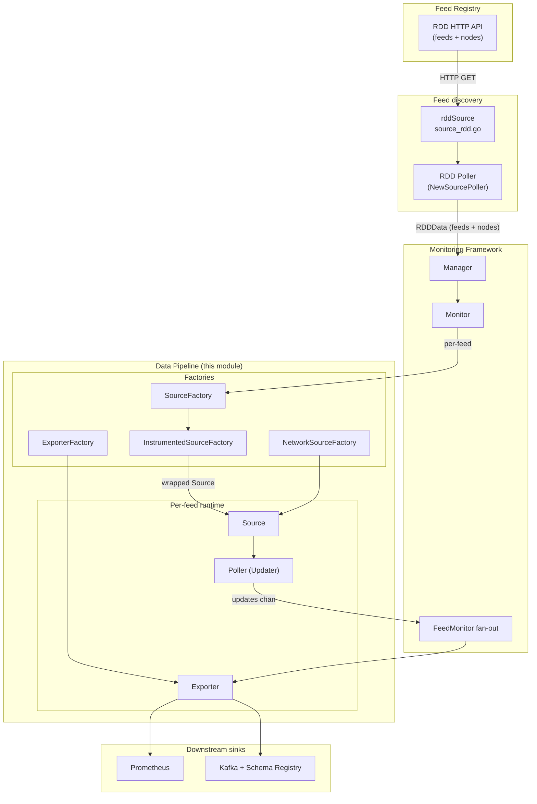
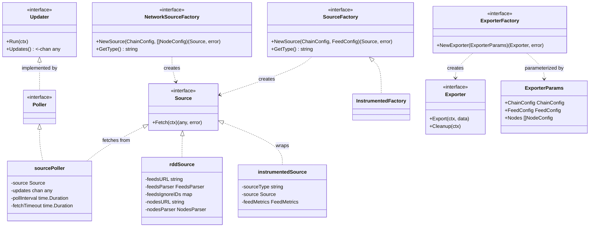
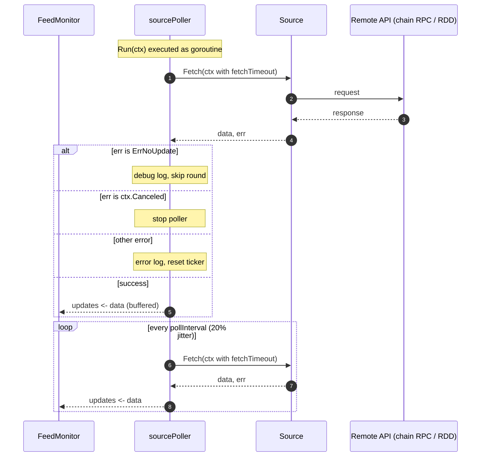
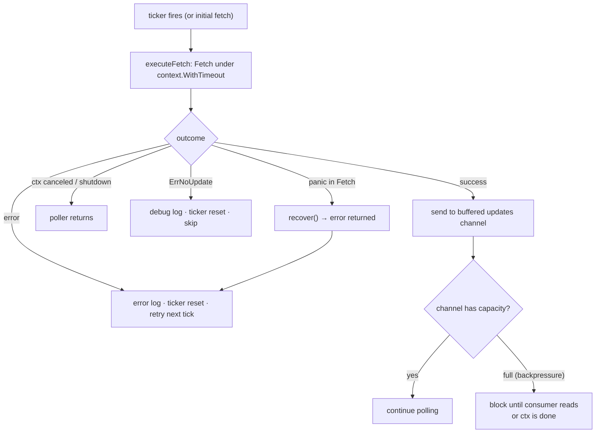
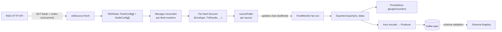

# Monitoring Data Pipeline

## Overview

The **monitoring_data_pipeline** module (`chainlink-common/pkg/monitoring`) defines the transport-agnostic heart of the Chainlink *monitoring daemon*: a small set of composable interfaces and concrete implementations that

1. **discover** what to monitor (the feed registry — RDD),
2. **fetch** data from remote APIs (typically chain RPC endpoints) on a periodic schedule,
3. **forward** each update to one or more **exporters** (Prometheus metrics, Kafka/Avro producers).

Everything in this module is deliberately chain-agnostic: chain integrations plug in by implementing the `Source` / `SourceFactory` / `Exporter` interfaces, while the scheduling, timeout, panic-recovery and fan-out plumbing is implemented once, here.

This page documents the pipeline primitives (`source.go`, `poller.go`, `updater.go`, `exporter.go`, `source_rdd.go`, `source_outputs.go`, `source_instrumented.go`). The surrounding layers are documented separately:

| Concern | Documentation |
| --- | --- |
| Monitoring daemon lifecycle (`Monitor`, `FeedMonitor`, `MultiFeedMonitor`, `Manager`) | [Monitoring Framework](monitoring_framework.md) |
| Configuration inputs (`ChainConfig`, `FeedConfig`, `NodeConfig`, parsers) | [Monitoring Configuration](monitoring_configuration.md) |
| Concrete exporters (Kafka/Avro producer, Prometheus, schema registry, HTTP server) | [Monitoring Exporters](monitoring_exporters.md) |
| Wire schemas (Avro/protobuf mappings) | [Monitoring Wire Schemas](monitoring_wire_schemas.md) |
| A concrete consumer of the pipeline (balance monitoring) | [Monitoring Balance](monitoring_balance.md) |
| Fake sources/exporters for testing | [Monitoring Test Utils](monitoring_testutils.md) |
| Sibling telemetry stacks (in-node OTEL/Beholder, CHIP Ingress) | [Beholder Telemetry](../beholder-telemetry.md), [CHIP Ingress](../chip-ingress.md) |
| Ops deployment of Kafka + Schema Registry | [Ops Monitoring Stack](../ops-monitoring-stack.md) |

> **Note:** this module is *not* the on-chain execution pipeline used by oracle jobs (see [Pipeline Execution Engine](../../Oracle_Engines___Data_Pipelines/pipeline.md)); it is the off-chain observability data pipeline.

---

## Architecture

### Component topology

The `Monitor` struct ([Monitoring Framework](monitoring_framework.md)) wires the pipeline together. Feed discovery flows through an RDD source + poller; each discovered feed receives its own set of sources, pollers and exporters.



### Interface model

The pipeline is built on three small interfaces. `Updater` is the producer side of every stage; `Poller` is its polling implementation; `Exporter` is the consumer side.



Key contracts enforced by the interfaces:

| Interface | Contract |
| --- | --- |
| `Source` | `Fetch` **must be thread-safe**; there is no ordering guarantee across concurrent calls on the same instance. |
| `Updater` | `Run` blocks and must be executed as a goroutine; `Updates` returns a channel that must **never be closed** by the consumer and must be read in a `select` with the same context passed to `Run`. |
| `Exporter` | `Export` may be executed **out of order** and must be thread-safe; `Cleanup` runs exactly once when the monitor for that feed terminates. |
| `SourceFactory` / `NetworkSourceFactory` | `GetType` returns a namespace used to label all sources produced by the factory (used by instrumentation and logging). |

The only sentinel error in the pipeline is [`ErrNoUpdate`](#error-handling-and-resilience): a successful `Fetch` that produced no new value. Pollers treat it as *not-an-error*.

---

## The Poller: scheduled fetching

`NewSourcePoller(source, log, pollInterval, fetchTimeout, bufferCapacity)` builds a `Poller` that periodically invokes the wrapped source's `Fetch`. Each poll:

1. runs `Fetch` under a `context.WithTimeout(ctx, fetchTimeout)`,
2. **recovers panics** from `Fetch` and converts them into returned errors so the daemon survives faulty sources,
3. sends successful values into a buffered channel (`bufferCapacity`) surfaced via `Updates()`,
4. schedules the next round with a jittered ticker (`Initial` jitter of 10 % and per-tick jitter of 20 %) to avoid thundering herds across many pollers.

An initial fetch is performed immediately at start-up before the ticker loop begins.



Fetch-outcome handling in detail:



Because `updates` is buffered but back-pressure-aware (the send is inside a `select` with `ctx.Done()`), a slow exporter can never drop or duplicate updates; it merely delays the poller.

---

## Sources

### Generic source factories

Chain integrations provide source *factories* rather than sources directly, because one source instance exists per monitored feed (or per network):

- `SourceFactory` — per-feed sources: receives the `ChainConfig` and `FeedConfig` for the feed being tracked. See [Monitoring Configuration](monitoring_configuration.md) for these interfaces.
- `NetworkSourceFactory` — network-level sources: receives the `ChainConfig` and the full list of node `NodeConfig`s. Used for cluster-wide (not per-feed) metrics such as node balances; see [Monitoring Balance](monitoring_balance.md).

### Feed discovery: `rddSource`

`NewRDDSource(feedsURL, feedsParser, feedsIgnoreIDs, nodesURL, nodesParser, log)` returns a `Source` whose `Fetch` produces an `RDDData{Feeds []FeedConfig, Nodes []NodeConfig}` payload. This is the only non-chain source shipped in the module and acts as the *monitor list generator*:

- Fetches the **feeds** and **nodes** endpoints **concurrently** (via `utils.Subprocesses`) and joins errors with `errors.Join`, so a failure in one endpoint does not mask data from the other.
- Filters out feeds with `contract_status == "dead"` and feeds whose ID appears in the `FEEDS_IGNORE_IDS` environment variable.
- Parsing is delegated to the pluggable `FeedsParser` / `NodesParser` functions (see [Monitoring Configuration](monitoring_configuration.md)).

The `Monitor` owns this source and pairs it with a dedicated `RDDPoller` (again a `NewSourcePoller`), so the feed list itself is refreshed on a schedule; each cycle the [Manager](monitoring_framework.md) reconciles running per-feed monitors with the new list.

### Standard data payloads

`source_outputs.go` defines the two canonical payload types that chain-integration sources produce:

- **`Envelope`** — the "everything an OCR aggregator needs" snapshot used by transmission monitoring:
  - latest transmission: `ConfigDigest`, `Epoch`, `Round`, `LatestAnswer`, `LatestTimestamp`
  - latest contract config: `ContractConfig`
  - extras: `BlockNumber`, `Transmitter`, `LinkBalance`, `LinkAvailableForPayment`
  - chain-specific fee coin: `JuelsPerFeeCoin`, `AggregatorRoundID`
  (built on `libocr/offchainreporting2plus/types`)
- **`TxResults`** — success/failure transaction counters for a fixed time window: `NumSucceeded`, `NumFailed`.

These payloads feed the [Avro transmission schemas](monitoring_wire_schemas.md) and the [exporters](monitoring_exporters.md).

### Instrumented sources

`NewInstrumentedSourceFactory(sourceFactory, chainMetrics)` is a decorator applied by the `Monitor` to every per-feed `SourceFactory`. The wrapped source measures each `Fetch` and records, per feed and per source type:

- fetch duration (`ObserveFetchFromSourceDuraction`),
- success/failure counters (`IncFetchFromSourceSucceeded` / `IncFetchFromSourceFailed`).

This gives every integration uniform fetch-quality telemetry with zero integration effort — the same pattern as the instrumented producer on the [exporter side](monitoring_exporters.md).

---

## The Exporter contract

An `Exporter` receives every update from every poller attached to its feed:

```go
Export(ctx context.Context, data any) // per update, may run out of order
Cleanup(ctx context.Context)          // once, when the feed monitor terminates
```

`ExporterFactory.NewExporter(ExporterParams)` is invoked per feed, receiving `ChainConfig`, `FeedConfig` and the `Nodes` list so exporters can enrich records (e.g. attach feed metadata via `FeedConfig.ToMapping()` when encoding to Kafka).

Concrete implementations — the Prometheus exporter, the Kafka/Avro `Pipeline`, the `Producer`/`SchemaRegistry` plumbing, and the metrics/HTTP machinery — are documented in [Monitoring Exporters](monitoring_exporters.md); the Avro/protobuf wire formats they emit are in [Monitoring Wire Schemas](monitoring_wire_schemas.md).

---

## End-to-end data flow

The full pipeline, from the registry to the sinks, assembled by `runMonitor` (see [Monitoring Framework](monitoring_framework.md)):



Per-feed wiring inside `runMonitor`:

1. One poller per source, using `chainConfig.GetPollInterval()` as interval and `chainConfig.GetReadTimeout()` as the fetch timeout (both from [Monitoring Configuration](monitoring_configuration.md)).
2. If **all** sources fail to initialize, the feed is not tracked (error logged).
3. One exporter per `ExporterFactory`; if **all** exporters fail, the feed is not tracked.
4. Pollers and the `FeedMonitor` run as goroutines in a shared `Subprocesses` group; `FeedMonitor` fans updates out to exporters and invokes `Cleanup` with a cleanup timeout on termination.

---

## Error handling and resilience

| Condition | Behavior |
| --- | --- |
| `Source.Fetch` returns `ErrNoUpdate` | Not reported as an error; debug-logged; poll round skipped; ticker reset. |
| `Source.Fetch` returns `context.Canceled` | Poller shuts down cleanly. |
| `Source.Fetch` returns any other error | Logged with context; poller continues; ticker reset. |
| `Source.Fetch` panics | Panic recovered and converted to an error; the daemon keeps running. |
| Fetch exceeds `fetchTimeout` | Context deadline exceeded — handled as a normal error. |
| Exporter downstream slow | Poller blocks on the buffered `updates` channel — back-pressure propagates to the source schedule, never data loss. |
| Updates channel | Must never be closed by consumers; owned by the poller. |
| Feed marked `dead` in RDD or in `FEEDS_IGNORE_IDS` | Excluded from discovery entirely. |

---

## Dependencies and deployment

The module is a standalone Go module (`chainlink-common/pkg/monitoring/go.mod`). Its key direct dependencies reflect the two sink types:

- `github.com/confluentinc/confluent-kafka-go/v2` — Kafka producer,
- `github.com/linkedin/goavro/v2` + `github.com/riferrei/srclient` — Avro encoding and Confluent Schema Registry client,
- `github.com/prometheus/client_golang` — Prometheus metrics,
- `github.com/smartcontractkit/libocr` — OCR2 on-chain types used by `Envelope`,
- `go.opentelemetry.io/otel` — metric SDK used by instrumentation helpers.

For local/ops deployment of the downstream data-plane (Kafka, Zookeeper, Confluent Schema Registry with `full_transitive` compatibility), see the compose stack in `chainlink-common/ops/monitoring/docker-compose.yml`, described in [Ops Monitoring Stack](../ops-monitoring-stack.md). For a lightweight in-node observability alternative (OTLP/Beholder and CHIP Ingress, which operate inside the node process rather than in the standalone monitoring daemon), see [Beholder Telemetry](../beholder-telemetry.md) and [CHIP Ingress](../chip-ingress.md).

---

## Testing

`testutils.go` ships fakes for every pipeline role — `fakeEnvelopeSourceFactory`, `fakeTxResultsSourceFactory`, `NewFakeRDDSource`, `fakeExporterFactory`, `fakeProducer`, `fakeSchema`, `fakePoller`, and a `devnullMetrics` implementation — enabling integrations to test their sources/exporters without any network. See [Monitoring Test Utils](monitoring_testutils.md).
