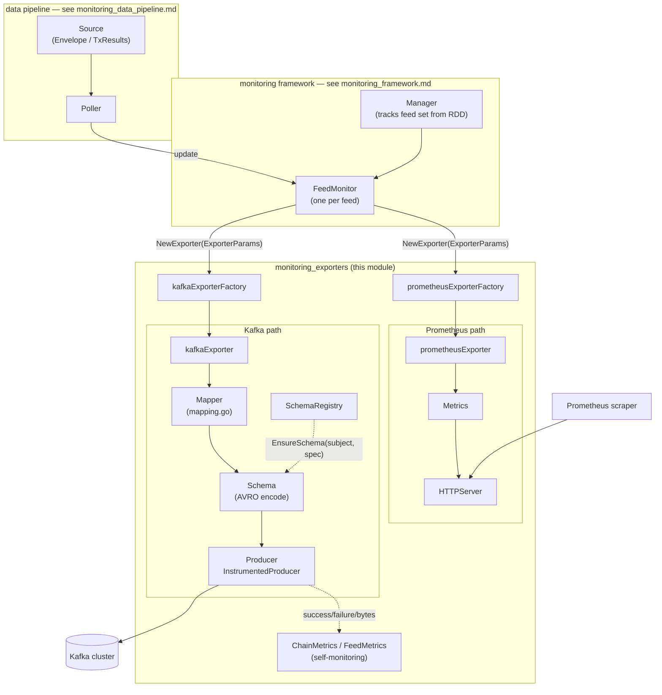
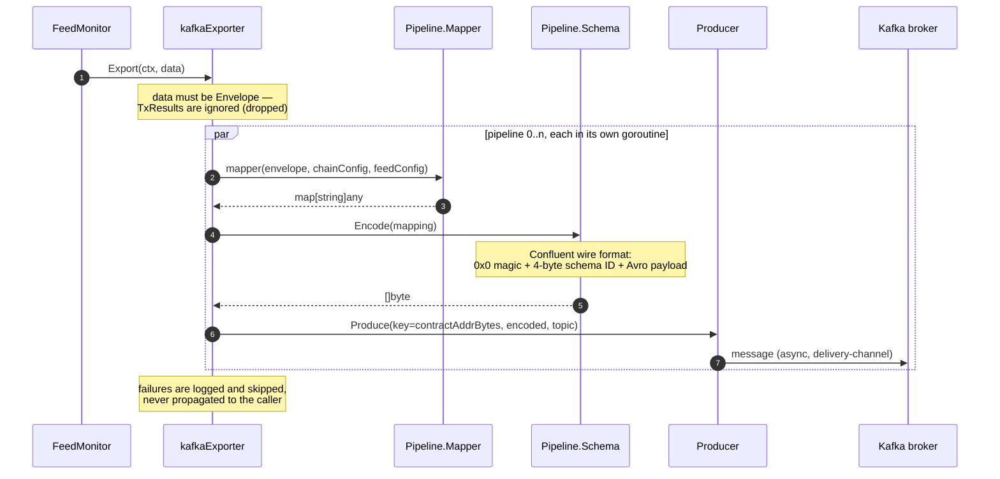
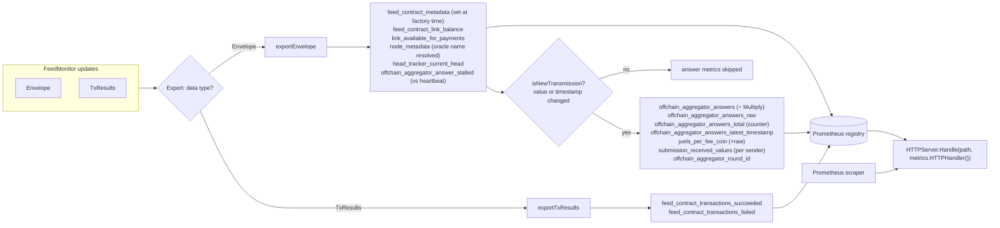
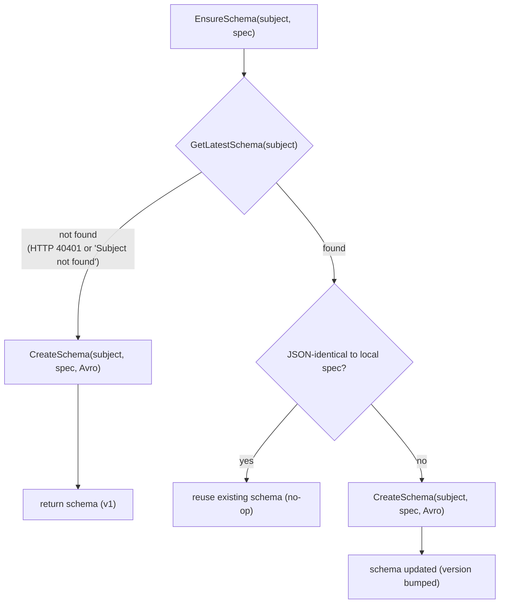
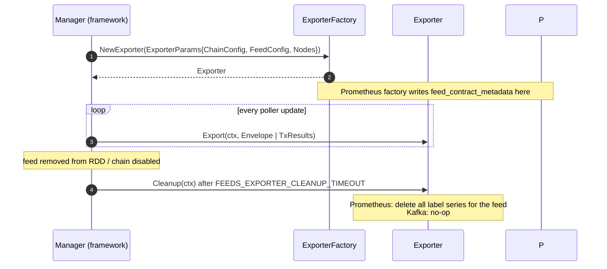

# Monitoring Exporters

> **Module**: `chainlink-common/pkg/monitoring` — the exporter layer of the on-chain feed monitoring pipeline.
> **Parent**: [Telemetry & Observability Platform](../../Telemetry___Observability_Platform.md) → [Monitoring](../monitoring.md)

## 1. Introduction

The **monitoring_exporters** module implements the *final stage* of the on-chain monitoring data pipeline. Once a feed's [`Source`](monitoring_data_pipeline.md) has read on-chain state into an `Envelope` (or `TxResults`), the exporter layer is responsible for publishing that data to two distinct destinations:

| Destination | Implementation | Format | Consumer |
|---|---|---|---|
| **Kafka** | `kafkaExporter` (`exporter_kafka.go`) | AVRO (Confluent wire format) | Downstream data pipelines / alerting (see [ops-monitoring-stack](../ops-monitoring-stack.md)) |
| **Prometheus** | `prometheusExporter` (`exporter_prometheus.go`) | Prometheus time series | Prometheus scraper, exposed via `HTTPServer` (`http.go`) |

The module also provides the supporting transport and encoding primitives:

- `Producer` (`producer.go`) — Kafka producer abstraction over `confluent-kafka-go/v2`
- `InstrumentedProducer` (`producer_instrumented.go`) — producer decorator adding self-monitoring counters
- `Schema` / `SchemaRegistry` (`schema.go`, `schema_registry.go`) — AVRO encoding and Confluent Schema Registry integration
- `Metrics` (`metrics.go`) — the Prometheus metric surface consumed by the Prometheus exporter
- `ChainMetrics` / `FeedMetrics` (`metrics_service.go`) — self-monitoring metrics for the monitoring process itself
- `HTTPServer` (`http.go`) — HTTP surface for metric scraping

All exporters conform to the platform-agnostic `Exporter` / `ExporterFactory` contract defined in [monitoring_data_pipeline](monitoring_data_pipeline.md), which is how the [monitoring framework](monitoring_framework.md) composes them per feed.

---

## 2. Architecture

### 2.1 Component topology



### 2.2 The `Exporter` contract

Exporters are *passive sinks*: the framework owns scheduling, and the exporter only decides how a data point is represented and transmitted. The contract lives in `chainlink-common/pkg/monitoring/exporter.go`:

```go
type Exporter interface {
    // Export is executed on each update on a monitored feed
    Export(ctx context.Context, data any)
    // Cleanup is executed once a monitor for a specific feed is terminated.
    Cleanup(ctx context.Context)
}

type ExporterFactory interface {
    NewExporter(ExporterParams) (Exporter, error)
}

type ExporterParams struct {
    ChainConfig ChainConfig
    FeedConfig  FeedConfig
    Nodes       []NodeConfig
}
```

Both factories in this module implement `ExporterFactory`; both exporters tolerate `data any` and internally type-switch to the known payload types `Envelope` and `TxResults` (`source_outputs.go`).

---

## 3. Kafka Exporter and Pipelines

Defined in `chainlink-common/pkg/monitoring/exporter_kafka.go`.

### 3.1 The `Pipeline` abstraction

```go
// Pipeline represents a succession of transformations on the data coming from a source:
// source output -> adapt to a map -> encode to AVRO -> send to Kafka
type Pipeline struct {
    Topic  string
    Mapper Mapper
    Schema Schema
}
```

Each pipeline is a complete *topic-bound transformation chain*. A single exporter can fan out to multiple topics (e.g. a transmissions topic and a config-set topic) using different mappers and AVRO schemas. The concrete mappers shipped with the module — `MakeTransmissionMapping` and `MakeConfigSetSimplifiedMapping` — are documented in [monitoring_wire_schemas](monitoring_wire_schemas.md).

### 3.2 Factory construction and validation

`NewKafkaExporterFactory(log, producer, pipelines)` validates at construction time that every pipeline's topic is consistent with its AVRO schema subject:

```go
if SubjectFromTopic(pipeline.Topic) != pipeline.Schema.Subject() {
    return nil, fmt.Errorf("topic '%s' does not match schema subject '%s'", ...)
}
```

`SubjectFromTopic` (in `schema.go`) derives the subject from a topic as `<topic>-value`, matching the Confluent convention. This fail-fast check prevents misconfigured pipelines from producing messages that no consumer can decode.

### 3.3 Export flow



Key behaviors:

- **Envelope-only.** `kafkaExporter.Export` silently drops anything that is not an `Envelope`; `TxResults` are exported only to Prometheus.
- **Message key.** The Kafka key is the feed's contract address bytes (`feedConfig.GetContractAddressBytes()`), which keeps a feed's messages ordered on a partition and co-located for consumers.
- **Concurrency.** All pipelines run concurrently per `Export` call using `utils.Subprocesses` (a `sync.WaitGroup` wrapper); the exporter waits for all pipeline goroutines before returning.
- **Fire-and-forget error handling.** Mapping, encoding and producing failures are logged with the topic and payload context but do not fail the export — monitoring must not stall the feed loop on a broken sink.
- **Feed-scoped logging.** The factory attaches `logger.With(log, "feed", name)` so every log line is attributable to a feed.
- **Cleanup is a no-op** — Kafka has no per-feed state to tear down (unlike Prometheus, see §5.4).

---

## 4. Kafka Transport: `Producer` and `InstrumentedProducer`

Defined in `chainlink-common/pkg/monitoring/producer.go` and `producer_instrumented.go`.

`Producer` is a deliberately narrow interface to make Kafka mockable:

```go
type Producer interface {
    Produce(key, value []byte, topic string) error
}
```

The production implementation wraps `confluentinc/confluent-kafka-go/v2` (see `chainlink-common/pkg/monitoring/go.mod`) and is configured from [`config.Kafka`](monitoring_configuration.md): brokers, client ID, security protocol and SASL credentials are mapped 1:1 onto the librdkafka `ConfigMap`.

**Lifecycle:** `NewProducer` spawns a `drainDeliveryChan` goroutine that consumes librdkafka delivery events (logged at debug level) and closes the underlying producer when the `services.StopRChan` is cancelled — this guarantees the librdkafka handle is released exactly once on shutdown.

`NewInstrumentedProducer(producer, chainMetrics)` returns a decorator that records delivery outcomes on the [chain-level self-monitoring metrics](#7-self-monitoring-chainmetrics--feedmetrics): success/failure counters per topic and a lower-bound byte counter (`key + value + topic`).

---

## 5. Prometheus Exporter

Defined in `chainlink-common/pkg/monitoring/exporter_prometheus.go`.

### 5.1 Export decision flow



### 5.2 Update deduplication

The exporter keeps the previous answer and timestamp per feed (`prevValue`, `prevTimestamp`, guarded by `prevMu`) and only refreshes the *answer-derived* metrics when a genuinely new transmission arrives:

| previous vs. new value / timestamp | Result |
|---|---|
| same value + same timestamp | skipped (no fresh transmission) |
| different value + same timestamp | exported (flagged as a likely inconsistency in the source data) |
| different value + different timestamp | exported |
| same value + different timestamp | exported (heartbeat with unchanged answer) |

Static metadata (link balance, node metadata, head tracker height, stalled flag) is updated on *every* envelope regardless of deduplication.

### 5.3 Value scaling and oracle naming

- Answers and juels-per-fee-coin are divided by the feed's `Multiply` parameter (`feedConfig.GetMultiply()`; a zero multiplier is treated as `1.0` to avoid division by zero). Both the scaled and the raw gauge are exposed.
- `getOracleName` resolves the transmitting account against the `Nodes []NodeConfig` passed via `ExporterParams`; unknown transmitters fall back to the raw account address, and are still recorded as a `sender` label.

### 5.4 Label tracking and cleanup

Prometheus series live forever unless deleted, so the exporter maintains a `prometheusLabels` accumulator (guarded by `labelsMu`) of every label set it has written — including the growing set of observed `senders`. On `Cleanup` (invoked by the framework after `FEEDS_EXPORTER_CLEANUP_TIMEOUT` once a feed disappears from the RDD), `Metrics.Cleanup` deletes all series for that feed across every metric vector. **Kafka cleanup is a no-op, Prometheus cleanup is essential** — this asymmetry prevents label-cardinality leaks when feed sets churn.

---

## 6. AVRO Encoding and Schema Registry

Defined in `chainlink-common/pkg/monitoring/schema.go` and `schema_registry.go`.

### 6.1 The `Schema` interface

```go
type Schema interface {
    ID() int
    Version() int
    Subject() string
    Encode(any) ([]byte, error)
    Decode([]byte) (any, error)
}
```

`wrapSchema` adapts `srclient.Schema`. `Encode` produces the **Confluent wire format**: `0x0` magic byte + 4-byte big-endian schema ID + AVRO binary payload (via goavro's `BinaryFromNative`). `Decode` validates the magic byte and the schema ID before decoding, so messages from a different schema version are rejected rather than misinterpreted. The AVRO specifications themselves (`TransmissionAvroSchema`, the config-set schema, and the generic `avro` helpers) are maintained in the [monitoring_wire_schemas](monitoring_wire_schemas.md) module.

### 6.2 `SchemaRegistry.EnsureSchema` — idempotent schema provisioning



`EnsureSchema` handles exactly three cases — create, reuse, or update-with-version-bump — making exporter startup idempotent against a shared registry. Not-found detection covers both the mock registry (string prefix `"Subject not found"`) and the real Confluent API (error code `40401`). Schema identity is compared as *unmarshalled JSON objects*, so formatting differences do not trigger spurious version bumps.

### 6.3 Ops stack

The Confluent backend (ZooKeeper + Kafka + Schema Registry with `full_transitive` compatibility) is provided by `chainlink-common/ops/monitoring/docker-compose.yml`; see [ops-monitoring-stack](../ops-monitoring-stack.md).

---

## 7. Self-Monitoring: `ChainMetrics` / `FeedMetrics`

Defined in `chainlink-common/pkg/monitoring/metrics_service.go`. These are the monitoring process's *own* operational metrics, distinct from the feed metrics it exports:

| Metric | Type | Level | Description |
|---|---|---|---|
| `new_feed_configs_detected` | Gauge | Chain | Number of monitored feeds on each RDD re-poll |
| `send_message_to_kafka_failed` / `_succeeded` | Counter | Chain | Kafka delivery outcomes (incremented by `InstrumentedProducer`) |
| `send_message_to_kafka_bytes` | Counter | Chain | Lower bound on bytes written (key+value+topic) |
| `fetch_from_source_failed` / `_succeeded` | Counter | Feed | Chain read outcomes per source |
| `fetch_from_source_duration` | Histogram | Feed | Latency of chain reads (100 ms → 20 s buckets) |

`ChainMetrics` is bound to the `ChainConfig` labels; `FeedMetrics` additionally carries `FeedConfig` labels (`source_name`, `feed_id`, `feed_name`, `contract_status`, `contract_type`, …). The feed-level metrics are consumed by the [data pipeline's instrumented sources](monitoring_data_pipeline.md).

---

## 8. Metric Catalog (exported feed metrics)

The `Metrics` interface (`metrics.go`) is a thin wrapper over the Prometheus client; its `defaultMetrics` implementation registers the vectors at package init via `promauto`. Common label axes: `contract_address`, `feed_id`, `chain_id`, `contract_status`, `contract_type`, `feed_name`, `feed_path`, `network_id`, `network_name` (plus `sender` and `symbol` where noted).

| Metric | Type | Purpose |
|---|---|---|
| `head_tracker_current_head` | Gauge | Block height the monitoring instance processed (`network_name`, `chain_id`, `network_id`) |
| `feed_contract_metadata` | Gauge (=1) | Feed inventory/info-as-labels |
| `feed_contract_link_balance` | Gauge | LINK balance of the feed contract |
| `link_available_for_payments` | Gauge | LINK usable for payments (balance minus debt) |
| `feed_contract_transactions_succeeded` / `_failed` | Counter | Tx outcome counts (`TxResults`) |
| `node_metadata` | Gauge (=1) | Node inventory (`chain_id`, `network_id`, `network_name`, `oracle_name`, `sender`) |
| `offchain_aggregator_answers_raw` *(deprecated)* | Gauge | Raw latest answer |
| `offchain_aggregator_answers` | Gauge | Latest answer ÷ Multiply |
| `offchain_aggregator_answers_total` | Counter | Incremented on each on-chain transmission |
| `offchain_aggregator_answers_latest_timestamp` | Gauge | Unix timestamp of latest transmission |
| `offchain_aggregator_juels_per_fee_coin_raw` *(deprecated)* | Gauge | Raw juels/fee-coin |
| `offchain_aggregator_juels_per_fee_coin` | Gauge | juels/fee-coin ÷ Multiply |
| `offchain_aggregator_submission_received_values` | Gauge | Per-sender observation at latest transmission |
| `offchain_aggregator_juels_per_fee_coin_received_values` | Gauge | Per-sender juels/fee-coin observation |
| `offchain_aggregator_answer_stalled` | Gauge | 1 when heartbeat interval elapsed without a transmission |
| `offchain_aggregator_round_id` | Gauge | Aggregator round ID (observation count) |

`Metrics.HTTPHandler()` exposes the registry through `promhttp` for scraping.

---

## 9. HTTP Server

Defined in `chainlink-common/pkg/monitoring/http.go`. `HTTPServer` is the process-wide HTTP surface used to expose Prometheus metrics (and, in the monitoring binary, configuration endpoints):

```go
type HTTPServer interface {
    Handle(path string, handler http.Handler)
    Run(ctx context.Context) // run as a goroutine
}
```

- Built with a `http.ServeMux`; the server's `BaseContext` derives from the process stop channel, so request contexts are cancelled with the process.
- `ReadHeaderTimeout` is 60 s (slowloris protection).
- `Run` starts `ListenAndServe` in a goroutine and performs a graceful `Shutdown` when the parent context is cancelled; startup failure is fatal-logged with the address.

Typical wiring: `httpServer.Handle(metricsPath, metrics.HTTPHandler())` before `Run`, binding the [metric catalog](#8-metric-catalog-exported-feed-metrics) to the scrape endpoint configured via `HTTP_ADDRESS` (see [monitoring_configuration](monitoring_configuration.md)).

---

## 10. Exporter Lifecycle



---

## 11. Configuration

Exporter-relevant configuration (parsed from environment variables in `chainlink-common/pkg/monitoring/config/parse.go`; full parsing rules in [monitoring_configuration](monitoring_configuration.md)):

| Env var | Type field | Used by |
|---|---|---|
| `KAFKA_BROKERS`, `KAFKA_CLIENT_ID`, `KAFKA_SECURITY_PROTOCOL` | `config.Kafka` | `NewProducer` |
| `KAFKA_SASL_MECHANISM`, `KAFKA_SASL_USERNAME`, `KAFKA_SASL_PASSWORD` | `config.Kafka` | `NewProducer` (SASL auth) |
| `KAFKA_TRANSMISSION_TOPIC`, `KAFKA_CONFIG_SET_SIMPLIFIED_TOPIC` | `config.Kafka` | Pipeline topics for the two standard pipelines |
| `SCHEMA_REGISTRY_URL`, `SCHEMA_REGISTRY_USERNAME`, `SCHEMA_REGISTRY_PASSWORD` | `config.SchemaRegistry` | `NewSchemaRegistry` (credentials optional) |
| `HTTP_ADDRESS` | `config.HTTP` | `NewHTTPServer` bind address |
| `FEEDS_EXPORTER_CLEANUP_TIMEOUT` (default 1 s) | `config.Feeds` | Grace period before `Exporter.Cleanup` runs |

Third-party dependencies of this layer (from `chainlink-common/pkg/monitoring/go.mod`): `confluentinc/confluent-kafka-go/v2` (transport), `riferrei/srclient` (schema registry client), `prometheus/client_golang` (metrics), `libocr` (account/config types).

---

## 12. Testing

- Unit tests: `exporter_kafka_test.go`, `exporter_prometheus_test.go`, `schema_registry_test.go` in the same package.
- Generated mocks: `exporter_mock.go`, `exporter_factory_mock.go`, `metrics_mock.go` (mockery; see `chainlink-common/.mockery.yaml`).
- Fakes (`fakeProducer`, `fakeSchema`, `fakeExporterFactory`, envelope generators, etc.) live in `testutils.go` and are documented in [monitoring_testutils](monitoring_testutils.md).
- The `Producer` / `Schema` / `Exporter` interfaces are intentionally minimal so tests need no real Kafka or Schema Registry; the Confluent stack for integration runs is available via [ops-monitoring-stack](../ops-monitoring-stack.md).

---

## 13. Related Documentation

- [Monitoring (module overview)](../monitoring.md) — positioning within the observability platform
- [Monitoring framework](monitoring_framework.md) — `Manager`, `FeedMonitor`, `MultiFeedMonitor` (callers of `ExporterFactory`)
- [Monitoring data pipeline](monitoring_data_pipeline.md) — `Source`/`Poller`/`Updater` and the `Exporter` contract
- [Monitoring configuration](monitoring_configuration.md) — env-var parsing and validation
- [Monitoring wire schemas](monitoring_wire_schemas.md) — AVRO specs, `Mapper` implementations, protobuf configs
- [Monitoring test utilities](monitoring_testutils.md) — fakes for producers, schemas and exporters
- [Beholder telemetry](../beholder-telemetry.md) — the OTLP/proto-based telemetry pipeline used by node processes (complementary to this batch Kafka exporter)
- [Telemetry ingress](../telemetry_ingress.md) — node-side WS-RPC telemetry egress
- [Ops monitoring stack](../ops-monitoring-stack.md) — Kafka/Schema-Registry docker deployment
- [Observability lib](../observability-lib.md) — Grafana dashboards for consuming these metrics
