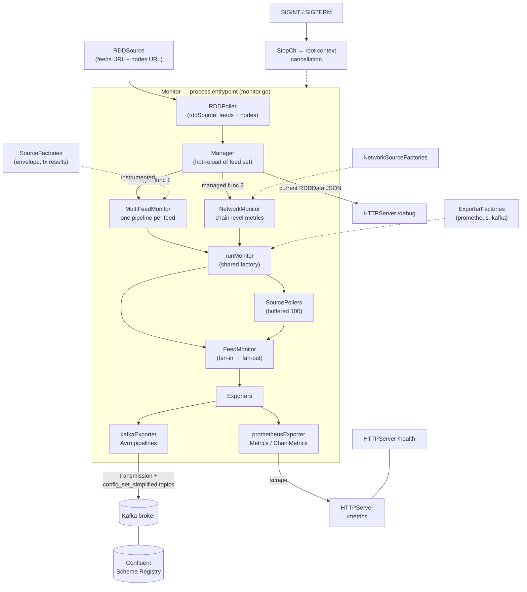
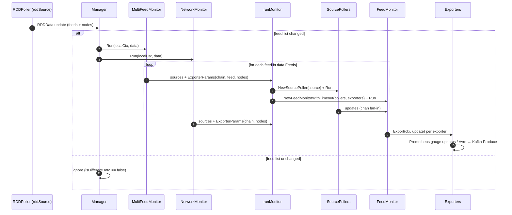
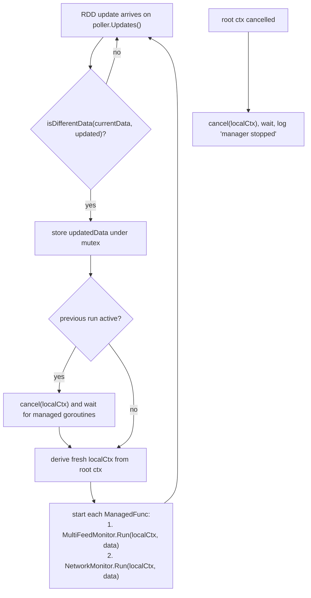

# Monitoring Framework

> **Module:** `chainlink-common/pkg/monitoring` (framework/orchestration layer)
> **Page:** [Telemetry & Observability Platform](../../Telemetry___Observability_Platform.md) → [Monitoring](../monitoring.md) → **Monitoring Framework**

The **monitoring framework** is the orchestration skeleton for standalone, on-chain *feed monitors* — small binaries that watch the health of Chainlink data feed contracts across a network and publish what they observe to Prometheus and Kafka. It composes the generic data pipeline primitives ([sources, pollers, exporters](monitoring_data_pipeline.md)) into a complete, self-managing process with a lifecycle, hot-reloading of the feed list, and operational HTTP endpoints.

An implementation of the framework must only supply the chain-specific pieces (a `ChainConfig`, an envelope source, a transaction-results source, and feed/node parsers); everything else — wiring, concurrency, restarts, cleanup — is handled here.

---

## 1. Purpose & Scope

| Concern | Handled by the framework |
|---|---|
| Process entrypoint & dependency injection | `Monitor` / `NewMonitor` (`monitor.go`) |
| Fetching the authoritative feed list (RDD) | `RDDSource` + `RDDPoller` (see [data pipeline](monitoring_data_pipeline.md)) |
| Hot-reload of the feed configuration | `Manager` (`manager.go`) |
| Per-feed metric collection (OCR transmissions, contract config) | `MultiFeedMonitor` → `runMonitor` → `FeedMonitor` |
| Network-level (non-feed) metrics: block height, balances, … | `NetworkMonitor` → `runMonitor` → `FeedMonitor` |
| Exporting observations | [Prometheus + Kafka exporters](monitoring_exporters.md) |
| Operational surface | HTTP server: `/metrics`, `/debug`, `/health` |

Out of scope (covered elsewhere): how configuration is [parsed from environment variables](monitoring_configuration.md), how Avro [wire schemas and Kafka topics](monitoring_wire_schemas.md) are defined, the Beholder OTLP emission stack ([Beholder](../beholder-telemetry.md)), and the Dockerized Kafka/ZooKeeper/Schema-Registry infrastructure used in ops ([Ops Monitoring Stack](../ops-monitoring-stack.md)).

---

## 2. Core Components

| Component | File | Responsibility |
|---|---|---|
| `Monitor` | `monitor.go` | The entrypoint for an on-chain monitor integration. Holds every dependency and owns the top-level `Run()` loop. Created only via `NewMonitor()`. |
| `NewMonitor` | `monitor.go` | Constructor that performs **dependency injection**: config parsing, Kafka producer, schema registry, exporter factories, RDD polling, manager, and HTTP server wiring. Serves as the template for advanced/custom setups. |
| `Monitor.Run()` | `monitor.go` | Starts all goroutines (RDD poller, manager, HTTP server, OS signal handler) under a single root context derived from `StopCh`. |
| `Manager` | `manager.go` | Restarts the *managed functions* (per-feed + network monitors) whenever the feed configuration list changes. Decoupled from the monitors via the `ManagedFunc` callback type. |
| `MultiFeedMonitor` | `multi_feed_monitor.go` | Iterates over each feed in `RDDData` and spins up one monitoring pipeline per feed. |
| `NetworkMonitor` | `network_monitor.go` | Runs a single pipeline for **network-level, feed-agnostic** metrics (block height, balances, etc.). |
| `FeedMonitor` | `feed_monitor.go` | Fan-in layer: consumes updates from all pollers of one feed and dispatches every update to every exporter, then performs graceful cleanup. |
| `runMonitor` | `run_monitor.go` | Shared factory used by both monitors: creates pollers from sources, exporters from exporter factories, and starts a `FeedMonitor`. |

### Supporting collaborators (defined in sibling modules)

- `Source` / `SourceFactory` / `NetworkSourceFactory`, `Poller`, `Exporter`, `RDDSource` — see [Monitoring Data Pipeline](monitoring_data_pipeline.md).
- `Producer` (Kafka), `SchemaRegistry` (Confluent SR), `Metrics`, `ChainMetrics`, `HTTPServer` — see [Monitoring Exporters](monitoring_exporters.md).
- `config.Config` (Kafka, SchemaRegistry, Feeds, Nodes, HTTP, Feature sections) — see [Monitoring Configuration](monitoring_configuration.md).
- Fakes for all of the above (e.g. `fakeEnvelopeSourceFactory`, `fakeFeedsParser`) — see [Monitoring Test Utilities](monitoring_testutils.md).

---

## 3. Architecture

`NewMonitor` wires the full dependency graph at startup:

1. `config.Parse()` reads configuration from environment variables and validates it.
2. `Metrics` / `ChainMetrics` are created; the Kafka `Producer` is wrapped in an `InstrumentedProducer` so Kafka delivery outcomes are counted in chain metrics.
3. `SchemaRegistry` ensures the `Transmission` and `ConfigSetSimplified` Avro schemas exist (create / version-bump / no-op semantics).
4. Two exporter factories are installed: **Prometheus** (scrapable gauges) and **Kafka** (Avro pipelines for the transmission and simplified-config topics).
5. `RDDSource` is wrapped in a `SourcePoller` (interval/timeout from config, **zero buffering**) and handed to the `Manager`.
6. The `HTTPServer` exposes `/metrics` (Prometheus handler), `/debug` (current `RDDData` snapshot as JSON, from `Manager.HTTPHandler()`), and `/health` (always-200, for Kubernetes).



### Interface contracts

The framework is defined almost entirely by small Go interfaces. `runMonitor` is the glue that turns factories into running instances:

```mermaid
classDiagram
    class Monitor {
        +Run()
        +StopCh
        +ChainConfig
        +Config
        +Manager
        +HTTPServer
    }
    class Manager {
        <<interface>>
        +Run(ctx, managed)
        +HTTPHandler() http.Handler
    }
    class MultiFeedMonitor {
        <<interface>>
        +Run(ctx, data RDDData)
    }
    class NetworkMonitor {
        <<interface>>
        +Run(ctx, data RDDData)
    }
    class FeedMonitor {
        <<interface>>
        +Run(ctx)
    }
    class Source {
        <<interface>>
        +Fetch(ctx) any-or-error
    }
    class Poller {
        <<interface>>
        +Run(ctx)
        +Updates() channel
    }
    class Exporter {
        <<interface>>
        +Export(ctx, data)
        +Cleanup(ctx)
    }
    Monitor --> Manager : runs under root ctx
    Manager ..> MultiFeedMonitor : ManagedFunc 1
    Manager ..> NetworkMonitor : ManagedFunc 2
    MultiFeedMonitor ..> FeedMonitor : via runMonitor, per feed
    NetworkMonitor ..> FeedMonitor : via runMonitor
    FeedMonitor --> Poller : fan-in Updates()
    Poller --> Source : Fetch()
    FeedMonitor --> Exporter : Export() / Cleanup()
    Source ..> "SourceFactory" : created by
    Exporter ..> "ExporterFactory" : created by
```

Key contract details (full definitions in [Monitoring Data Pipeline](monitoring_data_pipeline.md)):

- **`Source.Fetch(ctx)`** must be thread-safe; ordering of calls is not guaranteed.
- **`Poller`** is an alias for `Updater`: `Run(ctx)` blocks and must run as a goroutine; the `Updates()` channel must never be closed and must only be read in a `select` with the same context passed to `Run()`.
- **`Exporter.Export`** is invoked on every update; **`Exporter.Cleanup`** is invoked exactly once when that feed's monitor terminates.

---

## 4. Runtime Data Flow

The steady-state flow, from the Chainlink feeds registry (RDD — the feeds/nodes JSON registry the monitor fetches at `Feeds.URL` and `Nodes.URL`) to the two export backends:



Notes on the flow:

- **Feed-scoped logging:** every feed gets a logger annotated with `feed_name`, `feed_id`, and `network`, so all downstream components inherit correlation fields.
- **Instrumentation:** source factories are wrapped in `InstrumentedSourceFactory` and the producer in `InstrumentedProducer`, so source fetch latency/errors and Kafka delivery counters are captured in `ChainMetrics` (e.g. `SetNewFeedConfigsDetected`, `IncSendMessageToKafkaSucceeded/Failed`).
- **Feed monitors are blocking** functions controlled by their context — the `Manager` terminates them by cancelling that context when the feed set changes.

---

## 5. Lifecycle & Process Flows

### 5.1 Startup (`Monitor.Run`)

1. Derive `rootCtx` from `StopCh` and create the `utils.Subprocesses` group.
2. Start `RDDPoller`.
3. Wrap all per-feed `SourceFactory`s with `NewInstrumentedSourceFactory`.
4. Construct `MultiFeedMonitor` and `NetworkMonitor` (source-poller buffer capacity `100`; exporter cleanup timeout from `Config.Feeds.ExporterCleanupTimeout`).
5. Start the `Manager` with two managed functions — one running the multi-feed monitor, one running the network monitor (only if network factories were supplied).
6. Start the `HTTPServer` (`/metrics`, `/debug`, `/health`).
7. Start an OS signal handler for `SIGINT`/`SIGTERM`, which cancels the root context.
8. `subs.Wait()` blocks until every goroutine has drained.

### 5.2 Feed-configuration change (`Manager`)

The `Manager` is the framework's hot-reload mechanism. It never touches monitors directly — it only decides *when* to (re)invoke its `ManagedFunc`s with the latest `RDDData`:



On each restart it also logs the new feed configuration and updates the `/debug` snapshot, so operators can always inspect the *currently active* feed set via HTTP.

### 5.3 Update dispatch & shutdown (`FeedMonitor`)

- **Dispatch:** all pollers of one pipeline fan their updates into a single `updatesFanIn` channel; every update is dispatched to **each exporter in its own goroutine** with panic recovery (a panicking exporter cannot kill the monitor).
- **Shutdown:** when `ctx` is cancelled, the consume loop breaks; in-flight export goroutines are awaited (`subs.Wait()`); then every exporter's `Cleanup` runs under a fresh context bounded by `cleanupTimeout`, again with panic recovery. Cleanup ordering is guaranteed to happen *after* all exports have finished.

---

## 6. Configuration & Deployment

**Configuration** is loaded exclusively from environment variables by `config.Parse()` (parse → apply defaults → validate) into:

```
Config{ Kafka, SchemaRegistry, Feeds, Nodes, HTTP, Feature }
```

Notable fields consumed directly by this framework: `Feeds.RDDPollInterval`, `Feeds.RDDReadTimeout`, `Feeds.ExporterCleanupTimeout`, `Feeds.URL` / `Feeds.IgnoreIDs`, `Nodes.URL`, `HTTP.Address`, and the Kafka topic names (`TransmissionTopic`, `ConfigSetSimplifiedTopic`). Full variable reference: [Monitoring Configuration](monitoring_configuration.md).

**External dependencies** (from repository artifact `chainlink-common/pkg/monitoring/go.mod`, module `github.com/smartcontractkit/chainlink-common/pkg/monitoring`):

- `confluentinc/confluent-kafka-go/v2` — Kafka producer (exporter backend)
- `riferrei/srclient` — Confluent Schema Registry client (Avro schema registration)
- `linkedin/goavro/v2` — Avro encoding for Kafka pipelines ([wire schemas](monitoring_wire_schemas.md))
- `prometheus/client_golang` — `/metrics` exposition
- `go.opentelemetry.io/otel` — metrics primitives
- `smartcontractkit/libocr` + `chainlink-common` — OCR types (`ConfigDigest`, `ContractConfig`, …) and shared `services`/`utils` primitives (goroutine groups, stop channels — see [Shared Foundation: services](../../Shared_Foundation_Libraries___Domain_Types/services.md))

**Ops stack:** the Kafka + ZooKeeper + Confluent Schema Registry trio this framework talks to is provisioned by [`chainlink-common/ops/monitoring/docker-compose.yml`](../ops-monitoring-stack.md) (Kafka `29092`, Schema Registry `8989`, compatibility `full_transitive`).

**Kubernetes readiness:** the always-200 `/health` endpoint is explicitly provided for Kubernetes liveness probes; `/metrics` is the Prometheus scrape target; `/debug` dumps the active `RDDData` for troubleshooting.

---

## 7. Extending the Framework

`NewMonitor` is documented as the *starting template* for advanced configurations. Extension points:

1. **Chain-specific sources** — implement `SourceFactory` (per-feed: OCR envelope, tx results) and/or `NetworkSourceFactory` (block height, balances). Factories receive `ChainConfig` + `FeedConfig`/nodes and return `Source` instances; see the [data pipeline](monitoring_data_pipeline.md) contracts.
2. **Additional export backends** — implement `ExporterFactory` and append it to `Monitor.ExporterFactories` (or `NetworkExporterFactories`). The existing Prometheus and Kafka exporters (with their Avro topic pipelines) are the reference implementations; see [Monitoring Exporters](monitoring_exporters.md).
3. **Third-party delivery services** — inject a custom `Producer`-like component in `NewMonitor`'s wiring, mirroring how the Kafka exporter is composed.
4. **New monitors** — a complete product integration example is the [Balance Monitor](monitoring_balance.md), which plugs a balance `SourceFactory`/`ExporterFactory` pair into this framework.

Every monitor pipeline (feed-scoped or network-scoped) follows the identical `runMonitor` recipe: **sources → pollers → exporters → feed monitor**, which keeps product-specific code limited to factories.

---

## 8. Testing

The framework is designed for testability via dependency injection of factories and parsers. Ready-made fakes — `fakeEnvelopeSourceFactory`, `fakeTxResultsSourceFactory`, `fakeFeedsParser`, `fakeNodesParser`, `fakeExporterFactory`, `fakeProducer`, `fakeSchema`, `fakePoller`, and `devnullMetrics` — are provided in the [Monitoring Test Utilities](monitoring_testutils.md) module. `Manager.isDifferentData` uses `assert.ObjectsAreEqual` semantics, so test data must compare meaningfully by value.

---

## 9. Related Documentation

| Topic | Page |
|---|---|
| Platform overview & telemetry ingress options | [Telemetry & Observability Platform](../../Telemetry___Observability_Platform.md) |
| Parent module | [Monitoring](../monitoring.md) |
| Environment-driven configuration | [Monitoring Configuration](monitoring_configuration.md) |
| Source / Poller / Exporter primitives | [Monitoring Data Pipeline](monitoring_data_pipeline.md) |
| Prometheus & Kafka exporters, schema registry | [Monitoring Exporters](monitoring_exporters.md) |
| Avro schemas & mappings | [Monitoring Wire Schemas](monitoring_wire_schemas.md) |
| Balance monitor (product integration) | [Monitoring Balance](monitoring_balance.md) |
| Test doubles | [Monitoring Test Utilities](monitoring_testutils.md) |
| Dockerized Kafka/SR stack | [Ops Monitoring Stack](../ops-monitoring-stack.md) |
| OTLP-based node telemetry (alternative pathway) | [Beholder Telemetry](../beholder-telemetry.md) |
| Structured logging foundation used by all components | [Shared Foundation: Logger](../../Shared_Foundation_Libraries___Domain_Types/logger.md) |
