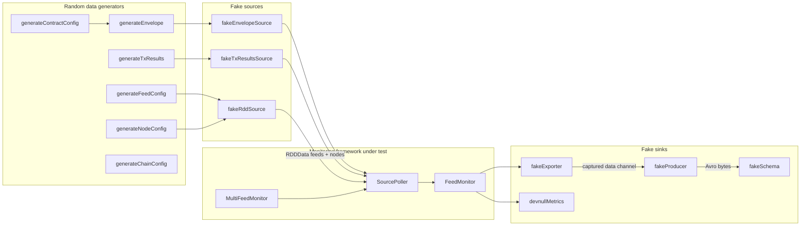
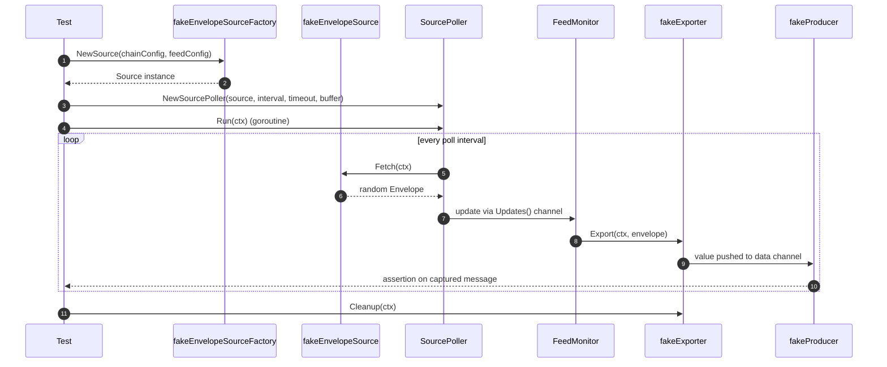
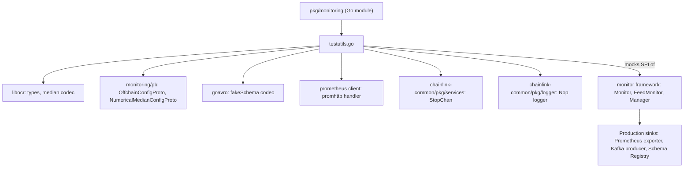

# monitoring_testutils

> **Source:** `chainlink-common/pkg/monitoring/testutils.go`

## Introduction

The `monitoring_testutils` module is the **test-double and data-generation layer** of the standalone OCR2 feed-monitoring platform (`chainlink-common/pkg/monitoring`). The monitoring platform continuously polls on-chain OCR2 aggregator contracts across many chains and feeds, and exports the results as Prometheus metrics and Avro-encoded Kafka messages (see [monitoring](../monitoring.md) and [monitoring_data_pipeline](monitoring_data_pipeline.md)).

To make the framework testable without RPC endpoints, Kafka clusters, or schema registries, `testutils.go` ships a complete set of **fakes and generators** for every SPI interface of the pipeline:

- **Fake sources** producing randomized `Envelope`s, `TxResults`, and feed lists (no blockchain required).
- **Fake exporters / producer / schema** capturing data in channels and wrapping a local Avro codec (no Kafka or Confluent Schema Registry required).
- **Data generators** producing realistic random OCR2 `ContractConfig`s (signers, transmitters, offchain config protobufs), `Envelope`s, feed/node/chain configs.
- **`devnullMetrics`**, a no-op `Metrics` implementation for tests that should not care about metric output.

These utilities intentionally live in a **non-`_test.go` file** inside the production package so they can be imported by other packages and development binaries (the file header notes this was done to expose them for `cmd/monitoring`); a blank-identifier block at the bottom of the file keeps the `unused` linter satisfied for symbols only referenced externally.

> ⚠️ **Constraint:** The file header states explicitly that the generated data *"shouldn't be used to run OCR instances."* The random configs/envelopes are valid enough to exercise the monitoring pipeline end-to-end, but they are **not** cryptographically coherent oracle artifacts.

The package is its own Go module (`github.com/smartcontractkit/chainlink-common/pkg/monitoring`, go 1.27.1 — see `chainlink-common/pkg/monitoring/go.mod`), with `goavro`, `prometheus/client_golang`, `libocr`, and `protobuf` as direct dependencies, all of which the test utils leverage.

---

## Component inventory

| Category | Component | Satisfies | Purpose |
|---|---|---|---|
| Source ctor | `NewFakeRDDSource(minFeeds, maxFeeds)` | `Source` | Fake of [`NewRDDSource`](monitoring_data_pipeline.md); returns a random number of feeds per `Fetch` |
| Source factory | `fakeEnvelopeSourceFactory` | `SourceFactory` | `GetType()` = `"fake-envelope"`; creates `fakeEnvelopeSource` |
| Source factory | `fakeTxResultsSourceFactory` | `SourceFactory` | `GetType()` = `"fake-txresults"`; creates `fakeTxResultsSource` |
| Source factory | `fakeRandomDataSourceFactory` | `SourceFactory` | `GetType()` = `"fake"`; sources relay values from a shared `updates` channel |
| Source factory | `fakeSourceFactoryWithError` | `SourceFactory` | Returns an error, or sources that emit errors from a channel |
| Source | `fakeEnvelopeSource` | `Source` | `Fetch` → `generateEnvelope(ctx)` |
| Source | `fakeTxResultsSource` | `Source` | `Fetch` → `generateTxResults()` |
| Source | `fakeSourceWithWait` | `Source` | Sleeps `waitOnRead` then returns `1`; returns `0` on context cancellation (timeout tests) |
| Source | `fakeSourceWithError` / `fakeSourceWithPanic` | `Source` | Deliver errors / panic values from channels (error-handling and panic-recovery tests) |
| Parsers | `fakeFeedsParser`, `fakeNodesParser` | `FeedsParser` / `NodesParser` func types | Decode the JSON wire format used by the RDD and the bundled fixtures |
| Configs | `fakeFeedConfig`, `fakeNodeConfig`, `fakeChainConfig` | `FeedConfig`, `NodeConfig`, `ChainConfig` | Full interface implementations over plain JSON-serializable structs |
| Generators | `generateContractConfig`, `generateEnvelope`, `generateTxResults`, `generateFeedConfig`, `generateNodeConfig`, `generateChainConfig`, `generateOffchainConfig`, `generateBigInt`, `generate32ByteArr` | — | Cryptographically-seeded random test data |
| Exporters | `fakeExporterFactory`, `fakeExporter` | `ExporterFactory`, `Exporter` | Capture exported values into a Go channel |
| Kafka | `fakeProducer` | `Producer` | Captures `Produce` calls into a channel; supports `Close` |
| Schema | `fakeSchema` | `Schema` | Wraps a `*goavro.Codec`; fixed `ID()`/`Version()` of `1` |
| Poller | `fakePoller` | `Poller` (i.e. `Updater`) | Emits `numUpdates` batches from an embedded `fakeRddSource{1,2}` |
| Metrics | `devnullMetrics` | `Metrics` | No-op for every metric method; `HTTPHandler()` returns `promhttp.Handler()` |
| Logger | `newNullLogger` | `Logger` | Returns `logger.Nop()` from the shared logger package |

---

## Architecture

### Fakes vs. the monitoring SPI

Every fake in this module is a drop-in replacement for one of the extension-point interfaces of the monitoring framework (defined in [monitoring_data_pipeline](monitoring_data_pipeline.md) and [monitoring_framework](monitoring_framework.md)):

```mermaid
classDiagram
    direction TB

    class Source {
        <<interface>>
        +Fetch(ctx) any, error
    }
    class SourceFactory {
        <<interface>>
        +NewSource(chainCfg, feedCfg) Source
        +GetType() string
    }
    class Updater {
        <<interface>>
        +Run(ctx)
        +Updates() chan any
    }
    class Poller {
        <<interface>>
    }
    class Exporter {
        <<interface>>
        +Export(ctx, data)
        +Cleanup(ctx)
    }
    class ExporterFactory {
        <<interface>>
        +NewExporter(params) Exporter
    }
    class Producer {
        <<interface>>
        +Produce(key, value, topic) error
    }
    class Schema {
        <<interface>>
        +ID() int
        +Version() int
        +Subject() string
        +Encode(value) bytes
        +Decode(buf) any
    }
    class Metrics {
        <<interface>>
        +SetOffchainAggregatorAnswers(...)
        +Cleanup(...)
        +HTTPHandler() http.Handler
    }

    class fakeEnvelopeSource
    class fakeTxResultsSource
    class fakeRddSource
    class fakeSource
    class fakeSourceWithWait
    class fakeSourceWithError
    class fakeSourceWithPanic
    class fakeEnvelopeSourceFactory
    class fakeTxResultsSourceFactory
    class fakeRandomDataSourceFactory
    class fakeSourceFactoryWithError
    class fakeExporter
    class fakeExporterFactory
    class fakeProducer
    class fakeSchema
    class fakePoller
    class devnullMetrics

    fakeEnvelopeSource ..|> Source
    fakeTxResultsSource ..|> Source
    fakeRddSource ..|> Source
    fakeSource ..|> Source
    fakeSourceWithWait ..|> Source
    fakeSourceWithError ..|> Source
    fakeSourceWithPanic ..|> Source
    fakeEnvelopeSourceFactory ..|> SourceFactory
    fakeTxResultsSourceFactory ..|> SourceFactory
    fakeRandomDataSourceFactory ..|> SourceFactory
    fakeSourceFactoryWithError ..|> SourceFactory
    fakeExporter ..|> Exporter
    fakeExporterFactory ..|> ExporterFactory
    fakeProducer ..|> Producer
    fakeSchema ..|> Schema
    fakePoller ..|> Poller
    devnullMetrics ..|> Metrics
    Poller --|> Updater
```



### Fake-to-production mapping

| Fake | Production counterpart |
|---|---|
| `fakeEnvelopeSourceFactory` | Chain-specific envelope sources (`source.go`-registered factories) |
| `fakeTxResultsSourceFactory` | Transaction-results source |
| `NewFakeRDDSource` / `fakeRddSource` | `NewRDDSource` in `source_rdd.go` (HTTP-backed feed/node registry reader) |
| `fakeFeedsParser` / `fakeNodesParser` | Production RDD JSON parsers wired via `NewRDDSource` |
| `fakeExporterFactory` / `fakeExporter` | [`prometheusExporter` and the Kafka `Pipeline` exporter](monitoring_exporters.md) |
| `fakeProducer` | Confluent Kafka producer (`exporter_kafka.go`) |
| `fakeSchema` | Confluent Schema-Registry-backed schema (`schema.go` / [monitoring_wire_schemas](monitoring_wire_schemas.md)) |
| `fakePoller` | `NewSourcePoller` (`poller.go`) |
| `devnullMetrics` | Prometheus metrics service (`metrics.go`, `metrics_service.go`) |
| `newNullLogger` | Chainlink structured logger |

---

## Data flow through the pipeline

The fakes are designed to be assembled into the **exact same pipeline topology** used in production (`runMonitor` in `run_monitor.go`: sources → pollers → `FeedMonitor` → exporters). This is how random data moves from generator to assertion point:



### Typical test sequence



---

## Component reference

### Fake sources and source factories

All fakes honor the contracts documented on their interfaces (see [monitoring_data_pipeline](monitoring_data_pipeline.md)):

- `Source.Fetch` must be thread-safe and unordered — the channel-based fakes satisfy this naturally.
- `Updater.Updates()` must never be closed, and must be read in a `select` with the same context passed to `Run` — `fakePoller` and `fakeSource` follow this rule by selecting on `ctx.Done()`.

**`NewFakeRDDSource(minFeeds, maxFeeds uint8) Source`** — the fake counterpart of the RDD source. Each `Fetch` returns between `minFeeds` and `maxFeeds` randomly generated `FeedConfig`s (via `generateFeedConfig`). Unlike the real `rddSource`, it does not filter dead feeds or ignored IDs; pair it with the production `filterFeeds` logic when testing those behaviors.

**`fakeEnvelopeSourceFactory` / `fakeTxResultsSourceFactory`** — stateless factories with `GetType()` identifiers `"fake-envelope"` and `"fake-txresults"`. They ignore the `ChainConfig`/`FeedConfig` arguments, so a single factory instance can back any number of feed monitors.

**`fakeRandomDataSourceFactory`** — a family of sources sharing one `updates chan any`; each `Fetch` blocks until an update arrives on the channel or the context is cancelled (returns `"source closed"` error). This gives tests precise control over *when* an update is delivered.

**Failure-injection sources:**

- `fakeSourceFactoryWithError` — either fails `NewSource` outright (`returnError = true`) or hands out `fakeSourceWithError` sources that surface errors from an `errors` channel, exercising the "all sources failed to initialize" paths in `runMonitor`.
- `fakeSourceWithPanic` — panics with a value from a `panics` channel, for testing panic recovery in the poller/monitor goroutines.
- `fakeSourceWithWait` — returns `1` after a configurable delay, or `0` when the context is cancelled first (used to assert read-timeout behavior).

### Data generators

Generators use `crypto/rand` (via `generateBigInt` and `generate32ByteArr`) and `math/rand` for indices, producing high-entropy data that avoids accidental collisions between parallel tests.

| Generator | Output |
|---|---|
| `generateBigInt(bitSize)` | Random `*big.Int` in `[0, 2^bitSize)` |
| `generate32ByteArr()` | Random `[32]byte` |
| `generateFeedConfig()` | `fakeFeedConfig` with a random coin pair (btc/eth/matic/link/avax/ftt/srm/usdc/sol/ray), 32-byte hex-encoded contract address as ID, `Multiply` = 10000, heartbeat 1s, contract type `ocr2` |
| `generateNodeConfig()` | `fakeNodeConfig` named `noop-#<id>` with a `0x`-prefixed 20-byte `types.Account` |
| `generateChainConfig()` | `fakeChainConfig` with `mainnet-beta` network/chain IDs, RPC endpoint `http://some-chain-host:6666`, 100ms read timeout, 1–5s poll interval |
| `generateContractConfig(ctx, n)` | libocr `types.ContractConfig` for `n` oracles (random 32-byte signers, sequential transmitters, `F` = 10) plus the decoded `median.OnchainConfig`, `pb.OffchainConfigProto`, and `pb.NumericalMedianConfigProto` and their encoded bytes |
| `generateEnvelope(ctx)` | Full monitoring `Envelope` (round, epoch, latest answer/timestamp, `ContractConfig` for 31 oracles, block number, transmitter, LINK balance/available-for-payment, juels-per-fee-coin, aggregator round ID) |
| `generateTxResults()` | `TxResults{NumSucceeded, NumFailed}` with random counts |

`generateContractConfig` is notable because it exercises the **real** serialization stack: the `median.StandardOnchainConfigCodec` for onchain config and the protobuf wire types `pb.OffchainConfigProto` / `pb.NumericalMedianConfigProto` (defined in `pb/offchainreporting2_monitoring_*.proto` — see [monitoring_wire_schemas](monitoring_wire_schemas.md)). Generated offchain configs include randomized OCR2 timing deltas, a 10-step reporting schedule, `n` offchain public keys and peer IDs, shared-secret encryptions, and a nested numerical-median plugin config.

### Feed & node config fakes and parsers

`fakeFeedConfig` implements the entire `FeedConfig` interface, including the historical quirk that `GetMultiply()` is actually a **divisor** for converting on-chain big integers into Prometheus floats. Its `ToMapping()` emits all keys required by the Avro transmission mapping, and deliberately includes the Solana-specific `transmissions_account` / `state_account` keys (empty byte arrays) for **backwards compatibility in Avro** when mixing data from multiple chains.

`fakeFeedsParser` / `fakeNodesParser` decode the RDD JSON wire format into those fakes:

- **Feeds** — JSON array of objects with keys `name`, `path`, `symbol`, `heartbeat`, `contract_type`, `status`, `contract_address_encoded`, `multiply` (parsed as a base-10 `*big.Int`; the address is taken as the first 32 bytes of the encoded value).
- **Nodes** — JSON array of `{name, account}` objects.

The bundled fixtures demonstrate the format and are consumed by the development binary path that loads feeds/nodes without a live RDD:

- `chainlink-common/pkg/monitoring/fixtures/feeds.json` — six `numerical_median_feed` entries (SOL/ETH/BTC/LINK/USDT/USDC), including `"status": "dead"` entries so the dead-feed filtering in the real `rddSource` can be exercised.
- `chainlink-common/pkg/monitoring/fixtures/nodes.json` — two `noop-#1` nodes with base58-style accounts.

### Fake exporters, producer, and schema

- **`fakeExporterFactory` / `fakeExporter`** — `NewExporter` either fails (`returnError = true`, exercising the "all exporters failed" path) or returns an exporter that pushes every `Export(ctx, data)` value into the shared `data` channel (respecting context cancellation) and no-ops `Cleanup`. Tests assert directly on received values.
- **`fakeProducer`** — captures `Produce(key, value, topic)` calls as `producerMessage` structs into `sendCh`; `Close()` closes the internal `services.StopChan`, after which `Produce` no longer blocks. This replaces the confluent-kafka-go producer with zero external infrastructure.
- **`fakeSchema`** — wraps any `*goavro.Codec` (built from the Avro schemas in [monitoring_wire_schemas](monitoring_wire_schemas.md)); `ID()`/`Version()` are pinned to `1` and `Subject()` is configurable. `Encode`/`Decode` delegate to the codec's binary conversions, letting tests round-trip payloads without a Confluent Schema Registry.

### `fakePoller`

A minimal `Poller` (the `Poller` interface is just `Updater` renamed): `Run(ctx)` pushes `numUpdates` batches — each fetched from an internal `fakeRddSource{1, 2}` — into its channel, terminating early on context cancellation. It substitutes for `NewSourcePoller` when tests want deterministic update counts instead of timed polling.

### `devnullMetrics`

Implements the full `Metrics` interface (head-tracker, feed contract metadata, LINK balances, transaction counters, aggregator answers, juels-per-fee-coin, round IDs, answer-stall flags, etc.) as no-ops, and `Cleanup` does nothing. `HTTPHandler()` still returns `promhttp.Handler()`, so an `HTTPServer` can be wired up in tests without changes. Use it when metric output is irrelevant; use the generated mocks in `metrics_mock.go` when assertions on metric calls are needed.

### `newNullLogger`

Returns `logger.Nop()` from the shared logger library — a discard logger for keeping test output clean while satisfying the `Logger` parameter of constructors like `NewRDDSource`.

---

## Usage patterns

### Wiring a fake end-to-end monitor (illustrative)

```go
// 1. Capture sink
producerCh := make(chan producerMessage, 10)
producer := fakeProducer{sendCh: producerCh, stopCh: services.NewStopCh()}
exporterFactory := &fakeExporterFactory{data: make(chan any, 10)}

// 2. Assemble the Monitor exactly as in production
monitor := monitoring.Monitor{
    ChainConfig:      generateChainConfig(),
    SourceFactories:  []SourceFactory{&fakeEnvelopeSourceFactory{}},
    ExporterFactories: []ExporterFactory{exporterFactory},
    Producer:         producer,
    SchemaRegistry:   /* fakeSchema-backed registry */,
    Metrics:          devnullMetrics{},
    Log:              newNullLogger(),
}
```

The framework under test (`Manager` → `MultiFeedMonitor` → `FeedMonitor` → pollers → exporters — see [monitoring_framework](monitoring_framework.md)) then runs unmodified against the fakes, and assertions are made on values read from the exporter/producer channels. The package's own test files (`monitor_test.go`, `multi_feed_monitor_test.go`, `manager_benchmark_test.go`, `poller_test.go`, `feed_monitor_test.go`, `exporter_kafka_test.go`, `exporter_prometheus_test.go`, `source_rdd_test.go`) are built on these utilities.

### Development-binary fixtures

Dev/ops binaries that run the monitor against a synthetic environment reuse `fakeFeedsParser` and `fakeNodesParser` with the JSON fixtures in `chainlink-common/pkg/monitoring/fixtures/`, emulating the RDD HTTP endpoints locally. This couples the test utils to the platform's Avro/Kafka stack (`confluent-kafka-go`, `goavro`, `srclient`), which is also what the [ops monitoring stack](../ops-monitoring-stack.md) (Kafka + Schema Registry + ZooKeeper compose file) provides in integration environments.

### Non-test-file placement and linter compliance

Because `testutils.go` is compiled into the production package (rather than a `_test.go` file), the Go `unused` linter would flag many symbols that are only referenced by external consumers or tests. The file therefore ends with an explicit blank-identifier block:

```go
var (
    _ = generateChainConfig()
    _ = generateFeedConfig
    _ = fakeProducer{}
    _ = fakeSchema{}
    _ = fakePoller{}
    _ = newNullLogger()
    _ = fakeExporterFactory{}
    // ...
)
```

When adding new test utilities here, extend this block so the package continues to lint cleanly (linting is enforced via the repo tooling described in [chainlink-common build tooling](../../Build,_CI___Release_Infrastructure/build-and-repo-tooling.md)).

---

## Module placement and dependencies



- The module boundary and dependency pins are declared in `chainlink-common/pkg/monitoring/go.mod`.
- The `Metrics`/`ChainMetrics`/`SchemaRegistry` interfaces consumed by the `Monitor` struct are defined in `metrics.go`, `metrics_service.go`, and `schema_registry.go`.

## Related documentation

- [Telemetry & Observability Platform](../../Telemetry___Observability_Platform.md) — platform overview; note this module serves the standalone OCR feed-monitoring stack, distinct from the node-side [beholder-telemetry](../beholder-telemetry.md) and [chip-ingress](../chip-ingress.md) pipelines.
- [monitoring](../monitoring.md) — parent module overview.
- [monitoring_framework](monitoring_framework.md) — the `Monitor`/`FeedMonitor`/`MultiFeedMonitor`/`Manager` components these fakes plug into.
- [monitoring_data_pipeline](monitoring_data_pipeline.md) — the `Source`/`Poller`/`Updater`/`Exporter` contracts.
- [monitoring_exporters](monitoring_exporters.md) — production exporters replaced by `fakeExporter`/`fakeProducer`.
- [monitoring_configuration](monitoring_configuration.md) — production config parsing, mirrored by `generateChainConfig`/`fakeFeedConfig`.
- [monitoring_wire_schemas](monitoring_wire_schemas.md) — Avro/protobuf wire schemas exercised by `generateContractConfig` and `fakeSchema`.
- [ops-monitoring-stack](../ops-monitoring-stack.md) — Kafka/Schema-Registry/ZooKeeper compose stack used alongside these test utils in integration testing.
