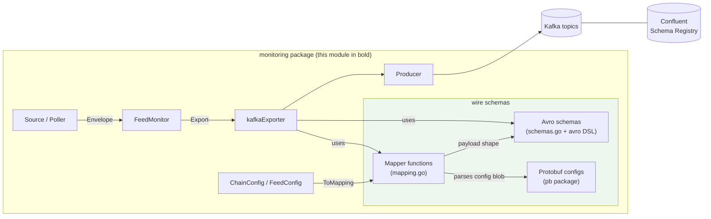
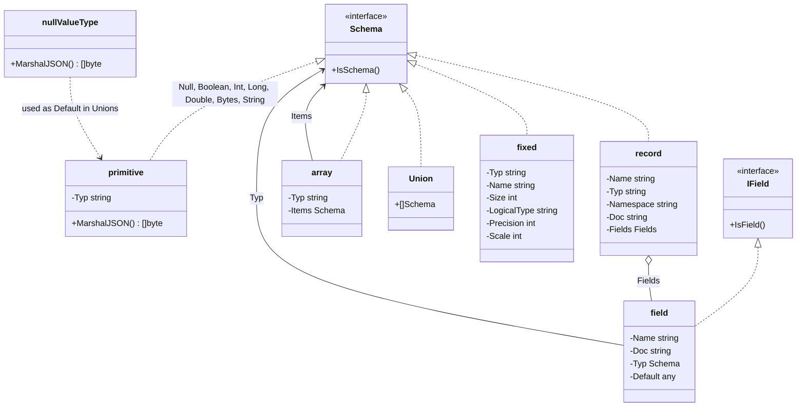
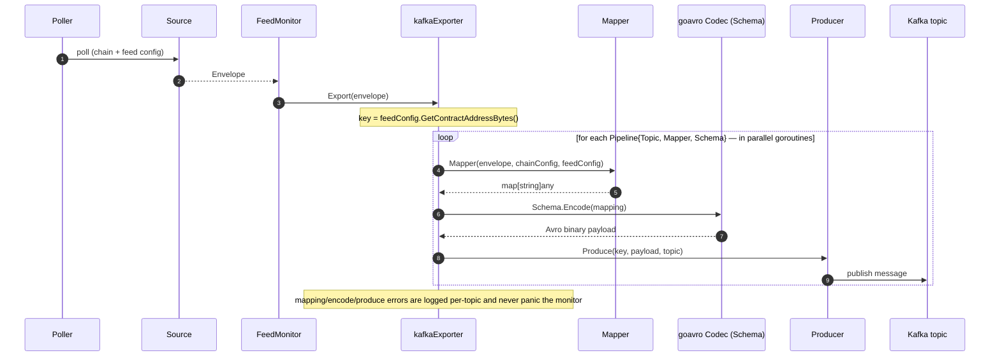
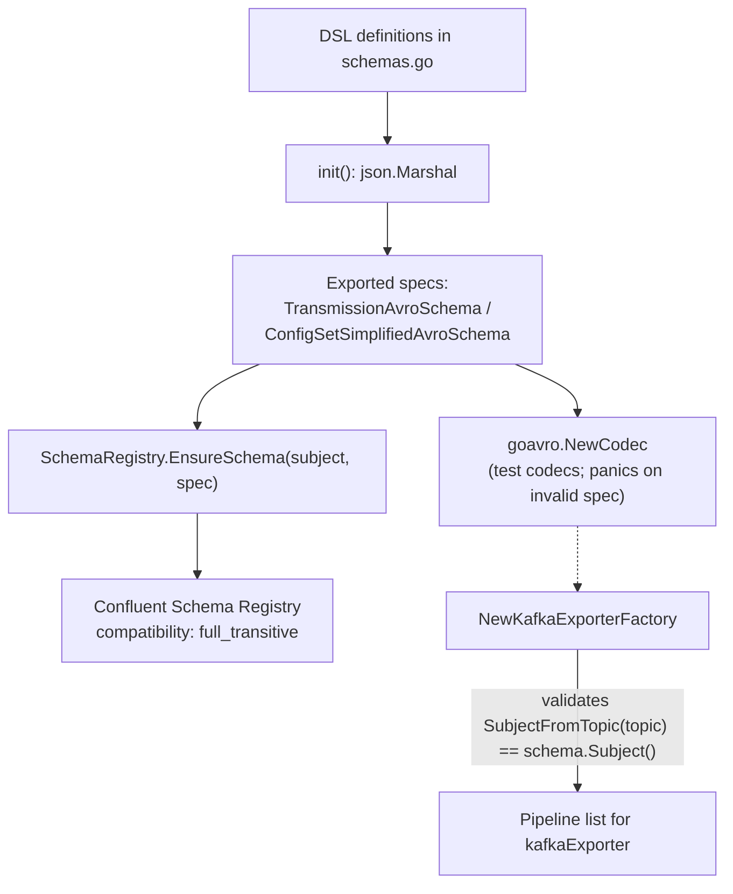

# Monitoring Wire Schemas

> Parent module: [Monitoring](../monitoring.md) · Platform: [Telemetry & Observability Platform](../../Telemetry___Observability_Platform.md)

## 1. Overview

The `monitoring_wire_schemas` module defines the **on-the-wire contract** for OCR2 feed-monitoring data published to Kafka. It is the serialization boundary between the in-memory monitoring pipeline and downstream analytics consumers. The module lives inside the standalone Go module `github.com/smartcontractkit/chainlink-common/pkg/monitoring` (see `chainlink-common/pkg/monitoring/go.mod`) and is responsible for three things:

1. **Avro schema definitions** — a small Go-DSL for building Avro schemas type-safely, plus two concrete OCR2 wire schemas (`transmission` and `config_set_simplified`).
2. **Mapping functions** — transformations from the internal [`Envelope`](monitoring_data_pipeline.md) domain object into `map[string]any` payloads that match the Avro schemas.
3. **Protobuf wire schemas** — `.proto` definitions that mirror libocr's offchain configuration structures, used to decode on-chain config blobs during mapping.

The schemas are consumed by the [Kafka exporter pipeline](monitoring_exporters.md) and synced to a Confluent Schema Registry whose compatibility mode is configured as `full_transitive` in the [ops monitoring stack](../ops-monitoring-stack.md) (`chainlink-common/ops/monitoring/docker-compose.yml`).

## 2. Module Position in the System

Within the Monitoring framework, this module provides the "shape" of every Kafka message:

- The [data pipeline](monitoring_data_pipeline.md) produces an `Envelope` from on-chain sources (poller → source → envelope).
- The [framework](monitoring_framework.md) delivers each `Envelope` to every configured exporter.
- The [Kafka exporter](monitoring_exporters.md) walks its list of `Pipeline{Topic, Mapper, Schema}` triples — **the `Mapper` and `Schema` halves of every pipeline are defined here**.
- The [configuration](monitoring_configuration.md) types (`ChainConfig`, `FeedConfig`) expose `ToMapping()` methods specifically so they can be embedded into Avro payloads.



## 3. Architecture and Component Relationships

### 3.1 Avro Schema DSL (`avro` package)

`chainlink-common/pkg/monitoring/avro/types.go` implements a **DSL that leverages Go's type system** to build valid Avro schemas. Every schema node implements the `Schema` marker interface (`IsSchema()`), and every record field implements `IField` (`IsField()`).



Key building blocks:

| Construct | Constructor / Value | JSON it emits | Purpose |
|---|---|---|---|
| Primitives | `avro.Null`, `avro.Boolean`, `avro.Int`, `avro.Long`, `avro.Double`, `avro.Bytes`, `avro.String` | `"int"`, `"string"`, … | Avro primitive types. `primitive.MarshalJSON` marshals only the type string. |
| Record | `avro.Record(name, opts, fields)` | `{"name":…, "type":"record", "fields":[…]}` | Top-level and nested structured types, with optional `Namespace` and `Doc`. |
| Field | `avro.Field(name, opts, typ)` | `{"name":…, "type":…, "doc":…, "default":…}` | A record member. `Opts.Default` supplies Avro field defaults. |
| Array | `avro.Array(items)` | `{"type":"array","items":…}` | Homogeneous list type. |
| Union | `avro.Union{...}` | JSON array of member schemas | Typically `[null, X]` to make fields "optional" for compatibility. |
| Fixed / Decimal | `avro.Fixed(name, size)`, `avro.Decimal(name, size, precision, scale)` | fixed with `"logicalType":"decimal"` | 78-digit decimals (size 32, precision 78, scale 0) used for on-chain 256-bit integers. |
| Null default | `avro.NullValue` (type `nullValueType`) | `null` | Sentinel **default value** for optional union fields — distinct from the `avro.Null` *type* used in union membership. |

All types implement `MarshalJSON` (or rely on struct tags) so a complete schema tree marshals directly into a JSON-encoded Avro schema specification.

### 3.2 Schema Parsing (`avro/helpers.go`)

`ParseSchema(schema Schema)` closes the loop between the DSL and the runtime codec:

```go
func ParseSchema(schema Schema) (jsonEncodedSchema string, codec *goavro.Codec, err error)
```

It JSON-marshals the DSL tree and hands the JSON string to `github.com/linkedin/goavro/v2` (`goavro.NewCodec`), returning both the registry-ready spec and a codec capable of binary `Encode`/`Decode`. Both steps are wrapped with descriptive errors (`failed to encode Avro schema to JSON`, `failed to parse JSON-encoded Avro schema into a codec`).

### 3.3 Predefined Wire Schemas (`schemas.go`)

`chainlink-common/pkg/monitoring/schemas.go` defines the two OCR2 wire schemas in the namespace `link.chain.ocr2` and eagerly materializes them in `init()`:

1. **`transmission`** → exported as `TransmissionAvroSchema` (JSON string).
2. **`config_set_simplified`** → exported as `ConfigSetSimplifiedAvroSchema` (JSON string).

`init()` marshals each DSL definition to JSON (panicking on failure — schemas are compile-time assets) and builds test-only codecs (`transmissionCodec`, `configSetSimplifiedCodec`). The header comment is the module's cardinal rule:

> *"changes to these schemas need to be both forward and backward compatible, ie. FULL_TRANSITIVE."*
> — `chainlink-common/pkg/monitoring/schemas.go`, referencing the [Confluent Schema Registry Avro rules](https://docs.confluent.io/platform/current/schema-registry/avro.html).

#### `transmission` schema (one OCR2 feed round)

| Field | Avro type | Notes |
|---|---|---|
| `block_number` | `bytes` | uint64, big-endian encoded |
| `block_number_uint64` | `union{null, decimal(32,78,0)}` | logical decimal `transmission_block_number` |
| `answer.data` | `bytes` | raw `*big.Int` bytes |
| `answer.data_uint256` | `union{null, decimal(32,78,0)}` | `transmission_data` |
| `answer.timestamp` | `long` | unix seconds of `LatestTimestamp` |
| `answer.config_digest` | `union{null, string}` | 32-byte digest, base64-encoded |
| `answer.epoch` / `answer.round` | `union{null, long}` / `union{null, int}` | OCR round identifiers |
| `chain_config` | `union{null, record}` | `network_name`, `network_id`, `chain_id` — doc says "required!" |
| `solana_chain_config` | `record` | **deprecated** in favour of `chain_config` (emitted as empty strings by the mapper) |
| `feed_config` | `record` | `feed_name`, `feed_path`, `symbol`, `heartbeat_sec`, `contract_type`, `contract_status`, `contract_address` (bytes), `contract_address_string` (union), plus **deprecated** `transmissions_account` / `state_account` bytes |
| `link_balance` | `union{null, bytes}` | raw LINK balance |
| `link_balance_uint256` | `union{null, decimal(32,78,0)}` | `transmission_link_balance` |

#### `config_set_simplified` schema (OCR2 contract configuration)

Carries the signing-set and timing configuration: `config_digest` (base64 string), `block_number` / `block_number_uint64` (decimal `config_block_number`), JSON-encoded `signers`, `transmitters`, `s` (schedule) and `oracles` arrays, `f`, `r_max`, `feed_state_account`, and the five `delta_*` timing fields (`progress`, `resend`, `round`, `grace`, `stage`), each present as raw `bytes` (uint64 big-endian) **and** as an optional `decimal` union (`config_delta_*`).

The dual `bytes` + `_uint64` decimal representation is a compatibility strategy: legacy consumers read the big-endian bytes, while the decimal unions (nullable for `FULL_TRANSITIVE` evolution) provide consumer-friendly numeric values. Similarly, union-wrapped fields exist because Avro requires new optional members to have defaults; the schema docs mark them "optional for FULL_TRANSITIVE compatibility, but they should be set in all cases."

### 3.4 Mapping Layer (`mapping.go`)

A `Mapper` is a pure function contract:

```go
type Mapper func(Envelope, ChainConfig, FeedConfig) (map[string]any, error)
```

It converts an `Envelope` (the [pipeline's data source output](monitoring_data_pipeline.md)) plus chain/feed configuration into the map shape demanded by an Avro schema. Two production mappers exist, and both are compile-time checked against the contract (`var _ Mapper = MakeTransmissionMapping`):

**`MakeTransmissionMapping`** populates the `transmission` shape:
- Reads `envelope.LatestAnswer`, `BlockNumber`, `LatestTimestamp`, `ConfigDigest`, `Epoch`, `Round`, `LinkBalance`.
- Emits each value twice (raw bytes **and** a `*big.Rat` under the `*_uint64` / `data_uint256` decimal keys) using helpers `uint64ToBeBytes`, `uint64ToBigRat`, `bigIntToBigRat`.
- Embeds `chainConfig.ToMapping()` under `chain_config` and `feedConfig.ToMapping()` under `feed_config` (both interfaces in [monitoring configuration](monitoring_configuration.md) guarantee `ToMapping` "for serializing to avro / encoding kafka messages").
- Writes deprecated `solana_chain_config` as empty strings to satisfy schema-required fields.

**`MakeConfigSetSimplifiedMapping`** populates the `config_set_simplified` shape. Its defining step is decoding `envelope.ContractConfig.OffchainConfig` — an opaque on-chain blob — via protobuf:

```go
func parseOffchainConfig(buf []byte) (*pb.OffchainConfigProto, error) // proto.Unmarshal
```

It then marshals `Signers`, `Transmitters`, and the schedule `S` (converted `[]uint32 → []int64`) to JSON strings, and zips `OffchainPublicKeys` + `PeerIds` + `Transmitters` into a JSON `oracles` array (`createConfigSetSimplifiedOracles` fails fast on length mismatches).

```mermaid
flowchart TD
    ENV["Envelope<br/>(from Source)"] --> M1["MakeTransmissionMapping"]
    ENV --> M2["MakeConfigSetSimplifiedMapping"]
    CC["ChainConfig"] -->|ToMapping| M1
    FC["FeedConfig"] -->|ToMapping| M1
    FC -->|GetContractAddress| M2
    ENV -->|"ContractConfig.OffchainConfig blob"| P1["proto.Unmarshal →<br/>OffchainConfigProto"]
    P1 --> M2
    M1 -->|map[string]any| S1["transmission schema<br/>Encode"]
    M2 -->|map[string]any| S2["config_set_simplified schema<br/>Encode"]
```

### 3.5 Protobuf Wire Schemas (`pb` package)

Two `.proto` files define the structures used to interpret OCR2 configuration data that only exists as opaque bytes on-chain. They are plain `proto3` messages (generated Go code lives in the same `pb` package; `option go_package = ".;pb"`):

**`pb/offchainreporting2_monitoring_offchain_config.proto` — `OffchainConfigProto`**

Mirrors libocr's serialized `OffchainConfig`: the five timing deltas in nanoseconds (`delta_progress`, `delta_resend`, `delta_round`, `delta_grace`, `delta_stage`), `r_max`, the `s` schedule, `offchain_public_keys`, `peer_ids`, `reporting_plugin_config`, per-plugin phase `max_duration_*` fields, and `shared_secret_encryptions` (`SharedSecretEncryptionsProto`: Diffie–Hellman point, shared-secret hash, encrypted shares).

**`pb/offchainreporting2_monitoring_median_config.proto` — `NumericalMedianConfigProto`**

The median reporting-plugin's config (`alpha_report_infinite`/`alpha_report_ppb`, `alpha_accept_infinite`/`alpha_accept_ppb`, `delta_c_nanoseconds`) — the "median" counterpart of the deviation/tolerance parameters referenced by job specs in the node status reporter.

## 4. Runtime Data Flow

The following sequence shows how a monitoring update traverses the wire-schema layer and reaches Kafka. The exporter behavior lives in [monitoring_exporters](monitoring_exporters.md); this module supplies the `Mapper` and `Schema` of each `Pipeline`.



Bootstrap-time flow (schema assets and registry sync):



Two contracts from the surrounding [monitoring module](../monitoring.md) matter here:

- **`Schema`** (`schema.go`): `ID()`, `Version()`, `Subject()`, `Encode(any)`, `Decode([]byte)` — the abstraction behind which a `goavro` codec (or registry-backed variant) operates.
- **`SchemaRegistry`** (`schema_registry.go`): `EnsureSchema(subject, spec)` creates the subject if absent, bumps the version when the spec changes, and is a no-op when identical — this is what makes schema evolution safe at deploy time.

The deployment target is the Confluent stack (zookeeper + kafka + schema-registry) declared in `chainlink-common/ops/monitoring/docker-compose.yml`, which pins `SCHEMA_REGISTRY_SCHEMA_COMPATIBILITY_LEVEL: 'full_transitive'` — the compatibility level the schema comments are written against. Detailed operations guidance is in [ops monitoring stack](../ops-monitoring-stack.md).

## 5. Integration Notes

- **Who consumes this module?** The [Kafka exporter factory](monitoring_exporters.md) (`NewKafkaExporterFactory`) wires `Pipeline` entries together; `kafkaExporter.Export` type-asserts incoming data to `Envelope` and refuses anything else, so `Mapper` inputs are always the pipeline's native output.
- **Topic/subject coupling.** Factory construction fails fast if `SubjectFromTopic(topic)` does not equal the pipeline schema's `Subject()` — topic naming is therefore part of the wire contract.
- **Testing support.** Test doubles such as `fakeEnvelopeSourceFactory`, `generateEnvelope`, and `fakeSchema` are provided by [monitoring testutils](monitoring_testutils.md); the `transmissionCodec`/`configSetSimplifiedCodec` built in `schemas.go` are explicitly test-only.
- **Related wire-schema families.** This module covers OCR2 feed monitoring over Kafka. Streaming event telemetry uses a different wire contract: see [Beholder wire schemas](../beholder-telemetry/beholder-telemetry_wire-schemas.md) (`base_message.proto`) and the [Chip Ingress protocol](../chip-ingress/chip-ingress_protocol.md).
- **Balance monitoring** shares the same mapping/exporter machinery for balance-specific envelopes — see [monitoring_balance](monitoring_balance.md).

## 6. Schema Evolution Guidelines

When changing `transmission` or `config_set_simplified`:

1. **Never break `FULL_TRANSITIVE` compatibility** — every addition must be a union with a default (`avro.NullValue`) or otherwise have an Avro default; removals/renames are only possible via deprecation + dual fields (see `solana_chain_config`, `transmissions_account`, `state_account`).
2. **Update the mapper in the same change** so the emitted map always matches the schema; mismatches surface as `Schema.Encode` failures logged by the exporter.
3. **Keep the dual representation** (`bytes` + `_uint64` decimal) pattern for numeric fields: add the decimal union for new consumers, keep legacy bytes populated.
4. **Registry sync is idempotent** — `EnsureSchema` creates, versions, or no-ops, so the changed spec only takes effect once deployed and the version bumps.

## 7. Related Documentation

| Topic | Page |
|---|---|
| Monitoring module overview & exports | [Monitoring](../monitoring.md) |
| Envelope / Source / Poller production | [Monitoring data pipeline](monitoring_data_pipeline.md) |
| `Pipeline`, Kafka exporter, Prometheus exporter | [Monitoring exporters](monitoring_exporters.md) |
| `ChainConfig` / `FeedConfig` / `ToMapping` | [Monitoring configuration](monitoring_configuration.md) |
| Monitor / FeedMonitor / Manager lifecycle | [Monitoring framework](monitoring_framework.md) |
| Kafka + Schema Registry deployment | [Ops monitoring stack](../ops-monitoring-stack.md) |
| Event-telemetry wire schemas (`base_message.proto`) | [Beholder wire schemas](../beholder-telemetry/beholder-telemetry_wire-schemas.md) |
| Streaming telemetry ingress protocol | [Chip Ingress protocol](../chip-ingress/chip-ingress_protocol.md) |
| Balance monitoring pipeline | [Monitoring balance](monitoring_balance.md) |
