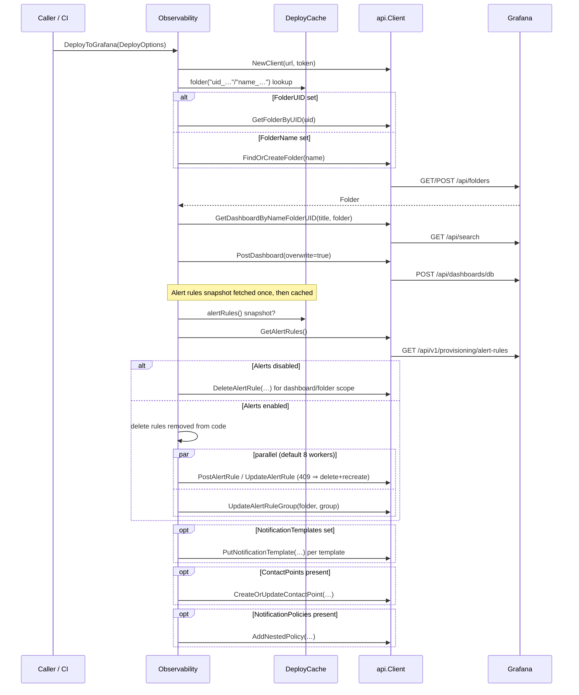
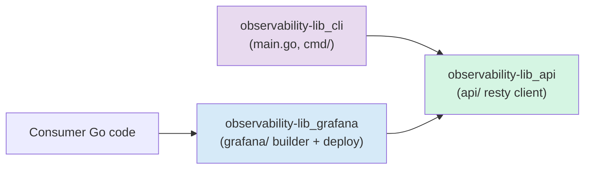

# observability-lib

> **Module path:** `chainlink-common/observability-lib/` · **Go module:** `github.com/smartcontractkit/chainlink-common/observability-lib`

## 1. Purpose and Overview

`observability-lib` is the **"observability as code" toolkit** of the Chainlink platform. It enables engineers to define, generate, deploy and manage **Grafana resources in Go code** instead of clicking through the Grafana UI:

- **Dashboards** (panels, rows, variables, overrides, transforms)
- **Alert rules** and **alert rule groups** (Grafana-managed alerting)
- **Contact points** (notification receivers, e.g. Slack/PagerDuty)
- **Notification policies** (routing trees for alerts)
- **Notification templates** (message templates)

The module ships in two usable forms:

1. **A Go library** — the `grafana` package provides a fluent `Builder` API to compose dashboards and alerts, plus a `DeployToGrafana` routine that reconciles them with a live Grafana instance. It is consumed by other Chainlink repositories and teams to version-control their dashboards.
2. **A CLI binary** (`observability-lib`) — a small `cobra` command line tool for inspecting and deleting Grafana resources (`api contact-point list/delete`, `api dashboard delete`, `api notification-policy list/delete`, `api rule delete`).

It is a **standalone Go module** (see `chainlink-common/observability-lib/go.mod`), so it can be imported without pulling in the whole `chainlink-common` dependency tree. Its runtime dependencies are deliberately minimal:

| Dependency | Role |
|---|---|
| `github.com/go-resty/resty/v2` | HTTP client used for all Grafana REST calls |
| `github.com/grafana/grafana-foundation-sdk/go` | Official Grafana schema types & builders (dashboards, alerting) |
| `github.com/spf13/cobra` | CLI framework for the `observability-lib` binary |
| `golang.org/x/sync` | `errgroup` for bounded-parallel alert-rule deployment |
| `github.com/stretchr/testify` / `gopkg.in/yaml.v3` | Testing and golden-file support |

## 2. Architecture Overview

The module is a three-layer stack. Each layer depends only on the layer below it:

```mermaid
flowchart TB
    subgraph Consumer["Consumers (other repos / teams)"]
        A["Go code defining dashboards<br/>& alerts via Builder API"]
    end

    subgraph CLI["CLI layer — cmd/ + main.go"]
        C1["cobra root command<br/>cmd/root.go"]
        C2["api subcommands:<br/>dashboard, contact-point,<br/>notification-policy, rule"]
    end

    subgraph GrafanaLayer["Builder & Deployment layer — grafana/"]
        G1["Builder<br/>(dashboard/panel/variable/alert<br/>composition, Build())"]
        G2["Observability<br/>(DeployToGrafana, DeleteDashboard)"]
        G3["DeployCache + parallelFor<br/>(memoization, bounded concurrency)"]
        G4["Panel, variable, alert,<br/>override & transform helpers"]
    end

    subgraph APILayer["HTTP API layer — api/"]
        K1["Client (resty)<br/>Bearer-token auth"]
        K2["Resource endpoints:<br/>folders, dashboards, alert rules,<br/>rule groups, contact points,<br/>notification policies/templates, datasources"]
    end

    T["Grafana instance<br/>(HTTP REST API)"]

    A --> G1
    G1 -->|Build()| G2
    G2 --> G3
    G4 --> G1
    G2 --> K2
    CLI --> APILayer
    K1 --> K2
    K2 -->|resty REST calls| T

    style T fill:#f9e79f
    style GrafanaLayer fill:#d6eaf8
    style APILayer fill:#d5f5e3
    style CLI fill:#e8daef
```

**Layer responsibilities:**

| Layer | Package(s) | Responsibility |
|---|---|---|
| CLI | `main.go`, `cmd/` | Thin `cobra` wrapper exposing resource list/delete operations directly against the API layer. |
| Builder & deployment | `grafana/` | Fluent dashboard/alert construction (`Builder`, panel & variable factories) and the declarative **reconciliation deploy loop** (`Observability.DeployToGrafana`, `DeleteDashboard`), including caching and parallelism. |
| HTTP API | `api/` | Auto-thin REST client over Grafana's `/api` and `/api/v1/provisioning` endpoints, one file per resource type. |

### How it fits into the Telemetry & Observability Platform

Within the wider platform (see [Telemetry & Observability Platform](../Telemetry___Observability_Platform.md)), `observability-lib` is the **presentation/dashboarding tier**:

- It does **not** emit telemetry itself. Telemetry generation and transport are handled by sibling modules: [beholder-telemetry](beholder-telemetry.md) (OTLP/protobuf emission), [chip-ingress](chip-ingress.md) (telemetry ingress protocol), [telemetry_ingress](telemetry_ingress.md) (node-side WS-RPC clients) and [monitoring](monitoring.md) (feed/chain monitoring pipeline producing to Kafka).
- It **consumes** whatever lands in the metrics backend: dashboards built with this library query Prometheus data sources, and the [ops-monitoring-stack](ops-monitoring-stack.md) (Kafka/ZooKeeper/Schema-Registry) plus the local dev stack in `chainlink/tools/docker/docker-compose.observability.yaml` (Prometheus + Grafana 10.4 + Alertmanager on ports 9090/3000/9093) are typical deployment targets for the dashboards and alerts this library provisions.
- Teams typically commit their dashboard/alert definitions as Go code and run `Observability.DeployToGrafana` from CI against a Grafana service account token.

## 3. Deployment Flow

The heart of the module is `Observability.DeployToGrafana` (`grafana/dashboard.go`), which declaratively reconciles one dashboard bundle with a live Grafana:



Key behavioural details:

- **Declarative deletes** — rules that exist in Grafana but are no longer defined in code are deleted (stale-rule reconciliation), scoped by dashboard UID annotation (`__dashboardUid__`) or by folder + rule-group name.
- **Provenance migration** — a `409 Conflict` on update (rule stored with a different provenance) is handled by delete-then-recreate.
- **Caching** — `DeployCache` memoizes folder resolution and the full alert-rule snapshot across multiple `DeployToGrafana` calls in one run, so composite deployments pay each Grafana lookup once. A no-op cache is substituted when none is provided.
- **Concurrency** — alert-rule writes run through `parallelFor` with a bounded errgroup (default 8, configurable via `DeployOptions.Concurrency`).

## 4. Sub-modules

The module splits cleanly into three sub-modules. Detailed documentation for each is generated under `Telemetry___Observability_Platform/observability-lib/`:

| Sub-module | Documentation file | Contents |
|---|---|---|
| **Grafana HTTP API client** | [observability-lib_api.md](observability-lib/observability-lib_api.md) | `api/` package — the resty-based `Client` and one resource file each for folders, dashboards, alert rules, rule groups, contact points, notification policies & templates, and datasources. |
| **Dashboard builder & deployment** | [observability-lib_grafana.md](observability-lib/observability-lib_grafana.md) | `grafana/` package — `Builder`, `Observability`, `DeployOptions`/`DeployCache`, panel & variable factories, alert helpers, panel-ID bookkeeping and golden-file tests. |
| **CLI** | [observability-lib_cli.md](observability-lib/observability-lib_cli.md) | `main.go` + `cmd/` — the `observability-lib` binary and its `api <resource> <action>` cobra command tree. |

Dependency direction between the sub-modules (each level imports only the level below):



## 5. Build, Test and Tooling

The module's `Makefile` (`chainlink-common/observability-lib/Makefile`) defines five targets:

| Target | Command | Purpose |
|---|---|---|
| `build` | `go build -o observability-lib .` | Compiles the CLI binary. |
| `run` | `./observability-lib` (depends on `build`) | Runs the CLI locally. |
| `lint` | `golangci-lint run` | Static analysis. |
| `test` | `go test ./...` | Unit + golden-file tests. |
| `update` | `go test ./dashboards/... -update=1` | Regenerates golden dashboard JSON snapshots after intentional changes. |

The `update` target is notable: dashboard definitions are verified against checked-in golden JSON files, so visual regressions in generated dashboards are caught in CI. Panel-ID determinism is additionally guarded by dedicated tests (`grafana/panel_ids_test.go`), since stable panel IDs are required for alert-to-panel annotations (`__panelId__`).

Example CLI usage (from `README.md`):

```shell
./observability-lib api contact-point list --grafana-url http://localhost:3000 --grafana-token <token>
./observability-lib api dashboard delete <name>  --grafana-url http://localhost:3000 --grafana-token <token>
./observability-lib api notification-policy delete <receiverName> --grafana-url http://localhost:3000 --grafana-token <token> --matchers key,=,value
```

## 6. Repository Pointers

- Library root: `chainlink-common/observability-lib/`
- README with quickstart: `chainlink-common/observability-lib/README.md`
- Go module definition: `chainlink-common/observability-lib/go.mod`
- Build targets: `chainlink-common/observability-lib/Makefile`
- Local Grafana/Prometheus stack used as a deployment target in development: `chainlink/tools/docker/docker-compose.observability.yaml`
- Ops Kafka monitoring stack (sibling module): `chainlink-common/ops/monitoring/docker-compose.yml`
