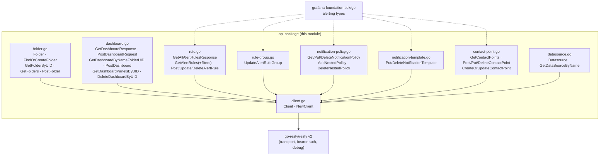
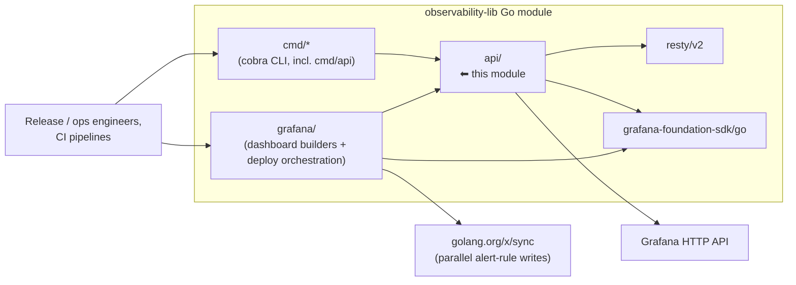
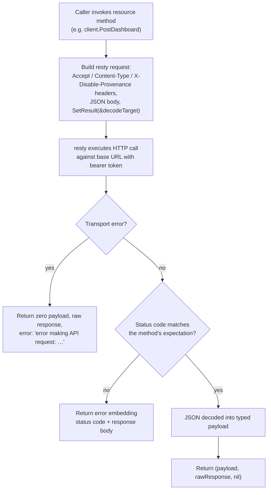
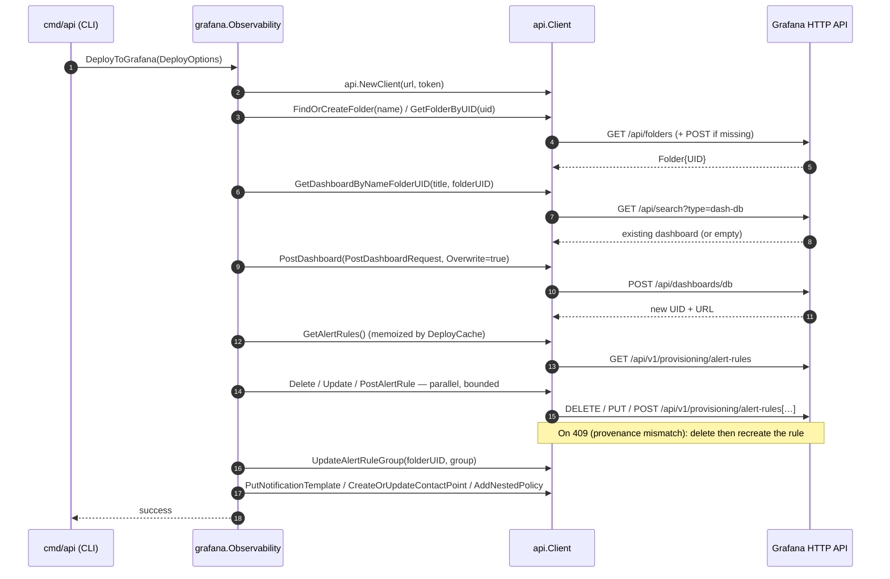
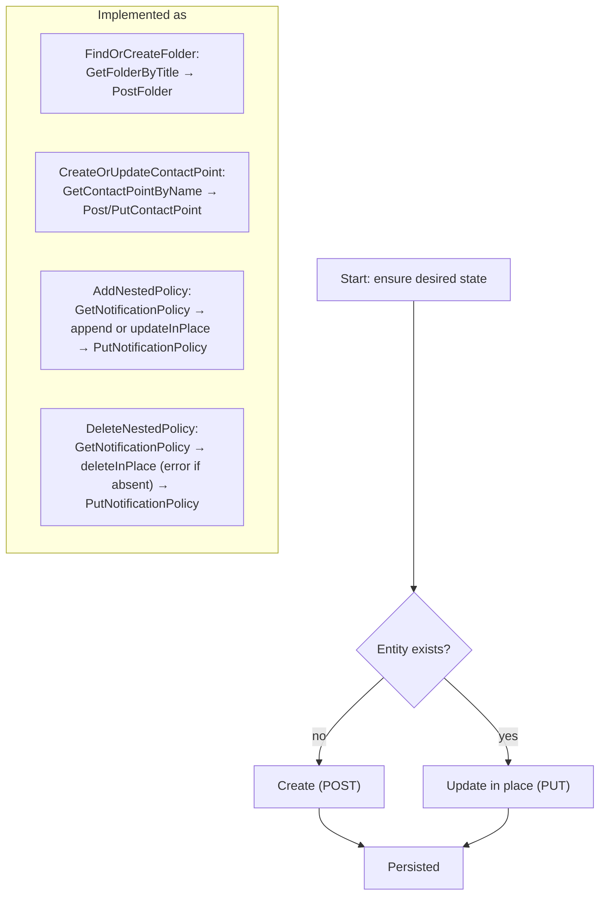

# observability-lib — API Client (`api` package)

## Introduction

The `api` package (source root: `chainlink-common/observability-lib/api/`) is the **Grafana HTTP client layer** of the [observability-lib](../observability-lib.md) module. It wraps the [`go-resty/resty`](https://github.com/go-resty/resty) HTTP client and exposes a small, typed, uniform CRUD surface over Grafana's HTTP API, covering:

- **Folders** — grouping containers for dashboards and alert rules
- **Dashboards** — search, create/update (upsert), panel introspection, deletion
- **Alert rules** — full CRUD over Grafana's unified alerting provisioning API
- **Alert rule groups** — group-level updates within a folder
- **Notification policies** — read/replace of the notification policy *tree*, plus nested-route surgery
- **Notification templates** — create/update/delete
- **Contact points** — full CRUD with name-based upsert
- **Datasources** — lookup by name

It is consumed by two siblings inside the same Go module:
- the [`grafana`](observability-lib_grafana.md) package, whose `Observability.DeployToGrafana` / `DeleteDashboard` orchestrators drive multi-step provisioning through this client, and
- the [`cmd/api`](observability-lib_cli.md) Cobra commands, which expose the client's operations as a CLI (`api [resources]` with required `--grafana-url` and `--grafana-token` flags).

| Fact | Value |
| --- | --- |
| Go module | `github.com/smartcontractkit/chainlink-common/observability-lib` (`chainlink-common/observability-lib/go.mod`, Go 1.26.6) |
| Package | `api` |
| Primary dependency | `github.com/go-resty/resty/v2` (v2.17.2) |
| Domain types | `github.com/grafana/grafana-foundation-sdk/go` (v0.0.18) — `alerting.Rule`, `RuleGroup`, `ContactPoint`, `NotificationPolicy`, `NotificationTemplate` |
| Auth model | Grafana **service-account API token** sent as `Authorization: Bearer <token>` |
| Build/test | `chainlink-common/observability-lib/Makefile` (`build`, `run`, `lint`, `test`, `update`) |

---

## Architecture

### Component map

Every resource file in the package follows the same shape: a request/response type (or a re-use of a `grafana-foundation-sdk` type) plus methods hanging off the shared `Client`.



### Position within the observability-lib module and the observability platform



### Where this fits in the wider platform

The `api` package is the *provisioning* side of the Chainlink observability story. It does **not** emit telemetry; it configures the **Grafana** side of the stack that consumes telemetry:

- Node-side emission (traces, logs, metrics, protobuf custom messages) is handled by [Beholder](../beholder-telemetry.md) — see in particular the [Beholder client](../beholder-telemetry/beholder-telemetry_client.md).
- On-chain / feed monitoring (Kafka + Avro + Prometheus exporters) is the [monitoring framework](../monitoring.md).
- The backend data plane (Kafka, schema registry, Prometheus, etc.) is the [ops monitoring stack](../ops-monitoring-stack.md).
- A local Grafana target for this client can be stood up with `chainlink/tools/docker/docker-compose.observability.yaml` (services: `grafana`, `prometheus`, `alertmanager`).

The typical consumer flow is: **product team defines dashboards/alerts as Go objects (via the [`grafana`](observability-lib_grafana.md) builders) → `api` client pushes them into Grafana** at deploy time or via the [`cmd/api`](observability-lib_cli.md) CLI.

---

## The `Client`

`client.go` defines the entire transport configuration of the package:

```go
func NewClient(url string, apiKey string) *Client
```

| Behaviour | Detail |
| --- | --- |
| Base URL | `resty.SetBaseURL(url)` — all endpoints below are relative to it |
| Authentication | Fixed header `Authorization: Bearer <apiKey>` on every request |
| Debugging | `DEBUG_RESTY=true` in the environment enables resty's verbose request/response logging (`SetDebug`) |
| Concurrency safety | A single `Client` may be shared; the [`grafana`](observability-lib_grafana.md) deployer issues concurrent alert-rule writes through one client (bounded by `DeployOptions.Concurrency`) |

There is no retry, timeout, or rate-limit policy in this layer — callers configure resty behavior implicitly by trusting Grafana's default server-side limits.

---

## API surface reference

The table below maps every client method to the Grafana endpoint it drives and the HTTP status code it treats as success. The triple return convention `(payload, *resty.Response, error)` is used throughout so callers can inspect raw responses (e.g. the provenance-migration logic on HTTP 409 in `grafana.DeployToGrafana` — see [grafana package](observability-lib_grafana.md)).

### Folders (`folder.go`)

| Client method | HTTP | Endpoint | Success | Notes |
| --- | --- | --- | --- | --- |
| `GetFolders()` | GET | `/api/folders?limit=1000` | 200 | List, capped at 1000 |
| `GetFolderByUID(uid)` | GET | `/api/folders/{uid}` | 200 | **404 ⇒ `(nil, nil)`** — absence is not an error |
| `GetFolderByTitle(title)` | — | (client-side scan of `GetFolders`) | — | Returns `nil, nil` when absent |
| `PostFolder(name)` | POST | `/api/folders` | **200** | Body `{"title": name}` |
| `FindOrCreateFolder(name)` | — | orchestration | — | Get-by-title → `PostFolder` if missing |

> **Note:** `Folder.ID` is `int64` because Grafana returns `-1` as the ID for some built-in folders (e.g. the *General* folder); `UID` is the stable handle used everywhere else.

### Dashboards (`dashboard.go`)

| Client method | HTTP | Endpoint | Success | Notes |
| --- | --- | --- | --- | --- |
| `GetDashboardByNameFolderUID(name, folderUID)` | GET | `/api/search?type=dash-db&query={name}` | 200 / 201 | Case-insensitive match on both title **and** `folderUID`; skips entries with nil `Title`/`FolderUID`/`UID` |
| `PostDashboard(req)` | POST | `/api/dashboards/db` | 200 / 201 | `PostDashboardRequest{Dashboard, FolderID?, FolderUID?, Overwrite}` — upsert when `Overwrite: true` |
| `GetDashboardPanelsByUID(uid)` | GET | `/api/dashboards/uid/{uid}` | 200 | **404 ⇒ `(nil, resp, nil)`**; recursively flattens nested row panels into `[]DashboardPanel{ID, Title, Type}` |
| `DeleteDashboardByUID(uid)` | DELETE | `/api/dashboards/uid/{uid}` | 200 / 201 | |

### Alert rules (`rule.go`)

| Client method | HTTP | Endpoint | Success | Notes |
| --- | --- | --- | --- | --- |
| `GetAlertRules()` | GET | `/api/v1/provisioning/alert-rules` | 200 | Full rule list (`[]alerting.Rule`) |
| `GetAlertRulesByDashboardUID(uid)` | — | filter of `GetAlertRules` | — | Matches rule annotation `__dashboardUid__` |
| `GetAlertRulesByFolderUIDAndGroupName(folderUID, group)` | — | filter of `GetAlertRules` | — | Matches `FolderUID` + `RuleGroup` |
| `PostAlertRule(rule)` | POST | `/api/v1/provisioning/alert-rules` | **201** | `X-Disable-Provenance: true` |
| `UpdateAlertRule(uid, rule)` | PUT | `/api/v1/provisioning/alert-rules/{uid}` | 200 | `X-Disable-Provenance: true` |
| `DeleteAlertRule(uid)` | DELETE | `/api/v1/provisioning/alert-rules/{uid}` | **204** | |

### Alert rule groups (`rule-group.go`)

| Client method | HTTP | Endpoint | Success | Notes |
| --- | --- | --- | --- | --- |
| `UpdateAlertRuleGroup(folderUID, group)` | PUT | `/api/v1/provisioning/folder/{folderUID}/rule-groups/{*group.Title}` | 200 | Replaces the whole group definition; `X-Disable-Provenance: true` |

### Notification policies (`notification-policy.go`)

The notification policy is a **tree**; this file provides both raw tree replacement and surgical nested-route editing.

| Client method | HTTP | Endpoint | Success | Notes |
| --- | --- | --- | --- | --- |
| `GetNotificationPolicy()` | GET | `/api/v1/provisioning/policies` | 200 | Returns the whole tree (`GetNotificationPolicyResponse`) |
| `PutNotificationPolicy(tree)` | PUT | `/api/v1/provisioning/policies` | **202** | Replaces the whole tree; `X-Disable-Provenance: true` |
| `DeleteNotificationPolicy()` | DELETE | `/api/v1/provisioning/policies` | **202** | Clears the tree |
| `AddNestedPolicy(route)` | — | orchestration | — | Fetch tree → append or in-place update → `PutNotificationPolicy` (see below) |
| `DeleteNestedPolicy(route)` | — | orchestration | — | Fetch tree → error if absent → splice out → `PutNotificationPolicy` |
| `PrintPolicyTree(policy, depth)` | — | (stdout helper) | — | Debug formatter for the matcher/receiver tree |

Tree surgery internals (`policyExist`, `updateInPlace`, `deleteInPlace`) match a route by **`ObjectMatchers` equality (order-insensitive) + `Receiver` equality**, and recurse into nested `Routes`.

### Notification templates (`notification-template.go`)

| Client method | HTTP | Endpoint | Success |
| --- | --- | --- | --- |
| `PutNotificationTemplate(t)` | PUT | `/api/v1/provisioning/templates/{*t.Name}` | **202** |
| `DeleteNotificationTemplate(name)` | DELETE | `/api/v1/provisioning/templates/{name}` | **204** |

### Contact points (`contact-point.go`)

| Client method | HTTP | Endpoint | Success | Notes |
| --- | --- | --- | --- | --- |
| `GetContactPoints()` | GET | `/api/v1/provisioning/contact-points` | 200 | |
| `GetContactPointByName(name)` | — | client-side scan | — | `nil, nil` when absent |
| `PostContactPoint(cp)` | POST | `/api/v1/provisioning/contact-points` | **202** | `X-Disable-Provenance: true` |
| `PutContactPoint(uid, cp)` | PUT | `/api/v1/provisioning/contact-points/{uid}` | **202** | `X-Disable-Provenance: true` |
| `DeleteContactPoint(uid)` | DELETE | `/api/v1/provisioning/contact-points/{uid}` | **202** | |
| `CreateOrUpdateContactPoint(cp)` | — | orchestration | — | Get-by-name → POST or PUT |

### Datasources (`datasource.go`)

| Client method | HTTP | Endpoint | Success | Notes |
| --- | --- | --- | --- | --- |
| `GetDataSourceByName(name)` | GET | `/api/datasources/name/{name}` | 200 | `name` is `url.PathEscape`d to survive spaces/special characters |

---

## Request lifecycle

Every method in the package executes the same pipeline:



### Convention summary

1. **Uniform return triple.** `(typedPayload, *resty.Response, error)` — the raw response is always returned alongside errors so callers can branch on exact status codes. (The `grafana` deployer uses this to detect HTTP 409 provenance conflicts and delete-and-recreate a rule; see [grafana package](observability-lib_grafana.md).)
2. **404-as-absence.** Only `GetFolderByUID` and `GetDashboardPanelsByUID` translate a 404 into a `nil` payload with `nil` error. Other "lookup by name" helpers (`GetFolderByTitle`, `GetDashboardByNameFolderUID`, `GetContactPointByName`) signal absence by returning a zero value / `nil` pointer with `nil` error after scanning a full list.
3. **Wrapped errors.** All failures wrap the cause with `%w` and embed the offending status code and body — no custom error types are introduced.
4. **Provenance.** All *mutating* alerting-provisioning calls send `X-Disable-Provenance: true` so Grafana records no provenance marker, avoiding read-back/ownership mismatches on subsequent updates.
5. **Success codes vary by API family.** Legacy dashboard/folder APIs expect `200` (creation included); dashboard search/delete accepts `200|201`; alerting provisioning accepts `201` (POST rule) / `202` (POST/PUT/DELETE policies, contact points, templates) / `204` (DELETE rule, template); classic rule APIs use `200`.

---

## Data flow: deploying an `Observability` bundle

The primary consumer is `grafana.Observability.DeployToGrafana` (details on the [grafana page](observability-lib_grafana.md)). The sequence below shows which `api` methods it composes:



Delete flows are symmetric: `grafana.DeleteDashboard` resolves the dashboard by name+folder, deletes its rules via `GetAlertRulesByDashboardUID` + `DeleteAlertRule`, then removes the dashboard with `DeleteDashboardByUID`.

### Idempotent orchestration helpers

Three `api` methods implement *get-then-write* idempotency, which is what makes repeated deploys and CLI invocations safe:



Because name lookups scan full lists (folders ≤ 1000, contact points, all alert rules), the `grafana` package layers a `DeployCache` on top so composite deployments pay each folder/rule lookup once — see [deploy cache & variables](observability-lib_grafana.md).

---

## Usage examples

### Direct API usage

```go
package main

import (
    "os"

    "github.com/smartcontractkit/chainlink-common/observability-lib/api"
)

func main() {
    client := api.NewClient("https://grafana.example.com", os.Getenv("GRAFANA_TOKEN"))

    // Idempotent folder provisioning
    folder, err := client.FindOrCreateFolder("Chainlink Ops")
    if err != nil {
        panic(err)
    }

    // Upsert a dashboard into that folder
    resp, _, err := client.PostDashboard(api.PostDashboardRequest{
        Dashboard: dashboardJSON,   // raw Grafana dashboard model
        FolderUID: folder.UID,
        Overwrite: true,
    })
    if err != nil {
        panic(err)
    }
    _ = resp

    // Guarded deletes: 404 ⇒ no error
    if err := client.DeleteDashboardByUID("some-uid"); err != nil {
        panic(err)
    }
}
```

### Via the deploy orchestrator (recommended)

```go
obs := grafana.Observability{
    Dashboard:            builtDashboard,
    Alerts:               alertRules,
    AlertGroups:          ruleGroups,
    ContactPoints:        contactPoints,
    NotificationPolicies: policies,
}
err := obs.DeployToGrafana(&grafana.DeployOptions{
    GrafanaURL:    "https://grafana.example.com",
    GrafanaToken:  token,
    FolderName:    "Chainlink Ops",
    EnableAlerts:  true,
    Concurrency:   8, // in-flight alert-rule writes
})
```

### Via the CLI

```bash
./observability-lib api dashboard --grafana-url … --grafana-token … [flags]
```

The `api` command group requires `--grafana-url` and `--grafana-token` (enforced in `cmd/api/api.go`) and exposes `dashboard`, `contact_point`, `notification_policy`, and `rule` subcommands — see [observability-lib CLI](observability-lib_cli.md).

---

## Design notes & gotchas

- **Status-code contract is strict and per-method.** E.g. `PostFolder` expects exactly `200` while `PostAlertRule` expects exactly `201`; `GetDashboardByNameFolderUID` accepts `200` *or* `201`. Any deviation surfaces as an error containing the code and body.
- **`X-Disable-Provenance` is set on writes** (alert rules, rule groups, policies, contact points) but **not** on folder/dashboard/template writes — legacy dashboard APIs do not participate in Grafana's provenance scheme.
- **Two different "not found" contracts** coexist (404⇒nil vs. scan⇒zero-value). Prefer the guarded helpers (`FindOrCreateFolder`, `CreateOrUpdateContactPoint`, `AddNestedPolicy`) when idempotency matters.
- **Full-list scans.** Name-based lookups are O(n) over complete lists; batch operations should reuse a `DeployCache` from the `grafana` package instead of re-fetching per resource.
- **`GetFolders` caps at 1000** (`limit=1000` query parameter); larger Grafana instances could truncate folder scans.
- **No pagination** is attempted on any list endpoint other than the single limit parameter above.
- **The client is stateless and cheap** — constructing one per call (as `grafana.DeployToGrafana` does) is fine; sharing is optional.

---

## Build, test & development

The package lives in its **own Go module** (`chainlink-common/observability-lib/go.mod`, module `github.com/smartcontractkit/chainlink-common/observability-lib`, Go 1.26.6), so it is versioned and built independently of `chainlink-common` and the node.

`chainlink-common/observability-lib/Makefile` targets:

| Target | Effect |
| --- | --- |
| `build` | `go build -o observability-lib .` (produces the CLI binary) |
| `run` | build + execute the CLI |
| `lint` | `golangci-lint run` |
| `test` | `go test ./...` |
| `update` | regenerate dashboard golden files (`go test ./dashboards/... -update=1`) |

For a local Grafana target (with Prometheus and Alertmanager), use `chainlink/tools/docker/docker-compose.observability.yaml`; enable wire-level debugging by exporting `DEBUG_RESTY=true`.

---

## Related documentation

- [observability-lib](../observability-lib.md) — parent module overview (this page's parent)
- [observability-lib — Grafana builders & deploy orchestration](observability-lib_grafana.md) — the primary consumer of this API
- [observability-lib — CLI](observability-lib_cli.md) — command-line wrapper around this API
- [Beholder telemetry](../beholder-telemetry.md) — how the *node* emits telemetry (client side of the platform)
- [Monitoring framework](../monitoring.md) — feed/on-chain monitoring exporters
- [Ops monitoring stack](../ops-monitoring-stack.md) — Kafka/Prometheus/Grafana data plane
- [Telemetry & Observability Platform](../../Telemetry___Observability_Platform.md) — platform overview

---

## Source files

| File | Contents |
| --- | --- |
| `chainlink-common/observability-lib/api/client.go` | `Client`, `NewClient` (bearer auth, base URL, debug toggle) |
| `chainlink-common/observability-lib/api/folder.go` | `Folder`, folder list/get/create, `FindOrCreateFolder` |
| `chainlink-common/observability-lib/api/dashboard.go` | Dashboard search/upsert/delete, recursive panel extraction |
| `chainlink-common/observability-lib/api/rule.go` | Alert rule list/filter/create/update/delete |
| `chainlink-common/observability-lib/api/rule-group.go` | `UpdateAlertRuleGroupResponse`, rule-group PUT |
| `chainlink-common/observability-lib/api/notification-policy.go` | Policy tree get/put/delete, nested add/delete, tree printing |
| `chainlink-common/observability-lib/api/notification-template.go` | Template put/delete |
| `chainlink-common/observability-lib/api/contact-point.go` | Contact point list/create/update/delete, `CreateOrUpdateContactPoint` |
| `chainlink-common/observability-lib/api/datasource.go` | `Datasource`, lookup by (escaped) name |
