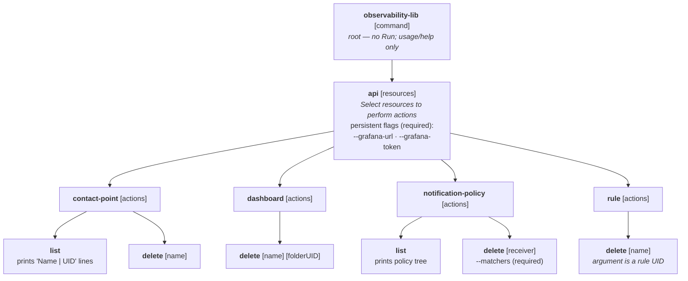
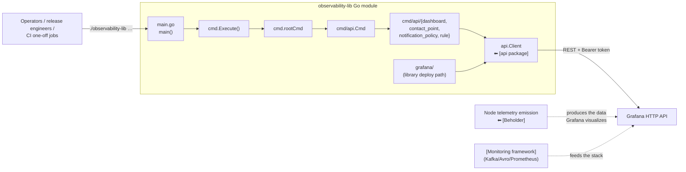
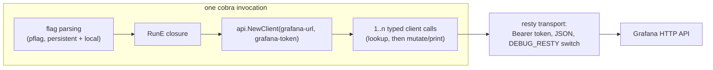
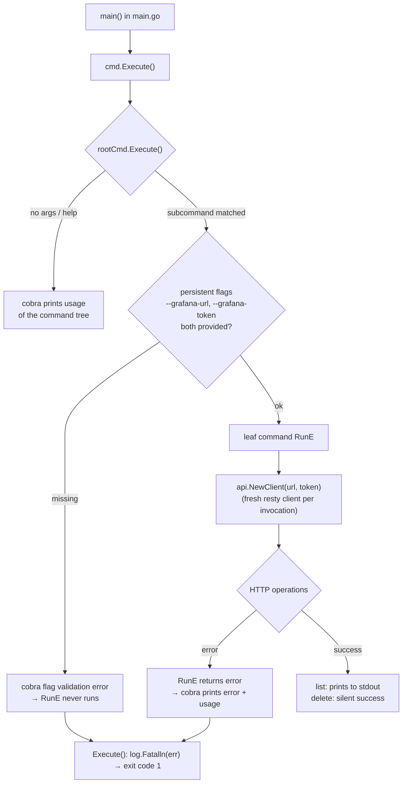
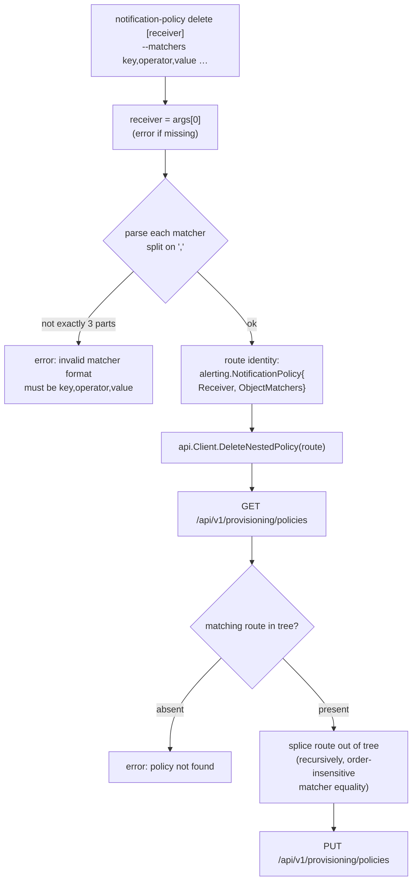
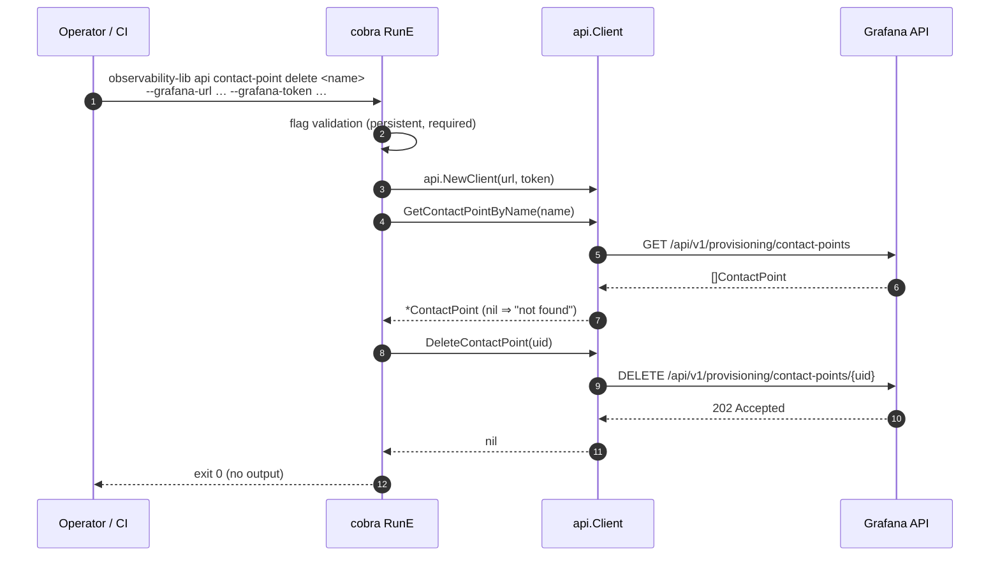
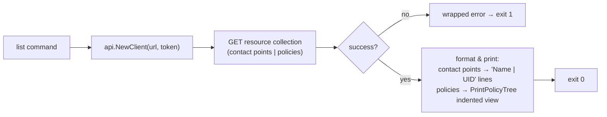

# observability-lib — CLI (`main`, `cmd`)

## Introduction

The CLI module is the **executable entry point** of the [observability-lib](../observability-lib.md) Go module (`chainlink-common/observability-lib`). It compiles to a single binary (`observability-lib`) built on [spf13/cobra](https://github.com/spf13/cobra) and turns the module's Grafana HTTP client ([`api` package](observability-lib_api.md)) into a scriptable command-line tool for **operating on Grafana observability resources**: dashboards, alert rules, contact points, and notification policies.

The CLI is intentionally a thin orchestration layer: every leaf command constructs a fresh `api.Client` from the required `--grafana-url` / `--grafana-token` persistent flags and delegates all HTTP work to the client. It exposes **read** (`list`) and **destructive** (`delete`) operations; *creating/updating* resources is the job of the library path ([`grafana` builders + deployer](observability-lib_grafana.md)) or CI pipelines that import the module.

| Fact | Value |
| --- | --- |
| Go module | `github.com/smartcontractkit/chainlink-common/observability-lib` (`chainlink-common/observability-lib/go.mod`, Go 1.26.6) |
| Packages | `main` (`main.go`), `cmd`, `cmd/api`, `cmd/api/{dashboard, contact_point, notification_policy, rule}` |
| CLI framework | `github.com/spf13/cobra` v1.10.2 (transitively `spf13/pflag`) |
| HTTP client used underneath | `github.com/go-resty/resty/v2` via the [`api` package](observability-lib_api.md) |
| Domain types | `github.com/grafana/grafana-foundation-sdk/go` (v0.0.18) — `alerting.NotificationPolicy`, `alerting.ObjectMatchers` |
| Required flags (all `api` subcommands) | `--grafana-url`, `--grafana-token` (persistent, validated by cobra) |
| Debug knob | `DEBUG_RESTY=true` environment variable (verbose HTTP request/response logging) |
| Build / run / lint / test | `chainlink-common/observability-lib/Makefile` (`build`, `run`, `lint`, `test`, `update`) |

---

## Architecture

### Command tree

The binary is a classic Cobra hierarchy: a silent root command, one resource-selector group (`api`), and per-resource groups whose leaf commands perform actions.



Wiring is done entirely through package-level `init()` functions: each group exports a `Cmd` var, and parents attach children in `init()` (`root.go` adds `api.Cmd`; `api.go` adds the four resource commands and marks both persistent flags required).

### Position within the observability-lib module and the platform



The CLI belongs to the **provisioning/administration** side of the [Telemetry & Observability Platform](../observability-lib.md). It emits no telemetry of its own; it manipulates the Grafana layer that visualizes data produced by [Beholder](../beholder-telemetry.md) (node emission) and the [monitoring framework](../monitoring.md) (feed/chain monitoring), both of which run on the backend stack described in the [ops monitoring stack](../ops-monitoring-stack.md). A local Grafana target suitable for exercising the CLI can be started with `chainlink/tools/docker/docker-compose.observability.yaml` (services: `grafana`, `prometheus`, `alertmanager`).

### Component interaction model

Every leaf command follows the identical interaction pattern — there is no shared client, cache, or state between commands:



---

## Runtime model

### Startup pipeline



Key behaviors:

1. **Exit codes.** `Execute()` wraps `rootCmd.Execute()`; any returned error is fatal via `log.Fatalln` (exit status 1). Successful runs fall through and return normally (exit 0).
2. **Flag validation is upfront.** `--grafana-url` and `--grafana-token` are marked `MarkPersistentFlagRequired` on the `api` group, so any leaf under `api` fails fast with cobra's standard error if either is missing.
3. **Positional-argument validation is per-command.** Leaf commands check `len(args)` inside `RunE` and return plain `errors.New` messages (cobra prints them together with usage).
4. **Fresh client per command.** `api.NewClient` is called inside every `RunE`, so there is no connection reuse across invocations and no stateful behavior — the CLI is safe for concurrent scripted use.
5. **Wire debugging.** The [api client](observability-lib_api.md) enables resty debug logging when `DEBUG_RESTY=true`; the CLI inherits this, which is the primary troubleshooting tool for auth/permission problems.

---

## Command reference

All commands below inherit the two required persistent flags from `api`:

| Flag | Meaning |
| --- | --- |
| `--grafana-url` | Base URL of the Grafana instance (e.g. `https://grafana.example.com`) |
| `--grafana-token` | Grafana service-account API token, sent as `Authorization: Bearer …` |

### `api dashboard delete [name] [folderUID]`

Deletes a dashboard by resolving it the way humans think about it (name + folder) and deleting it by its internal UID.

1. `GetDashboardByNameFolderUID(name, folderUID)` — case-insensitive search over `/api/search?type=dash-db`.
2. If the returned dashboard has a nil `UID` → error (see quirks below).
3. `DeleteDashboardByUID(uid)` → `DELETE /api/dashboards/uid/{uid}`.

Silent on success. Requires exactly two positional args, otherwise: `please provide dashboard name and folder UID`.

### `api contact-point list`

Fetches all contact points (`GET /api/v1/provisioning/contact-points`) and prints one line each:

```
| Name: <name> | UID: <uid> |
```

### `api contact-point delete [name]`

1. `GetContactPointByName(name)` — client-side scan; `nil` result ⇒ error `contact point not found`.
2. `DeleteContactPoint(uid)` → `DELETE /api/v1/provisioning/contact-points/{uid}`.

Silent on success.

### `api notification-policy list`

Fetches the full notification policy tree (`GET /api/v1/provisioning/policies`) and renders it with `api.PrintPolicyTree(policy, 0)` — an indented debug view of receivers and object matchers, recursing into nested routes.

### `api notification-policy delete [receiver] --matchers <key,operator,value>[,…]`

Removes a **nested route** from the notification policy tree. This is the most involved command:

- `--matchers` is a required repeatable flag; each value is a comma-separated triple `key,operator,value` (e.g. `team,=,observability`). Malformed entries abort with `invalid matcher format must be key,operator,value`.
- The command builds an `alerting.NotificationPolicy{Receiver: &receiver, ObjectMatchers: matchers}` — a *route identity*, not a full policy.
- Delegation to `api.Client.DeleteNestedPolicy(route)` performs read-modify-write tree surgery: fetch the tree, locate the route by (matcher-set + receiver) equality, splice it out, and `PUT` the replacement tree.



### `api rule delete [name]`

Deletes a single alert rule by **UID** via `DELETE /api/v1/provisioning/alert-rules/{uid}` (the [`api` client](observability-lib_api.md) treats HTTP 204 as success). The positional placeholder is named `[name]` but the value is passed straight through as a rule UID — there is no name resolution. Silent on success; failure surfaces the wrapped HTTP status/body from the client.

### Quirks and gotchas

When scripting against the CLI, be aware of these source-level details:

- **`dashboard delete` mislabeled error.** When the dashboard lookup succeeds but returns a dashboard with a nil UID, the error message is `contact point not found` — a copy-paste artifact from the contact-point code. It still means *dashboard not found / unresolvable*.
- **`rule` group help text.** The `rule` command group's short description is `Perform actions on dashboard` (another copy-paste artifact); it actually operates on alert rules.
- **Deletes are silent.** No confirmation prompt and no success output — the CLI is meant for CI, not interactive safety.
- **Exact arg counts.** `dashboard delete` needs 2 args, `notification-policy delete` needs exactly 1, `rule delete` needs 1, `contact-point delete` accepts the name as `args[0]` without an explicit count check.

---

## Data flow: typical operator sessions

### Deletion flow (lookup-then-delete)

Both `contact-point delete` and `dashboard delete` follow the same two-phase pattern — resolve a human identifier to a UID, then delete by UID:



Error paths short-circuit at any numbered step: transport errors and non-expected status codes are wrapped (with status code + body) by the [api client](observability-lib_api.md), returned through `RunE`, and printed by cobra before `Execute` exits with status 1.

### Read-only flow (list commands)

`list` commands are single round trips with stdout formatting:



---

## Build, run, and development

The module has its own `chainlink-common/observability-lib/Makefile` and is an isolated Go module (its own `chainlink-common/observability-lib/go.mod`), so it builds without touching the main chainlink tree:

| Target | Command | Purpose |
| --- | --- | --- |
| `build` | `go build -o observability-lib .` | Produces the CLI binary in the module root |
| `run` | `./observability-lib` | Build + invoke (shows root usage) |
| `lint` | `golangci-lint run` | Static analysis |
| `test` | `go test ./...` | Unit tests (incl. [grafana package](observability-lib_grafana.md) tests) |
| `update` | `go test ./dashboards/... -update=1` | Refresh golden fixtures used by dashboard-builder tests |

Typical usage against a local Grafana:

```bash
cd chainlink-common/observability-lib
make build

# requires a Grafana reachable at the URL and a service-account token
./observability-lib api contact-point list \
  --grafana-url http://localhost:3000 \
  --grafana-token <token>

DEBUG_RESTY=true ./observability-lib api dashboard delete my-dashboard <folderUID> \
  --grafana-url http://localhost:3000 --grafana-token <token>
```

**Extending the CLI.** Adding a new resource follows the established pattern: create `cmd/api/<resource>/<resource>.go` exporting a `Cmd` group with subcommand files per action, each action declaring a `RunE` that calls `api.NewClient(cmd.Flag("grafana-url")…, cmd.Flag("grafana-token")…)` and delegates to the [api package](observability-lib_api.md); register the group in `cmd/api/api.go`'s `init()`.

---

## Related modules

- [`api` package](observability-lib_api.md) — the Grafana HTTP client all CLI commands delegate to; full endpoint/status-code reference lives there.
- [`grafana` package](observability-lib_grafana.md) — programmatic dashboard/alert building and the `Observability.DeployToGrafana` orchestrator; use this (as a library) for create/update flows the CLI does not expose.
- [observability-lib](../observability-lib.md) — parent module overview and Makefile-level build context.
- [Beholder telemetry](../beholder-telemetry.md) — node-side telemetry emission that produces the data Grafana consumes.
- [Monitoring framework](../monitoring.md) — feed/chain monitoring pipeline feeding the observability stack.
- [Ops monitoring stack](../ops-monitoring-stack.md) — the Kafka/schema-registry backend; see also `chainlink/tools/docker/docker-compose.observability.yaml` for a local Grafana+Prometheus+Alertmanager target for CLI experimentation.
