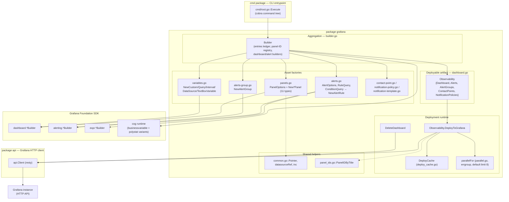
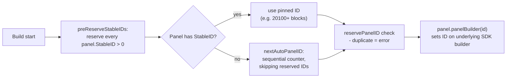
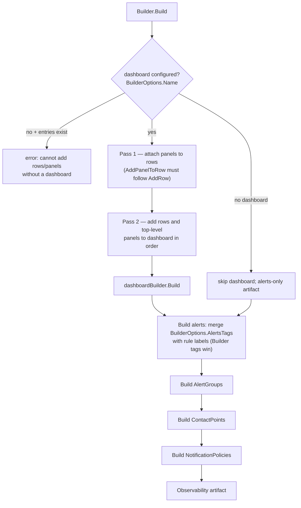
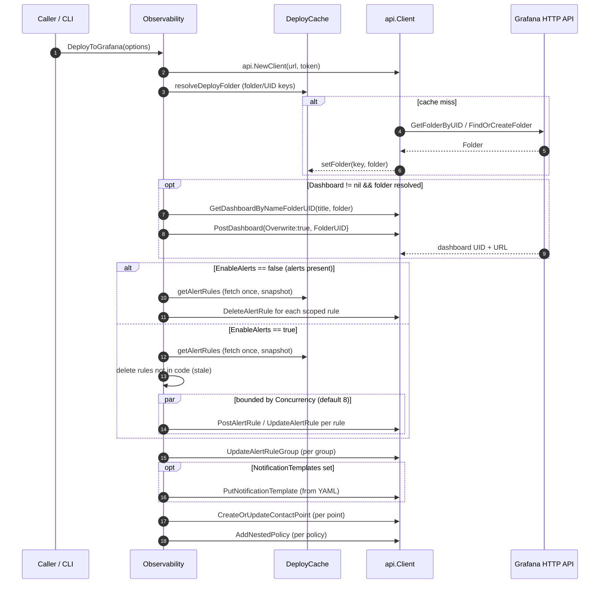
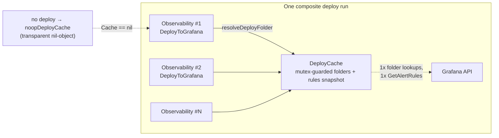
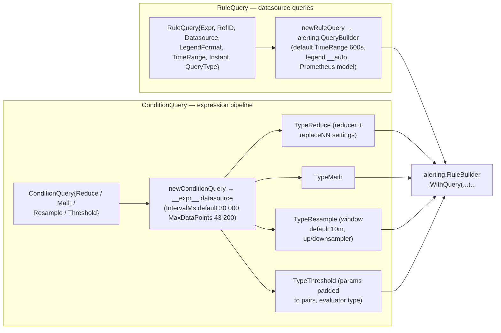
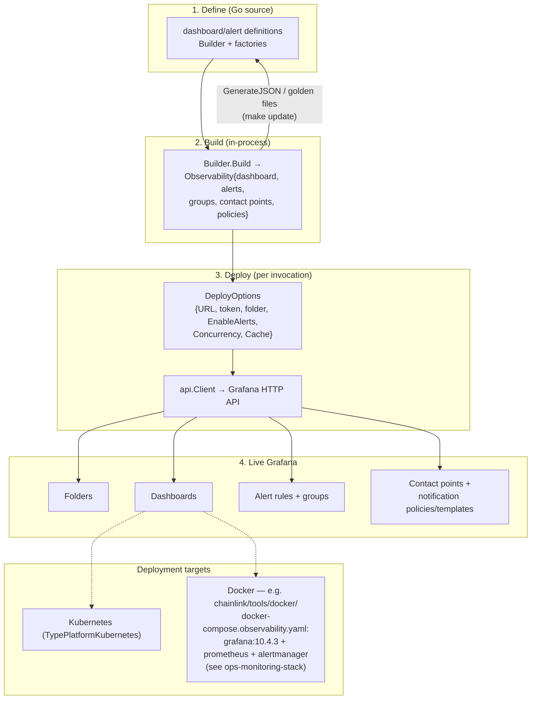

# Observability Library — Grafana Package (`observability-lib_grafana`)

> **Module:** `chainlink-common/observability-lib/grafana/`  
> **Parent:** [observability-lib](../observability-lib.md) — a self-contained Go module (see `chainlink-common/observability-lib/go.mod`) providing a CLI and programmatic API for managing Grafana observability assets as code.  
> **Platform context:** [Telemetry & Observability Platform](../../Telemetry___Observability_Platform.md)

## Introduction

The `grafana` package is the **asset-construction and deployment engine** of the observability-lib. It turns Go code into fully formed Grafana artifacts — dashboards, panels, template variables, alert rules, alert groups, contact points, and notification policies — and pushes them to a live Grafana instance idempotently. It is built on the official [`grafana-foundation-sdk`](https://github.com/grafana/grafana-foundation-sdk) (v0.0.18, per `chainlink-common/observability-lib/go.mod`) and extends it with Chainlink-specific conveniences: opinionated panel presets, alert-tag propagation, panel-ID pinning for stable alert-to-panel wiring, and a concurrency/cache-aware deploy path.

Its key design goals:

1. **Observability as code** — dashboards and alerts are defined in Go, version-controlled, and rendered/reviewed like any other source (the Makefile in `chainlink-common/observability-lib/Makefile` provides `build`, `test`, `lint`, and a golden-file `update` target for dashboard snapshots).
2. **Idempotent deployment** — repeated `DeployToGrafana` calls converge to the declared state: existing resources are updated, resources removed from code are deleted, and provenance mismatches (HTTP 409) are healed by delete-and-recreate.
3. **Bounded, cache-aware bulk deploys** — composite deployments of many dashboards share folder lookups and alert-rule snapshots through [`DeployCache`](#deploycache) and fan out alert-rule writes with a bounded worker pool.
4. **Stable panel identity** — panels can pin their Grafana IDs (`StableID`) so alerts can be linked to panels declaratively by title without ID drift between builds.

While this package **defines and deploys** observability assets, the **emission side** of the platform is covered by [beholder-telemetry](../beholder-telemetry.md), [chip-ingress](../chip-ingress.md), and [telemetry_ingress](../telemetry_ingress.md); the standalone chain/feed monitoring agent is documented in [monitoring](../monitoring.md).

---

## Architecture Overview

The package decomposes into four layers: **factories** (panels, variables, alerts), an **aggregating builder**, a **deployable artifact**, and a **deployment runtime** (API client usage, caching, concurrency).



### Relationships to sibling packages

| Package | Role | Interaction with `grafana` |
|---|---|---|
| [`api`](observability-lib_api.md) | Thin Grafana HTTP client over `go-resty` (folders, dashboards, rules, contact points, datasources) | `DeployToGrafana` / `DeleteDashboard` create `api.Client` from `DeployOptions`/`DeleteOptions` and drive every mutation through it. The `Observability` struct mirrors the request/response types (`api.PostDashboardRequest`, `alerting.Rule`, …) |
| [`cmd`](observability-lib_cli.md) | Cobra CLI (`main.go` → `cmd/root.go::Execute`) | Subcommands (e.g. `api dashboard`, `api rule`) construct `Builder`/`Observability` values and invoke deploy/delete with CLI-supplied options |

---

## Core Components

### 1. `Builder` — asset aggregation (`builder.go`)

`Builder` is the single orchestration point for composing an `Observability` artifact. It wraps SDK builders for all five asset kinds and keeps a **ledger of build entries** (`buildEntry{kind, rowTitle, panel}`) so rows, top-level panels, and row-attached panels are emitted **in declaration order**.

Construction options (`BuilderOptions`):

| Field | Purpose |
|---|---|
| `Name`, `Tags`, `Refresh`, `TimeFrom`/`TimeTo`, `TimeZone`, `GraphTooltip` | Dashboard shell settings (timezone defaults to `browser`) |
| `AlertsTags` | Common label set merged onto **every** alert rule at build time |

API surface:

- `AddVars(...)` — attach dashboard template variables (see [variables](#4-variables--template-variable-factories-variablesgo)).
- `AddRow(title)` — register a row; panels added later via `AddPanelToRow` attach to it.
- `AddPanel(...)` / `AddPanelToRow(rowTitle, ...)` — add panels; **panels carrying alert builders automatically promote those alerts** into the Builder's alert list (the `panel_title` annotation set by `NewTimeSeriesPanel` is consumed during deploy, see [deploy flow](#deployment-flow)).
- `AddAlert` / `AddAlertGroup` / `AddContactPoint` / `AddNotificationPolicy` — register alerting assets independently of any dashboard.
- `Build()` — one-shot materialization; a Builder refuses to build twice.

#### Panel-ID assignment strategy

Grafana identifies panels by numeric ID; alerts reference panels through `__panelId__` annotations. `Builder` guarantees collision-free IDs:



- **Stable IDs** are declared via `PanelOptions.StableID` and are pre-reserved **before** auto-assignment begins, so auto-ID generation skips them regardless of entry ordering in `Build()`.
- **Auto IDs** come from an incrementing counter (`common.go::inc`) that skips already-reserved IDs.
- A duplicate ID is a hard build error (`duplicate panel ID %d`).

#### Build pipeline



Notable details:

- **Two-pass assembly**: panels are attached to row builders *before* rows are added to the dashboard, because `WithRow` snapshots the row's children.
- **Alert tag merge semantics**: `maps.Copy(tags, alert.Labels)` — rule-specific labels override builder-level `AlertsTags`.
- Custom panel variants (`businessvariable`, `polystat`) are registered with the `cog` runtime in `NewBuilder` (`RegisterPanelcfgVariant`), enabling typed builders for those plugin panel types.

### 2. `Observability` — the deployable artifact (`dashboard.go`)

`Observability` aggregates everything produced by `Build()`:

```go
type Observability struct {
    Dashboard            *dashboard.Dashboard
    Alerts               []alerting.Rule
    AlertGroups          []alerting.RuleGroup
    ContactPoints        []alerting.ContactPoint
    NotificationPolicies []alerting.NotificationPolicy
}
```

- `GenerateJSON()` renders the whole artifact as indented JSON (useful for golden-file testing and the `make update` target).
- `TypePlatform` constants (`kubernetes`, `docker`) indicate the intended hosting platform for consumers embedding this library.

### 3. Deployment (`DeployToGrafana`, `DeleteDashboard`, `DeployOptions`)

`DeployOptions` controls one deploy invocation:

| Field | Behavior |
|---|---|
| `GrafanaURL`, `GrafanaToken` | Target instance credentials (passed to `api.NewClient`) |
| `FolderName` / `FolderUID` | Target folder — by title (created if missing) or by UID |
| `EnableAlerts` | `true` → upsert declared alerts and delete stale ones; `false` → **delete** the artifact's scoped alerts |
| `RuleGroupFromDashboard` | When true, every alert's rule group is set to the dashboard title (default one-rule-group-per-dashboard, which keeps `DeployCache` snapshots valid) |
| `NotificationTemplates` | Path to a YAML file of notification templates (parsed by `NewNotificationTemplatesFromFile`, `grafana/notification-template.go`) |
| `Concurrency` | Bound on in-flight alert-rule writes; `0` → default `8`, `1` → serial |
| `Cache` | Shared [`DeployCache`](#5-deploycache--memoization-for-composite-deploys-deploy_cachego) across a composite deploy run |

#### Deployment flow



Key behaviors worth highlighting for maintainers:

- **Alert scoping.** Existing rules are fetched once (`getAlertRules`) and filtered by either `__dashboardUid__` annotation or (folder UID ∩ rule-group name) — the same scope is used for stale deletion and for existence checks, so rules removed from Go code are garbage-collected from Grafana.
- **Panel wiring.** For each alert carrying a `panel_title` annotation, `panelIDByTitle` → [`PanelIDByTitle`](#7-helpers-commongoparallelgopanel_idsgo) resolves the built dashboard's panel ID; the annotation is replaced with `__panelId__` + `__dashboardUid__` (both set or neither). This makes "alert on this panel" wiring stable across builds that renumber panels.
- **Provenance migration.** An alert-rule update returning **HTTP 409** (provenance mismatch, e.g. rule previously created via API vs. file provisioning) is healed automatically by deleting and recreating the rule with current provenance.
- **Group enforcement.** When no dashboard is present, every alert must belong to an explicit rule group; with a dashboard and `RuleGroupFromDashboard`, the dashboard title becomes the group.

#### Teardown

`DeleteDashboard(DeleteOptions{Name, GrafanaURL, GrafanaToken, FolderUID})` looks the dashboard up by name+folder, deletes its alert rules, then deletes the dashboard itself.

### 4. Variables — template variable factories (`variables.go`)

`VariableOptionValues` is an (empty) marker namespace; the workhorses are the `New*Variable` constructors, all of which share `VariableOption` (name, label, description, visibility, current selection) and default the current selection to the Grafana `All` sentinel (`$__all`) when unset:

| Constructor | SDK builder | Notes |
|---|---|---|
| `NewCustomVariable` | `CustomVariableBuilder` | `Values` map → options list; reserved chars (`,` `:`) escaped in the values string |
| `NewQueryVariable` | `QueryVariableBuilder` | Prometheus query or typed query map; regex filter, sort, refresh (default: on dashboard load), include-all |
| `NewIntervalVariable` | `IntervalVariableBuilder` | Interval presets |
| `NewDataSourceVariable` | `DatasourceVariableBuilder` | Datasource picker filtered by `Type` + `Regex` |
| `NewTextBoxVariableOptions` | `TextBoxVariableBuilder` | Free-form input |

All builders receive their datasource reference through `common.go::datasourceRef` (UID-based `dashboard.DataSourceRef`).

### 5. `DeployCache` — memoization for composite deploys (`deploy_cache.go`)

A `DeployCache` caches two things that are **invariant across a single deploy run**:

1. **Folder resolution** — keyed `"uid_"+FolderUID` or `"name_"+FolderName`.
2. **The full alert-rule list snapshot** — taken on first use, distinguishing "fetched, empty" from "not yet fetched" via a `rulesReady` flag.



**Scoping rules (from source documentation, must be honored by callers):**

- Bound to **one Grafana instance** — never share across `DeployOptions` with different `GrafanaURL`/`GrafanaToken`.
- The rule snapshot is **not invalidated by the deploy's own writes**; safe when each dashboard in the run touches a disjoint rule set (e.g. `RuleGroupFromDashboard` = one group per dashboard). Do **not** reuse a cache for repeated deploys of the same dashboard.
- Safe for concurrent use (single mutex).
- When `DeployOptions.Cache` is nil, a `noopDeployCache` is substituted so the deploy path never handles a nil cache.

### 6. Panels — panel factories and presets (`panels.go`)

`PanelOptions` is the common denominator for all panel types (datasource — defaulting to `"Prometheus"` — title, span/height grid geometry, unit, thresholds, transforms, overrides, color scheme, query interval, and `StableID`). The `Panel` struct wraps exactly one SDK panel builder; `panelBuilder(id)` returns the active one as a `cog.Builder[dashboard.Panel]` after stamping the assigned ID.

Supported factories (11 panel types):

| Factory | SDK builder | Distinguishing options |
|---|---|---|
| `NewStatPanel` | `stat.PanelBuilder` | text/value sizes, color/graph/text modes, mappings, reduce options |
| `NewTimeSeriesPanel` | `timeseries.PanelBuilder` | line/fill style, legend, tooltip, stacking, axis soft-min/max, **`AlertsOptions` → auto-generates alert rules** |
| `NewBarGaugePanel` | `bargauge.PanelBuilder` | orientation, show-unfilled, reduce `lastNotNull` |
| `NewGaugePanel` | `gauge.PanelBuilder` | reduce options, show-all-values |
| `NewTablePanel` | `table.PanelBuilder` | filterable, footer (sum reducer + pagination), sort-by |
| `NewLogPanel` | `logs.PanelBuilder` | show-time, prettify JSON, dedup strategy, sort order (default newest-first) |
| `NewHeatmapPanel` | `heatmap.PanelBuilder` | queries forced to `PromQueryFormatHeatmap` |
| `NewTextPanel` | `text.PanelBuilder` | markdown (default) / HTML content; no datasource |
| `NewHistogramPanel` | `histogram.PanelBuilder` | bucket count/size/offset, combine, extensive axis options |
| `NewBusinessVariablePanel` | `businessvariable.PanelBuilder` (custom, registered in `cog`) | display mode, variable reference, padding |
| `NewPolystatPanel` | `polystat.PanelBuilder` (custom, registered in `cog`) | polygon visuals, per-metric thresholds, tooltip sorting, click-through |

Shared plumbing used by every factory:

- `newQuery(Query)` → `prometheus.DataqueryBuilder` with expression/legend/format; `Interval` validated against a Grafana duration regex (`\d+(ms|s|m|h|d|w|M|y)`); optional instant mode and query type.
- `newLegend`, `newThresholds`, `newToolTip`, `newTransform`, `newOverride` — small normalizers giving every panel type the same option ergonomics.
- `setDefaults` — datasource `Prometheus`, full-width `Span=24`, `Height=6`, `NoValue="No data"`.

**Time-series presets** — drop-in functions matching Grafana's built-in viz presets, each wrapping a `PanelOptions` base:

| Preset | Configures |
|---|---|
| `LinesWithPoints` | line + always-on points, no fill |
| `StackedLines` / `Stacked100Percent` | normal / percent stacking, 50% fill |
| `LineFill` / `LineHue` | opacity / hue gradient fills |
| `LineScheme` | continuous GrYlRd color scheme + scheme gradient |
| `ThresholdScheme` | threshold-driven coloring (requires caller-set thresholds) |

**Alert propagation.** `TimeSeriesPanelOptions.AlertsOptions` is the declarative link between a visualization and its alerting: `NewTimeSeriesPanel` builds an `alerting.RuleBuilder` per entry, defaulting the alert's title and rule group to the **panel title** and stamping the `panel_title` annotation. Because `AddPanel`/`AddPanelToRow` hoist `panel.alertBuilders` into the `Builder`, alerts are built and deployed alongside the dashboard that owns them.

### 7. Helpers (`common.go`, `parallel.go`, `panel_ids.go`)

- **`Pointer[T]`** (common.go) — generic pointer constructor used pervasively for optional SDK fields; also hosts `datasourceRef` and the auto-ID counter `inc`.
- **`parallelFor[T]`** (parallel.go) — bounded-concurrency `errgroup` fan-out. First non-nil error is returned after in-flight calls finish; not-yet-started items may still run (deliberate partial-apply semantics matching the old serial loop). Requires `fn` to be safe for concurrent use — true for alert rules because each is addressed by its own UID.
- **`PanelIDByTitle`** (panel_ids.go) — finds a panel by title, scanning top-level panels **and** panels nested inside row containers; used at deploy time to materialize `__panelId__` annotations (see [deployment flow](#deployment-flow)).

---

## Alert Rule Construction (`alerts.go`)

`NewAlertRule(AlertOptions)` assembles a complete Grafana alert rule with sensible defaults: `For=5m`, `NoDataState=NoData`, `ExecErrState=Alerting`, condition ref `A`, rule group `Default` (unless overridden or set from dashboard title), plus `summary` / `description` / `runbook_url` annotations and caller tags.

The rule's data pipeline is composed from two query families:



- **`RuleQuery`** sources raw series from Prometheus (instant or range), with a relative time range.
- **`ConditionQuery`** chains server-side `__expr__` stages — reduce, math, resample, and threshold expressions — via the SDK's `expr` builders; threshold evaluator params are normalized so a single-param condition becomes a two-param (upper, 0) pair.
- `AlertGroupOptions` (`alerts-group.go`) configures rule-group evaluation interval via `NewAlertGroup` → `alerting.RuleGroupBuilder`.

---

## Data Flow: From Code to Grafana



The dashboard data ultimately visualized in these dashboards flows through the platform's emission stack — [beholder](../beholder-telemetry.md) → [chip-ingress](../chip-ingress.md) — into datasources such as Prometheus; the standalone [monitoring](../monitoring.md) agent is an alternative feed-monitoring pipeline with its own Kafka/Prometheus exporters. The `grafana` package is agnostic to all of this: it only needs a datasource UID to reference.

---

## Build, Test and Operations

From `chainlink-common/observability-lib/Makefile` (module: `github.com/smartcontractkit/chainlink-common/observability-lib`, Go 1.26.6):

| Target | Command | Purpose |
|---|---|---|
| `build` | `go build -o observability-lib .` | Compile the CLI binary |
| `run` | `./observability-lib` | Run the CLI |
| `lint` | `golangci-lint run` | Static analysis |
| `test` | `go test ./...` | Unit tests (incl. `dashboard_deploy_test.go`, `panel_ids_test.go`, `parallel_internal_test.go`) |
| `update` | `go test ./dashboards/... -update=1` | Refresh golden JSON files for dashboard snapshots |

Key module dependencies (from `chainlink-common/observability-lib/go.mod`): `grafana-foundation-sdk/go v0.0.18` (builders), `go-resty/resty/v2` (HTTP, used by the [`api`](observability-lib_api.md) package), `golang.org/x/sync` (errgroup for `parallelFor`), `spf13/cobra` (CLI), `stretchr/testify` (tests), `gopkg.in/yaml.v3` (notification templates).

**Operational notes for maintainers:**

- Prefer `StableID` (high blocks, e.g. `20100+`) for panels referenced by alerts; rely on auto-increment otherwise.
- For composite deploys, share one `DeployCache` across all `Observability` values targeting the same Grafana instance, and keep one rule group per dashboard (`RuleGroupFromDashboard: true`) to keep the alert-rule snapshot valid.
- Alert-rule writes are the only parallelized step (bounded at 8 by default); every other mutation is sequential, so large fleets of contact points or policies dominate deploy wall-clock time.
- Deploy output (dashboard URL) is written to `stderr`, keeping stdout clean for scripted use.

---

## Related Documentation

- [observability-lib](../observability-lib.md) — module overview, CLI, and library layout
- [observability-lib_api](observability-lib_api.md) — Grafana HTTP client used by every deploy mutation
- [observability-lib_cli](observability-lib_cli.md) — cobra command tree driving this package
- [ops-monitoring-stack](../ops-monitoring-stack.md) — Docker Compose stack (Prometheus + Grafana + Alertmanager) these assets deploy into
- [beholder-telemetry](../beholder-telemetry.md), [chip-ingress](../chip-ingress.md), [telemetry_ingress](../telemetry_ingress.md) — how telemetry is emitted and ingested upstream
- [monitoring](../monitoring.md) — standalone chain/feed monitoring agent with its own exporters
- [Telemetry & Observability Platform](../../Telemetry___Observability_Platform.md) — platform-level map
