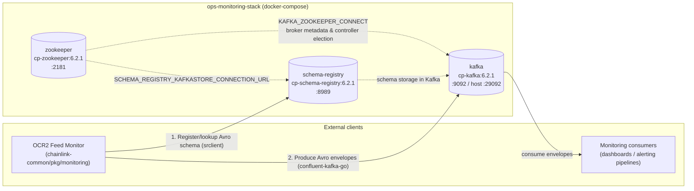
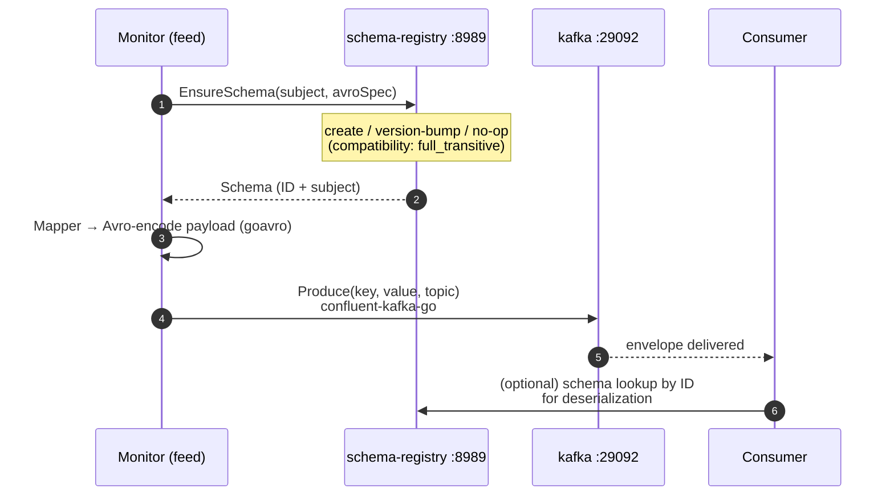
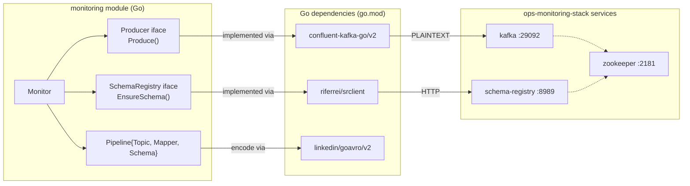

# Ops Monitoring Stack

> **Module scope:** `chainlink-common/ops/monitoring/docker-compose.yml`
> **Parent platform:** [Telemetry & Observability Platform](../Telemetry___Observability_Platform.md)

## 1. Introduction

The **ops-monitoring-stack** module is a single-artifact module: a Docker Compose definition (`chainlink-common/ops/monitoring/docker-compose.yml`) that deploys the **streaming data plane** consumed by the OCR2 feed-monitoring system ([monitoring](monitoring.md)).

It provisions three cooperating services:

| Service | Image | Role |
|---|---|---|
| `zookeeper` | `confluentinc/cp-zookeeper:6.2.1` | Distributed coordination for the Kafka broker and Schema Registry |
| `kafka` | `confluentinc/cp-kafka:6.2.1` | Message bus that durably stores monitoring envelopes produced by feed monitors |
| `schema-registry` | `confluentinc/cp-schema-registry:6.2.1` | Central registry of Avro schemas used to serialize monitoring payloads |

The monitoring framework in `chainlink-common/pkg/monitoring` is built directly against this infrastructure — its `go.mod` depends on `confluentinc/confluent-kafka-go/v2` (Kafka producer), `linkedin/goavro/v2` (Avro encoding) and `riferrei/srclient` (Schema Registry client). The stack therefore exists to give that framework a compatible Kafka + Schema Registry endpoint to run against, whether locally during development or in an ops/staging environment.

This module is intentionally **not** a full metrics/visualization stack. Prometheus/Grafana/Alertmanager live in a sibling compose file (`chainlink/tools/docker/docker-compose.observability.yaml`, see [§7](#7-related-modules-and-artifacts)) and dashboard tooling lives in [observability-lib](observability-lib.md). The ops-monitoring-stack supplies the **event-streaming backbone**; everything else in the platform either produces into it or consumes from it.

---

## 2. Architecture

### 2.1 Stack topology

The three services form a strict dependency chain: Kafka requires ZooKeeper, and the Schema Registry requires both.



Key structural properties, all traceable to `chainlink-common/ops/monitoring/docker-compose.yml`:

- **Boot order** is expressed with `depends_on`: `zookeeper` → `kafka` → `schema-registry`. The Schema Registry additionally `depends_on` ZooKeeper because (in the Confluent 6.2.1 line used here) it stores its schemas in a Kafka topic and connects to the cluster via `SCHEMA_REGISTRY_KAFKASTORE_CONNECTION_URL: 'zookeeper:2181'`.
- **Dual Kafka listeners** make the broker reachable from two namespaces:
  - `PLAINTEXT://kafka:9092` — used by workloads running *inside* the compose network (the monitoring producer resolves the hostname `kafka`).
  - `PLAINTEXT_HOST://localhost:29092` — used by clients running on the *host machine* or outside the compose network (host port `29092` → container port `9092`).
- **Single-node cluster**: all replication factors and min-ISR values are pinned to `1` (see [§4](#4-service-reference)), so the stack has no redundancy — it is sized for ops validation and development, not HA production.

### 2.2 Where it sits in the observability platform

```mermaid
flowchart TB
    subgraph producers["Telemetry & monitoring producers"]
        FEEDMON["Feed monitoring framework<br/>(see monitoring module)"]
        NODE["Chainlink nodes /<br/>telemetry pipelines"]
    end

    subgraph thisstack["ops-monitoring-stack (this module)"]
        K["Kafka :29092"]
        SR["Schema Registry :8989"]
        ZK["ZooKeeper :2181"]
    end

    subgraph surfaces["Consumption & visualization"]
        LIB["observability-lib<br/>(Grafana dashboard provisioning)"]
        DASH["Dashboards /<br/>alert pipelines"]
    end

    FEEDMON -- "Avro envelopes" --> K
    NODE -- "node telemetry<br/>(separate OTLP path)" -.-> BH["Beholder OTLP pipeline"]
    K --> DASH
    SR -. "schema contract" .- LIB
    K -. "data source" .- LIB
```

- The **feed-monitoring path** (solid arrows) is what this stack serves directly.
- **Beholder** ([beholder-telemetry](beholder-telemetry.md)) is the *node-side* OTLP telemetry path and does **not** depend on this stack.
- [observability-lib](observability-lib.md) provisions Grafana dashboards that read from data lands in this stack.

---

## 3. Data flow

The typical end-to-end flow of a monitoring envelope through this stack, as implemented by the [monitoring](monitoring.md) framework:



How the code maps onto this (all from `chainlink-common/pkg/monitoring`):

1. **Schema contract.** `Monitor` holds a `SchemaRegistry` (interface with `EnsureSchema(subject, spec string) (Schema, error)`). Per its contract, calling `EnsureSchema` (a) creates the subject if it does not exist, (b) registers a new version if the spec changed, or (c) no-ops if identical. The `full_transitive` compatibility level configured in the compose file is what makes case (b) safe: new versions must be backward- *and* forward-compatible with all prior versions, so consumers never break during schema evolution.
2. **Export pipeline.** Kafka exporters are defined as `Pipeline{Topic, Mapper, Schema}`: poll results are mapped by a `Mapper` into the Avro record defined by the registered `Schema`, then written via the `Producer` interface (`Produce(key, value []byte, topic string) error`).
3. **Transport.** The producer resolves the broker through the advertised listeners. In-compose clients use `kafka:9092`; host-side clients use `localhost:29092`.
4. **Aggregation.** The `Monitor`/`Manager` wire these pieces together alongside `HTTPServer`/`Metrics` for scrape-able runtime health — that runtime layer is documented in [monitoring](monitoring.md); this module only provides the services those components point at.

---

## 4. Service reference

All configuration below is quoted from `chainlink-common/ops/monitoring/docker-compose.yml`.

### 4.1 `zookeeper`

| Aspect | Value |
|---|---|
| Image | `confluentinc/cp-zookeeper:6.2.1` |
| Ports | `2181:2181` |
| Environment | `ZOOKEEPER_CLIENT_PORT: 2181`, `ZOOKEEPER_TICK_TIME: 2000` |

ZooKeeper provides the coordination substrate that the Confluent 6.2.1 releases of both Kafka and the Schema Registry expect: broker registration, controller election and (for the Schema Registry) the `KAFKASTORE_CONNECTION_URL` bootstrap. `ZOOKEEPER_TICK_TIME: 2000` (ms) is the default tick unit for session timeouts.

### 4.2 `kafka`

| Aspect | Value |
|---|---|
| Image | `confluentinc/cp-kafka:6.2.1` |
| Depends on | `zookeeper` |
| Ports | `29092:29092` (host) |
| Advertised listeners | `PLAINTEXT://kafka:9092`, `PLAINTEXT_HOST://localhost:29092` |

Environment and rationale:

| Variable | Value | Purpose |
|---|---|---|
| `KAFKA_BROKER_ID` | `1` | Single-broker cluster |
| `KAFKA_ZOOKEEPER_CONNECT` | `zookeeper:2181` | Coordination endpoint |
| `KAFKA_LISTENER_SECURITY_PROTOCOL_MAP` | `PLAINTEXT:PLAINTEXT,PLAINTEXT_HOST:PLAINTEXT` | Both listeners are unauthenticated |
| `KAFKA_OFFSETS_TOPIC_REPLICATION_FACTOR` | `1` | Single-node internal topic sizing |
| `KAFKA_TRANSACTION_STATE_LOG_MIN_ISR` | `1` | Allow transactions with one in-sync replica |
| `KAFKA_TRANSACTION_STATE_LOG_REPLICATION_FACTOR` | `1` | Single-node transaction log |
| `KAFKA_GROUP_INITIAL_REBALANCE_DELAY_MS` | `0` | Consumer groups start immediately (fast local iteration) |
| `KAFKA_SOCKET_REQUEST_MAX_BYTES` | `80001200` | ~80 MB per request |
| `KAFKA_MESSAGE_MAX_BYTES` | `80001200` | ~80 MB per message |
| `KAFKA_CFG_MAX_REQUEST_SIZE` | `80001200` | ~80 MB max produce request |

The ~80 MB ceilings are deliberately large: OCR2 **config-set** envelopes (the full on-chain configuration of a feed and its nodes, see `ChainConfig`/feed configuration in the [monitoring](monitoring.md) module) can be very large, and the default 1 MB Kafka limit would reject them. Clients should still be aware that producing near this ceiling is an edge condition, not a target operating point.

**Note:** with replication factors of `1` and no volumes declared, broker data is lost when the container is recreated. This is acceptable for the stack's purpose (ops validation / development) but must be reworked for durable production use.

### 4.3 `schema-registry`

| Aspect | Value |
|---|---|
| Image | `confluentinc/cp-schema-registry:6.2.1` |
| Depends on | `zookeeper`, `kafka` |
| Ports | `8989:8989` |
| Environment | `SCHEMA_REGISTRY_HOST_NAME: schema-registry`, `SCHEMA_REGISTRY_KAFKASTORE_CONNECTION_URL: 'zookeeper:2181'`, `SCHEMA_REGISTRY_LISTENERS: 'http://schema-registry:8989'`, `SCHEMA_REGISTRY_DEBUG: 'true'`, `SCHEMA_REGISTRY_SCHEMA_COMPATIBILITY_LEVEL: 'full_transitive'` |

The registry is the schema contract enforcement point for everything the monitoring exporters write. The `full_transitive` compatibility level is the strictest built-in policy: every new schema version must be compatible with *all* previous versions, in both directions. This pairs with the `SchemaRegistry.EnsureSchema` contract in the monitoring framework — a version bump can only happen if old consumers would still successfully read new data (and vice versa).

`SCHEMA_REGISTRY_DEBUG: 'true'` enables verbose logging; it is a dev-oriented default and is safe to remove in a shared environment.

---

## 5. Deployment & operations

### 5.1 Running the stack

```bash
cd chainlink-common/ops/monitoring
docker compose up -d
```

### 5.2 Connectivity matrix

| Client | Broker bootstrap | Schema Registry |
|---|---|---|
| Workload in the compose network (e.g. a feed-monitor container) | `kafka:9092` (`PLAINTEXT` listener) | `http://schema-registry:8989` |
| Process on the host machine | `localhost:29092` (`PLAINTEXT_HOST` listener) | `http://localhost:8989` |

The split advertised-listener setup exists because Kafka advertises listener addresses back to clients: a client that connects to `localhost:29092` must be told to keep using `localhost:29092`, while an in-network client must be told to use `kafka:9092`. Misconfigured `KAFKA_ADVERTISED_LISTENERS` is the most common failure mode when extending this file.

### 5.3 Health & troubleshooting quick checks

- ZooKeeper reachable: `nc -z localhost 2181`
- Kafka reachable: `nc -z localhost 29092`
- Schema Registry reachable: `curl http://localhost:8989/subjects` (lists registered monitoring subjects)
- Boot order errors ("broker not available", schema-registry failing to start) almost always mean `depends_on` ordering was broken or `zookeeper:2181` is not resolvable.

### 5.4 Known limitations

- **No HA:** single broker, replication factor 1 everywhere.
- **No persistence:** no Docker volumes; restarts lose messages and schemas.
- **No auth/TLS:** `PLAINTEXT` on all listeners; suitable only for trusted networks.
- **Confluent 6.2.1 era:** this line still routes Schema Registry through ZooKeeper (`SCHEMA_REGISTRY_KAFKASTORE_CONNECTION_URL`); newer Confluent images drop that requirement.

---

## 6. Component interaction summary



The monitoring module is decoupled from this stack behind the `SchemaRegistry` and `Producer` interfaces, so tests can substitute fakes (`fakeProducer`, `fakeSchema` in its testutils) — but any *integration* run of the feed monitor expects a live instance of exactly this compose stack.

---

## 7. Related modules and artifacts

**Within the Telemetry & Observability Platform** ([parent page](../Telemetry___Observability_Platform.md)):

- [monitoring](monitoring.md) — the OCR2 feed-monitoring framework (`Monitor`, `Producer`, `SchemaRegistry`, `Pipeline`, exporters); the primary producer into this stack.
- [observability-lib](observability-lib.md) — Go library for provisioning Grafana dashboards/folders; consumes monitoring data and documents schema-driven dashboards.
- [beholder-telemetry](beholder-telemetry.md) — the OTLP-based node telemetry pipeline (independent of this Kafka stack).
- [telemetry_ingress](telemetry_ingress.md) and [chip-ingress](chip-ingress.md) — node → telemetry-ingress-server paths, complementary to the ops feed-monitoring path.

**Sibling deployment artifacts in the repository:**

- `chainlink/tools/docker/docker-compose.observability.yaml` — the *node-development* observability stack (Prometheus :9090, Grafana :3000, Alertmanager :9093). Use that stack to visualize per-node metrics during local node development; use **this** stack to run the feed-monitoring data plane. The two are independent compose files with disjoint ports and can be run side by side.
- `chainlink/core/scripts/cre/environment/environment/chip_ingress_stack.go` — programmatic deployment of the Chip Ingress stack used by CRE system tests (a different, self-contained telemetry environment).

**Code references cited in this document:**

- `chainlink-common/ops/monitoring/docker-compose.yml` — the module itself (all service definitions).
- `chainlink-common/pkg/monitoring/go.mod` — client dependencies (`confluent-kafka-go/v2`, `goavro/v2`, `srclient`).
- `chainlink-common/pkg/monitoring/monitor.go`, `manager.go`, `producer.go`, `schema_registry.go`, `exporter_kafka.go`, `http.go` — the consuming interfaces.
