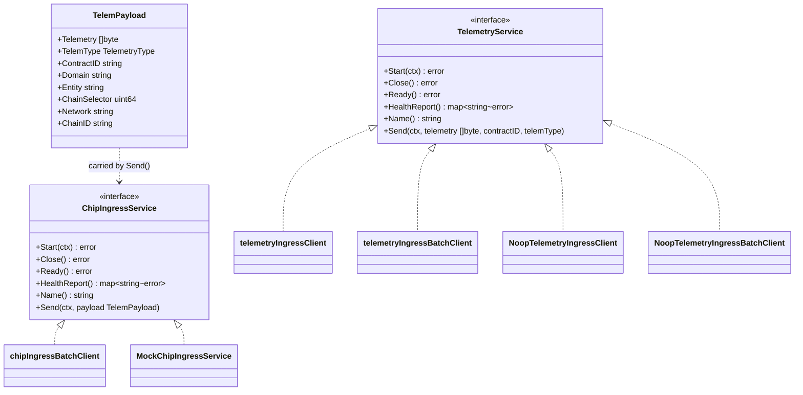
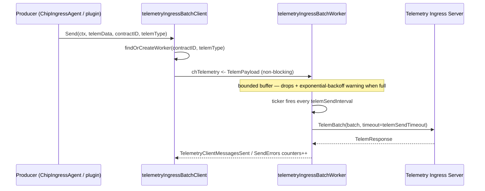

# Telemetry Ingress (node egress clients)

> **Module path:** `chainlink/core/services/synchronization` (egress clients, workers, wire protocol) and `chainlink/core/services/telemetry` (CHIP ingress adapter) · **Part of the** [Telemetry & Observability Platform](../Telemetry___Observability_Platform.md)

## 1. Purpose

The `telemetry_ingress` module implements the **node-side egress pipeline for off-chain telemetry**. Chainlink nodes produce high-volume operational telemetry — OCR2/OCR3 reporting internals, Mercury / Data Streams observations, CCIP commit & exec logs — that must be shipped off-node to Chainlink-operated **telemetry ingress servers** for analytics, monitoring and SLA computation.

The module provides two cooperating families of components:

1. **wsrpc-backed telemetry clients** — a *simple* client (single-payload sends) and a *batch* client (per `(ContractID, TelemType)` worker goroutines that buffer and periodically flush `TelemBatch` requests). Both connect to a legacy telemetry ingress server over [`wsrpc`](https://github.com/smartcontractkit/wsrpc) (WebSocket RPC authenticated with the node's CSA Ed25519 key) and call the `telem.Telem` / `telem.TelemBatch` gRPC-style RPCs. See [telemetry_ingress_wsrpc_clients](telemetry_ingress/telemetry_ingress_wsrpc_clients.md).
2. **CHIP ingress adapter** — `ChipIngressAgent`, a thin adapter that enriches raw telemetry bytes with chain-identity metadata (chain selector, network, chain ID, contract ID) and domain/entity labels derived from the telemetry type, then forwards structured `TelemPayload`s to a `ChipIngressService` (e.g. the chip-ingress batch client, or the Beholder-based emitter). See [telemetry_ingress_chip_adapter](telemetry_ingress/telemetry_ingress_chip_adapter.md).

Both families share a small contract surface — `TelemPayload` plus the `TelemetryService` / `ChipIngressService` interfaces — and both ship **no-op implementations** (`NoopTelemetryIngressClient`, `NoopTelemetryIngressBatchClient`) used when telemetry ingress is disabled in configuration.

## 2. Position within the platform

The module is the *producer-side edge* of the observability stack:

| Concern | Where it lives | Documentation |
|---|---|---|
| CHIP ingress wire protocol & gRPC client (`chipingress.Client`) | `chainlink-common/pkg/chipingress` | [chip-ingress](chip-ingress.md) |
| Beholder OTLP emission (incl. `ChipIngressBatchEmitterService`) | `chainlink-common/pkg/beholder` | [beholder-telemetry](beholder-telemetry/beholder-telemetry_emission.md) |
| Chain performance monitoring updaters | `chainlink-common/pkg/monitoring` | [monitoring](monitoring.md) |
| Grafana/dashboards tooling | `chainlink-common/observability-lib` | [observability-lib](observability-lib.md) |
| Node configuration of ingress endpoints (`TelemetryIngress`, `TelemetryIngressEndpoint`) | `chainlink/core/config/telemetry_ingress_config.go` | [core_config_observability](../Node_Application_Core___Interfaces/core_config/core_config_observability.md) |
| CSA keystore used to sign the wsrpc connection | `core/services/keystore` | [keystore](../Node_Platform_Services/keystore.md) |

## 3. Architecture

### 3.1 Component overview

```mermaid
flowchart LR
    subgraph Producers[Telemetry producers inside the node]
        OCR[OCR2 / OCR3 plugins, CCIP, Mercury, capabilities]
    end

    subgraph Enrich[Enrichment layer — core/services/telemetry]
        CIA["ChipIngressAgent<br/>(MonitoringEndpoint / MultitypeMonitoringEndpoint)"]
    end

    subgraph Transport[Egress clients — core/services/synchronization]
        TIC[telemetryIngressClient<br/>single-payload wsrpc]
        TIBC[telemetryIngressBatchClient<br/>per-(contract,type) batch workers]
        CIBC[chipIngressBatchClient<br/>chipingress.Client gRPC]
        NOOP[Noop clients<br/>(ingress disabled)]
    end

    subgraph Ingress[Chainlink ingress servers]
        WSRPC[Telemetry Ingress Server<br/>telem.Telem / telem.TelemBatch over wsrpc]
        CHIP[CHIP Ingress Server<br/>chip_ingress gRPC]
    end

    OCR -->|"raw telemetry bytes"| CIA
    CIA -->|"TelemPayload (enriched)"| CIBC
    CIA -.->|"legacy path"| TIC
    CIA -.->|"legacy path"| TIBC
    TIC --> WSRPC
    TIBC --> WSRPC
    CIBC --> CHIP
    NOOP -.-> discards((discarded))
```

### 3.2 Core abstractions

All egress implementations are wired through two interfaces defined in `core/services/synchronization/common.go`:



- **`TelemetryService`** — legacy contract for the wsrpc clients: `Send(ctx, telemetry []byte, contractID string, telemType TelemetryType)`. Metadata (chain selector, domain, entity) is *implicit* on this path; the ingress server only receives the contract address and telemetry type.
- **`ChipIngressService`** — richer contract used by CHIP-style pipelines: `Send(ctx, payload TelemPayload)`, where the payload explicitly carries chain selector, network, chain ID, domain and entity (e.g. `data-feeds.telemetry.ocr2-median` / `offchainreporting2.TelemetryWrapper`).

`TelemetryType` constants (e.g. `OCR2Median`, `OCR3Mercury`, `OCR2CCIPCommit`, `OCR3CCIPExec`) are mapped to domain/entity pairs by `synchronization.TelemetryTypeToDomainAndEntity`, which is also what drives domain-based routing on the server side.

### 3.3 Data flow (batch client)



Key behavioural properties shared by both wsrpc clients:

- **Non-blocking `Send`** — payloads are pushed onto a bounded buffered channel; if the buffer is full the message is **dropped** (telemetry is best-effort and must never block oracle operation) and a warning is logged with **exponential backoff** (1, 2, 4, … 100, 200, 300 …) to avoid log flooding.
- **Resilient connection** — `Start` returns immediately; `wsrpc.Dial` retries the connection in the background, so the node recovers automatically when the ingress server comes back.
- **Mutual authentication** — the connection is signed with the node's **CSA Ed25519 key** (via `keystore.CSASigner`) and the server's public key is **pinned** (`serverPubKeyHex`).
- **Health reporting** — implements `services.ServiceCtx` (`HealthReport`, `Ready`); the batch client additionally emits the `telemetry_client_connection_status` gauge from a 5-second connectivity ticker.

## 4. Sub-modules

Detailed documentation for each sub-module lives under [`telemetry_ingress/`](telemetry_ingress/):

| Sub-module | Focus | Documentation |
|---|---|---|
| wsrpc egress clients | `NoopTelemetryIngressClient` / `NoopTelemetryIngressBatchClient` and the concrete `telemetryIngressClient`, `telemetryIngressBatchClient` + per-contract batch workers, wsrpc/CSA connection handling and health monitoring | [telemetry_ingress/telemetry_ingress_wsrpc_clients.md](telemetry_ingress/telemetry_ingress_wsrpc_clients.md) |
| CHIP ingress adapter | `ChipIngressAgent` (`SendLog` / `SendTypedLog`) enrichment adapter, `ChipIngressService` contract, `MockChipIngressService` and the test suite validating chain-selector / domain / entity derivation | [telemetry_ingress/telemetry_ingress_chip_adapter.md](telemetry_ingress/telemetry_ingress_chip_adapter.md) |

The two sub-modules are complementary: the **CHIP adapter** produces enriched `TelemPayload`s, while the **wsrpc clients** (and the chip-ingress batch client built on the [chip-ingress](chip-ingress.md) protocol) consume and transmit them.

## 5. Wire protocol

Both wsrpc clients speak the `telem` protocol generated from [`core/services/synchronization/telem/telem.proto`](../repo/chainlink/core/services/synchronization/telem/telem.proto):

```protobuf
service Telem {
    rpc Telem(TelemRequest) returns (TelemResponse);
    rpc TelemBatch(TelemBatchRequest) returns (TelemResponse);
}

message TelemRequest       { bytes telemetry; string address; string telemetry_type; int64 sent_at; }
message TelemBatchRequest  { string contract_id; repeated bytes telemetry; string telemetry_type; int64 sent_at; }
```

The simple client uses `Telem` (one RPC per payload); the batch client uses `TelemBatch` (all buffered payloads for one `(contractID, telemType)` pair per RPC). CHIP-style payloads instead use the `chip_ingress` protocol documented in [chip-ingress/chip-ingress_protocol](chip-ingress/chip-ingress_protocol.md).

## 6. Configuration

Egress behaviour is entirely driven by the `TelemetryIngress` config interface (`core/config/telemetry_ingress_config.go`):

| Setting | Meaning |
|---|---|
| `UseBatchSend()` | Selects the batch client vs. the simple client |
| `UniConn()` | Uses the TLS "uni connection" transport variant (sends gated on `connected`) |
| `Logging()` | Enables debug logging of successfully sent telemetry |
| `BufferSize()` | Per-worker (or per-client) channel capacity before drops |
| `MaxBatchSize()` | Maximum payloads per `TelemBatch` RPC |
| `SendInterval()` / `SendTimeout()` | Batch flush cadence / per-RPC deadline |
| `Endpoints()` | Ingress endpoints (`Network`, `ChainID`, `ServerPubKey`, `URL`) |
| `ChipIngressEnabled()` | Enables the CHIP-style pipeline (`ChipIngressAgent` + chip batch client) |

Full semantics, TOML keys and defaults are documented in [core_config_observability](../Node_Application_Core___Interfaces/core_config/core_config_observability.md). Dev/test CHIP ingress stacks are provisioned by the CRE environment tooling (see `core/scripts/cre/environment/environment/chip_ingress_stack.go`).

## 7. Observability

The clients expose Prometheus metrics defined in `core/services/synchronization/metrics.go`:

| Metric | Type | Labels | Description |
|---|---|---|---|
| `telemetry_client_connection_status` | gauge | `endpoint` | 1 when the wsrpc connection is `Ready`, else 0 |
| `telemetry_client_messages_sent` | counter | `endpoint`, `telemetry_type` | Successful `Telem`/`TelemBatch` sends |
| `telemetry_client_messages_send_errors` | counter | `endpoint`, `telemetry_type` | Failed sends |
| `telemetry_client_messages_dropped` | counter | `endpoint`, `telemetry_type` | Payloads dropped due to full buffers |
| `telemetry_client_workers` | counter | `endpoint`, `telemetry_type` | Batch workers spawned |

These feed the node dashboards shipped via the [ops monitoring stack](ops-monitoring-stack.md) and can be extended with Grafana assets from [observability-lib](observability-lib.md).

## 8. Related modules

- [chip-ingress](chip-ingress.md) — the gRPC ingress protocol & client used by the CHIP pipeline.
- [beholder-telemetry](beholder-telemetry.md) — OTLP-based emission; `ChipIngressBatchEmitterService` batches Beholder messages through CHIP ingress.
- [monitoring](monitoring.md) — periodic chain-performance monitoring built on Kafka/Avro.
- [core_config_observability](../Node_Application_Core___Interfaces/core_config/core_config_observability.md) — tracing and telemetry-ingress configuration.
