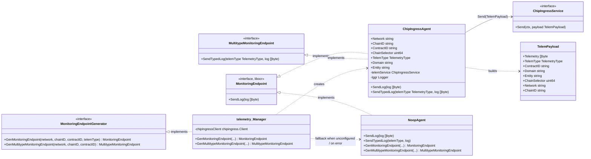
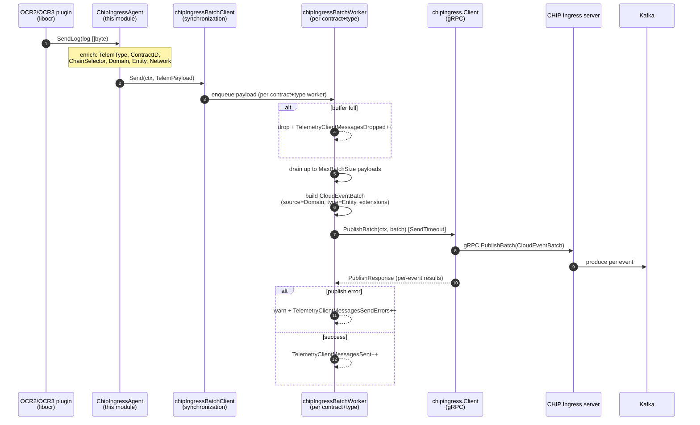
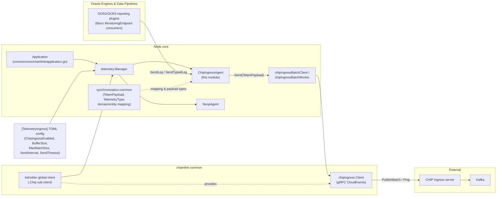

# Telemetry Ingress — CHIP Adapter

> **Module scope:** `chainlink/core/services/telemetry/chip_ingress.go` (and its test `chip_ingress_test.go`)

The **CHIP adapter** module provides the [`ChipIngressAgent`](#chipingressagent) — the bridge between Chainlink's oracle engines (OCR / OCR2 / OCR3 reporting plugins, which emit telemetry through libocr's `MonitoringEndpoint` interface) and the modern **CHIP Ingress** pipeline (a gRPC CloudEvents service that fans telemetry out to Kafka). It *adapts* two worlds:

1. **Upstream (libocr):** plugins call `SendLog(log []byte)` on a `commontypes.MonitoringEndpoint`. This interface has no context, no metadata, and no concept of domains or entities.
2. **Downstream (CHIP):** telemetry is published as [CloudEvents](https://cloudevents.io) that must carry a `domain` (Kafka subject), an `entity` (schema type), and rich extension attributes (`chainselector`, `contractid`, `networkname`, …).

`ChipIngressAgent` performs that translation: it enriches each raw log with chain identity (a **chain selector** derived from network + chain ID) and routing metadata (**domain/entity** derived from the telemetry type), then hands the resulting `TelemPayload` to a `ChipIngressService` for batching and publication.

It is one of three endpoint strategies offered by the telemetry [Manager](#manager-integration); the alternatives (legacy wsrpc-based ingress clients) are documented in [telemetry_ingress_wsrpc_clients](telemetry_ingress_wsrpc_clients.md).

---

## 1. Component Model

### 1.1 Types & Interfaces

| Symbol | File | Kind | Purpose |
|---|---|---|---|
| `ChipIngressAgent` | `core/services/telemetry/chip_ingress.go` | struct | Adapts libocr monitoring endpoints to CHIP ingress; the core of this module. |
| `NewChipIngressAgent` | same | constructor | Single-type agent: telemetry type (and domain/entity) fixed at construction. |
| `NewChipIngressAgentMultitype` | same | constructor | Multitype agent: telemetry type supplied per call via `SendTypedLog`. |
| `MonitoringEndpointGenerator` | `core/services/telemetry/common.go` | interface | Factory used by OCR services to obtain monitoring endpoints (implemented by `telemetry.Manager`). |
| `MultitypeMonitoringEndpoint` | `core/services/telemetry/common.go` | interface | `SendTypedLog(TelemetryType, []byte)` contract for endpoints that handle many telemetry types. |
| `ChipIngressService` | `core/services/synchronization/common.go` | interface | `Send(ctx, TelemPayload)` contract implemented by the batching client downstream. |
| `TelemPayload` | `core/services/synchronization/common.go` | struct | Enriched telemetry envelope (raw bytes + routing metadata). |
| `TelemetryType` | `core/services/synchronization/common.go` | string enum | Product/protocol discriminator (e.g. `ocr2-median`, `ocr3-ccip-commit`). |
| `MockChipIngressService` | `core/services/telemetry/chip_ingress_test.go` | test double | testify mock of `ChipIngressService` used to unit-test the agent. |

`ChipIngressAgent` satisfies **both** endpoint contracts at compile time:

```go
var (
        _ commontypes.MonitoringEndpoint = (*ChipIngressAgent)(nil) // libocr: SendLog(log []byte)
        _ MultitypeMonitoringEndpoint    = (*ChipIngressAgent)(nil) // core:  SendTypedLog(type, log)
)
```

### 1.2 Class Diagram



### 1.3 `ChipIngressAgent` in Depth

**Construction** — both constructors validate inputs and pre-compute routing metadata:

1. Reject a nil telemetry service (`"telemetry service cannot be nil"`).
2. Derive the **chain selector** with the `chain-selectors` library: `GetChainDetailsByChainIDAndFamily(chainID, strings.ToLower(network))`. Unknown chain IDs or unsupported network families fail construction with `"failed to get chain details …"`.
3. Single-type constructor only: map `TelemType` → `(Domain, Entity)` via `synchronization.TelemetryTypeToDomainAndEntity`; unsupported types fail with `"failed to map telemetry type to domain/entity"`.

Verified selector derivations (from `chip_ingress_test.go`):

| Network | Chain ID | Chain (name) | ChainSelector |
|---|---|---|---|
| `EVM` | `1` | Ethereum mainnet | `5009297550715157269` |
| `EVM` | `137` | Polygon | `4051577828743386545` |
| `EVM` | `42161` | Arbitrum One | `4949039107694359620` |

**Emission paths** — two methods, two modes:

| Method | Single-type agent | Multitype agent |
|---|---|---|
| `SendLog(log)` | Builds a `TelemPayload` with the pre-computed `TelemType`/`Domain`/`Entity` and forwards it to `telemService.Send`. | **No-op**: logs `"SendLog called on multitype agent, use SendTypedLog instead"` and returns. |
| `SendTypedLog(type, log)` | Also works — maps the *supplied* type to domain/entity on the fly. | The primary path: maps the supplied type per call; unknown types are logged at `Errorw` and **dropped** (no send, no panic). |

Both methods build the payload with `context.Background()` because the libocr `MonitoringEndpoint.SendLog` signature predates contexts in Chainlink; the interface intentionally mirrors that shape.

The enrichment performed per send:

```text
TelemPayload{
  Telemetry:     <raw log bytes from the OCR plugin>,
  TelemType:     fixed (single-type) or per-call (multitype),
  ContractID:    fixed at construction,
  ChainSelector: derived from (Network, ChainID) at construction,
  Domain:        "data-feeds.telemetry.ocr2-median" | "ccip.telemetry.ocr3" | …,
  Entity:        "offchainreporting2.TelemetryWrapper" | "offchainreporting3.TelemetryWrapper" | …,
  Network:       fixed at construction,
}
```

### 1.4 Telemetry Type → Domain / Entity Mapping

`TelemetryTypeToDomainAndEntity` (in `core/services/synchronization/common.go`) is the routing table consumed by the adapter. The `Domain` becomes the CloudEvent `source` (Kafka subject) and the `Entity` the CloudEvent `type`:

| TelemetryType | Domain | Entity |
|---|---|---|
| `ocr` | `data-feeds.telemetry.ocr` | `offchainreporting.TelemetryWrapper` |
| `ocr2-median` | `data-feeds.telemetry.ocr2-median` | `offchainreporting2.TelemetryWrapper` |
| `ocr2-ccip-commit` / `ocr2-ccip-exec` | `ccip.telemetry.ocr2` | `offchainreporting2.TelemetryWrapper` |
| `ocr2-functions` | `functions.telemetry.ocr2-functions` | `offchainreporting2.TelemetryWrapper` |
| `ocr3-mercury` | `data-streams.telemetry.ocr3-mercury` | `offchainreporting3.TelemetryWrapper` |
| `ocr3-ccip-commit` / `ocr3-ccip-exec` | `ccip.telemetry.ocr3` | `offchainreporting3.TelemetryWrapper` |
| `ocr3-data-feeds` | `data-feeds.telemetry.ocr3-data-feeds` | `offchainreporting3.TelemetryWrapper` |
| `enhanced-ea` | `data-feeds.telemetry.enhanced-ea` | `telem.EnhancedEA` |
| `enhanced-ea-mercury` | `data-streams.telemetry.enhanced-ea-mercury` | `telem.EnhancedEAMercury` |
| `llo-observation` / `llo-outcome` / `llo-attributed-observation` / `pipeline-bridge` | `data-streams.telemetry.…` | `telem.LLO*Telemetry` |
| `functions-requests` | `functions.telemetry.functions-requests` | `telem.FunctionsRequest` |
| `head-report` | `ccip.telemetry.head-report` | `telem.HeadReportRequest` |
| *(anything else)* | — | error: `could not resolve domain and entity from telem type, unsupported telem type: …` |

> Types such as `ocr2-threshold`, `ocr2-s4`, `ocr3-rebalancer` and `ocr3-bootstrap` exist in the `TelemetryType` enum but currently have **no** mapping — calling `SendLog`/`SendTypedLog` with them drops the message (with an error log for the typed path; constructors fail fast for the single-type path).

---

## 2. Where the Adapter Fits in the System

### 2.1 Manager Integration

The [telemetry `Manager`](../../Node_Application_Core___Interfaces/node_application.md) (`core/services/telemetry/manager.go`) is created once per node in `NewApplication` (`core/services/chainlink/application.go`) and registered as a node service. It implements `MonitoringEndpointGenerator` and decides **per generated endpoint** which transport to use:

- If `[TelemetryIngress].ChipIngressEnabled = true`, it grabs the global Beholder client's CHIP sub-client (`beholder.GetClient().Chip` — see [beholder-telemetry](../beholder-telemetry.md)) and wraps it in a `ChipIngressBatchClient` (see [§2.2](#22-downstream-pipeline)). Endpoint generation then returns **`ChipIngressAgent`s**.
- Otherwise it falls back to the legacy wsrpc telemetry clients, either single-send or batched — see [telemetry_ingress_wsrpc_clients](telemetry_ingress_wsrpc_clients.md).
- If no endpoint is configured for the requested `(network, chainID)` pair — or if agent construction fails — a `NoopAgent` is returned so that oracle jobs never crash on missing telemetry configuration; a warning is logged instead.

Decision flow when an OCR service requests an endpoint:

```mermaid
flowchart TD
    A["OCR service calls<br/>GenMonitoringEndpoint(network, chainID, contractID, telemType)"] --> B{Endpoint configured for<br/>(network, chainID)?}
    B -- "no" --> N["Return NoopAgent<br/>(warn: telemetry NOT sent)"]
    B -- "yes" --> C{"ChipIngressEnabled?"}
    C -- "yes" --> D{"NewChipIngressAgent<br/>succeeds?"}
    D -- "no (nil service / bad chainID /<br/>unsupported telemType)" --> N2["Return NoopAgent<br/>(error logged)"]
    D -- "yes" --> E["Return ChipIngressAgent<br/>(single-type)"]
    C -- "no" --> F{"UseBatchSend?"}
    F -- "yes" --> G["TypedIngressAgentBatch<br/>(wsrpc, see sibling module)"]
    F -- "no" --> H["TypedIngressAgent<br/>(wsrpc)"]

    I["GenMultitypeMonitoringEndpoint(network, chainID, contractID)"] --> J{Endpoint configured?}
    J -- "no" --> N3["Return NoopAgent"]
    J -- "yes" --> K{"ChipIngressEnabled?"}
    K -- "yes" --> L{"NewChipIngressAgentMultitype<br/>succeeds?"}
    L -- "no" --> N3
    L -- "yes" --> M["Return ChipIngressAgent<br/>(multitype)"]
    K -- "no" --> N4["MultiIngressAgent(Batch)<br/>(wsrpc)"]
```

### 2.2 Downstream Pipeline

The adapter does not talk to the network itself. `telemService.Send` hands the payload to the **chip ingress batching client** (`core/services/synchronization/chip_ingress_batch_client.go`), which owns fan-out, buffering, and delivery:

- One **worker per `(ContractID, TelemType)` pair** — the worker count naturally tracks active jobs.
- Each worker owns a buffered channel (`BufferSize` from config). On `Send`, the payload is queued; if the buffer is full the message is **dropped** with exponentially backed-off warning logging.
- A ticker fires every `SendInterval`; the worker drains up to `MaxBatchSize` payloads, converts each to a **CloudEvent** (`source = Domain`, `type = Entity`, protobuf content type, and extensions `telemetrytype`, `chainselector`, `contractid`, `networkname`, `sentat`; `nodeoperatorname`/`nodename`/`nodecsapublickey` are set server-side), batches them, and calls `chipingress.Client.PublishBatch` with a `SendTimeout` deadline.
- A 5-second health monitor pings the ingress server and updates the `telemetry_client_connection_status` gauge.

The gRPC wire protocol (Publish/PublishBatch/Ping/RegisterSchema) is defined in `chainlink-common/pkg/chipingress/pb/chip_ingress.proto` and is documented in [chip-ingress](../chip-ingress.md).

### 2.3 End-to-End Data Flow



### 2.4 Module Dependency Map



Related context pages: the platform overview lives at [Telemetry & Observability Platform](../../Telemetry___Observability_Platform.md); configuration surfaces are covered in [core_config_observability](../../Node_Application_Core___Interfaces/core_config/core_config_observability.md).

---

## 3. Configuration

The adapter is activated through the node TOML `[TelemetryIngress]` section (parsed into `config.TelemetryIngress`, see `core/config/telemetry_ingress_config.go`). Settings that govern this module:

| Setting | Effect on the CHIP path |
|---|---|
| `ChipIngressEnabled` | Master switch: when `true`, the Manager wires `ChipIngressAgent`s; when `false`, legacy wsrpc clients are used. |
| `Endpoints` | List of `{Network, ChainID, URL, ServerPubKey}` entries. Only `(Network, ChainID)` pairs listed here get real agents; others get `NoopAgent`. When CHIP is enabled, `URL`/`ServerPubKey` are retained for matching but the network destination is the Beholder-managed CHIP endpoint. |
| `BufferSize` | Per-worker channel capacity in the batching client. |
| `MaxBatchSize` | Max CloudEvents per `PublishBatch` call. |
| `SendInterval` | Worker flush cadence. |
| `SendTimeout` | Per-`PublishBatch` deadline. |
| `Logging` | Enables debug logging of successful batch sends. |

`UseBatchSend` and `UniConn` apply only to the legacy wsrpc fallback (see [telemetry_ingress_wsrpc_clients](telemetry_ingress_wsrpc_clients.md)). The CHIP client itself (TLS/auth/keepalive/retry options, CloudEvent construction) is configured through the Beholder client — see [beholder-telemetry](../beholder-telemetry.md) and [chip-ingress](../chip-ingress.md).

---

## 4. Observability

Delivery metrics are emitted by the batching client/worker layer (Prometheus, defined in `core/services/synchronization/metrics.go`). All carry `endpoint="chip-ingress"`:

| Metric | Type | Labels | Meaning |
|---|---|---|---|
| `telemetry_client_connection_status` | gauge | `endpoint` | `1` when the last Ping succeeded, `0` otherwise (checked every 5 s). |
| `telemetry_client_messages_sent` | counter | `endpoint`, `telemetry_type` | Successfully published batches. |
| `telemetry_client_messages_send_errors` | counter | `endpoint`, `telemetry_type` | Failed `PublishBatch` calls. |
| `telemetry_client_messages_dropped` | counter | `endpoint`, `telemetry_type` | Messages dropped due to a full worker buffer, or CloudEvent build failures. |
| `telemetry_client_workers` | counter | `endpoint`, `telemetry_type` | Workers created (incremented once per new `(ContractID, TelemType)` pair). |

Failure semantics to keep in mind when operating the node:

- **Telemetry is fire-and-forget at the adapter boundary.** `SendLog`/`SendTypedLog` never return errors and never block indefinitely; back-pressure resolves to **drops** (with metrics + backed-off warnings), never to oracle job stalls.
- Multitype misuse (`SendLog` on a multitype agent) and unknown telemetry types are silently dropped (warn/error logs) — watch `telemetry_client_messages_dropped` for unexpected growth.

---

## 5. Testing

`core/services/telemetry/chip_ingress_test.go` provides `MockChipIngressService` — a testify mock implementing the full `ChipIngressService` surface (`Start`, `Close`, `Send`, `HealthReport`, `Name`, `Ready`) — and the unit suite for the adapter:

| Test | Coverage |
|---|---|
| `TestNewChipIngressAgent` | Construction success for Ethereum mainnet / Polygon / Arbitrum One (asserts derived `ChainSelector`, `Domain`, `Entity`), and the three failure modes: nil service, unresolvable chain ID/network family, unsupported telemetry type. |
| `TestNewChipIngressAgentMultitype` | Multitype construction leaves `TelemType`/`Domain`/`Entity` empty; nil-service and chain-ID validation errors. |
| `TestChipIngressAgent_SendLog` | Single-type agent forwards an exactly-matching `TelemPayload` to `Send`; multiple sequential sends; no panic when the service misbehaves; multitype agent **does not** send and logs a warning. |
| `TestChipIngressAgent_SendTypedLog` | Per-call type mapping (different domains per call); invalid type → error log, no send; typed sends also work on single-type agents. |
| `TestChipIngressAgent_ExportedFields` | Pins all public fields post-construction. |
| `TestChipIngressAgent_InterfaceCompliance` | Assignability to `commontypes.MonitoringEndpoint` and `MultitypeMonitoringEndpoint`. |

For testing code that consumes endpoints, the package also ships a mockery-generated `MockMonitoringEndpointGenerator` (`monitoring_endpoint_generator_mock.go`), and the downstream batching layer has its own suite in `core/services/synchronization/chip_ingress_batch_*_test.go`.

---

## 6. Usage Notes for Developers

**When to use which constructor.** Use `NewChipIngressAgent` when a consumer is bound to exactly one product (a classic OCR2 median job). Use `NewChipIngressAgentMultitype` when one contract context emits several telemetry kinds (e.g. CCIP commit + exec from shared infrastructure) — the caller then selects the type per message. In practice, consumers rarely construct agents directly; they request endpoints from the `MonitoringEndpointGenerator` (the telemetry Manager), which encapsulates this choice.

**API shape caveat.** `MonitoringEndpointGenerator.GenMonitoringEndpoint` returns libocr's narrow `MonitoringEndpoint` (only `SendLog`). If you hold the concrete `*ChipIngressAgent` you also get `SendTypedLog`; if you need typed sends through the factory, use `GenMultitypeMonitoringEndpoint` and the `MultitypeMonitoringEndpoint` interface.

**Selector discipline.** `ChainSelector` is derived once at construction. It uses the canonical `chain-selectors` registry, so it matches selectors used elsewhere in the stack (e.g. CCIP). Passing a lowercase-insensitive network family is handled (`strings.ToLower`), but unknown families (e.g. `"INVALID_NETWORK"`) or malformed chain IDs fail construction — the Manager converts such failures into a `NoopAgent` so job startup is never blocked by telemetry misconfiguration.

**Related modules.**

- Sibling transport: [telemetry_ingress_wsrpc_clients](telemetry_ingress_wsrpc_clients.md) — legacy wsrpc clients and batch workers (`TelemetryIngressClient`, `TelemetryIngressBatchClient`), used when `ChipIngressEnabled` is false.
- Wire protocol & CloudEvent semantics: [chip-ingress](../chip-ingress.md) (`chainlink-common/pkg/chipingress`).
- Client construction/auth plumbing: [beholder-telemetry](../beholder-telemetry.md) (`chainlink-common/pkg/beholder`).
- Product definitions consuming these endpoints: [OCR engines & data pipelines](../../Oracle_Engines___Data_Pipelines.md) and [CCIP Cross-Chain Protocol](../../CCIP_Cross-Chain_Protocol.md).
