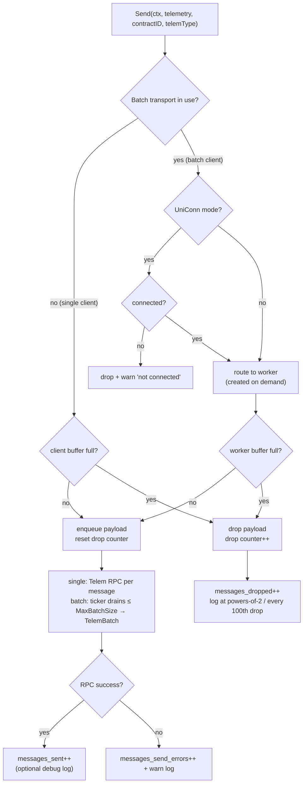
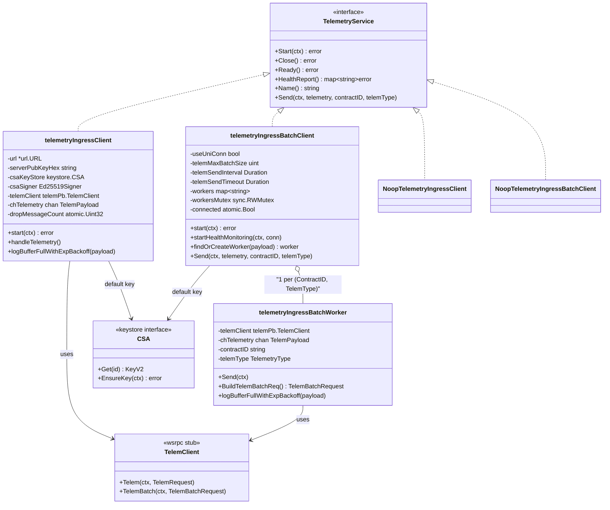
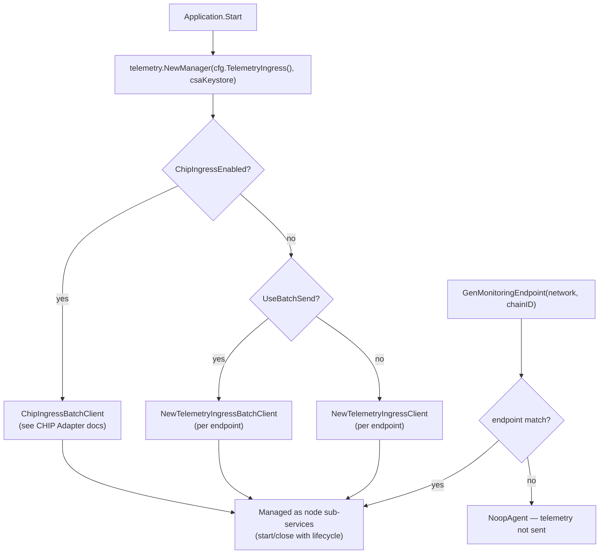

# Telemetry Ingress wsrpc Clients

> **Module location:** `chainlink/core/services/synchronization` (files: `telemetry_ingress_client.go`, `telemetry_ingress_batch_client.go`, `telemetry_ingress_batch_worker.go`, `common.go`, `metrics.go`)
>
> Part of the [Telemetry Ingress](../telemetry_ingress.md) subsystem within the [Telemetry & Observability Platform](../../Telemetry___Observability_Platform.md).

## Introduction

This module implements the **wsrpc-backed clients** that transmit job telemetry from a Chainlink node to the off-node **telemetry ingress server**. Every telemetry-producing subsystem inside the node (OCR/OCR2/OCR3 reporting plugins, LLO pipelines, Enhanced EA / Mercury, Functions, head reporter, pipeline bridges) eventually funnels messages through one of the clients implemented here.

The module provides:

- A common [`TelemetryService`](#the-telemetryservice-contract) contract implemented by all ingress transports.
- A **single-send client** that forwards each telemetry message as an individual RPC.
- A **batch client** that fans messages out to per-(contract, telemetry-type) workers which aggregate and flush them as batched RPCs.
- **Noop implementations** used when telemetry egress is disabled or no endpoint is configured, so producers never need nil-checks.
- Prometheus instrumentation for connection health, throughput, errors, and dropped messages.

All network I/O uses the [`wsrpc`](https://github.com/smartcontractkit/wsrpc) library — a WebSocket transport with gRPC-style service stubs and **mutual Ed25519 authentication**: the node signs each connection with its **CSA key** (see [Keystore](../../Node_Platform_Services/keystore.md)) and pins the server's public key from node configuration.

---

## Where the module fits in the node

The node's [Application lifecycle](../../Node_Application_Core___Interfaces/node_application/node_application_lifecycle.md) instantiates a `telemetry.Manager` (see `chainlink/core/services/chainlink/application.go`, `telemetryManager := telemetry.NewManager(cfg.TelemetryIngress(), csaKeystore, globalLogger)`). The manager reads the `[TelemetryIngress]` TOML section (see [Core Config — Observability](../../Node_Application_Core___Interfaces/core_config/core_config_observability.md)) and, **per configured endpoint**, decides which transport to create:

| Condition (from `TelemetryIngress` config) | Transport created |
|---|---|
| `ChipIngressEnabled = true` | `ChipIngressBatchClient` — see [Telemetry Ingress CHIP Adapter](telemetry_ingress_chip_adapter.md) and [Chip Ingress](../chip-ingress.md) |
| `UseBatchSend = true` | **`NewTelemetryIngressBatchClient`** (this module) |
| otherwise | **`NewTelemetryIngressClient`** (this module) |

Job-level code obtains a monitoring endpoint via `Manager.GenMonitoringEndpoint(network, chainID, contractID, telemType)`; if no endpoint matches the network/chain pair, a `NoopAgent` is returned and telemetry is silently not sent. The monitoring-endpoint generator interface consumed by the manager is defined in [types-core plugin services](../../Shared_Foundation_Libraries___Domain_Types/types-core/types-core_plugin-services.md).

### Architecture overview

```mermaid
flowchart TB
    subgraph node["Chainlink Node Process"]
        subgraph producers["Telemetry Producers"]
            OCR["OCR / OCR2 / OCR3 plugins"]
            LLO["LLO pipeline telemetry"]
            EA["Enhanced EA / Mercury / Functions"]
        end

        subgraph mgr["telemetry.Manager (core/services/telemetry)"]
            AG["TypedIngressAgent (single)"]
            AGB["TypedIngressAgentBatch"]
        end

        subgraph clients["This module — synchronization wsrpc clients"]
            TC["telemetryIngressClient<br/>(single-send)"]
            TBC["telemetryIngressBatchClient"]
            subgraph workers["per (ContractID, TelemetryType)"]
                W1["batchWorker A"]
                W2["batchWorker B"]
            end
        end

        KS[("CSA Keystore<br/>(default Ed25519 key)")]
    end

    subgraph offnode["Off-node infrastructure"]
        ING["Telemetry Ingress Server<br/>(wsrpc, Telem service)"]
    end

    producers -->|Send(TelemPayload)| AG & AGB
    AG -->|route| TC
    AGB -->|fan-out| TBC
    TBC -->|route by key| W1 & W2
    TC -->|"Telem() RPC"| ING
    W1 & W2 -->|"TelemBatch() RPC"| ING
    KS -->|"default CSA key + Ed25519 transport signing"| TC & TBC
```

---

## The `TelemetryService` contract

Defined in `chainlink/core/services/synchronization/common.go`, this is the interface every transport (including the noop variants) satisfies:

```go
type TelemetryService interface {
    services.ServiceCtx // Start / Close / Ready / HealthReport / Name
    Send(ctx context.Context, telemetry []byte, contractID string, telemType TelemetryType)
}
```

Key semantic points:

- **`Send` never blocks indefinitely and never returns an error.** Messages are pushed into bounded per-client (or per-worker) channels; when a buffer is full the message is **dropped** and the drop is logged/metered. Telemetry is best-effort by design so ingestion can never stall oracle execution.
- **Lifecycle is managed by the `services` framework** (start/stop with health reporting), consistent with other node services.

### Payload and telemetry types

`TelemPayload` is the unit of telemetry in flight:

```go
type TelemPayload struct {
    Telemetry     []byte
    TelemType     TelemetryType
    ContractID    string
    Domain        string
    Entity        string
    ChainSelector uint64
    Network       string
    ChainID       string
}
```

`TelemetryType` is a string enum (`ocr`, `ocr2-median`, `ocr3-ccip-commit`, `llo-observation`, `head-report`, `enhanced-ea`, …) covering all reporting plugins. The same file provides `TelemetryTypeToDomainAndEntity`, used by the CHIP ingress path (see [CHIP Adapter](telemetry_ingress_chip_adapter.md)) to map a telemetry type onto Beholder domain/entity streams (see [Beholder Telemetry](../beholder-telemetry.md)).

---

## Single-send client (`telemetryIngressClient`)

**Constructor:** `NewTelemetryIngressClient(url *url.URL, serverPubKeyHex string, csaKeyStore keystore.CSA, lggr logger.Logger, telemBufferSize uint) TelemetryService`

### Startup and connection

1. On `Start`, a goroutine dials the ingress server with `wsrpc.DialWithContext`, configured with:
   - `wsrpc.WithTransportSigner(csaSigner, serverPubKey)` — the node signs the transport with its **default CSA key** (`keystore.GetDefault(ctx, tc.csaKeyStore)` wrapped in `core.NewEd25519Signer` with `keystore.CSASigner`), and pins the **server public key** supplied via config.
   - `wsrpc.WithLogger(tc.eng)` — wsrpc logs flow through the service engine.
2. Dial failures are handled contextually:
   - If the context was cancelled (shutdown), a warning is logged ("gave up connecting to telemetry endpoint").
   - Otherwise it is treated as a critical failure: logged at critical level **and** emitted into the node health report (`EmitHealthErr`), so operators see a degraded/unhealthy service.
3. Once connected, a `telemPb.TelemClient` stub is created over the connection and `handleTelemetry()` is started; the goroutine then waits on `ctx.Done()` and closes the connection on shutdown.

### Message flow

`Send` performs a **non-blocking enqueue** into the buffered `chTelemetry` channel (size `telemBufferSize`). The `handleTelemetry` goroutine drains the channel and issues **one RPC per message**:

```go
telemReq := &telemPb.TelemRequest{
    Telemetry:     p.Telemetry,
    Address:       p.ContractID,
    TelemetryType: string(p.TelemType),
    SentAt:        time.Now().UnixNano(),
}
_, err := tc.telemClient.Telem(ctx, telemReq)
```

Send errors are logged and the message is lost (no retry). When `logging` is enabled, successfully sent payloads are logged at debug level — useful for troubleshooting but verbose, hence disabled by default (see [Configuration](#configuration)).

### Backpressure

If the channel is full, `Send` hits the `default` branch and drops the payload via `logBufferFullWithExpBackoff`, which increments an atomic drop counter and logs a warning only when the count is a power of two or a multiple of 100 (1, 2, 4, 8, … 100, 200, 300, …). A successful enqueue resets the counter. This avoids log flooding during sustained saturation while still surfacing the outage.

---

## Batch client (`telemetryIngressBatchClient`)

**Constructor:**

```go
NewTelemetryIngressBatchClient(url, serverPubKeyHex, csaKeyStore, logging, lggr,
    telemBufferSize, telemMaxBatchSize uint,
    telemSendInterval, telemSendTimeout time.Duration,
    useUniconn bool) TelemetryService
```

This is the **default transport** (`UseBatchSend = true` in node config). It trades per-message RPCs for per-worker batching, and adds connection-health instrumentation.

### Connection modes

| Mode | Behavior |
|---|---|
| `useUniConn = false` (default) | Standard `wsrpc.Dial` with the CSA transport signer. A health-monitoring goroutine polls `conn.GetState()` every 5 s and writes `1`/`0` to the `telemetry_client_connection_status` gauge (labeled by endpoint URL). wsrpc reconnects automatically if the server is unavailable. |
| `useUniConn = true` | A `wsrpc.UniClientConn` created via `wsrpc.NewTLSUniClientConn` with `credentials.NewClientTLSSigner` (server public keys validated through `credentials.ValidPublicKeysFromEd25519`). An atomic `connected` flag gates sending: while disconnected, `Send` **drops messages immediately** with a warning instead of buffering. |

Shutdown (`close`) cancels the health monitor, closes the connection (guarded so a never-established UniConn is not closed), and closes the CSA signer.

### Workers: per-(contract, telemetry-type) batching

`Send` routes each payload to a worker located (or lazily created) by the composite key `ContractID + "_" + TelemType` (`findOrCreateWorker`):

- Each worker owns a buffered channel (`telemBufferSize`) and is scheduled on a ticker that fires every `telemSendInterval`, invoking `worker.Send` through the engine (`tc.eng.GoTick`).
- Worker creation increments the `telemetry_client_workers` counter (labeled `endpoint`, `telemetry_type`).

`telemetryIngressBatchWorker.Send` then:

1. Returns immediately if its channel is empty.
2. `BuildTelemBatchReq()` drains up to `telemMaxBatchSize` payloads into a `telemPb.TelemBatchRequest{ContractId, TelemetryType, Telemetry [][]byte, SentAt}`.
3. Calls `telemClient.TelemBatch` under a `telemSendTimeout` context.
4. Increments `telemetry_client_messages_sent` on success or `telemetry_client_messages_send_errors` on failure (with a warning log).

Dropped messages follow the same exponential-backoff logging strategy as the single client and additionally increment `telemetry_client_messages_dropped`.

### Batch send sequence

```mermaid
sequenceDiagram
    autonumber
    participant P as Producer / Ingress Agent
    participant BC as telemetryIngressBatchClient
    participant W as Batch Worker<br/>(ContractID, TelemType)
    participant S as Ingress Server (wsrpc)

    Note over BC,S: Start
    alt UniConn mode
        BC->>S: NewTLSUniClientConn + Dial (TLS signer, pinned server keys)
        BC->>BC: connected = true
    else Classic mode
        BC->>S: wsrpc.Dial (CSA transport signer)
        BC->>BC: startHealthMonitoring → gauge every 5s
    end

    P->>BC: Send(ctx, telemetry, contractID, telemType)
    BC->>BC: findOrCreateWorker("contractID_telemType")
    alt worker buffer has capacity
        BC->>W: chTelemetry ← payload (reset drop counter)
    else worker buffer full
        BC->>BC: drop payload; dropped++ ; backoff log
    end

    loop every telemSendInterval (per worker ticker)
        BC->>W: Send(ctx) via GoTick
        W->>W: BuildTelemBatchReq(): drain ≤ MaxBatchSize payloads
        W->>S: TelemBatch(TelemBatchRequest) within SendTimeout
        S-->>W: ack
        W->>W: messages_sent++ / messages_send_errors++
    end
```

---

## Message lifecycle and backpressure



**Design intent:** telemetry is strictly best-effort. Drops are always counted, logged in a throttled fashion, and visible in Prometheus, but never propagate errors to producers or block oracle hot paths.

---

## Noop implementations

`NoopTelemetryIngressClient` and `NoopTelemetryIngressBatchClient` satisfy the full `TelemetryService` contract with empty bodies: `Start`/`Close`/`Ready` succeed, `HealthReport` returns an empty map, and `Send` discards the payload. They serve two purposes:

1. **Safe defaults** — any code path can hold a `TelemetryService` even when telemetry egress is not configured (no nil checks, no feature flags at call sites).
2. **Test isolation** — producers and the manager can be exercised without a wsrpc server.

> Note: the *agent-level* `NoopAgent` returned by the manager for unmatched network/chain pairs lives in `core/services/telemetry` and wraps the same idea one layer up.

---

## Component relationships



---

## Configuration

All knobs come from the `TelemetryIngress` config interface (`chainlink/core/config/telemetry_ingress_config.go`), populated from the `[TelemetryIngress]` TOML section documented in `chainlink/core/config/docs/core.toml` (see also [Core Config — Observability](../../Node_Application_Core___Interfaces/core_config/core_config_observability.md)):

| TOML key | Accessor | Default | Consumed by |
|---|---|---|---|
| `UniConn` | `UniConn()` | `false` | Batch client connection mode |
| `Logging` | `Logging()` | `false` | Both clients (debug logging of raw payloads) |
| `BufferSize` | `BufferSize()` | `100` | Both clients (channel capacity) |
| `MaxBatchSize` | `MaxBatchSize()` | `50` | Batch client (max messages per `TelemBatch`) |
| `SendInterval` | `SendInterval()` | `500ms` | Batch client (worker flush ticker) |
| `SendTimeout` | `SendTimeout()` | `10s` | Batch client (per-batch RPC deadline) |
| `UseBatchSend` | `UseBatchSend()` | `true` | Manager: batch vs single transport |
| `ChipIngressEnabled` | `ChipIngressEnabled()` | `false` | Manager: CHIP ingress takes precedence (see [CHIP Adapter](telemetry_ingress_chip_adapter.md)) |
| `[[TelemetryIngress.Endpoints]]` — `Network`, `ChainID`, `URL`, `ServerPubKey` | `Endpoints()` | — | One transport per endpoint |

Example:

```toml
[TelemetryIngress]
UniConn = false
Logging = false
BufferSize = 100
MaxBatchSize = 50
SendInterval = '500ms'
SendTimeout = '10s'
UseBatchSend = true
ChipIngressEnabled = false

[[TelemetryIngress.Endpoints]]
Network = 'EVM'
ChainID = '111551111'
ServerPubKey = 'test-pub-key-111551111-evm'
URL = 'localhost-111551111-evm:9000'
```

**Security note:** `ServerPubKey` pins the ingress server's Ed25519 identity; the node signs the transport with its default **CSA key** from the keystore. Operators must provision a CSA key (the keystore `EnsureKey`/`GetDefault` path in [Keystore](../../Node_Platform_Services/keystore.md)) before telemetry egress can authenticate.

### Selection flow



---

## Observability

Prometheus metrics are declared in `chainlink/core/services/synchronization/metrics.go`. Note the instrumentation is **batch-client only**; the single-send client relies on logs and health reports.

| Metric | Type | Labels | Emitted by | Meaning |
|---|---|---|---|---|
| `telemetry_client_connection_status` | Gauge | `endpoint` | Batch client (classic mode, 5 s poll) | `1` when wsrpc state is `Ready`, else `0` |
| `telemetry_client_workers` | Counter | `endpoint`, `telemetry_type` | Batch client | Incremented each time a new worker is created |
| `telemetry_client_messages_sent` | Counter | `endpoint`, `telemetry_type` | Batch worker | Successful `TelemBatch` flushes |
| `telemetry_client_messages_send_errors` | Counter | `endpoint`, `telemetry_type` | Batch worker | Failed batch sends |
| `telemetry_client_messages_dropped` | Counter | `endpoint`, `telemetry_type` | Batch worker | Payloads discarded due to full buffers |

Operational signals outside Prometheus:

- **Health report**: the single client reports critical dial failures via `EmitHealthErr`, surfacing in the node's health check API.
- **Logs**: throttled "buffer full, dropping message" warnings (single client, no counter), batch worker send warnings, and UniConn "not connected" warnings.

---

## Dependencies

| Dependency | Role |
|---|---|
| [`wsrpc`](https://github.com/smartcontractkit/wsrpc) | WebSocket transport with gRPC stubs and Ed25519 transport signing |
| `core/services/synchronization/telem` (protobuf) | `TelemClient`, `TelemRequest`, `TelemBatchRequest` wire types |
| [Keystore — CSA](../../Node_Platform_Services/keystore.md) | Default CSA key + `CSASigner` for transport authentication |
| `chainlink-common/pkg/services` | Service lifecycle engine (`ServiceCtx`, `Engine`, `GoTick`) used by both clients and workers |
| `chainlink-common/pkg/timeutil` | Adaptive ticker for worker flush intervals |
| `chainlink-common/pkg/types/core` | `Ed25519Signer` abstraction |
| [Telemetry Ingress config](../../Node_Application_Core___Interfaces/core_config/core_config_observability.md) | All tuning parameters and endpoint list |

## Related documentation

- [Telemetry Ingress](../telemetry_ingress.md) — parent module and ingress architecture
- [Telemetry Ingress CHIP Adapter](telemetry_ingress_chip_adapter.md) — the CHIP-based transport that supersedes these clients when enabled
- [Beholder Telemetry](../beholder-telemetry.md) — OTLP-based emission used for CHIP and general metrics
- [Chip Ingress](../chip-ingress.md) — CHIP ingress client library and protocol
- [Node Application Lifecycle](../../Node_Application_Core___Interfaces/node_application/node_application_lifecycle.md) — where the telemetry manager is registered as a node service
- [types-core Plugin Services](../../Shared_Foundation_Libraries___Domain_Types/types-core/types-core_plugin-services.md) — `MonitoringEndpointGenerator` contract consumed by the manager
