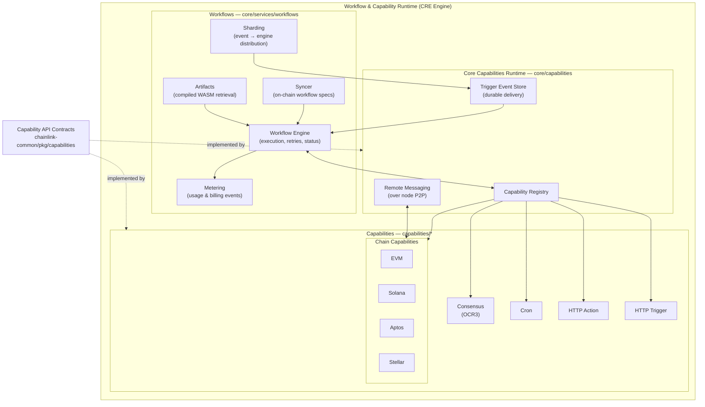
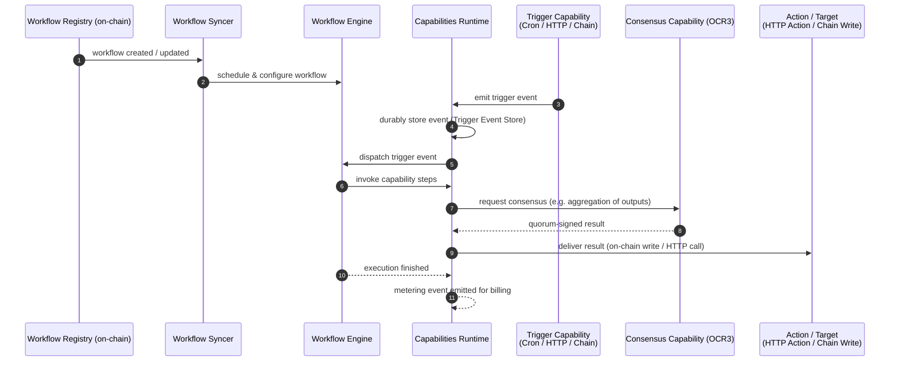

# Workflow & Capability Runtime (CRE Engine)

## Purpose

The **Workflow & Capability Runtime (CRE Engine)** module implements the Chainlink Runtime Environment: the machinery that lets a Chainlink node — and the Decentralized Oracle Networks (DONs) it participates in — define, distribute, execute, and bill for **decentralized workflows**, together with the **capability framework** those workflows are built on.

Concretely, this module owns:

- **Workflow lifecycle** — syncing workflow specifications from the on-chain Workflow Registry, retrieving compiled workflow artifacts (WASM binaries), executing the workflow DAG, sharding trigger events, and metering execution for billing.
- **The in-node capability runtime** — the host process that registers local capabilities, brokers *remote* capability calls between DON members over P2P, and durably buffers trigger events.
- **The capability contract layer** — the shared Go/protobuf interfaces (`Trigger`, `Action`, `Target`, `Consensus` capabilities) that both the node core and every capability implementation compile against.
- **Standard capabilities** — consensus (OCR3-based), cron, HTTP action, and HTTP trigger.
- **Chain-family capabilities** — triggers, actions (reads/writes), forwarders, and monitoring for EVM, Solana, Aptos, and Stellar.

Workflows composed in this module are the end-user surface of CRE (Keystone): a workflow is a DAG of capability invocations whose steps can fan out across DON nodes, reach quorum agreement via the consensus capability, and deliver results on-chain or via HTTP.

## Architecture

### Component overview

The layering is deliberate: `chainlink-common/pkg/capabilities` defines the contract; `core/capabilities` is the host-side runtime that satisfies and brokers that contract; `core/services/workflows` is the primary consumer driving execution; and everything under `capabilities/` is a pluggable implementation registered into the runtime.

### Workflow execution flow

### External touchpoints

- **P2P service** (Node Platform Services) carries remote capability messaging between DON members.
- **Loop plugin framework** (`chainlink-common/pkg/loop`) exposes chain relayers to the chain capabilities' plugin runtimes.
- **Metering & billing** and **Beholder telemetry** shared libraries consume the engine's usage events and observability output.
- **CRE / Keystone Deployment Suite** deploys the on-chain Workflow Registry, Capabilities Registry, and forwarder contracts that this runtime syncs from and writes to.

## Core Components

| Component | Code Location | Documentation |
|---|---|---|
| Workflows (syncer, engine, artifacts, metering, sharding, standalone) | `chainlink/core/services/workflows` | [Workflows](<Workflow___Capability_Runtime_(CRE_Engine)/workflows.md>) |
| Core Capabilities Runtime (registry, remote messaging, trigger event store, vault types, Web API config) | `chainlink/core/capabilities` | [Core Capabilities Runtime](<Workflow___Capability_Runtime_(CRE_Engine)/core_capabilities_runtime.md>) |
| Capability API contracts, protobufs, registry, vault & consensus interfaces, v2 tooling | `chainlink-common/pkg/capabilities` | [Capabilities](<Workflow___Capability_Runtime_(CRE_Engine)/capabilities.md>) |
| Shared capability libraries (chain consensus & monitoring) | `capabilities/libs` | [Capabilities Shared Libs](<Workflow___Capability_Runtime_(CRE_Engine)/capabilities_shared_libs.md>) |
| Consensus capability (OCR3 oracle core, reporting plugin, service API) | `capabilities/consensus` | [Consensus Capability](<Workflow___Capability_Runtime_(CRE_Engine)/consensus_capability.md>) |
| Cron trigger capability (service, trigger store, observability) | `capabilities/cron` | [Cron Capability](<Workflow___Capability_Runtime_(CRE_Engine)/cron_capability.md>) |
| HTTP action capability (action service, direct & gateway proxies, validation limits) | `capabilities/http_action` | [HTTP Action Capability](<Workflow___Capability_Runtime_(CRE_Engine)/http_action_capability.md>) |
| HTTP trigger capability (webhook-triggered workflows) | `capabilities/http_trigger` | [HTTP Trigger Capability](<Workflow___Capability_Runtime_(CRE_Engine)/http_trigger_capability.md>) |
| EVM chain capability (triggers, actions, forwarders, monitoring, plugin runtime) | `capabilities/chain_capabilities/evm` | [Chain Capability: EVM](<Workflow___Capability_Runtime_(CRE_Engine)/chain_capability_evm.md>) |
| Solana chain capability (triggers, actions, config, monitoring, plugin runtime) | `capabilities/chain_capabilities/solana` | [Chain Capability: Solana](<Workflow___Capability_Runtime_(CRE_Engine)/chain_capability_solana.md>) |
| Aptos chain capability (actions, config, monitoring) | `capabilities/chain_capabilities/aptos` | [Chain Capability: Aptos](<Workflow___Capability_Runtime_(CRE_Engine)/chain_capability_aptos.md>) |
| Stellar chain capability (plugin runtime, actions, forwarder, monitoring, metering) | `capabilities/chain_capabilities/stellar` | [Chain Capability: Stellar](<Workflow___Capability_Runtime_(CRE_Engine)/chain_capability_stellar.md>) |
| Code shared across all chain capabilities | `capabilities/chain_capabilities/common` | [Chain Capabilities Common](<Workflow___Capability_Runtime_(CRE_Engine)/chain_capabilities_common.md>) |

For further reading: the CRE/Keystone on-chain components (registries, forwarders, OCR3 setup for workflows) are covered in the [CRE & Keystone Deployment Suite](deployment/cre) module, and the plugin transport used by capability binaries in the [Plugin Process Framework (Loop)](loop) module.