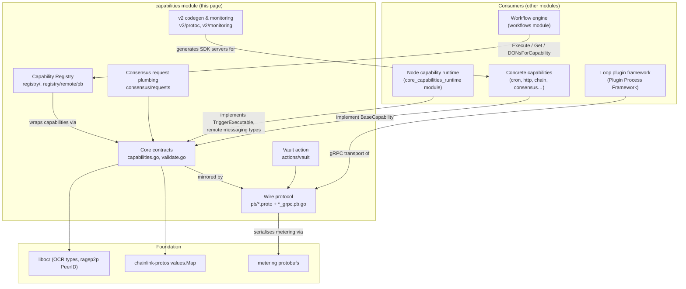
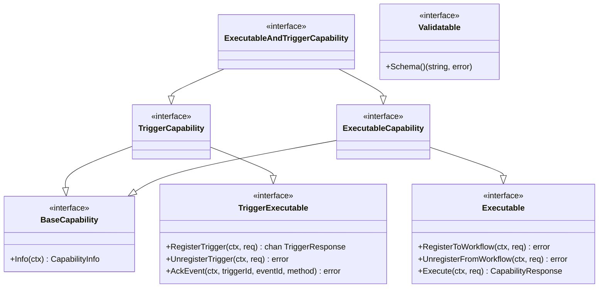
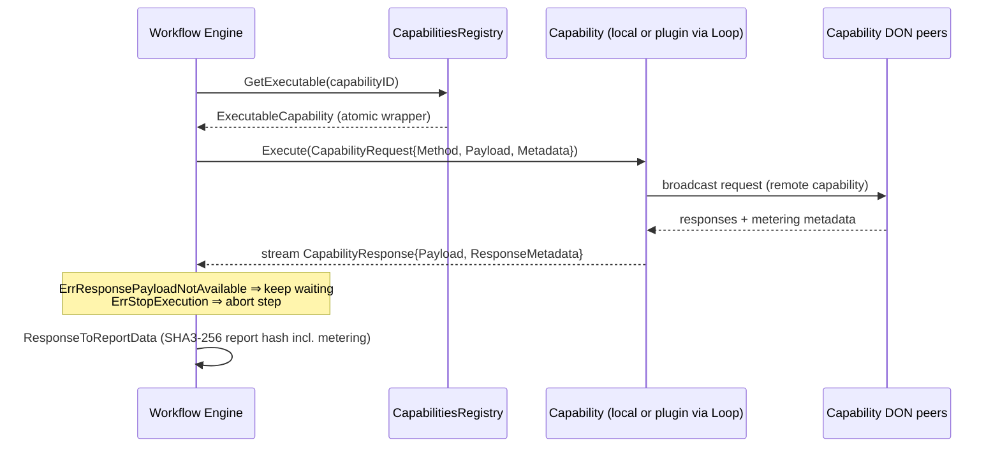

# Capabilities — Shared Capability Framework (`chainlink-common/pkg/capabilities`)

## 1. Purpose

The **capabilities** module is the foundational contract layer of the Chainlink Capability Runtime (CRE). It lives in the `chainlink-common/pkg/capabilities` Go package and defines **what a capability is**, **how it is invoked over the wire**, **how it is registered and discovered**, and **how capability SDKs are generated** — independent of any concrete capability implementation.

Everything else in the CRE stack is built on top of these contracts:

- The **workflow engine** ([workflows](workflows.md)) resolves capabilities through this module's registry and sends it `CapabilityRequest`s.
- The **node-side runtime** ([core_capabilities_runtime](core_capabilities_runtime.md)) implements the remote trigger/executable plumbing (DON-to-DON messaging, trigger event store) that satisfies these interfaces.
- The **concrete capabilities** ([cron_capability](cron_capability.md), [http_action_capability](http_action_capability.md), [chain_capability_evm](chain_capability_evm.md), [capabilities_shared_libs](capabilities_shared_libs.md), …) implement `TriggerCapability` / `ExecutableCapability` in their own Go modules.
- The **plugin process framework** ([Plugin_Process_Framework_(Loop)](../Plugin_Process_Framework_(Loop).md)) transports capabilities and the registry itself across process boundaries using the gRPC services defined here.

In short: **this module is the "API surface + wire protocol + registry + codegen" of the capability system**, while sibling modules provide the engine, transport, and implementations.

## 2. Architecture Overview

### 2.1 The capability model

A **capability** is a unit of off-chain functionality (a trigger, an action, a consensus step, or a write target) that a workflow can invoke. The module defines:

| Concept | Defined in | Notes |
|---|---|---|
| `BaseCapability` | `capabilities.go` | Minimal contract: `Info(ctx) (CapabilityInfo, error)` |
| `TriggerCapability` | `capabilities.go` | `BaseCapability` + `TriggerExecutable` (RegisterTrigger / UnregisterTrigger / AckEvent, event channel) |
| `ExecutableCapability` | `capabilities.go` | `BaseCapability` + `Executable` (Register/UnregisterToWorkflow, Execute) |
| `ExecutableAndTriggerCapability` | `capabilities.go` | Combined trigger + executable ("combined" type) |
| `CapabilityType` | `capabilities.go` | `trigger`, `action`, `consensus`, `target`, `combined` |
| `CapabilityInfo` / Capability ID | `capabilities.go` | `{name}:{label_key}_{label_value}@{semver}`, validated by `idRegex` (max 128 chars) |
| `CapabilityRequest` / `CapabilityResponse` | `capabilities.go` | Dual-mode payloads: `values.Map` config/inputs (DAG SDK) or `anypb.Any` payload + `method` (no-DAG / v2 SDK) |
| `RequestMetadata` / `ResponseMetadata` | `capabilities.go` | Workflow/DON identity, spend limits, metering reports, `CapDON_N` |
| `DON` / `Node` | `capabilities.go` | Topology: workflow DON (0..1 per node) vs capability DONs (0..N per node) |
| `Validatable` | `capabilities.go` | JSON-schema exposure for config/inputs/outputs |

**Sentinel errors** shape engine behaviour: `ErrStopExecution` lets a capability abort a workflow step gracefully, and `ErrResponsePayloadNotAvailable` tells the engine to keep waiting for another (identical) response instead of failing the step — the key primitive behind response aggregation in remote capabilities.

### 2.2 Dual SDK generations (DAG vs. "no-DAG")

The request/response types deliberately carry two payload styles:

- **DAG (v1)**: `Config`/`Inputs`/`Value` as `values.Map` — used by the standard workflow spec engine.
- **No-DAG (v2)**: `Payload`/`ConfigPayload` as `google.protobuf.Any` plus a `Method` string — used by typed, generated SDKs (see [cre-sdk-generated-capabilities](../Developer_Toolchain_(CLI,_SDKs___API_Clients)/cre-sdk-generated-capabilities.md)).

The same pattern applies on the wire in `pb/capabilities.proto`, so both generations interoperate through the same gRPC services.

### 2.3 Registry topology

The registry splits into two concerns:

- **Base registry** (`CapabilitiesRegistryBase`): add/remove/list/lookup capabilities in-process, with **atomic wrappers** so capability implementations can be hot-swapped (e.g. when a gRPC plugin reconnects) without racing concurrent workflow executions.
- **Metadata registry** (`CapabilitiesRegistryMetadata`): a read-only snapshot of the on-chain `CapabilitiesRegistry` contract — DONs, nodes, capabilities, per-DON capability configurations (`pb/registry.proto` `CapabilityConfig`, including `Ocr3Configs`, method configs, restricted keys). `RegistryMetadata` answers questions like "which DONs serve capability X?", "what is my local node's topology?" and "what config applies to capability X on DON Y?".

The remote gRPC binding (`registry/remote/pb`) exposes exactly these two facets to **plugin processes** over Loop, so a capability running in a separate OS process can query the node's registry.

### 2.4 Wire protocol

All cross-node and cross-process communication is protobuf-defined. `pb/capabilities.proto` declares the gRPC services every capability SDK must expose (`BaseCapability`, `TriggerExecutable`, `Executable`, `StandardCapabilities`, `Settings`), while `pb/triggers.proto` defines the coordinated-event format used by trigger consensus queues, and `pb/registry.proto` defines both the per-capability configuration and the offchain registry distribution document (`OffchainCapabilitiesRegistry`).

### 2.5 Lifecycle of a capability invocation (no-DAG, remote)

## 3. Sub-modules

The module is organised into six sub-modules. Detailed documentation for each lives under `capabilities/` (paths relative to this page):

| Sub-module | Documentation file | Contents |
|---|---|---|
| Core contracts & validation | [`capabilities/capabilities_core.md`](capabilities/capabilities_core.md) | `capabilities.go` interfaces/types, sentinel errors, request/response metadata, DON/Node topology, ID parsing, remote trigger/executable configs, and the generic JSON-schema `Validator` |
| Wire protocol & gRPC services | [`capabilities/capabilities_pb.md`](capabilities/capabilities_pb.md) | `pb/capabilities.proto`, `pb/registry.proto`, `pb/triggers.proto` and generated gRPC bindings |
| Capability registry | [`capabilities/capabilities_registry.md`](capabilities/capabilities_registry.md) | `CapabilitiesRegistry`, `RegistryMetadata`, atomic capability wrappers, remote Loop gRPC surface |
| Vault secrets action | [`capabilities/capabilities_vault.md`](capabilities/capabilities_vault.md) | `actions/vault` message schema (TDH2 threshold-encrypted secrets, OCR3.1 plugin config) and its mock |
| Consensus request plumbing | [`capabilities/capabilities_consensus.md`](capabilities/capabilities_consensus.md) | Generic `requests.Handler`/`Store` for pending consensus requests, response caching; deprecated OCR3 consensus types |
| v2 codegen & monitoring | [`capabilities/capabilities_v2_tooling.md`](capabilities/capabilities_v2_tooling.md) | `MonitoringLabels` interface and the `TemplateGenerator` protoc plugin used to build capability SDK servers |

## 4. Repository / build context

The concrete capabilities built on these contracts live in the separate `capabilities/` **Go workspace** at the repository root (`module github.com/smartcontractkit/capabilities`, see `capabilities/go.mod`), with per-capability modules such as `capabilities/cron`, `capabilities/http_action`, `capabilities/chain_capabilities/evm`, etc. The workspace's root `capabilities/Makefile` provides the shared toolchain:

- `make protoc` — installs `protoc` 29.3 and `protoc-gen-go` v1.36.10 (the versions used to generate the `*_grpc.pb.go` files in this module; generated files carry `protoc v5.29.3` headers).
- `make generate` — runs all `go:generate` directives across workspace modules (proto + mockery generation).
- `make gomodtidy` / `make tidy` / `make modgraph` — multi-module housekeeping.
- `make update-chain-capabilities` — bumps one of the chain capability sub-modules via `capabilities/script/update-chain-capabilities.sh`.

Protobuf schemas for monitoring payloads used by the chain capabilities are also generated from this workspace (e.g. `capabilities/libs/monitoring/execution_context.proto`); they are documented in [capabilities_shared_libs](capabilities_shared_libs.md), and workspace build wiring in [capabilities_workspace_tooling](../Build,_CI___Release_Infrastructure/capabilities_workspace_tooling.md).

## 5. Relationship to other modules

| Related module | Relationship |
|---|---|
| [workflows](workflows.md) | The engine consumes `CapabilitiesRegistry` lookups and `Executable`/`TriggerExecutable` calls; workflow registration metadata (`RegisterToWorkflowRequest`) originates there. |
| [core_capabilities_runtime](core_capabilities_runtime.md) | Node-side implementation of remote capability messaging (`remote/types` `DON`/`Dispatcher`), trigger event store and webapi/vault standard capabilities — all typed against this module's contracts. |
| [capabilities_shared_libs](capabilities_shared_libs.md) | `capabilities/libs` shared by capability implementations (chain consensus types, monitoring execution context). |
| [consensus_capability](consensus_capability.md) / [cron_capability](cron_capability.md) / [http_action_capability](http_action_capability.md) / [chain_capability_evm](chain_capability_evm.md) … | Concrete `BaseCapability` implementations shipped with the node. |
| [Plugin_Process_Framework_(Loop)](../Plugin_Process_Framework_(Loop).md) | gRPC bindings that tunnel `BaseCapability`/`Executable`/registry metadata to plugin binaries; the Loop relayer services embed a `CapabilitiesRegistry` server generated from this module. |
| [Shared_Foundation_Libraries___Domain_Types/types-core](../Shared_Foundation_Libraries___Domain_Types/types-core.md) | `Keystore`, `TelemetryClient`, `KeyValueStore`, `RelayerSet` etc. handed to standard capabilities via `StandardCapabilities.Initialise` (see `InitialiseRequest` in `pb/capabilities.proto`). |

## 6. Key invariants

1. **Capability IDs** must match `{name}:{label_key}_{label_value}@{semver}`, ≤128 chars; labels are sorted alphanumerically and `ChainSelector` is a first-class label (`ChainSelectorLabel`).
2. **DON membership**: a node belongs to **at most one** workflow DON but any number of capability DONs; `RegistryMetadata.NodeByPeerID` enforces/logs violations.
3. **Stored records are backwards-compatible**: vault `StoredSecret`/`StoredMetadata`/`StoredPendingQueue*` records are persisted and must remain wire-compatible.
4. **Metering is aggregated, not identical**: `ResponseMetadata.Metering` is repeated because each capability node emits its own report; `ExtractMeteringFromMetadata` expects exactly one per peer.
5. **Registry state changes are atomic**: capability updates flow through `atomicBaseCapability.Update`, never by mutating the wrapped capability in place.
