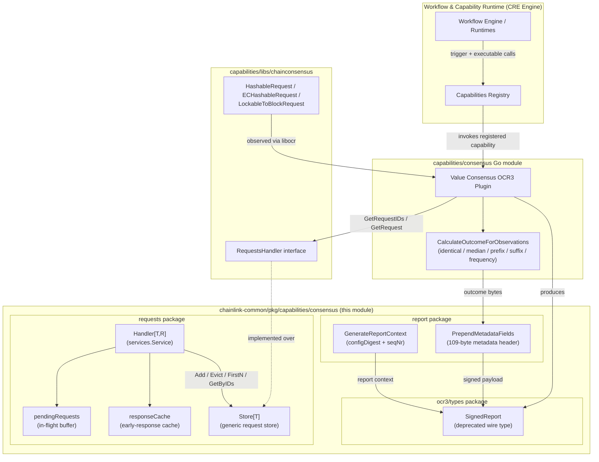
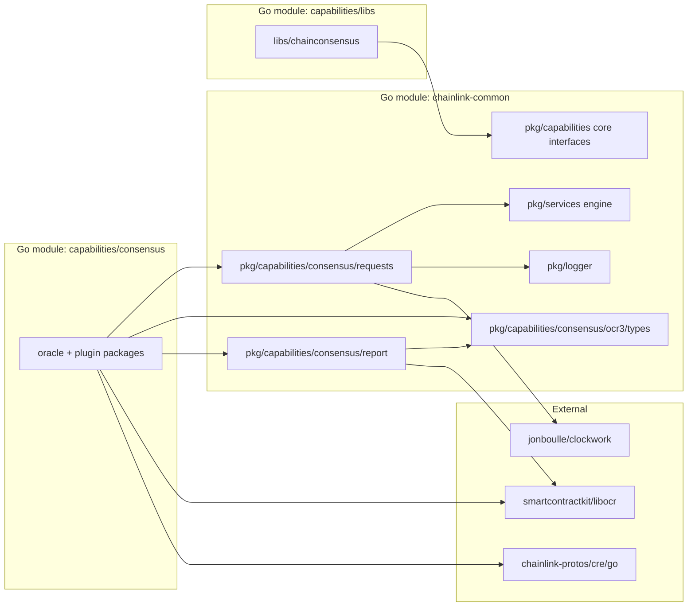
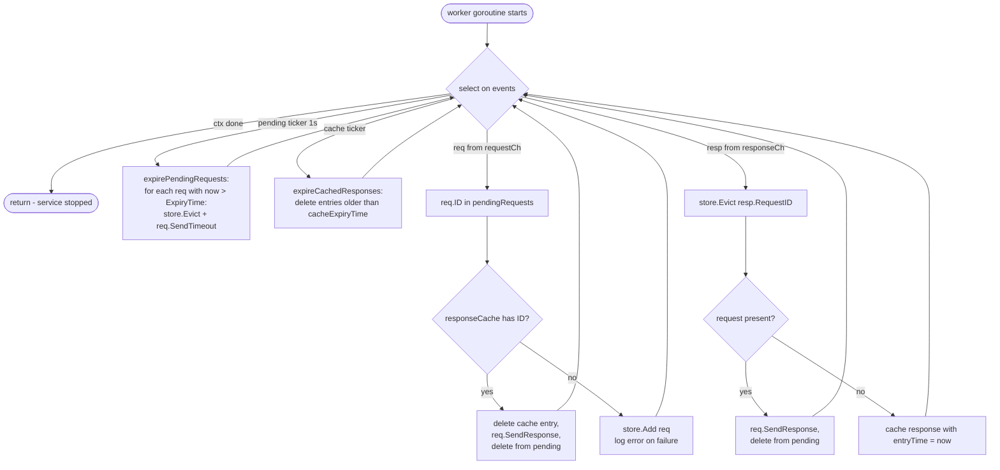
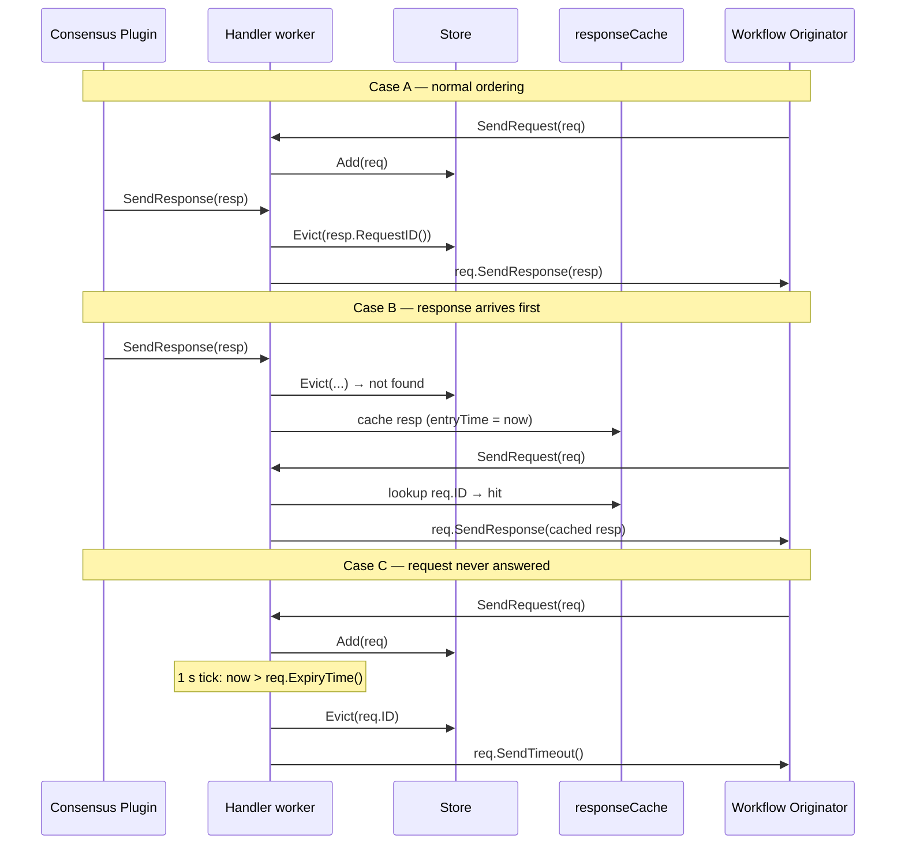
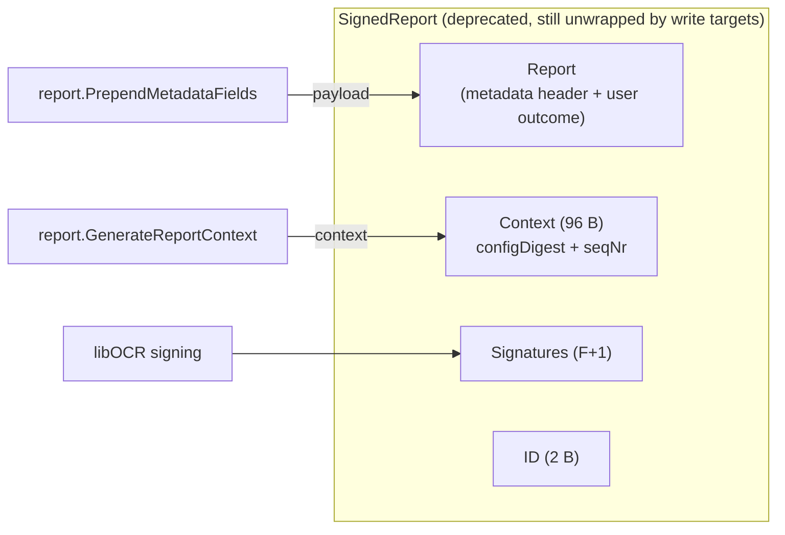
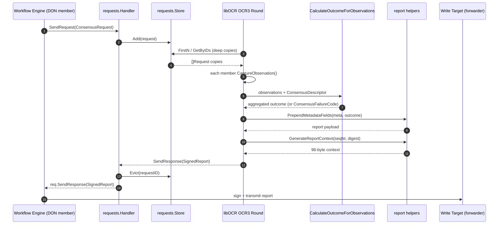

# Capabilities: Consensus (`chainlink-common/pkg/capabilities/consensus`)

The **consensus capability module** provides the shared, product-agnostic building blocks that Chainlink's consensus workflows are built on: a generic request/response coordination runtime (`requests`), the wire format for signed consensus reports handed to write targets (`ocr3/types`), and report encoding helpers (`report`). These primitives are consumed by the OCR-based value consensus plugin deployed inside CRE (Chainlink Runtime Environment) nodes and by chain-consensus oracle libraries.

This page covers the `chainlink-common/pkg/capabilities/consensus` tree:

```
chainlink-common/pkg/capabilities/consensus/
├── requests/          # Generic consensus request handling & storage (Handler, Store)
├── ocr3/types/        # SignedReport wire type + deprecated encoder types
└── report/            # Report context generation & metadata field encoding
```

Related but distinct modules are documented separately:

- The **value consensus OCR plugin** itself (aggregation algorithms, plugin lifecycle) lives in the `capabilities/consensus` Go module — see [Consensus Capability](../consensus_capability.md).
- Chain-specific consensus request types (`HashableRequest`, `EventuallyConsistentRequest`, `LockableToBlockRequest`, …) live in the shared libs — see [Capabilities Shared Libs](../capabilities_shared_libs.md).
- The surrounding capability interfaces (`ExecutableAndTriggerCapability`) are described in [Capabilities Core](capabilities_core.md), and capability registration in [Capabilities Registry](capabilities_registry.md).

---

## Purpose and Core Functionality

Running a workflow step through consensus is inherently asynchronous and racy: a workflow execution on each DON member produces a *request* that must be aggregated by the OCR reporting plugin, and the *response* (a signed report) may come back at a different time — or even **before** the request is fully registered on a node. This module provides:

| Package | Responsibility |
|---|---|
| `requests` | Buffers in-flight consensus requests, matches them to responses (including responses that arrive early), expires stale work, and stores requests in a thread-safe, order-preserving, deep-copying store. |
| `ocr3/types` | Defines `SignedReport` — the report struct a consensus capability hands to a write target — plus deprecated encoder types kept for backward compilation. |
| `report` | Deterministic byte-level encoding of the OCR report *context* (config digest + sequence number) and the capability *metadata* fields (execution ID, workflow identity, DON identity, report ID) that are prepended to user payloads before signing. |

The design goals are:

1. **Genericity** — `Handler` and `Store` are fully generic over request/response types, so the value consensus plugin and chain-consensus oracles reuse identical coordination logic.
2. **Race safety** — responses arriving before their request are cached and delivered when the request shows up, so no response is ever lost due to goroutine scheduling.
3. **Determinism** — report context and metadata fields are encoded with fixed widths and big-endian byte order so every DON member produces byte-identical reports, a prerequisite for identical-consensus signing.
4. **Observability** — the store exposes an optional stats collector hook (`SetRequestCount`) that the consensus plugin wires into metrics.

---

## Architecture

### Component overview



### Dependency relationships between Go modules



The `capabilities/consensus` module's `go.mod` (`capabilities/consensus/go.mod`) pins `chainlink-common`, `capabilities/libs`, `libocr`, `cre-sdk-go`, and the CRE protos, confirming this dependency direction: **the standalone plugin module depends on the shared primitives in this module, never the reverse.** This keeps `chainlink-common` free of plugin logic while still providing the concurrency and wire-format contracts.

---

## The `requests` Package

### `ConsensusRequest` and `ConsensusResponse`

Defined in `chainlink-common/pkg/capabilities/consensus/requests/handler.go`:

```go
type ConsensusRequest[T any, R ConsensusResponse] interface {
    ID() string
    Copy() T
    ExpiryTime() time.Time
    SendResponse(ctx context.Context, response R)
    SendTimeout(ctx context.Context)
}

type ConsensusResponse interface {
    RequestID() string
}
```

- `ID()` — globally unique request identifier (the value consensus plugin derives it from workflow execution ID + step reference, see the proto section below).
- `Copy()` — deep copy used by the store to guarantee read isolation (see [StoredRequest](#storedrequest)).
- `ExpiryTime()` — wall-clock deadline after which the handler times the request out.
- `SendResponse` / `SendTimeout` — completion callbacks invoked back onto the originator (typically a channel owned by the workflow engine or plugin).

`Chainlink`'s chain-consensus libraries define concrete implementations — `HashableRequest`, `ECHashableRequest`, and `LockableToBlockRequest` — documented in [Capabilities Shared Libs](../capabilities_shared_libs.md).

### `Handler[T, R]` — request/response coordinator

`Handler` is a `services.Service` (started via `services.Engine`) that runs a single goroutine (`worker`) multiplexing four event sources:

| Event source | Handling |
|---|---|
| `requestCh` (new request) | Registers the request in `pendingRequests`. If a **cached response** already exists for its ID (the response arrived first), delivers it immediately and removes it from the cache. Otherwise, persists the request via `Store.Add`. |
| `responseCh` (new response) | Attempts `Store.Evict(resp.RequestID())`. If the request is present, calls `req.SendResponse`. If not (early arrival), caches the response with a timestamp for later pickup. |
| Pending-expiry ticker (1 s) | Walks `pendingRequests`; any request whose `ExpiryTime()` has passed is evicted from the store and completed via `req.SendTimeout`. |
| Cache-expiry ticker (`cacheExpiryTime`) | Drops cached responses older than the configured response expiry window. |

The 1-second pending-request resolution is a deliberate trade-off: "sufficient resolution for expiring requests without causing too much overhead". The clock is injected as a `clockwork.Clock`, which makes the entire lifecycle deterministic in tests.

#### Worker event loop



#### Lifecycle sequence: handling the early-response race

The defining behaviour of `Handler` is resolving the race where the OCR report (response) is ready before the workflow's request is registered locally — for example when a node joins mid-round or when channels are contended.



### `StoredRequest` and `Store[T]`

Defined in `chainlink-common/pkg/capabilities/consensus/requests/store.go`. `Store` is a **thread-safe, insertion-order-preserving** container for ongoing consensus requests, backed by a `map[string]T` plus an ordering slice `requestIDs`, guarded by a `sync.RWMutex`.

```go
type StoredRequest[T any] interface {
    ID() string
    Copy() T
}
```

| Method | Semantics |
|---|---|
| `Add(req)` | Rejects duplicate IDs; appends to `requestIDs` and `requests`; updates the stats collector. |
| `Get(id)` / `GetByIDs(ids)` | Returns **deep copies** (`Copy()`); missing IDs are silently skipped in `GetByIDs`. |
| `FirstN(batchSize)` | First `batchSize` requests in insertion order (errors on `0`). |
| `RangeN(start, batchSize)` | Ordered pagination slice `[start, start+batchSize)` with bounds validation. |
| `All()` | Deep copy of every request in insertion order. |
| `Len()` | Number of stored requests. |
| `Evict(id)` | Removes and returns the request (O(n) over the ordering slice). |

Key invariants:

- **Copy-on-read.** Every read path returns `Copy()` results, so OCR observation aggregation on one node can never mutate a request referenced elsewhere.
- **Ordering.** `requestIDs` preserves insertion order, so `FirstN`/`RangeN` produce deterministic batches — important for report batching reproducibility across DON members.
- **Stats hook.** `NewStoreWithStatsCollector` installs a `statsCollector` whose `SetRequestCount(int)` is called on `Add`/`Evict`; the default is a no-op. The value consensus plugin wires this into its request-count metric (`capabilities/consensus/metrics`).

---

## The `report` Package

These helpers produce the deterministic byte layouts consumed by libOCR signing and on-chain verification.

### `GenerateReportContext(seqNr, configDigest)` — `report/context.go`

Builds the 96-byte report context that libOCR appends to the report before signing:

```
[ 32-byte configDigest ][ seqNr big-endian uint32 at offset 27..31 of a 32-byte zero buffer ][ 32 zero bytes ]
```

This matches the `Context` field documented on `SignedReport`: *"config digest + round/epoch/sequence numbers (currently 96 bytes)… has to be appended to the report before validating signatures."*

### `PrependMetadataFields(meta, userPayload)` — `report/metadata.go`

Serializes capability metadata as a fixed-width, big-endian header prepended to the user payload:

| Field | Bytes |
|---|---|
| Version | 1 |
| Execution ID | 32 |
| Timestamp | 4 |
| DON ID | 4 |
| DON config version | 4 |
| Workflow ID (spec hash) | 32 |
| Workflow Name | 10 |
| Workflow Owner | 20 |
| Report ID | 2 |
| **Header total** | **109** |

All identifier fields are hex-decoded and length-validated, so malformed metadata fails fast rather than producing misaligned on-chain payloads. Downstream write targets (e.g. the Keystone forwarder, see [CRE & Keystone Deployment Suite → cre-forwarder](../../CRE___Keystone_Deployment_Suite/cre-forwarder.md)) rely on this exact layout.

---

## The `ocr3/types` Package (Deprecated Wire Types)

`chainlink-common/pkg/capabilities/consensus/ocr3/types/deprecated.go` retains the original OCR3 consensus capability wire types. Per the file's own comments, the OCR3 consensus capability that produced these types **has been removed from chainlink-common**; they are kept only so existing encoder implementations and write-target paths (chainlink-aptos, chainlink-framework) keep compiling.

```go
type SignedReport struct {
    Report     []byte   // aggregated consensus outcome
    Context    []byte   // report context appended before signing (config digest + round/epoch/seqNr, 96 bytes)
    Signatures [][]byte // always exactly F+1 signatures
    ID         []byte   // report ID from the workflow spec (2 bytes)
}
```



Also deprecated: `MetadataFieldName` (the `"INTERNAL_METADATA"` aggregation-outcome key) and the `Encoder` interface. New code should not depend on these; they exist purely for compile compatibility on the consumer side.

---

## Data Flow: From Workflow Step to Signed Report

Putting the pieces together for the value consensus flow (the plugin itself is detailed in [Consensus Capability](../consensus_capability.md)):



The consensus outcome semantics (identical vs. median vs. prefix/suffix/frequency aggregation, the `f+1` quorum rules, and the `ConsensusFailureCode` taxonomy such as `NO_VALUES_MET_FPLUS1_THRESHOLD_FOR_IDENTICAL_CONSENSUS` or `OUTCOME_TOO_LARGE`) are defined by the plugin's wire contract in `capabilities/consensus/oracle/types/value_consensus_types.proto` and executed by `CalculateOutcomeForObservations` in `capabilities/consensus/oracle/consensus_execution.go`; see [Consensus Capability](../consensus_capability.md) for the algorithm details.

---

## How This Module Fits the CRE Engine

- **Workflow engine** ([Workflows → Engine](../workflows/workflows_engine.md)) executes WASM workflows that call consensus steps; each step's trigger/event plumbing ends in a `ConsensusRequest` handled by this module's `Handler`/`Store` pair.
- **Capability contracts** — consensus capabilities implement the `ExecutableAndTriggerCapability` interfaces from [Capabilities Core](capabilities_core.md) and are discovered via the [Capabilities Registry](capabilities_registry.md).
- **OCR integration** — the report types and context generation align with libOCR's OCR3 reporting plugin contract; how plugins are loaded (in-process or as separate processes over gRPC) is covered in [Plugin Process Framework (Loop)](../../Plugin_Process_Framework_(Loop).md) and [loop-plugin-core](../../Plugin_Process_Framework_(Loop)/loop-plugin-core.md).
- **Chain consensus oracles** — request types for chain-native consensus (block polling, hashable observations, lock-to-block semantics) are provided by [Capabilities Shared Libs](../capabilities_shared_libs.md) and satisfy this module's `StoredRequest`/`ConsensusRequest` contracts.

---

## Build & Code Generation

The protobuf types used by the consensus plugin (`value_consensus_types.proto`, chainconsensus `ocr.proto`) are generated through the workspace toolchain:

- `capabilities/Makefile` provides the `protoc` target (installs protoc 29.3 + `protoc-gen-go` v1.36.10 via `capabilities/script/install-protoc.sh`) and the `generate` target, which runs all `go:generate` directives across every Go module in the workspace.
- Module boundaries and dependency tidying are managed by the `gomodtidy`/`modgraph` targets; see [Capabilities Workspace Tooling](../../Build,_CI___Release_Infrastructure/capabilities_workspace_tooling.md).

`capabilities/consensus/go.mod` declares this module's consumers' key dependencies: `chainlink-common` (these primitives), `capabilities/libs` (chain-consensus request types), `libocr` (OCR3 runtime), `cre-sdk-go`, `chainlink-protos/cre/go`, plus OpenTelemetry for metrics.

---

## Operational Notes for Maintainers

1. **Do not remove `ocr3/types/deprecated.go`.** Write targets in chainlink-aptos and chainlink-framework still unwrap workflow inputs into `SignedReport`; removing it breaks downstream modules.
2. **Store copies are mandatory.** When adding new read methods to `Store`, always return `Copy()` results — OCR plugins and the workflow engine concurrently observe the same underlying request objects by design (request implementations intentionally return `self` from `Copy()` and guard internal state with mutexes).
3. **Ticker granularity.** `Handler` expires pending requests at 1-second resolution; do not shrink without measuring overhead at high request rates, and keep the injectable `clockwork.Clock` for tests.
4. **Report byte layout is consensus-critical.** Any change to `GenerateReportContext` or `PrependMetadataFields` field widths/order must be synchronized with on-chain verification logic and rolled out via DON config version (the `DONConfigVersion` metadata field exists for this purpose).
5. **Metrics wiring.** Use `NewStoreWithStatsCollector` when embedding a store so request-count gauges reflect actual in-flight consensus load.

---

## Related Documentation

- [Consensus Capability](../consensus_capability.md) — the value consensus OCR plugin and aggregation algorithms.
- [Capabilities Shared Libs](../capabilities_shared_libs.md) — chain-consensus request types and oracle interfaces.
- [Capabilities Core](capabilities_core.md) — capability interfaces implemented by consensus capabilities.
- [Capabilities Registry](capabilities_registry.md) — how consensus capabilities are registered and discovered.
- [Workflows Engine](../workflows/workflows_engine.md) — the workflow runtime that issues consensus requests.
- [Plugin Process Framework (Loop)](../../Plugin_Process_Framework_(Loop).md) — process boundary over which reporting plugins run.
- [Oracle Engines & Data Pipelines / OCR](../../Oracle_Engines___Data_Pipelines/ocr.md) — the OCR/OCR2 oracle stack this module complements.
